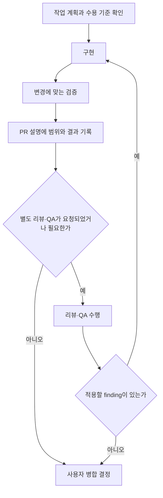

# 개발 PR·리뷰·QA 참고 절차

## 목적

PR 단위 목록과 검증 기준을 참고용으로 정리한다. 별도 실행 skill이나 필수 멀티 에이전트 절차가 아니며, 작업자는 사용자의 요청과 변경 위험에 맞는 범위만 적용한다.

## 현재 설계 점검 결과

기존 delivery 문서는 작업 ID, 입력, 구현 범위, 성공 조건, 테스트와 증거를 갖추고 있다. 그러나 다음 항목은 명시적 계약이 아니었다.

- 작업 ID를 어떤 PR 단위로 묶는지
- 구현 완료 후 코드 리뷰와 QA를 어떤 순서로 수행하는지
- 리뷰·QA 실패를 누가 고치고 어디까지 재검증하는지
- gate를 통과한 PR의 병합 조건과 다음 개발 PR 시작 조건
- PR마다 남겨야 하는 공통 증거와 승인 상태

아래 내용은 작업 문서와 사용자 지시를 보조하는 참고 자료다.

## 핵심 원칙

1. 하나의 PR은 하나의 검증 가능한 사용자 결과 또는 기술 계약을 완성한다.
2. 각 PR은 관련 production code와 해당 테스트를 함께 포함한다.
3. 변경에 직접 관련된 자체 검증을 수행하고 결과를 PR에 기록한다.
4. 독립 코드 리뷰와 별도 QA는 사용자가 요청했거나 변경 위험상 필요한 경우에 수행한다.
5. UI/프로세스 변경은 자동 테스트만으로 확인하기 어려운 동작을 필요에 따라 직접 확인한다.
6. 작업자는 사용자의 명시적 승인 없이 PR을 병합하지 않는다.
7. 현재 PR이 기본 브랜치에 병합됐다는 확인 전에는 다음 PR의 구현을 시작하지 않는다.
8. 미결정·차단 요구사항은 임의로 구현하지 않고 별도 PR 단위도 시작하지 않는다.
9. 각 PR은 변경 동작과 직접 영향받는 계약만 테스트한다. 전체 회귀는 별도 품질 단계에서 수행한다.
10. UI PR의 검증은 변경된 화면 동작과 직접 영향받는 반응형·접근성 조건에 한정한다. UIR 개편 UI PR은 최종 HEAD의 1440×900·390×844 및 영향을 받은 상태 캡처와 [`시안 직접 비교`](../ui/07-visual-acceptance.md#시안과-구현-화면의-직접-비교)를 필수 증거로 남긴다. 설명되지 않은 실질적인 시각 차이가 있으면 `ready_to_merge`가 될 수 없다. 문서 전용 PR에는 화면 캡처가 필요 없다.
11. 이 문서는 참고용 절차다. 필요한 검증과 리뷰 범위는 변경 위험과 사용자의 요청에 맞게 정한다.

## PR 개발 단위 기준

다음 조건을 모두 만족할 때 하나의 PR 단위로 인정한다.

- PR 제목으로 사용자 또는 시스템 결과를 한 문장으로 설명할 수 있다.
- 포함하는 delivery 작업 ID와 요구사항 ID가 명확하다.
- 정상, 실패, 경계 조건을 해당 PR만으로 검증할 수 있다.
- 미완성 API와 UI를 함께 노출하지 않는다. 필요하면 비노출 내부 계약 PR로 분리한다.
- 선행 PR이 머지된 기본 브랜치에서 시작한다.
- 리뷰어가 관련 없는 대규모 변경 없이 전체 diff를 이해할 수 있다.
- 되돌려도 이후 머지된 독립 기능의 데이터가 손상되지 않는다.

파일 수, 줄 수와 작업 시간만으로 PR 크기를 판정하지 않는다. 하나의 결과에 백엔드·도메인·UI가 모두 필요하면 함께 묶되, 서로 독립 검증 가능한 결과 두 개는 분리한다.

## 작업 상태

| 상태 | 의미 | 진입 조건 | 종료 조건 |
| --- | --- | --- | --- |
| `planned` | 순서만 배치됨 | PR 단위표 등록 | 선행 의존성 확인 |
| `ready` | 구현 가능 | 결정·선행 PR·수용 기준 확정 | 브랜치 생성 |
| `in_progress` | 구현 중 | 최신 기본 브랜치에서 시작 | 자체 검증 완료 |
| `code_review` | 필요 시 리뷰 중 | 요청된 리뷰 완료 | 적용할 finding 처리 |
| `qa` | 필요 시 동작 검증 중 | 요청된 QA 완료 | 적용할 finding 처리 |
| `fix_required` | 수정 필요 | 변경에 직접 관련된 finding 확인 | 수정 후 관련 검증 |
| `ready_to_merge` | 변경에 필요한 검증 결과 확인 완료 | PR 병합 가능 상태 확인 | 사용자 결정에 따라 병합 또는 보류 |
| `merged` | 기본 브랜치 반영 | GitHub에서 병합 확인 | 다음 PR `ready` 전환 |
| `blocked` | 진행 불가 | 결정·환경·선행 산출물 누락 | 원인 해소 후 재계획 |

`ready_to_merge`는 완료가 아니다. `merged`만 후속 구현의 선행 조건을 충족한다.

## 한 PR의 반복 절차

코드 리뷰나 QA에서 발견된 문제는 영향받는 테스트와 사용자 경로를 다시 확인해 수정한다. 필요한 절차와 횟수는 변경 범위에 맞게 정한다.

## UI 구현 참고

- UI 개편 작업은 제품 동작·보안·접근성·반응형 계약을 먼저 지키고, `docs/blueprint-design/README.md`의 매핑 이미지를 주 시안으로 사용한다. `docs/template/README.md`는 새 시안에 없는 상태에만 사용한다. third-party UI package, design tokens, stylesheet, or MCP를 UI 기준으로 새로 추가하지 않는다.

## 필요한 검증과 증거

- 변경된 동작과 직접 관련된 테스트를 우선 실행한다. 앱 코드나 빌드 설정을 바꾼 경우 관련 build도 실행한다.
- UI 변경이면 영향받는 viewport와 상태에서 실제 동작을 확인하고, 필요할 때 화면 캡처를 PR에 첨부한다.
- 리뷰와 QA는 사용자가 요청했거나 변경 위험상 필요할 때 수행한다. 전용 agent, 분리된 실행 context, 정해진 재검토 반복은 요구하지 않는다.
- PR에는 변경 범위, 실행한 검증과 알려진 제한을 간단히 기록한다.
- 병합은 사용자가 명시적으로 승인한 경우에만 진행한다.

## PR 단위 실행 순서

아래 순서는 초기 계획이다. 각 행은 독립 PR이며 앞 행의 병합 확인이 다음 행 구현의 선행 조건이다.

| 순서 | PR unit | 포함 작업 | 검증 가능한 결과 | 상태 |
| ---: | --- | --- | --- | --- |
| 1 | `AUTH-PR-01` Google OIDC 서버 인증 경계 | AUTH-002 | 검증된 OIDC identity에만 session 발급 | merged (#3) |
| 2 | `BRD-PR-01` Windsoft 브랜드 표기 | BRD-001 | 앱 소유 브랜드 변경과 기존 브라우저 데이터 보존 | merged (#4) |
| 3 | `AUTH-PR-02` Google 로그인·보호 라우트 | AUTH-001, 003, 004 | Google 로그인 UI, 비인증 API 차단, returnTo와 logout | merged (#5) |
| 4 | `AUTH-PR-03` 인증 identity 기반 owner context | AUTH-005 | 안정적인 ownerKey와 안전한 identity 전환 | merged (#6) |
| 5 | `FND-PR-01` 런타임·화면 기반 | FND-001, 002 | React 18과 `docs/template` 기반 Blueprint 소유 semantic HTML/CSS | merged (#7) |
| 6 | `FND-PR-02` 도메인·Agent 계약 | FND-003, 004 | 상태·schema·모델 registry 계약 테스트 | merged (#8) |
| 7 | `FND-PR-03` 테스트 기반 | FND-005 | unit/contract/browser test 명령과 CI gate 실행 | merged (#9, `d3e56d5`) |
| 8 | `PRJ-PR-01` 라우팅·프로젝트 생성 | PRJ-101, 102 | 홈에서 생성, 잘못된 경로 404 | merged (#10, `ef5aceb`) |
| 9 | `PRJ-PR-02` 저장·최근 목록 | PRJ-103, 104 | 새로고침 복구, 20/21 경계와 실패 보존 | merged (#11, `4581d4619125fcd23227a65fe71a2dc0b0d4d48c`) |
| 10 | `PRJ-PR-03` 작업 공간 셸 | PRJ-105 | desktop/mobile 셸과 탭·저장 상태 복구 | merged (#12, `f5c1dc3b07304e23f650a020d2afd2d56df36a3b`) |
| 11 | `AI-PR-01` 모델·prompt·budget 기반 | AI-001, 002, 006, 008, 009 | profile routing, schema version, budget/eval foundation | merged (#13; DEFAULT=gpt-5-mini; existing budget retained) |
| 12 | `CON-PR-01` turn 수명주기 | CON-202, 206, AI-010 | 인증된 turn, TTL 기반 중복 방지·circuit breaker, 입력 보존과 bounded retry | merged (#14) |
| 13 | `CON-PR-02` 질문·선택 폼 | CON-203, 204, AI-005 | catalog 질문과 7개 form, 선택 경로 API 0회 | merged (#15, `4335ca1`) |
| 14 | `CON-PR-03` 메시지·AI block | CON-201, 205, AI-004 | 프로젝트 AI 데이터 동의, 허용 block 렌더, 진행·취소·compaction | merged (#16, `ecbb7e0402f4a81f5fa1c184916a776a0723a38c`) |
| 15 | `DSG-PR-01` 제안 검토·확정 | DSG-301~303 | 복수 제안 개별 수정·승인·거절 | merged (#17, `e33212d2de305f571db287631fb9256eda0196eb`) |
| 16 | `DSG-PR-02` 충돌·의존·일괄 처리 | DSG-304, 305, 307 | 충돌 해결, dependents 재검토와 atomic 일괄 승인·거절 | merged (#18, `7246eaee32d2d72856e0fafaf3b4910e1e237613`) |
| 17 | `DSG-PR-03` 설계 보드·readiness | DSG-306 | 10개 설계 영역, 3상태 readiness, Requirements 진입 gate | merged (#19) |
| 18 | `DOC-PR-01` Requirements | DOC-401, 402, AI-006 | 코드 plan, Mini draft/review, 추적 가능한 요구사항 | merged (#20; head `47f4cdf7304ee546547b96b255f98d345752f31a`, merge `6ded90838a415ee10f9a3ba0b518ebd0932c9618`; tests 13/13, Playwright 2/2, build, Mermaid 38/38; independent review/QA pass; AI eval and Vercel pass) |
| 19 | `DOC-PR-02` Requirements ready·PRD | DOC-403, 404, AI-007 | ready 잠금과 Terra PRD, Mini review | merged (#21; head `490c84fc7aa7375b0348ab9648f8b110a61d90d0`, merge `f0c922635ae0a620022f4a05d86fe6ea4fcc1ff9`; focused QA 16/16, Playwright 2/2, build; independent review/QA pass; AI eval and Vercel pass) |
| 20 | `DOC-PR-03` 부분 보완·정합성 | DOC-406, 407 | 선택 section만 patch, 불일치 proposal | merged (#22; head `775ec6bd14ee1ec38e04768b205750cc870c7ad6`, merge `94bdf704e1909d49813a9e3592dcf056c8e9f3cb`; tests 36/36, Playwright desktop/mobile 1/1 each, build; independent review/QA pass; AI eval and Vercel pass) |
| 21 | `DOC-PR-04` 직접 편집 영향 | DOC-405 | 영향 preview 후 항목별 제외·원자 적용과 stale 계산 | merged (#23; head `2b0497a5a693d09858dbf41f8bcec098cca85f58`, merge `1178050576338245d1b5bdbd913e3b19cff669df`; unit 5/5, Playwright 6/6 plus prior DOC browser contracts 4/4, build; independent review/QA pass; AI eval and Vercel pass) |
| 22 | `SRC-PR-01` 파일 제한·추출 | SRC-501, 502 | 지원 파일 추출과 제한·실패 UI | merged (#24; head `8fa05f6b4032713c1d30c6bb0da2b7f706704233`, merge `f169cf7da310dc446fdb02b7006817c65703ea12`; focused unit 13/13, Playwright desktop/mobile 6/6, build, diff-check; independent review/QA gates passed; AI synthetic eval and Vercel checks passed) |
| 23 | `SRC-PR-02` 근거 연결 | SRC-503 | 발췌 preview와 자료 제거 영향 | merged (PR #26; merge `5a326055acc91b76ce33f3d5345579d5bffff3b0`) |
| 24 | `EXP-PR-01` 문서 복사·다운로드 | EXP-505 | 안전한 개별 Markdown 내보내기 | merged (#25; merge `aee5afddcdf32d4da7d46e1aebf260522670a780`) |
| 25 | `DEC-PR-01` 자료 수정·설정 가이드 완료 정책 | DEC-044, DEC-045 | 추출 결과 read-only/download, 사용자 승인된 setup guide 완료 gate, 병합 상태 동기화 | merged (PR #27; merge `1ee6ff4f879389cefce1892b2cba5b8037c4ba39`) |
| 26 | `SRC-PR-03` 추출 결과 다운로드 | SRC-502 | 원본 파일과 구분되는 추출 텍스트 다운로드, 외부 편집, 원본 자료·근거 불변 | merged (PR #28; merge `8bd59a14c1bd6e526b41f37cb5b9fe42018833f7`) |
| 27 | `GDE-PR-01` 설정 가이드 | GDE-504 | SETUP_GUIDE_DRAFT registry/prompt/schema와 golden eval, 근거 있는 가이드 생성·승인 gate | merged (#29) |
| 28 | `QLT-PR-01` 접근성·반응형·성능 | QLT-601~603 | 지정 viewport와 키보드·성능 gate | merged (#66) |
| 29 | `QLT-PR-02` 보안·전체 회귀·AI eval | QLT-604, 605, 608 | 전체 프로세스와 보안·모델 회귀 통과 | merged (#67; `9dea685`) |
| 30 | `QLT-PR-03A` 기술 출시 준비 | QLT-607 | legacy reference audit, retired route 404, README/environment/deployment docs, evidence-linked technical checklist | merged (#69; `fa5140a`) |
| 31 | `QLT-PR-03` 사용자 검증·최종 출시 판정 | QLT-606 | participant sessions, PRD metric review, P0 decision and final release checklist | planned (participant readiness required) |
| 31 | `AUTH-PR-04` ideon 로그인 화면 시안 개편 | AUTH-001, UI-AUTH-001, UIR-010 | ideon 로그인 시각 개편, Google 단일 로그인과 인증 상태 보존 | merged (#43) |
| 32 | `AUTH-PR-05` 로그인 redirect 토스트와 Vercel SPA 경로 fallback | AUTH-001, UI-AUTH-001, UIR-010; `AUTH-REDIR-001`, `DEP-SPA-001` | 일시적인 redirect 상태 토스트와 `/login?returnTo=%2F` 직접 새로고침, API·정적 파일 경로 보존 | merged (#46) |
| 33 | `AUTH-PR-06` Google 로그인 버튼 초기 자동 포커스 제거 | UI-AUTH-001; `AUTH-FOCUS-001` | 직접 진입·새로고침 시 자동 포커스 없이 시작하며 키보드·오류 알림 포커스 보존 | in_progress |

위 표는 저장소의 일반 delivery PR 순서다. 현재 화면 개편은 이 순서와 독립된 [UI 개편 계획](../superpowers/plans/2026-10-22-blueprint-ui-overhaul.md)의 선행 관계를 따른다. 각 UIR 후속 PR은 바로 앞 UIR PR의 GitHub 병합을 확인한 최신 `main`에서 시작한다.

### 대화 동작 계약 후속

CON-PR-01~03은 해당 PR 당시 승인된 질문/catalog 동작을 구현한 과거 기록이다. 현재 실행과 문서가 고정 `QUESTION_CATALOG`를 다음 질문 source로 쓴다는 점을 확인했으며, 사용자가 이를 목표 동작으로 거부했다. 후속 계약은 [대화 정본](../product/04-conversation-process.md)이다. component type registry는 strict allowlist로 유지하지만 질문과 선택지 데이터는 current context에서 만들고, 선택은 pending proposal로 저장해 사용자 승인 후 확정한다.

| PR unit | 선행 조건 | 결과 | 상태 |
| --- | --- | --- | --- |
| [`CON-PR-04`](../tasks/CON-PR-04/plan.md) 대화·결정 요약 계약 재정립 | PR #63 merged; docs-only unit | product/process/UI/AI 계약 및 CON-PR-05 구현 설계 정렬 | merged (#63) |
| [`CON-PR-05`](../tasks/CON-PR-05/plan.md) 대화 주도 발견·결정 패널 동기화 | CON-PR-04 merged; technical DoR verified | freeform turn, context-derived choices, allowlisted renderer, proposal approval, same-revision summary, responsive error recovery | merged (#64) |

| 순서 | UIR PR unit | 선행 조건 | 상태 |
| ---: | --- | --- | --- |
| 1 | `UIR-PR-01` 시각 기준·제품/UI 계약 | 완료된 기반 작업 | merged |
| 2 | `UIR-PR-02` 공통 셸·홈 및 CSS 기반 | UIR-PR-01 merged | merged (#35) |
| 3 | [`UIR-PR-02A`](../tasks/UIR-PR-02A/plan.md) 시안 직접 비교 gate | UIR-PR-02 merged | merged (#36, `285197b`) |
| 4 | [`UIR-PR-02B`](../tasks/UIR-PR-02B/plan.md) 홈 화면 시안 배치 보정 | UIR-PR-02A merged | merged (#37, `45649ab`) |
| 5 | [`UIR-PR-02C`](../tasks/UIR-PR-02C/plan.md) 홈 픽셀 일치 보정 | UIR-PR-02B merged | merged (PR #38; merge `2d9a32f`) |
| 6 | [`UIR-PR-02D`](../tasks/UIR-PR-02D/plan.md) 홈 정렬·입력 보정 | UIR-PR-02C merged | merged (PR #39; merge `8148725`) |
| 7 | [`UIR-PR-02E`](../tasks/UIR-PR-02E/plan.md) 짧은 데스크톱 홈 첫 화면 맞춤 | UIR-PR-02D merged | merged (PR #40; merge `921d8df2462e7659dbed81cdcdd156d11e916205`) |
| 8 | [`UIR-PR-03`](../tasks/UIR-PR-03/plan.md) 단계·대화 | UIR-PR-02E merged (#40) | merged (#41) |
| 9 | [`UIR-PR-03A`](../tasks/UIR-PR-03A/plan.md) 대화 화면 시안 정합성 보정 | UIR-PR-03 merged (#41) | merged (#44) |
| 10 | `UIR-PR-04` 제안 검토 | UIR-PR-03A merged | merged (#49, #50) |
| 11 | `UIR-PR-05` 준비도 표현 | UIR-PR-04 merged | merged (#52, `73f616be34aac006a545d91afbb1dc5f6deb9824`) |
| 12 | [`UIR-PR-06`](../tasks/UIR-PR-06/plan.md) 문서·지원 흐름 | UIR-PR-05 merged (#52) | merged (#54, #55, #56) |

### Current-main UI follow-up

| PR unit | 선행 조건 | 결과 | 상태 |
| --- | --- | --- | --- |
| [`UIR-PR-03D`](../tasks/UIR-PR-03D/plan.md) 선택 카드·아이디어 입력 포커스 보정 | UIR-PR-03C merged (#51); branch from latest `origin/main` | 선택지 개수에 맞는 균형 배치, 필요한 아이콘 표시, 보안 문구 한국어화, 키보드 접근성을 유지한 입력 포커스 표시 | merged (#53, `ac5b8abade7b1235e68cb549703e7081a55379fa`) |
| [`UIR-PR-03E`](../tasks/UIR-PR-03E/plan.md) 아이디어 포커스 링 제거·대화 여백 정리 | PR #59 merged to `main` at `1f62a20` | 홈·대화 입력 포커스 링 제거, 대화·요약 여백 및 모바일 요약 아이콘 정리 | merged (PR #59; `Capture home UI states` failed on stale `/design` route assertion) |
| [`UIR-PR-03F`](../tasks/UIR-PR-03F/plan.md) 포커스 시 입력 배경 유지 | UIR-PR-03E merged (#59); branch from `origin/main` `1f62a20` | 홈·대화 입력 포커스 시 대체 배경 강조 제거, 홈 검증 배경 보존 | merged (PR #60; merge `9b81e9f`) |
| [`UIR-PR-03G`](../tasks/UIR-PR-03G/plan.md) 대화·요약 패널 외부 여백 보정 | UIR-PR-03F merged (#60); branch from `origin/main` `9b81e9f` | 대화·요약 카드의 데스크톱 좌측·하단 외부 여백을 26px로 정리하고 composer를 카드 안에 유지 | merged (#61) |

기존 `QLT-PR-01`의 전체 화면 감사는 UIR-PR-01~06이 병합된 뒤 새 UI에도 적용한다.

`blocked` 행은 필요한 제품 결정이 기록되기 전까지 건너뛰고 다음 비의존 PR로 순서를 재계획할 수 있다. 단, 의존하는 후속 PR은 시작할 수 없다. 실제 개발 중 PR이 너무 크면 수용 기준을 보존한 채 `-A`, `-B`로 분할하고 이 표와 추적표를 먼저 갱신한다.

## 머지 후 기록

병합한 경우 PR과 최종 검증 결과를 task 표와 추적표에 반영한다. 다음 작업은 해당 계획의 의존 관계를 확인하고 요청받았을 때 시작한다.

## 완료 판정

개발 작업은 계획된 사용자 결과와 직접 적용되는 수용 기준이 검증되면 완료로 기록할 수 있다. 필요한 검증은 변경 범위와 사용자 요청에 맞춘다.

- 계획된 PR unit이 기본 브랜치에 병합됐고 결과가 GitHub에서 확인됐다.
- 차단 finding과 미연결 P0 요구사항이 없다.
- 요구사항 추적표에 PR과 검증 증거가 연결됐다.
- build와 전체 회귀 검증은 변경 범위 또는 품질 단계에서 필요할 때 수행한다.
