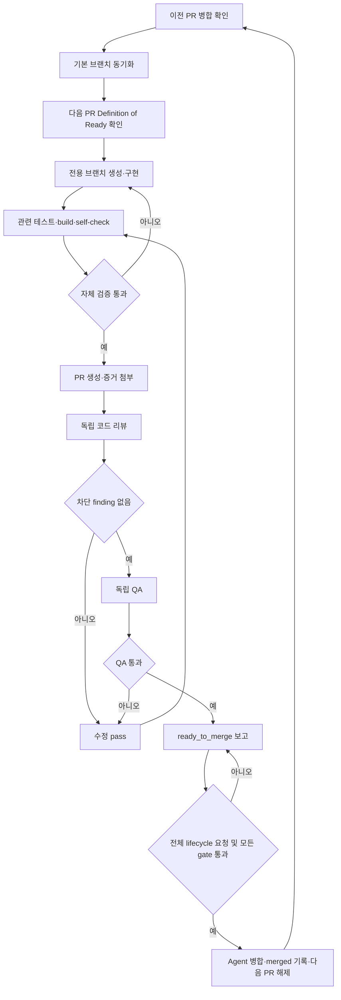

# 개발 PR·리뷰·QA 반복 워크플로

## 목적

PRD의 개발 단위를 독립적으로 검증 가능한 Pull Request로 구현하고, 매 PR마다 자체 검증·코드 리뷰·QA·승인된 병합을 통과시키는 반복 절차를 정의한다. 이 문서는 구현 순서뿐 아니라 다음 개발 단계를 시작할 수 있는 조건을 규정한다.

## 현재 설계 점검 결과

기존 delivery 문서는 작업 ID, 입력, 구현 범위, 성공 조건, 테스트와 증거를 갖추고 있다. 그러나 다음 항목은 명시적 계약이 아니었다.

- 작업 ID를 어떤 PR 단위로 묶는지
- 구현 완료 후 코드 리뷰와 QA를 어떤 순서로 수행하는지
- 리뷰·QA 실패를 누가 고치고 어디까지 재검증하는지
- gate를 통과한 PR의 병합 조건과 다음 개발 PR 시작 조건
- PR마다 남겨야 하는 공통 증거와 승인 상태

아래 절차가 이 공백을 보완하며 기존 단계별 작업 문서보다 실행 순서에서 우선한다.

## 핵심 원칙

1. 하나의 PR은 하나의 검증 가능한 사용자 결과 또는 기술 계약을 완성한다.
2. 각 PR은 관련 production code와 해당 테스트를 함께 포함한다.
3. 구현자 자체 검증, 독립 코드 리뷰, 독립 QA를 모두 통과해야 `ready_to_merge`가 된다.
4. 구현자가 자신의 작업을 최종 승인하지 않는다.
5. 자동 테스트만으로 UI/프로세스 QA를 대체하지 않는다.
6. Agent는 사용자가 전체 PR lifecycle을 요청했을 때만 모든 gate가 통과된 PR을 병합할 수 있다. 이 요청이 없으면 `ready_to_merge`에서 멈춘다.
7. 현재 PR이 기본 브랜치에 병합됐다는 확인 전에는 다음 PR의 구현을 시작하지 않는다.
8. 미결정·차단 요구사항은 임의로 구현하지 않고 별도 PR 단위도 시작하지 않는다.
9. 각 PR은 변경 동작과 직접 영향받는 계약만 테스트한다. 전체 회귀는 별도 품질 단계에서 수행한다.
10. UI PR의 검증은 변경된 화면 동작과 직접 영향받는 반응형·접근성 조건에 한정한다. 캡처는 선택적 증거다.
11. 단계별 구현은 Codex `$pr-development-loop` skill과 별도 planner, implementer, code-reviewer, QA agent 규칙을 따른다.

## PR 개발 단위 기준

다음 조건을 모두 만족할 때 하나의 PR 단위로 인정한다.

- PR 제목으로 사용자 또는 시스템 결과를 한 문장으로 설명할 수 있다.
- 포함하는 delivery 작업 ID와 요구사항 ID가 명확하다.
- 정상, 실패, 경계 조건을 해당 PR만으로 검증할 수 있다.
- 미완성 API와 UI를 함께 노출하지 않는다. 필요하면 비노출 내부 계약 PR로 분리한다.
- 선행 PR이 머지된 기본 브랜치에서 시작한다.
- 리뷰어가 관련 없는 대규모 변경 없이 전체 diff를 이해할 수 있다.
- 되돌려도 이후 머지된 독립 기능의 데이터가 손상되지 않는다.

파일 수, 줄 수와 작업 시간만으로 PR 크기를 판정하지 않는다. 하나의 결과에 백엔드·도메인·UI가 모두 필요하면 함께 묶되, 서로 독립 검증 가능한 결과 두 개는 분리한다.

## 작업 상태

| 상태 | 의미 | 진입 조건 | 종료 조건 |
| --- | --- | --- | --- |
| `planned` | 순서만 배치됨 | PR 단위표 등록 | 선행 의존성 확인 |
| `ready` | 구현 가능 | 결정·선행 PR·수용 기준 확정 | 브랜치 생성 |
| `in_progress` | 구현 중 | 최신 기본 브랜치에서 시작 | 자체 검증 완료 |
| `code_review` | 독립 리뷰 중 | build·관련 테스트·self-check 통과 | 차단 finding 0건 |
| `qa` | 동작 검증 중 | 코드 리뷰 통과 | QA 차단 finding 0건 |
| `fix_required` | 수정 필요 | 리뷰 또는 QA 실패 | 한 번의 수정 pass 후 재검증 |
| `ready_to_merge` | 모든 merge gate 통과 | 리뷰·QA·증거 및 필요한 CI 성공 | 전체 lifecycle 요청이면 Agent 병합, 아니면 사용자 대기 |
| `merged` | 기본 브랜치 반영 | GitHub에서 병합 확인 | 다음 PR `ready` 전환 |
| `blocked` | 진행 불가 | 결정·환경·선행 산출물 누락 | 원인 해소 후 재계획 |

`ready_to_merge`는 완료가 아니다. `merged`만 후속 구현의 선행 조건을 충족한다.

## 한 PR의 반복 절차



코드 리뷰 finding은 Codex `$pr-development-loop`의 bounded fix/re-review loop를 따른다. QA finding은 하나의 통합 correction pass로 묶고 수정 후 전체 관련 테스트와 영향 경로를 다시 검증한다. 재시도 한도 뒤에도 같은 QA 차단 문제가 남으면 PR을 `blocked`로 돌리고 범위·설계를 다시 정한다.

## Skill과 멀티 에이전트 실행

- Codex는 저장소 root `AGENTS.md`와 [`$pr-development-loop`](../../.agents/skills/pr-development-loop/SKILL.md)를 먼저 따른다.
- coordinator와 프로젝트 agents `blueprint-task-planner`, `blueprint-implementer`, `blueprint-code-reviewer`, `blueprint-qa-reviewer` 역할을 분리한다.
- implementer는 production/test 파일을 쓰지만 자신의 최종 코드 리뷰나 QA를 승인하지 않는다.
- reviewer와 QA는 서로 다른 agent context를 사용한다. QA는 diff뿐 아니라 실행 중 화면과 프로세스를 검증한다.
- 구현 agent를 병렬 실행해 공유 파일을 수정하지 않는다. 리뷰와 QA는 앞 단계 산출물에 의존하므로 순차 실행한다.
- UI 작업은 `docs/template/README.md`와 화면별 연결 이미지를 시각 참고 근거로 기록한다. third-party UI package, design tokens, stylesheet, or MCP를 UI 기준으로 새로 추가하지 않는다.
- 프로젝트 `.codex/hooks.json`은 workflow context를 제공하고 gate 누락 상태의 PR merge, 일반·간접 `main` 직접 push, Git aliases와 `gh api`/`curl` GitHub API merge를 차단한다. merge hook은 프로세스 잠금 안에서 최신 PR HEAD와 리뷰·QA 증거가 일치하는지 확인하고 15분 1회 허가를 소비한다. hook은 Codex에서 검토·신뢰된 뒤 실행된다. GitHub `main` branch protection도 pull request를 요구하도록 설정해 hook을 우회하는 외부 push를 막는다.

## 역할과 책임

### 구현자

- 허용된 PR 범위만 변경한다.
- 테스트를 기능과 함께 작성한다.
- UI 작업에서 참고한 `docs/template/` 이미지와 semantic HTML/CSS 구현 범위를 기록한다.
- build, 자동 테스트와 self-check 결과를 PR에 첨부한다.
- finding을 수정하고 수정 영향 범위를 설명한다.
- PR을 머지하지 않는다.

### 코드 리뷰어

- 구현자와 분리된 read-only 관점에서 diff를 검토한다.
- 요구사항 누락, 회귀, 보안, 데이터 무결성, 오류 처리와 테스트 신뢰성을 판정한다.
- UI 변경은 연결된 reference image, semantic HTML, 접근성, 반응형과 CSS 구현을 확인한다.
- finding을 severity, 파일·위치, 재현 근거와 기대 결과로 남긴다.
- 직접 기능 범위를 확장하지 않는다.

### QA

- PR 수용 기준을 사용자 행동과 프로세스 상태 전이로 검증한다.
- 변경 범위에 해당하는 정상·실패·경계 동작만 검증한다. 빈 상태, 재시도, 새로고침, 중복 실행은 acceptance criteria 또는 직접 영향받는 경우에 포함한다.
- UI 변경은 변경된 데스크톱·모바일 동작과 직접 영향받는 키보드, 포커스, 반응형 조건을 검증한다.
- AI 작업은 변경에 직접 관련된 fixture schema, 호출 수, model profile과 실패 시 상태 보존을 확인한다.
- 코드 리뷰 결과를 반복하는 대신 실행 증거를 남긴다.
- 캡처는 설명 가치가 있는 경우 최종 HEAD에서 선택적으로 첨부한다. 캡처 자체는 QA 통과 gate가 아니다.

### 사용자 승인자

- PR 범위와 제품 결과를 확인한다.
- 코드 리뷰와 QA가 `pass`인지 확인한다.
- 필요하면 수정·보류를 결정한다.
- 전체 PR lifecycle 요청 여부를 결정하고 병합 뒤 다음 PR의 조건을 검토한다.

## Definition of Ready

다음 항목이 모두 있어야 브랜치를 만든다.

- PR unit ID와 제목
- 포함·제외 범위
- 요구사항 ID와 delivery 작업 ID
- 선행 PR의 `merged` 상태
- 관찰 가능한 수용 기준
- 정상·실패·경계 테스트 목록
- UI 변경 시 화면 ID, viewport와 `docs/template/` image 근거
- 데이터/API 변경 시 schema, migration과 rollback 영향
- 미결정 차단 항목 0건

## 구현자 자체 검증

PR 생성 전 최소 검증:

- 변경 동작과 직접 영향받는 계약을 검증하는 관련 단위·통합·계약 테스트만 실행한다. 전체 suite는 결과가 넓은 회귀 위험을 보여줄 때 그 이유를 기록하고 추가한다.
- `npm run build`는 production code, dependency 또는 build configuration 변경이 있을 때 실행한다.
- UI 변경 시 Playwright Chromium으로 변경된 핵심 경로와 직접 영향받는 viewport/접근성 조건을 검증한다. Agent Browser가 있으면 같은 범위에서 선택적으로 함께 쓸 수 있다. 사용할 수 없는 도구의 부재만으로 QA를 차단하지 않는다.
- 변경된 실패·빈 상태·loading·재시도 동작이 있는 경우 해당 상태만 검증한다.
- secret, token, 사용자 원문과 임시 결과 파일 미포함 확인
- 관련 Mermaid 문서 변경 시 `npm run docs:check:mermaid`
- `git diff --check`

아직 존재하지 않는 테스트 script가 필요하면 테스트 기반 PR에서 먼저 추가한다. 실행하지 못한 검증은 성공으로 표시하지 않고 제한으로 기록한다.

## 코드 리뷰 gate

다음 중 하나라도 있으면 `fail`이다.

- P0/P1 수용 기준 미구현
- 인증·권한 우회, secret 또는 개인정보 노출
- schema 검증 전 상태 반영
- 사용자 데이터 유실 또는 비원자적 저장
- 관련 없는 파일 변경이나 숨은 범위 확장
- 실패 경로·경계값 테스트 누락
- 임의 디자인 값 또는 중복 UI primitive 추가
- 독립 review/QA 또는 required check가 pass가 아닌 PR의 자동 merge 설정

리뷰 결과는 `pass`, `pass_with_non_blocking`, `fail` 중 하나다. `pass_with_non_blocking` 항목은 후속 작업 ID가 있어야 하며 P0 결함에는 사용할 수 없다.

## QA gate

PR 유형별 QA 항목은 적용 가능한 범위를 고르는 기준이다. 현재 PR의 수용 기준과 직접 영향받는 계약만 실행하고, 변경과 무관한 실패 상태나 경로는 추가하지 않는다.

| 유형 | 필수 검증 |
| --- | --- |
| 도메인·상태 | 변경된 정상/금지 전이, 원자성, revision 또는 새로고침 계약 |
| API | 변경된 정상·오류 status fixture, 중복 요청, 로그 안전성 계약 |
| AI | 변경된 schema, ID 검증, model profile, 호출·비용 budget, 입력 보존 계약 |
| 저장 | 변경된 생성·업데이트·migration·손상·실패 복구·사용자 격리 경로 |
| UI | 변경에 직접 영향받는 desktop/mobile 반응형, keyboard, focus, 상태와 긴 콘텐츠 동작 |
| 문서 | 변경된 source/revision coverage, ready gate, stale/conflict, 다운로드 계약 |

QA 결과는 `pass` 또는 `fail`이다. 재현할 수 없는 항목은 `pass`가 아니라 `blocked`로 기록한다.

## PR 본문 계약

모든 PR은 다음 정보를 포함한다.

```markdown
## PR Unit
- ID:
- 사용자/시스템 결과:
- 요구사항:
- Delivery 작업:
- 선행 PR:

## Scope
- 포함:
- 제외:

## Acceptance
- [ ] 관찰 가능한 결과

## Validation
- 자동 테스트:
- build:
- 브라우저/프로세스:
- 접근성/반응형:

## Review
- 결과: pending | pass | pass_with_non_blocking | fail
- findings:

## QA
- 결과: pending | pass | fail | blocked
- 환경·fixture:
- 증거:

## Screenshots
- 선택적으로 캡처 링크 (없어도 gate 통과 가능)
- 첨부 시 검증 대상 동작을 설명하는 viewport/state만 포함

## Risk
- 데이터/API/config 영향:
- rollback:
- 알려진 제한:

## Merge
- Agent auto-merge: 전체 PR lifecycle을 사용자가 요청한 경우 모든 gate 통과 후에만 허용
- Merge result: pending | merged
```

스크린샷·녹화·대용량 로그는 PR 첨부나 CI artifact로 보관하고 저장소 루트에 커밋하지 않는다. 저장소에는 지속적으로 필요한 fixture와 테스트 코드만 남긴다.

### UI 검증 및 선택적 캡처

- QA는 변경된 화면의 사용자 행동과 직접 영향받는 반응형·접근성 조건을 검증한다. 전체 앱 회귀나 관련 없는 상태를 반복하지 않는다.
- 적합한 viewport 수는 변경에 따라 정한다. 특정 고정 viewport 개수나 다섯 화면 캡처 세트는 요구하지 않는다. NFR/품질 PR에서 별도로 지정한 반응형 범위는 해당 PR에서 검증한다.
- 캡처는 결과 설명이나 finding 재현에 도움이 될 때만 최종 검증 HEAD에서 선택적으로 첨부한다. 캡처의 부재는 `ready_to_merge`를 막지 않는다.
- 첨부할 경우 secret, token, 개인 이메일, 운영 데이터와 로컬 경로를 제외한다. 임시 파일은 gitignored `.pr-artifacts/<pr-unit>/`에 둔다.

## PR 단위 실행 순서

아래 순서는 초기 계획이다. 각 행은 독립 PR이며 앞 행의 병합 확인이 다음 행 구현의 선행 조건이다.

| 순서 | PR unit | 포함 작업 | 검증 가능한 결과 | 상태 |
| ---: | --- | --- | --- | --- |
| 1 | `AUTH-PR-01` Google OIDC 서버 인증 경계 | AUTH-002 | 검증된 OIDC identity에만 session 발급 | merged (#3) |
| 2 | `BRD-PR-01` Windsoft 브랜드 표기 | BRD-001 | 앱 소유 브랜드 변경과 기존 브라우저 데이터 보존 | merged (#4) |
| 3 | `AUTH-PR-02` Google 로그인·보호 라우트 | AUTH-001, 003, 004 | Google 로그인 UI, 비인증 API 차단, returnTo와 logout | merged (#5) |
| 4 | `AUTH-PR-03` 인증 identity 기반 owner context | AUTH-005 | 안정적인 ownerKey와 안전한 identity 전환 | merged (#6) |
| 5 | `FND-PR-01` 런타임·화면 기반 | FND-001, 002 | React 18과 `docs/template` 기반 Blueprint 소유 semantic HTML/CSS | merged (#7) |
| 6 | `FND-PR-02` 도메인·Agent 계약 | FND-003, 004 | 상태·schema·모델 registry 계약 테스트 | merged (#8) |
| 7 | `FND-PR-03` 테스트 기반 | FND-005 | unit/contract/browser test 명령과 CI gate 실행 | merged (#9, `d3e56d5`) |
| 8 | `PRJ-PR-01` 라우팅·프로젝트 생성 | PRJ-101, 102 | 홈에서 생성, 잘못된 경로 404 | merged (#10, `ef5aceb`) |
| 9 | `PRJ-PR-02` 저장·최근 목록 | PRJ-103, 104 | 새로고침 복구, 20/21 경계와 실패 보존 | merged (#11, `4581d4619125fcd23227a65fe71a2dc0b0d4d48c`) |
| 10 | `PRJ-PR-03` 작업 공간 셸 | PRJ-105 | desktop/mobile 셸과 탭·저장 상태 복구 | merged (#12, `f5c1dc3b07304e23f650a020d2afd2d56df36a3b`) |
| 11 | `AI-PR-01` 모델·prompt·budget 기반 | AI-001, 002, 006, 008, 009 | profile routing, schema version, budget/eval foundation | merged (#13; DEFAULT=gpt-5-mini; existing budget retained) |
| 12 | `CON-PR-01` turn 수명주기 | CON-202, 206, AI-010 | 인증된 turn, TTL 기반 중복 방지·circuit breaker, 입력 보존과 bounded retry | merged (#14) |
| 13 | `CON-PR-02` 질문·선택 폼 | CON-203, 204, AI-005 | catalog 질문과 7개 form, 선택 경로 API 0회 | merged (#15, `4335ca1`) |
| 14 | `CON-PR-03` 메시지·AI block | CON-201, 205, AI-004 | 프로젝트 AI 데이터 동의, 허용 block 렌더, 진행·취소·compaction | merged (#16, `ecbb7e0402f4a81f5fa1c184916a776a0723a38c`) |
| 15 | `DSG-PR-01` 제안 검토·확정 | DSG-301~303 | 복수 제안 개별 수정·승인·거절 | merged (#17, `e33212d2de305f571db287631fb9256eda0196eb`) |
| 16 | `DSG-PR-02` 충돌·의존·일괄 처리 | DSG-304, 305, 307 | 충돌 해결, dependents 재검토와 atomic 일괄 승인·거절 | merged (#18, `7246eaee32d2d72856e0fafaf3b4910e1e237613`) |
| 17 | `DSG-PR-03` 설계 보드·readiness | DSG-306 | 10개 설계 영역, 3상태 readiness, Requirements 진입 gate | ready (base `7246eaee32d2d72856e0fafaf3b4910e1e237613`) |
| 18 | `DOC-PR-01` Requirements | DOC-401, 402, AI-006 | 코드 plan, Mini draft/review, 추적 가능한 요구사항 | merged (#20; head `47f4cdf7304ee546547b96b255f98d345752f31a`, merge `6ded90838a415ee10f9a3ba0b518ebd0932c9618`; tests 13/13, Playwright 2/2, build, Mermaid 38/38; independent review/QA pass; AI eval and Vercel pass) |
| 19 | `DOC-PR-02` Requirements ready·PRD | DOC-403, 404, AI-007 | ready 잠금과 Terra PRD, Mini review | merged (#21; head `490c84fc7aa7375b0348ab9648f8b110a61d90d0`, merge `f0c922635ae0a620022f4a05d86fe6ea4fcc1ff9`; focused QA 16/16, Playwright 2/2, build; independent review/QA pass; AI eval and Vercel pass) |
| 20 | `DOC-PR-03` 부분 보완·정합성 | DOC-406, 407 | 선택 section만 patch, 불일치 proposal | merged (#22; head `775ec6bd14ee1ec38e04768b205750cc870c7ad6`, merge `94bdf704e1909d49813a9e3592dcf056c8e9f3cb`; tests 36/36, Playwright desktop/mobile 1/1 each, build; independent review/QA pass; AI eval and Vercel pass) |
| 21 | `DOC-PR-04` 직접 편집 영향 | DOC-405 | 영향 preview 후 항목별 제외·원자 적용과 stale 계산 | merged (#23; head `2b0497a5a693d09858dbf41f8bcec098cca85f58`, merge `1178050576338245d1b5bdbd913e3b19cff669df`; unit 5/5, Playwright 6/6 plus prior DOC browser contracts 4/4, build; independent review/QA pass; AI eval and Vercel pass) |
| 22 | `SRC-PR-01` 파일 제한·추출 | SRC-501, 502 | 지원 파일 추출과 제한·실패 UI | merged (#24; head `8fa05f6b4032713c1d30c6bb0da2b7f706704233`, merge `f169cf7da310dc446fdb02b7006817c65703ea12`; focused unit 13/13, Playwright desktop/mobile 6/6, build, diff-check; independent review/QA gates passed; AI synthetic eval and Vercel checks passed) |
| 23 | `SRC-PR-02` 근거 연결 | SRC-503 | 발췌 preview와 자료 제거 영향 | merged (PR #26; merge `5a326055acc91b76ce33f3d5345579d5bffff3b0`) |
| 24 | `EXP-PR-01` 문서 복사·다운로드 | EXP-505 | 안전한 개별 Markdown 내보내기 | merged (#25; merge `aee5afddcdf32d4da7d46e1aebf260522670a780`) |
| 25 | `DEC-PR-01` 자료 수정·설정 가이드 완료 정책 | DEC-044, DEC-045 | 추출 결과 read-only/download, 사용자 승인된 setup guide 완료 gate, 병합 상태 동기화 | ready_to_merge (PR #27; validation, independent review/QA and CI pass) |
| 26 | `SRC-PR-03` 추출 결과 다운로드 | SRC-502 | 원본 파일과 구분되는 추출 텍스트 다운로드, 외부 편집, 원본 자료·근거 불변 | planned |
| 27 | `GDE-PR-01` 설정 가이드 | GDE-504 | SETUP_GUIDE_DRAFT registry/prompt/schema와 golden eval, 근거 있는 가이드 생성·승인 gate | planned |
| 28 | `QLT-PR-01` 접근성·반응형·성능 | QLT-601~603 | 지정 viewport와 키보드·성능 gate | planned |
| 29 | `QLT-PR-02` 보안·전체 회귀·AI eval | QLT-604, 605, 608 | 전체 프로세스와 보안·모델 회귀 통과 | planned |
| 30 | `QLT-PR-03` 사용자 검증·출시 정리 | QLT-606, 607 | P0 결함 0건과 release checklist | planned |

`blocked` 행은 필요한 제품 결정이 기록되기 전까지 건너뛰고 다음 비의존 PR로 순서를 재계획할 수 있다. 단, 의존하는 후속 PR은 시작할 수 없다. 실제 개발 중 PR이 너무 크면 수용 기준을 보존한 채 `-A`, `-B`로 분할하고 이 표와 추적표를 먼저 갱신한다.

## 머지 후 절차

현재 PR의 GitHub 병합이 확인된 뒤에만 다음을 수행한다.

1. 기본 브랜치를 최신 상태로 동기화한다.
2. 머지된 commit과 CI 결과를 기록한다.
3. 추적표의 해당 작업을 `done`으로 바꾸고 PR·테스트 증거를 연결한다.
4. 다음 PR의 선행 조건과 base 동작을 smoke test한다.
5. 다음 PR을 `ready`로 전환한다. 새 브랜치와 다음 PR은 해당 작업을 요청받았을 때 시작한다.

머지 뒤 회귀가 발견되면 다음 기능을 계속 쌓지 않는다. 해당 PR의 revert 또는 hotfix를 별도 사용자 승인 PR로 먼저 처리한다.

## 실행 예시

### 정상 UI PR

1. `blueprint-task-planner`가 plan과 화면·상태 acceptance를 작성한다.
2. `blueprint-implementer`가 TDD 구현과 self-check를 수행한다.
3. `blueprint-code-reviewer`가 별도 context에서 diff와 spec을 검토한다.
4. finding 수정과 scoped re-review가 끝나면 `blueprint-qa-reviewer`가 변경된 사용자 경로와 직접 영향받는 desktop/mobile 반응형·접근성 조건을 Playwright Chromium으로 검증한다. Agent Browser는 사용 가능하고 유용하면 같은 범위에서 보조적으로 쓸 수 있다.
5. 필요한 경우 QA가 설명에 도움이 되는 최종 HEAD 캡처를 선택적으로 첨부한다.
6. 전체 PR lifecycle 요청이면 gate 통과 후 Agent가 PR을 병합하고 결과를 확인한다. 요청이 없으면 `ready_to_merge`에서 멈춘다.

### Agent 또는 QA 실패

- 필수 QA agent, UI runtime, fixture 또는 사용 가능한 모든 브라우저 자동화를 사용할 수 없으면 정확한 누락을 기록하고 해당 gate를 `blocked`로 둔다. Agent Browser 부재 시 허용되는 Playwright Chromium 대체 검증은 위 조건에 해당하지 않는다.
- UI 런타임이나 사용 가능한 브라우저 자동화가 없으면 QA를 `blocked`로 기록한다. Playwright Chromium으로 같은 흐름과 viewport를 검증할 수 있고 Agent Browser만 사용할 수 없는 경우, 도구 목록·실행 파일 확인을 기록한 뒤 Playwright 결과로 QA를 판정한다. 캡처만 올리고 `pass`로 처리하지 않는다.
- QA correction pass 뒤에도 같은 차단 finding이 남으면 PR을 머지 대기로 보내지 않고 task 범위나 설계를 다시 정한다.

## 완료 판정

개발 단계는 코드 작성, PR 생성 또는 QA 통과만으로 완료되지 않는다. 다음 조건이 모두 충족돼야 한다.

- 계획된 PR unit이 기본 브랜치에 병합됐고 결과가 GitHub에서 확인됐다.
- 각 PR에 코드 리뷰와 QA 결과가 있다.
- 차단 finding과 미연결 P0 요구사항이 없다.
- 요구사항 추적표에 PR과 검증 증거가 연결됐다.
- 기본 브랜치의 build와 누적 회귀 테스트가 통과한다.
