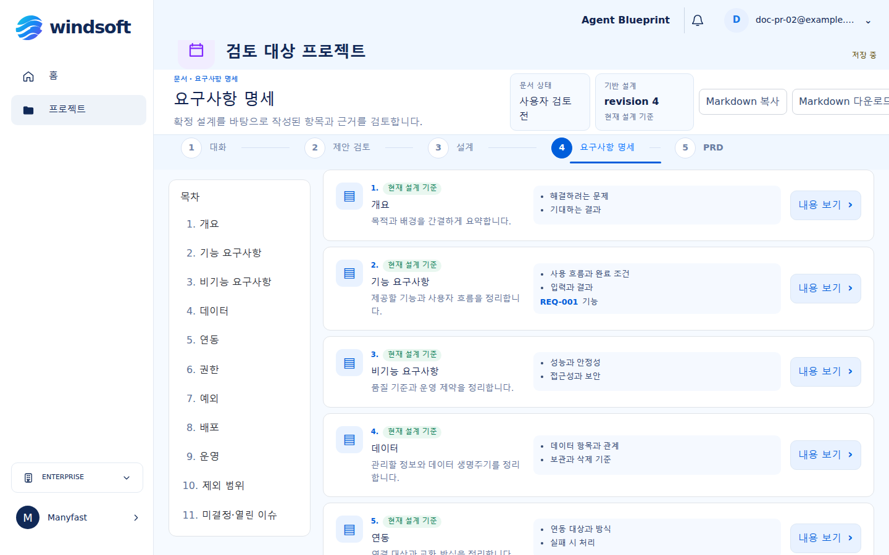
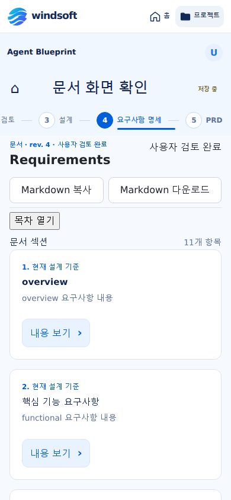
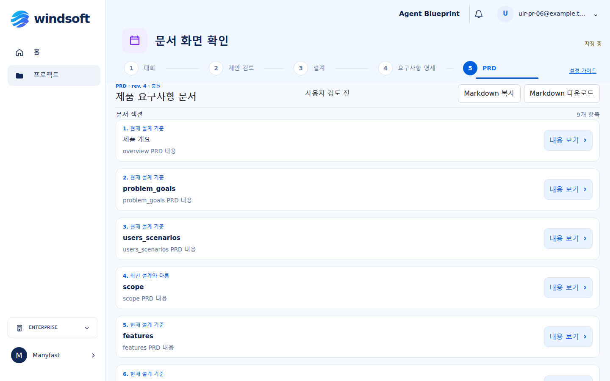
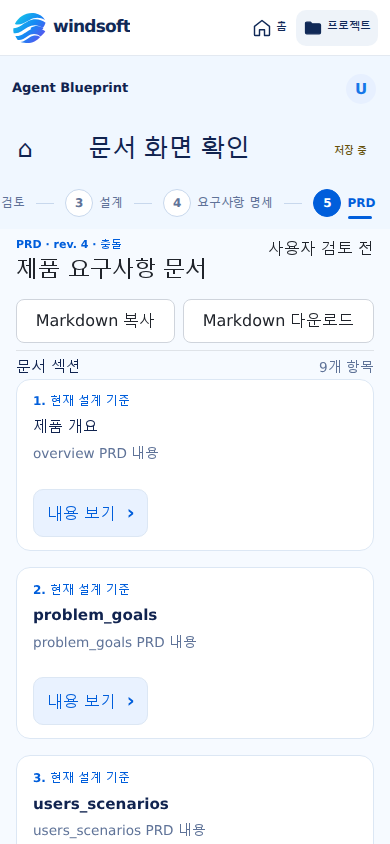

# UIR-PR-06 visual evidence

These screenshots use synthetic local browser fixtures with generic, non-product-specific Korean section markdown. The refreshed requirements overview screenshots show the Korean `요구사항 명세` title, 11 individually navigable localized sections, linked requirement data, step 4 current, and PRD as separate next step 5. They were captured from follow-up commit `53a358241a42341373388f734134f68dba0fa3e5`, based on merged `origin/main` `42f5bc763f76a571329f0d9bfd600be11ed01f39`, at 1440×900 desktop and 390×844 mobile CSS viewports. The complete evidence set, including interaction-state captures, is stored under `docs/delivery/evidence/UIR-PR-06/`; raw Playwright artifacts remain under `.pr-artifacts/UIR-PR-06/`.

Primary references: [Requirements dashboard](../../../blueprint-design/회의실%20예약%20서비스%20요구사항%20대시보드.png) and [PRD dashboard](../../../blueprint-design/한국어%20PRD%20대시보드%20화면.png), both 1586×992. Template captures were used only to verify requirements draft/overview/detail and PRD generation states absent from the primary images.

## Requirements

Ready document overview, 11 localized sections:

Ready confirmation and document support/source access are also covered by `requirements-ready-*.png` and `requirements-sources-mobile-390x844.png`.

Requirements conflict overview/detail captures are available at both viewports. The header reports `충돌 해결 필요`; the detail view shows the edit lock and resolution guidance.

## PRD

The overview includes one stale and one conflict section. Selected section detail and focus return, loading, and locked states are captured at both viewports.

The conflict detail and stale overview are also captured at both viewports. Conflict sections show resolution guidance without an edit control, and stale PRD status is labeled `최신 설계와 다름`.

## Editing and supported flows

The evidence set also includes direct editor and impact-dialog states, source-result keyboard focus, and setup-guide review on desktop/mobile.

## Primary-reference anchor comparison

Approximate measurements use the source and refreshed render screenshots without distorting image ratios.

| Anchor | Requirements reference | Render at 1440×900 | Delta |
| --- | ---: | ---: | ---: |
| Left application rail edge | x≈253 / 1586 (16.0%) | x≈248 / 1440 (17.2%) | +1.2 percentage points |
| Table of contents width | ≈241 / 1586 (15.2%) | ≈230 / 1440 (16.0%) | +0.8 percentage points |
| Stage navigation top | y≈214 / 992 (21.6%) | y≈218 / 900 (24.2%) | +2.6 percentage points; shared project-title/save row remains above it |
| First section card top | y≈263 / 992 (26.5%) | y≈275 / 900 (30.6%) | +4.1 percentage points, within the 5% position tolerance |
| First section card width | ≈1021 / 1586 (64.4%) | ≈892 / 1440 (61.9%) | −2.5 percentage points |
| First section card height | ≈119 / 992 (12.0%) | ≈115 / 900 (12.8%) | +0.8 percentage points |

The cards follow the reference hierarchy with an icon, Korean title and markdown summary, stored sync-status badge, content and linked requirement area, and detail action. Status derives from stored section sync state, and linked requirements are matched from source IDs. Additional markdown lines and linked requirement data appear in the content area; when neither exists, the concise empty state reads `연결된 항목 없음`. No sample product claims are added. The rendered card tops are about 36px below the proportional source coordinate at a 900px viewport height. The shared project title/save row and numbered stage navigation remain visible; the duplicate document work-panel title was removed. The requirements route marks `요구사항 명세` step 4 current; PRD remains a separate next step 5. The active stage label is automatically revealed in the horizontally scrollable navigation on mobile. All 11 canonical section keys appear with Korean presentation labels and persisted data is unchanged.

Requirements and PRD use one document H1, H2 for overview and selected document sections, and H3 for nested section cards and requirement items. The semantic heading correction retains the prior rendered font scale. Sections marked conflict provide resolution guidance and do not expose direct edit or AI patch-target controls.

The local Vite render used a mocked session and synthetic IndexedDB data. It is presentation evidence only, not proof of live authentication or deployed behavior.
