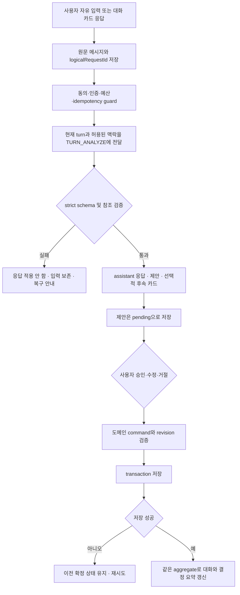

# 대화 turn·선택 입력 처리 계약

제품 대화의 정본은 [대화·결정 프로세스](../product/04-conversation-process.md)다. 이 문서는 API, schema, 저장 상태 및 질문·선택 카드의 실행 경계를 정의한다. 다음 질문을 카탈로그에서 고르는 기존 CON-PR-02 구현 기록은 완료 이력이며, CON-PR-05 이후의 주 대화 계약으로 사용하지 않는다.

## 실행 흐름

AI 호출은 기본 입력 경로다. 선택 카드 응답도 대화의 사용자 turn으로 저장한 뒤 동일 분석 흐름에 연결한다. 폼 검증은 입력을 즉시 거절할 수 있지만, 폼을 제출했다는 사실만으로 설계 상태를 확정하지 않는다.

## Request / Response 의미 계약

실제 field 이름과 versioned JSON Schema는 [프롬프트·응답 계약](../product/13-prompt-and-response-contracts.md)에서 관리하고 `CON-PR-05` 구현 전에 갱신한다. 의미 계약은 다음과 같다.

### Request

- `logicalRequestId`, `attemptId`: 앱이 생성한다. 동일한 사용자 turn의 재시도는 기존 idempotency 경계를 사용한다.
- `project`와 `designRevision`: 서버 권한·세션 검증 뒤 현재 aggregate에서 가져온다.
- `userTurn`: 현재 원문 또는 선택 카드 응답. catalog `questionId` 없이도 유효하다.
- `recentMessages`: 현재 사용자의 대화 맥락만 포함한다. 압축된 summary는 원문과 구별하고 source message ID를 유지한다.
- `confirmedDesign`: 현재 revision의 허용된 확정 항목만 포함한다.
- `sourceExcerpts`: 요청에 전달한 발췌만 포함한다. 파일 전체를 보내지 않는다.

클라이언트가 보낸 design status, readiness, proposal approval, document ready는 신뢰하지 않는다. 서버/도메인 command가 다시 검증한다.

### `TURN_ANALYZE` 응답

- `assistant_text`: 대화를 이어갈 간결한 응답.
- `proposals`: 0개 이상의 원자적 제안 초안. target/type, before/after, rationale, evidence reference와 구분된 fact/preference/assumption/inference를 포함한다.
- `follow_up`: 선택적 질문 또는 선택 카드 0~1개. `prompt`, 선택적 도움말, schema로 제한된 component type, 직접 입력 가능 여부, 현재 맥락에서 생성한 선택지를 가질 수 있다. 선택지 수와 값 규칙은 type별 schema로 검증한다. 고정 질문·추천 content catalog에서 고르지 않는다.
- `ambiguities`: 안전하게 제안으로 만들 수 없었던 모호성에 대한 설명.

Provider가 전달하는 ID는 제안 ID로 사용하지 않는다. 응용 프로그램이 검증 후 안정된 ID와 source links를 부여한다. 응답에 `readiness`, `processState`, 승인 여부, 저장 결과, CTA route는 허용하지 않는다. schema 위반, 허용되지 않은 ID, 근거 불일치는 응답 전체를 적용하지 않는다.

### 명시적 추천 요청

`OPTION_RECOMMEND`는 사용자의 명시적 추천 요청에서만 호출한다.

- 확정 설계와 request context로 뒷받침되는 정확히 11개의 서로 구별된 후보를 반환한다.
- 후보마다 짧은 이름·내용, 근거, 적합 이유, trade-off와 가정을 제공한다.
- 후보가 11개로 명확히 나뉘지 않을 만큼 맥락이 부족하면 candidates를 만들지 말고 필요한 확인을 돌려준다.
- 응답이 출력 token cap 안에 들어오도록 후보 설명은 간결하게 제한한다. model profile, input/output token cap은 이 PR에서 올리지 않는다. 안전한 11개 결과를 cap 안에 만들 수 없으면 내용을 자르거나 채워 넣지 않고 오류 또는 후속 질문으로 처리한다.
- 서버는 후보 ID를 부여한다. 사용자가 선택한 후보만 정상 제안 생성·검토 흐름으로 전달한다. 승인 전에는 확정 설계가 아니다.

## 질문·선택 카드 규칙

- 새 자유 대화 runtime은 `TURN_ANALYZE`가 현재 대화·확정 설계·허용된 자료에 맞는 `followUp`을 선택적으로 만든다. `QUESTION_CATALOG`와 `QUESTION_COMPOSE`는 이전 catalog형 흐름 및 저장 answer의 호환 표시를 위해 남아 있으며 새 대화의 질문 source가 아니다.
- 다음 질문과 option 내용은 현재 turn에 맞춰 동적으로 만든다. catalog의 고정 콘텐츠·질문 순서·항목 소진은 대화 완료 조건이나 질문 선택 source가 아니다.
- 애플리케이션은 `single_choice`, `multiple_choice`, `free_text`, `number`, `range`, `rank`, `confirm`의 allowlisted component type registry와 각 strict schema로 렌더링한다. 모델은 이 타입 중 하나와 현재 turn에 근거한 표시 데이터만 제안하며 HTML/React/code, 임의 component type, URL/action route, ID 또는 저장 상태를 생성하지 않는다.
- 서버는 payload type, 필수/선택 필드, option 수·고유 value, component별 값 범위, 입력 보완 정책과 evidence reference를 검증한다. unknown field/type, 잘못된 value 또는 근거 불일치는 fail closed하고 응답을 적용하지 않는다.
- 선택 제출은 pending proposal을 만든다. 사용자가 기존 proposal review transaction에서 승인하기 전까지 confirmed design과 readiness는 변하지 않는다.
- 자유 입력은 모든 시점에 가능하다. 사용자가 제안 처리 중에도 대화를 이어갈 수 있다.
- 한 turn에는 질문 block이 최대 1개다. 질문이 필요 없으면 질문 없이 응답을 끝낸다.
- option click은 draft 선택만 변경한다. 명시적 제출 전에는 응답을 보내지 않는다.
- 추천 표시는 선택 상태가 아니며 확정과 같은 색/상태로 나타내지 않는다.
- 지원 입력 유형은 `single`, `multiple`, `text`, `number`, `range`, `rank`, `confirm`이다. 미지원 유형, 누락된 값, 중복 값은 fail closed한다.

## 제안·확정·요약 동기화

1. AI response와 모든 proposals는 `pending`으로 저장한다.
2. 사용자가 승인, 수정 후 승인, 거절, 보류 또는 충돌 해결을 선택한다.
3. 도메인 command는 현재 design revision, proposal state, before-value와 참조 ID를 다시 검사한다.
4. 검증된 transaction 성공 후에만 aggregate와 revision이 바뀐다.
5. 대화의 우측 summary와 설계 보드는 저장된 동일 aggregate revision에서 다시 계산한다.

summary source는 `thread.summary`가 아니라 현재 `confirmed` design items, pending/deferred/review-required/conflict states와 source references다. `thread.summary`는 token 절약과 오래된 대화 이해를 돕는 context일 뿐 표시되는 결정의 권위 있는 source가 아니다. 승인 전의 suggestion은 `확정 내용`에 나타나지 않는다.

도식은 앱이 확정 item과 허용된 관계에서 읽기 전용으로 계산한다. diagram node에는 원본 item/source를 따라갈 수 있는 참조가 있어야 한다. 필요한 관계가 없으면 선을 추측해 만들지 않고 text projection만 제공한다.

## 성공·실패·재시도

| 결과 | 대화 상태 | aggregate / summary |
| --- | --- | --- |
| 유효한 turn, proposal 없음 | assistant 응답과 필요 시 follow-up 표시 | 확정 item을 변경하지 않는다. |
| 유효한 turn, proposal 있음 | 검토할 proposal source/이유 표시 | proposal은 pending이다. |
| 승인 transaction 성공 | 처리 결과를 메시지/상태로 표시 | 확정 상태와 summary를 같은 revision으로 갱신한다. |
| 거절·보류 | 선택 결과와 이유를 표시 | 거절 이력 또는 deferred/open issue를 갱신한다. |
| 잘못된 schema/evidence/target | 입력 원문 보존, 안전한 오류와 수정·재시도 | 현재 aggregate와 우측 summary를 유지한다. |
| provider timeout/unknown | request lifecycle에 따른 재시도 또는 확인 경로 | idempotency lock을 우회해 중복 요청을 만들지 않는다. |
| 저장 실패 | 입력과 pending 변경을 보존하고 재시도 제공 | 성공한 것처럼 summary를 앞당기지 않는다. |
| stale revision/conflict | before와 현재값을 비교하도록 이동 | 기존 확정값을 덮지 않는다. |
| 새로고침 | 마지막 저장 thread/message/job 복구 | 현재 aggregate로 summary를 다시 계산한다. |

취소, consent, server session, token budget, circuit breaker, context compaction, telemetry와 secret 정책은 관련 기존 contracts를 따른다. AI 장애는 fallback 답변·제안·도식으로 성공처럼 가리지 않는다.

## 검증 관찰점

- predefined catalog question/recommendation content 없이 freeform turn → context-derived options → allowlisted component → pending proposal → 사용자 승인 → 확정 요약까지 완료된다.
- model output으로 임의 HTML/React/code/component/action이 렌더되거나 실행되는 경우가 0건이며, schema 위반은 상태를 변경하지 않는다.
- 한 번의 사용자 turn에서 여러 atomic proposals가 독립 처리되고, 미처리 제안이 확정으로 보이지 않는다.
- 확정·미정·제안·충돌의 우측 항목이 같은 aggregate revision과 source turn을 참조한다.
- 추천 요청은 grounded 11개 후보, insufficient-context follow-up, output-token-cap 경계를 구별한다.
- 같은 turn 재전송, timeout unknown, cancel, schema failure, transaction failure, refresh에서 내용이 손실되거나 중복 반영되지 않는다.
- 모바일, 키보드, screen reader에서 대화와 결정 패널 사이 이동 및 원래 위치 focus return이 동작한다.
