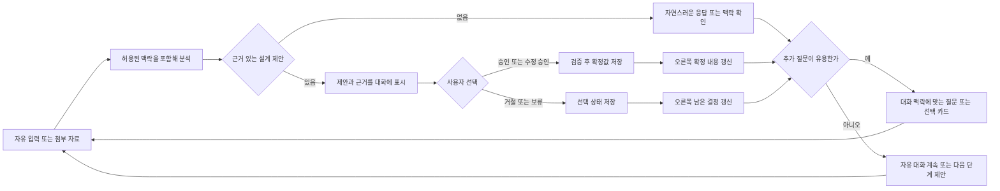

# 대화·결정 프로세스 명세

이 문서는 Agent 대화의 정본 동작 계약이다. 구현 가능한 상태 전이와 schema 경계는 [질문·응답 처리 계약](../process/03-question-and-answer-decisions.md), 제안 승인과 준비도는 [제안·준비도 프로세스](../process/04-proposal-and-readiness.md)를 따른다. 화면 배치는 [대화와 선택 입력 명세](../ui/02-conversation-and-forms.md), 주 시안은 [대화 캔버스](../blueprint-design/README.md)다. 시안에 없는 상태에만 [template 캡처](../template/README.md)를 참고한다.

## 제품 목표

Blueprint는 정해진 질문 목록을 완료하는 설문이 아니다. 사용자가 아이디어와 자료를 자연스럽게 설명하면 Agent가 대화 맥락을 이어받아 의미를 확인하고, 근거가 있는 설계 제안을 만든다. 선택형 카드는 대화를 돕는 선택적 입력이며 대화의 순서나 완료 조건을 통제하지 않는다.

데스크톱의 대화 단계는 왼쪽에 연속 대화와 입력창, 오른쪽에 실제 저장 상태에서 만든 `확정 내용`과 `남은 결정`을 둔다. 요약 항목은 해당 대화·제안·설계 상세로 연결한다. 모바일에서는 대화를 먼저 제공하고 요약은 대화 뒤 또는 접근 가능한 펼침 제어로 제공한다.

## 한 turn의 기본 흐름

각 turn은 원문 사용자 메시지와 응답을 대화 이력에 저장한다. AI 응답은 설명, 0개 이상의 근거 연결 제안, 필요할 때만 하나의 후속 질문 또는 선택 카드를 포함할 수 있다. 사용자가 입력을 보완하거나 수정하고, 파일을 첨부하고, 주제를 이어가는 일을 모든 대화 turn에서 지원한다.

## AI와 애플리케이션의 책임

| 책임 | 담당 | 계약 |
| --- | --- | --- |
| 의도·사실·선호·가정 분석, 요약 응답 | AI `TURN_ANALYZE` | 현재 turn과 허용된 대화·확정 설계·자료 발췌에 근거한다. |
| 설계 후보와 근거 추출 | AI `TURN_ANALYZE` | 제안은 대상 하나와 변경 의도 하나를 가지며 제공된 source ID만 인용한다. |
| 다음 대화 표현 또는 선택 카드 | AI `TURN_ANALYZE` | 맥락상 유용할 때 0~1개를 반환한다. 고정 질문·추천 목록에서 고르지 않고 현재 맥락으로 구성한다. |
| 추천안 11개 | AI `OPTION_RECOMMEND` | 사용자가 명시적으로 추천을 요청하고 근거가 충분할 때만 서로 구별되는 후보 11개를 만든다. 부족하면 먼저 맥락을 묻는다. |
| schema·참조·revision 검증, 메시지 ID 부여 | 애플리케이션 | 검증 실패는 상태를 변경하지 않는다. |
| 제안 승인·수정·거절·충돌 처리 | 사용자 행동 + 도메인 command | 사용자의 명시적 행동만 확정 설계를 변경한다. |
| 우측 결정 요약 | aggregate projection | 저장된 aggregate의 단일 revision에서 계산한다. thread summary만을 원본으로 사용하지 않는다. |
| readiness·다음 단계·문서 ready 판단 | 코드 | AI 응답으로 상태나 gate를 변경하지 않는다. |
| 도식 요약 | 애플리케이션의 읽기 전용 projection | 확정 데이터와 출처에서만 만든다. 같은 내용을 텍스트 목록으로도 제공한다. |

AI는 자체 제안을 승인하거나, 사용자 의도를 대신 확정하거나, readiness·충돌 해결·문서 ready 상태를 정하지 않는다. 인증, 프로젝트별 AI 동의, 예산, 취소, idempotency, 요청 복구와 서버 권한은 기존 정책을 따른다.

## 결정 상태와 우측 패널

| 상태 | 출처 데이터 | 우측 패널 표현 | 허용 행동 |
| --- | --- | --- | --- |
| 확정 | 현재 revision의 `confirmed` 설계 항목 | `확정 내용`, 값과 연결 근거 | 근거 대화 열기, 항목 검토·수정 |
| 제안 대기 | `pending` 제안 | `남은 결정`의 검토 대기 | 제안 검토로 이동 |
| 명시적 미정·보류 | `deferred` 결정/열린 이슈 | `남은 결정`과 보류 사유 | 대화로 돌아가 결정 |
| 충돌·재검토 | 현재 확정값과 제안의 불일치, 종속 항목 변경 | 원인과 영향이 있는 `남은 결정` | 비교·충돌 해결 |
| 거절 | 거절된 제안 또는 방향 | 필요한 경우 접을 수 있는 제외 이력 | 출처 확인 |

확정 내용은 승인 transaction 저장이 성공한 뒤에만 바뀐다. 저장 중 또는 실패 시 제안 상태를 유지하고 오류와 재시도 행동을 제공한다. 각 패널 항목은 status, source turn/item, 현재 revision과 다음 행동을 보존한다. 오래된 conversation compaction summary는 맥락 제공용일 뿐 실시간 결정 상태의 원본이 아니다.

## 대화형 선택과 추천

현재 runtime과 과거 개발 기록은 다음 질문 및 선택지를 고정 `QUESTION_CATALOG`에서 가져오는 방식이다. 이것은 현행 구현 사실이며, 사용자가 승인한 목표 동작은 아니다. 후속 구현에서는 고정 질문·추천 콘텐츠나 미리 정해진 순서를 주 대화의 source of truth로 사용하지 않는다. Agent는 확정 설계, 대화와 허용된 자료에서 빠진 결정을 판단해 질문과 선택지 내용을 해당 turn에 맞게 생성한다. 이미 제공한 정보는 다시 묻지 않고, 질문이 불필요하면 질문 없이 응답을 마친다.

선택이 유용하면 앱은 strict schema로 검증한 component type만 allowlist renderer에서 선택한다. 허용 타입은 `single_choice`, `multiple_choice`, `free_text`, `number`, `range`, `rank`, `confirm`이다. 모델은 선택할 component type과 현재 맥락에서 생성한 label/help/options/value를 데이터로 제안할 수 있지만, HTML, React, 코드, 스타일, 임의 renderer 또는 서버 식별자를 보낼 수 없다. 앱은 option 개수·고유 안정값·필수 입력 규칙·source reference를 검증하고, 잘못된 payload는 fail closed한다. 렌더 registry의 타입은 UI 구성요소 선택의 안전 경계이며 질문·추천 내용을 고정 catalog에서 가져온다는 뜻이 아니다. 사용자는 항상 자유 입력으로 답을 보완할 수 있다.

옵션을 선택하는 것만으로 제출·승인·확정되지 않는다. 선택 제출은 해당 맥락의 pending proposal을 만들고, 기존 proposal review transaction에서 사용자가 승인한 뒤에만 확정 설계를 바꾼다. 선택 카드가 없는 자유 대화도 전체 기능 경로다.

사용자가 `추천해 주세요` 또는 의미가 같은 명시적 요청을 하면 `OPTION_RECOMMEND`가 현재 확정 설계와 허용된 근거를 바탕으로 11개의 서로 다른 후보를 반환한다. 각 후보는 짧은 제안, 맞는 이유, trade-off, 가정과 근거를 가진다. 후보들은 초기 선택 상태가 아니며, 사용자가 선택한 후보만 정상 제안 검토 transaction으로 이동한다. 근거가 부족하면 11개를 채우거나 일반론을 만들어내지 말고, 먼저 필요한 맥락을 묻는다.

## 설계 결과와 도식

오른쪽 요약은 확정 결정과 미결 결정을 상태별로 빠르게 읽게 한다. 설계 단계에서는 현재 UI 시안의 다섯 그룹으로 열 개 원본 설계 영역을 묶어 보여줄 수 있다. 이 그룹은 표현 계층이며 기존 readiness 계산·원본 영역·문서 gate를 변경하지 않는다.

필요한 도식은 제품 목표, 사용자, 기능, 데이터와 제약 사이의 연결을 보여주는 읽기 전용 표현으로 제한한다. 도식의 각 항목은 확정 설계와 source로 되돌아갈 수 있어야 한다. 제안·미정·충돌은 확정 도식에서 분리한다. 관계가 충분히 확정되지 않았거나 도식 생성에 실패하면 사실을 보충해 그리지 말고 같은 결과를 텍스트 목록으로 제공한다. 범용 다이어그램 편집기나 새 wireframe 기능은 이 계약에 포함하지 않는다.

## 문서 단계와의 경계

대화에서 확정된 설계는 요구사항 명세의 입력으로 누적되며, 대화 자체를 문서 생성으로 오인하지 않는다. 사용자는 별도 `요구사항 명세` 단계에서 기존 readiness gate에 따라 생성을 요청하고, 검토·준비 완료 후에만 PRD를 요청한다. 기존 revision, stale/conflict, 직접 편집·부분 보완·정합성 검토 정책은 [문서 생성 프로세스](../process/05-document-generation.md)를 따른다.

## 데이터·근거·대화 보존

- 프로젝트마다 하나의 연속 대화 thread를 사용한다.
- 사용자 원문, 첨부 자료 발췌, AI 응답, 제안과 확정 설계를 출처 ID와 revision으로 연결한다.
- 모델이 제공하는 ID는 허용된 request context의 ID와 대조한다. 임의·외부 ID는 거부한다.
- 오래된 대화 압축은 확정 사실, 미정, 거절, 열린 질문과 source message ID를 보존한다.
- 응답이 모호하거나 출력 검증에 실패해도 입력과 이전 확정값을 보존한다.

## 오류와 복구

| 상황 | 처리 |
| --- | --- |
| 응답 대기 | 실제 `GenerationJob` 상태와 취소 동작을 표시한다. |
| provider 오류·timeout | 사용자 입력을 보존하고 safe error, 재시도 상태를 표시한다. 결과 unknown이면 기존 idempotency 잠금을 따른다. |
| 잘못된 schema·근거 | 응답과 제안을 적용하지 않고 검증 오류를 표시한다. |
| 저장 실패 | 패널을 확정 상태로 앞당기지 않는다. 입력·proposal을 보존하고 저장 재시도를 제공한다. |
| 중복 제출·응답 재생 | logical request ID로 한 번만 반영한다. |
| stale revision·충돌 | 기존 확정값을 덮지 않고 비교·재검토로 이동한다. |
| 확정 정보 없음 | 오류나 빈 도식 대신 안내와 대화 계속 행동을 제공한다. |
| 도식 생성 불가 | 출처가 있는 텍스트 요약으로 대체한다. 도메인 내용을 생성해 채우지 않는다. |

## 수용 기준

- 사용자는 카탈로그 질문에 답하지 않아도 첫 아이디어부터 연속 자유 대화를 진행할 수 있다.
- AI가 분석한 여러 사실은 출처가 있는 개별 제안이며, 승인 전에는 확정 패널·도식에 포함되지 않는다.
- 승인·수정·거절 후 제안, 설계 aggregate, 우측 요약과 출처가 동일한 revision을 가리킨다.
- 제안 승인이 저장되기 전/실패 시 우측 `확정 내용`은 바뀌지 않는다.
- 대화 요약, 선택 카드, 11개 추천, 패널 탐색, 단계 이동과 모바일 접근성의 세부 행동은 각각 이 문서의 companion 계약과 화면 명세에 연결된다.
- 요구사항 명세/PRD는 명시적 사용자 행동과 기존 gate 없이 자동 생성되거나 ready로 표시되지 않는다.
