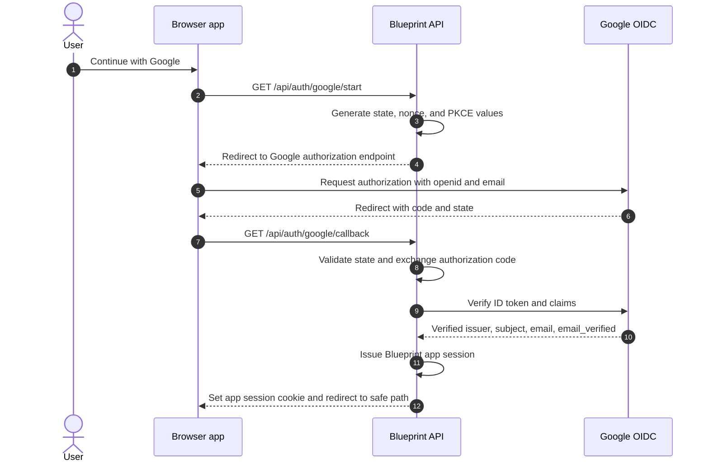

# Google OAuth 로그인 및 세션 설계

## 목적과 범위

Agent Blueprint는 Google OAuth 2.0 Authorization Code flow와 OpenID Connect로 사용자를 인증한다. 이 문서는 OAuth 시작, callback 검증, Blueprint 세션, 보호 API, 로그아웃과 사용자별 로컬 데이터 경계를 정의한다.

인증 코드를 화면에 입력하거나 애플리케이션에서 별도 인증 코드를 발급하지 않는다. Google 계정의 이메일 소유 확인은 OIDC `email_verified` claim으로 확인한다. Gmail mailbox/API 접근이나 메일 전송은 범위에 포함하지 않는다.

## 구현 선행 조건

인증 구현 시작 전 다음 Google Cloud 설정을 준비한다.

- OAuth consent screen과 web application OAuth client
- 개발·preview·production 환경에 등록한 정확한 redirect URI
- 서버 환경에만 저장하는 OAuth client secret과 Blueprint session signing secret
- `openid email` scope 동의
- OAuth client 및 각 callback URI의 환경별 소유자와 운영 절차

Client ID는 브라우저 설정에 노출될 수 있지만 client secret과 session secret은 서버에만 둔다. Gmail API scope는 등록하지 않는다. 설정값은 저장소, 브라우저 번들, 로그나 캡처 증거에 포함하지 않는다.

## 인증 흐름



## OAuth 요청과 callback

1. 로그인 시작 endpoint는 cryptographically random `state`와 `nonce`를 만들고, 선택한 authorization-code flow 구현이 지원하면 PKCE verifier/challenge도 만든다.
2. 서버가 state, nonce, PKCE verifier, 허용된 내부 `returnTo`, 생성/만료 시각을 짧은 수명의 서버 검증 가능 transaction cookie 또는 동등한 보호 저장소에 보관한다. 외부 사이트 URL은 `returnTo`로 받지 않는다.
3. 브라우저를 Google authorization endpoint로 보낸다. 최소 scope는 `openid email`이다. 공개 프로필이 제품 동작에 불필요하면 `profile`을 요청하지 않는다.
4. Callback은 OAuth 오류, state 불일치/만료/재사용을 거절한다. Authorization code를 서버에서 Google token endpoint와 교환하며 token을 브라우저에 노출하지 않는다.
5. 검증 라이브러리와 Google의 공개 signing keys를 이용해 ID token을 확인한다. `iss`, 이 client의 `aud`, `exp`, 요청 transaction의 `nonce`를 확인하고 `email_verified === true`만 허용한다.
6. 검증된 `(iss, sub)`를 사용자 identity로 저장하고 Blueprint session을 발급한다. Callback의 query, token, secret 값을 로그에 남기지 않는다.

`email` 문자열, 클라이언트 저장 상태, authorization 성공 URL만으로 로그인 처리하지 않는다. `email_verified`가 없거나 false인 경우, ID token 검증 실패, 만료, 잘못된 audience/issuer/nonce의 경우 세션을 발급하지 않는다.

## Blueprint session과 API 경계

- 앱 session은 서명되고 만료가 있는 서버 검증 가능한 cookie/session으로 관리한다.
- Cookie 속성: `HttpOnly`, `SameSite=Lax`, `Path=/`; HTTPS 환경에서는 `Secure`를 적용한다.
- `/`, `/blueprints/*` 화면과 모든 `/api/blueprint/*` API는 유효한 앱 session을 요구한다. 각 API handler는 공통 서버 `requireSession` 경계를 거친다.
- 비인증 요청은 `401 AUTH_REQUIRED`를 반환하며 제품 데이터나 OpenAI API를 처리하지 않는다. unsafe method에는 same-origin/CSRF 방어를 적용한다.
- UI route guard는 사용자 경험을 위한 보조 장치이며 서버 API 권한 확인을 대신하지 않는다.
- session 확인 endpoint는 최소 사용자 표시 정보만 반환한다. ID token이나 access token을 반환하거나 브라우저 저장소에 보관하지 않는다.
- 인증 실패는 일반 메시지를 보여 계정 존재 여부를 드러내지 않는다. 시작 및 callback 요청에는 적절한 rate limit을 적용한다.

## 사용자 identity와 브라우저 데이터

- 안정적인 identity key는 정규화한 issuer와 Google `sub`의 조합이다. 이메일은 표시/연락 속성이며 namespace key가 아니다.
- `ownerKey`는 `(issuer, subject)`로부터 일방향 파생한다. 원문 이메일을 IndexedDB key로 사용하지 않는다.
- 이메일 주소가 바뀌어도 동일 subject면 같은 사용자의 로컬 namespace를 유지한다.
- 계정 전환 시 현재 사용자 namespace의 열린 aggregate, 메모리 캐시와 선택된 프로젝트를 닫은 뒤 새 subject의 데이터를 연다.
- 브라우저 프로젝트 저장은 서버 동기화나 공동 편집을 의미하지 않는다.

## 로그아웃과 만료

- `GET /api/auth/session`은 인증 여부와 최소 사용자 표시 정보를 반환한다. `POST /api/auth/session`은 same-origin 검증 후 Blueprint session cookie를 만료시킨다. 로그아웃 반복 호출은 안전하게 처리한다.
- 로그아웃 시 화면의 사용자 데이터와 메모리 상태를 정리한다. Google 계정 전체 로그아웃을 했다고 표현하지 않는다.
- 만료 또는 무효 session은 보호 API에서 `401 AUTH_REQUIRED`로 처리한다. 화면은 저장되지 않은 사용자 입력을 다른 계정으로 넘기지 않고 재인증을 안내한다.

## 오류 계약

| 상황 | 서버 동작 | 화면 동작 |
| --- | --- | --- |
| 사용자가 Google 동의를 취소함 | session 미발급, 안전한 로그인 화면으로 복귀 | 인증을 완료하지 못했다는 일반 안내와 다시 시도 제공 |
| state, nonce, PKCE 검증 실패 | callback 거절, session 미발급 | 로그인 재시도 안내 |
| OAuth code 교환 또는 Google 검증 서비스 실패 | 안전한 오류 응답, 민감값 비기록 | 잠시 후 다시 시도 안내 |
| ID token 만료, 서명/issuer/audience 오류 | session 미발급 | 로그인 재시도 안내 |
| `email_verified`가 true가 아님 | session 미발급 | Google 계정 이메일 확인을 안내하는 일반 메시지 |
| Blueprint session 만료 | API는 `401 AUTH_REQUIRED` | 현재 입력을 보존 가능한 상태로 유지하고 재인증 안내 |

## Environment configuration

| 변수 | 위치 | 목적 |
| --- | --- | --- |
| `GOOGLE_CLIENT_ID` | server configuration; may also be exposed where OAuth initiation requires it | Google OAuth client 식별 |
| `GOOGLE_CLIENT_SECRET` | server only | 서버의 authorization code 교환 |
| `GOOGLE_REDIRECT_URI` | server configuration | 현재 환경의 정확한 callback URI |
| `APP_SESSION_SECRET` | server only | Blueprint session 서명/암호화 |
| `APP_BASE_URL` | server configuration | 안전한 내부 redirect와 환경 origin 확인 |
| `UPSTASH_REDIS_REST_URL` | server only | Vercel 인스턴스 사이 OAuth transaction 소비와 인증 rate limit 공유 |
| `UPSTASH_REDIS_REST_TOKEN` | server only | Upstash Redis REST 접근 인증 |

Production 및 인증을 사용하는 Preview 배포에는 두 Upstash 변수를 모두 설정한다. 값이 없거나 저장소 요청이 실패하면 인증 endpoint는 fail closed로 응답한다. 로컬 Vite 개발은 단일 프로세스 메모리 저장소를 사용하므로 여러 개발 서버 사이에서 transaction이나 rate limit을 공유하지 않는다.

실제 secret 값은 저장소 문서에 기록하지 않는다. 로컬 환경 설정 예시는 값 대신 변수명만 사용하고 secret manager 운영 절차에 연결한다.

## 구현 구조 예시

```text
api/auth/google/start.ts
api/auth/google/callback.ts
api/auth/session.ts
api/_lib/google-oidc.ts
api/_lib/session.ts
api/_lib/require-session.ts
```

위 경로는 설계 예시다. 실제 구현은 기존 API 디렉터리 규칙에 맞춘다. Google 서명 키 조회와 claim 검증은 직접 암호 코드를 구현하지 않고 유지 관리되는 OIDC 검증 라이브러리를 사용한다.

## UI 계약

- 비인증 사용자는 제품 데이터를 렌더링하기 전에 로그인 화면으로 이동한다.
- 기본 화면은 시안의 `ideon` 표기와 `Google로 시작하기` 단일 primary action을 제공한다.
- password, 이메일 입력, 수동 코드 입력 UI는 두지 않는다.
- 취소, callback 오류, 진행 중, 로그인 완료, session 만료 상태를 구분해 키보드/스크린리더 사용을 지원한다.
- 로그인 화면과 오류 문구는 전 직장 또는 조직 구성원 자격을 전제하지 않는다.

## 검증 기준

- 정상 Google callback은 검증된 subject로만 session을 생성한다.
- 잘못된 state/nonce, 재사용 transaction, 잘못된 issuer/audience, 만료/서명 오류, 미검증 이메일은 session 발급에 실패한다.
- client secret, session secret, code, ID token, access token이 번들·localStorage·로그·문서 증거에 나타나지 않는다.
- 비인증 상태에서 보호 화면과 직접 API 호출이 차단된다.
- 로그아웃 후 session cookie와 현재 계정의 화면 데이터가 제거된다.
- 서로 다른 `(issuer, subject)`의 로컬 프로젝트가 분리되고 같은 subject의 이메일 변경은 namespace를 바꾸지 않는다.
- Google 계정에 Gmail API 접근 권한이나 mailbox/send scope를 요청하지 않는다.
