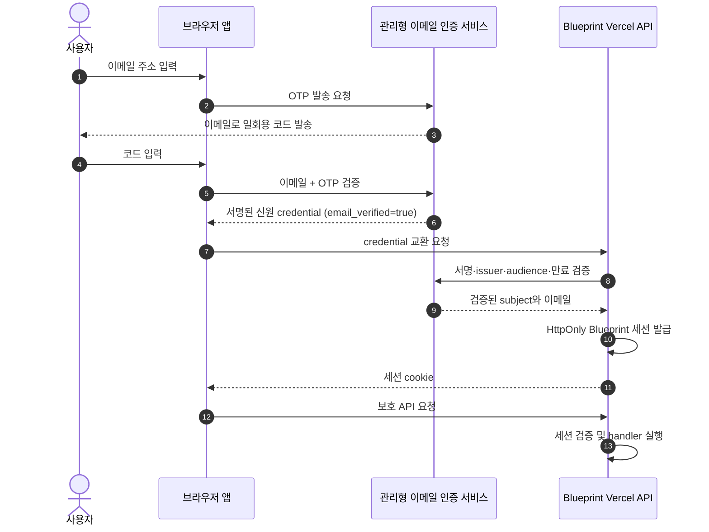

# 이메일 OTP 인증 및 중립 제품 문서 설계

## 목적

제품 문서 전반의 이전 회사·브랜드 의존 표현을 제거하고, AX Login 기반 사내 Microsoft 인증을 이메일 소유 확인 기반 인증으로 교체한다. PRD의 출시 단계와 개발 작업 순서도 새 인증 선행 조건에 맞춰 다시 정렬한다.

## 사용자 의도와 제약

- 제품은 더 이상 이전 회사의 서비스로 표현하지 않는다.
- 사용자는 이메일 주소에 접근할 수 있음을 확인하는 정도의 간단한 인증을 사용한다.
- 특정 회사 도메인이나 회사 계정 allowlist에 묶지 않는다.
- Gmail OAuth나 Gmail mailbox API 연동은 요구하지 않는다. Gmail 주소는 다른 이메일 주소와 동일하게 OTP를 받을 수 있다.
- 이메일 코드 발송과 검증은 관리형 인증 서비스가 제공한다. 애플리케이션이 OTP를 직접 생성·보관·발송하지 않는다.
- 앱의 Vercel serverless API는 계속 존재한다. 이 API는 인증 결과를 서버에서 검증하고 제품 API와 OpenAI 비밀값을 보호한다.
- 이 변경의 산출물은 설계 문서다. 제품 코드, dependency, 배포 환경은 바꾸지 않는다.

## 결정할 인증 방식

**관리형 이메일 OTP를 기본 인증 방식으로 사용한다.** 인증 서비스는 주소로 일회용 코드를 발송하고 만료·일회성·재시도 제한을 검증한다. 구체적인 공급자는 구현 PR의 Definition of Ready에서 선정하고, 공급자 SDK/API가 제공하는 signed identity credential 계약을 확인한다.

Google OAuth는 선택하지 않는다. Google 계정에 종속되고 사용자가 Gmail이 아닌 주소를 확인하는 요구와 맞지 않는다. 자체 메일 서버도 선택하지 않는다. 공급자 미지정은 문서 계약에는 허용하되 구현 시작 전에는 해소해야 하는 운영 선행 조건이다.

## 인증 흐름

### 신뢰 경계

- 브라우저 입력, 화면 상태와 클라이언트가 전달한 이메일 문자열만으로 인증하지 않는다.
- API는 공급자 credential의 서명, issuer, audience, 만료 시각과 `email_verified === true`를 검증한 후에만 앱 세션을 발급한다.
- 앱 세션은 `HttpOnly`, `SameSite=Lax`, `Path=/`를 사용하고 HTTPS 운영 환경에서 `Secure`를 적용한다.
- 모든 `/api/blueprint/*` 요청은 서버 세션 검증을 통과해야 한다. UI route guard는 보조 통제다.
- OTP의 생성·메일 발송·만료·일회성·시도 제한은 인증 공급자 책임이다. 앱 로그와 브라우저 저장소에 OTP 또는 공급자 bearer credential을 남기지 않는다.
- 사용자 오류 문구는 이메일 존재 여부를 노출하지 않는다. 요청·재전송·검증 endpoint는 공급자와 애플리케이션 경계 모두에서 rate limit을 적용한다.
- 로그아웃은 앱 세션을 종료하고 클라이언트 auth session도 종료한다. 다른 메일 서비스의 전체 로그아웃으로 표현하지 않는다.

## 사용자와 로컬 데이터

- 인증 주체는 관리형 인증 공급자의 안정적인 `(issuer, subject)` 조합이다.
- `ownerKey`는 `(issuer, subject)`에서 파생하며 원문 이메일을 IndexedDB namespace key로 사용하지 않는다.
- 이메일이 변경되더라도 공급자 subject가 유지되면 같은 사용자 namespace를 사용한다.
- 동일 브라우저의 사용자 전환 때 열린 프로젝트와 캐시를 비우고 현재 subject namespace만 연다.
- 로그인과 이메일 인증은 암호, 실시간 공동 편집, 조직 역할 또는 서버 프로젝트 저장을 추가하지 않는다.

## PRD 개발 흐름 순서

인증은 홈·프로젝트보다 먼저 완료한다. 순서는 다음과 같다.

1. **인증 공급자 선행 설정:** 이메일 OTP, 허용 callback origin, 메일 발신 도메인, 만료·rate limit 정책을 구성한다. 공급자와 환경별 값은 구현 PR 시작 전에 확인한다.
2. **AUTH-PR-01 — 이메일 인증 서버 경계:** 관리형 인증 credential 검증, `email_verified` 확인, Blueprint HttpOnly 세션 발급과 session/logout API를 구현한다.
3. **AUTH-PR-02 — 이메일 OTP 로그인과 보호 경로:** 이메일/OTP 화면, 인증 상태, returnTo, route guard와 Blueprint API 공통 보호를 구현한다.
4. **AUTH-PR-03 — 사용자 데이터 격리:** 안정적 provider subject 기반 IndexedDB namespace와 계정 전환 정리를 구현한다.
5. **FND-PR-01~03 — 구현 기반과 계약:** React/UI 기준, 도메인·Agent 계약, 테스트 기반을 완성한다.
6. 이후 기존 delivery 순서대로 프로젝트 저장, 대화, 설계, 문서, 자료·내보내기, 품질 단계를 진행한다.

앞 PR이 병합된 뒤에만 다음 PR을 시작한다. 이 순서를 `docs/product/02-prd.md`, `docs/product/08-delivery-plan.md`, delivery PR 단위표, task index와 AUTH task plans에 동일하게 반영한다. 상태는 실제 PR 병합 근거에 맞춰 갱신한다.

## 이전 회사·브랜드 표현 정리

- 모든 저장소 Markdown 문서에서 이전 회사명, 제품의 회사 소유 표현, 조직 내부 인증 명칭·endpoint·MCP, 사내 직원 전용 문구와 해당 조직을 가리키는 디자인 시스템 이름을 제거한다.
- 제품명은 중립적인 `Agent Blueprint`로 통일한다. 조직은 `사용자`, `운영자`, `제품 운영자`처럼 역할로 표현한다.
- 이전 UI package 고유명은 문서에서 제거하고 `기존 외부 UI 라이브러리` 등 기능 중심 문구로 대체한다. 코드 dependency의 제거 일정과 acceptance criteria는 유지하되 회사명이나 package 고유명으로 표현하지 않는다.
- 배포 가이드, 이전 계획과 체크리스트 같은 과거 문서도 현재 유효한 설정 안내인 것처럼 보이는 회사·인증 계약을 남기지 않는다. 필요한 역사적 설명은 브랜드 중립적으로 다시 쓴다.
- 사용자 요청은 문서에 대한 것이므로 제품 소스의 기존 문구나 package 이름은 이 문서 개정 범위에 포함하지 않는다.

## 문서 변경 범위

- 인증 기준 문서를 `docs/product/11-ax-login-authentication.md`에서 `docs/product/11-email-otp-authentication.md`로 전환하고 모든 링크를 갱신한다.
- 제품 정의, PRD, 요구사항, 아키텍처, UI 설계, 결정 기록, delivery 계획과 traceability에서 구 회사/조직 인증 계약을 교체한다.
- 로그인 UI 화면 청사진과 상태표를 이메일 입력·OTP 요청·OTP 입력·검증 오류·재전송 대기·세션 만료 상태로 갱신한다.
- `AUTH-PR-01`~`03` 계획, 전체 PR 순서, task index, 배포 가이드, root `AGENTS.md`, README, template·UI 안내, AI prompt 지침과 기존 계획 문서를 함께 갱신한다.
- `.md` 파일 이름은 사용자 요청이 텍스트뿐 아니라 내용도 제거하라는 것이므로 브랜드 문자열을 포함하지 않게 한다. 필요한 문서 이동은 모든 상대 링크를 함께 수정한다.

## 완료 기준

1. 저장소 내 tracked Markdown 본문과 Markdown 파일명에서 이전 회사명 및 AX/Microsoft 사내 로그인 계약 관련 표현이 검색되지 않는다.
2. 모든 문서에서 인증을 “관리형 이메일 OTP로 이메일 소유 확인”으로 일관되게 정의하고 Gmail OAuth/mailbox access 또는 회사 도메인 제한을 요구하지 않는다.
3. 인증 결과와 보호 API의 서버 검증 경계가 유지되고, client-only 인증을 충분한 보호로 표현하지 않는다.
4. PRD 출시 순서, delivery PR table, task index와 AUTH task plans가 동일한 선행 조건과 작업 순서를 따른다.
5. 구현 전 인증 공급자 선택·callback·메일 발신 설정 확인이 Definition of Ready에 명시된다.
6. Markdown 내부 상대 링크가 유효하고 Mermaid 문서 검증과 `git diff --check`가 통과한다.
7. 변경은 문서와 문서 링크에만 한정되며 애플리케이션 소스·dependency·배포 설정은 수정하지 않는다.

## 미포함

- 관리형 인증 공급자 선택 또는 계정 생성
- 인증, 메일 발송, 세션 또는 사용자 인터페이스 코드 변경
- 제품 코드의 이전 브랜드 문구·패키지 dependency 정리
- 도메인 allowlist, 역할 기반 권한, 조직 계정 정책 추가
