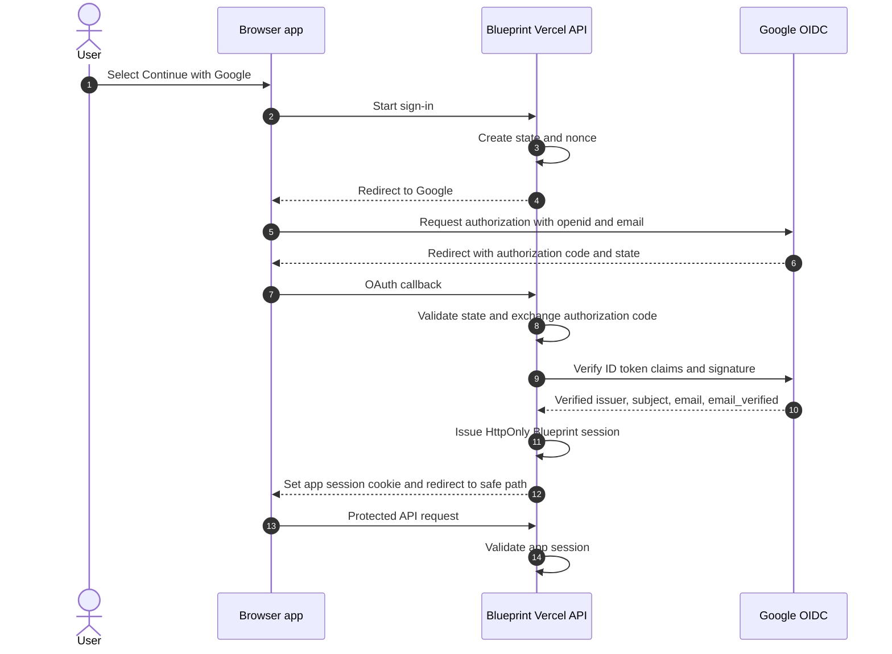

# Google OAuth Authentication and Neutral Product Documentation

## Purpose

Remove former company identity and internal-service assumptions from repository Markdown. Replace the organization-bound login design with Google sign-in, and align the PRD and delivery order with that authentication boundary.

## User intent and constraints

- The product is independent and must not be described as belonging to a former employer.
- Users sign in with Google. There is no application-issued OTP code or separate email verification flow.
- Google OIDC supplies the verified email identity. The app does not request Gmail mailbox access or the Gmail API send scope.
- The existing Vercel serverless API remains the server trust boundary. It validates the Google sign-in response and issues the Blueprint HttpOnly application session.
- This change updates design and delivery documentation only. Do not change application source, dependencies, or deployment configuration.

## Authentication decision

Use Google OAuth 2.0 Authorization Code flow with OpenID Connect. Request only the `openid` and `email` scopes needed to authenticate and confirm the Google account email. Do not request Gmail API scopes. The server handles the OAuth callback, exchanges the authorization code, verifies the ID token (signature, issuer, audience, expiry, and `email_verified === true`), and then issues the app session. Never accept a client-supplied email as proof of identity.

Before implementation, configure a Google Cloud OAuth client, consent screen, exact environment callback URLs, and server-only client secret. Keep OAuth `state` and OIDC `nonce` validation, use PKCE where supported by the selected server flow, and reject unsafe `returnTo` destinations.

## Authentication flow

## Trust and session boundaries

- OAuth state and OIDC nonce are generated and checked by the server; callback errors, mismatches, expired tokens, invalid audiences, and unverified email are rejected.
- Verify the ID token using Google's published keys and an established OIDC verification library. Validate `iss`, `aud`, `exp`, and `email_verified === true`; use `(iss, sub)` as the stable identity key.
- Keep the Google client secret and app session signing secret on the server. Do not place authorization codes, tokens, secrets, or session credentials in browser storage, logs, source, or tracked docs.
- Issue an `HttpOnly`, `SameSite=Lax`, `Path=/` app cookie and set `Secure` in HTTPS environments.
- Every `/api/blueprint/*` route validates the app session server-side. UI route guards are supplementary and never replace API checks.
- Logout revokes the app session and clears the app cookie. It need not sign the user out of their Google account.
- Use generic authentication failures that do not disclose account existence. Apply rate limits to sign-in initiation and callback handling.

## User identity and local data

- Derive the local `ownerKey` from the stable `(issuer, subject)` pair, not the email string.
- An email change for the same Google subject retains the same local namespace.
- On account switching, close the current user's project and cache state before opening the selected subject namespace.
- Google sign-in does not introduce passwords, authorization roles, collaboration, or server-side project persistence.

## PRD and delivery order

Authentication precedes foundation and product features:

1. **Google OAuth setup:** Create/configure the OAuth consent screen and client, approved callback URLs for each environment, and server-only secrets.
2. **AUTH-PR-01 — Server authentication boundary:** Implement authorization-code callback, state/nonce checks, ID-token validation, verified-email requirement, app session, session inspection, and logout.
3. **AUTH-PR-02 — Google sign-in UI and protected access:** Add the Continue with Google entry point, safe return navigation, route guards, and common server protection for Blueprint APIs.
4. **AUTH-PR-03 — Local data isolation:** Namespace IndexedDB by stable `(issuer, subject)` and clear user-scoped state on account change.
5. **FND-PR-01–03 — Foundation and contracts:** Establish the implementation baseline, domain contracts, and test foundation.
6. Continue the existing delivery sequence for projects, conversations, design, documents, imports/exports, and quality.

Only begin an auth unit when its documented prerequisites are satisfied; do not report a product unit as complete without merge evidence. The same order must appear in the PRD, delivery table, task index, and AUTH plans.

## Neutral documentation requirements

- Remove former employer names, company ownership claims, internal identity systems/endpoints/MCPs, staff-only access rules, and proprietary design-system identifiers from tracked Markdown paths and contents.
- Use `Agent Blueprint` and neutral roles such as user, operator, or product operator.
- Replace company-specific package references with generic descriptions while preserving useful dependency-removal requirements.
- Rework historical documents so they do not present obsolete internal services as current setup instructions.
- Do not alter product source or package dependencies as part of this documentation change.

## Scope

- Rename `docs/product/11-ax-login-authentication.md` to `docs/product/11-google-oauth-authentication.md` and update all links.
- Align product definition, PRD, requirements, architecture, UI, decisions, delivery plans, and traceability with Google OIDC.
- Update login screen states and process documents to use a single Google sign-in action, redirect/callback outcomes, authenticated state, and session expiry.
- Update AUTH task plans, root instructions, READMEs, deployment guidance, templates, and other affected Markdown.
- Leave product code, dependencies, and deployment settings untouched.

## Acceptance criteria

1. Tracked Markdown paths and contents contain no former-company branding or obsolete internal login contract.
2. Google OAuth/OIDC is the sole authentication method described; there is no OTP input or code issuance/verification flow.
3. The requested scopes do not include Gmail mailbox or Gmail send access.
4. Server-side validation of state, nonce, ID token signature, issuer, audience, expiry, and verified email precedes app-session issuance.
5. Blueprint APIs retain server-side session validation, and local data uses stable `(issuer, subject)` identity.
6. PRD, delivery table, task index, and AUTH task plans use the same setup prerequisite and AUTH-PR-01/02/03 order.
7. Relative Markdown links and Mermaid diagrams validate, and `git diff --check` passes.
8. Only Markdown documents and links change.
