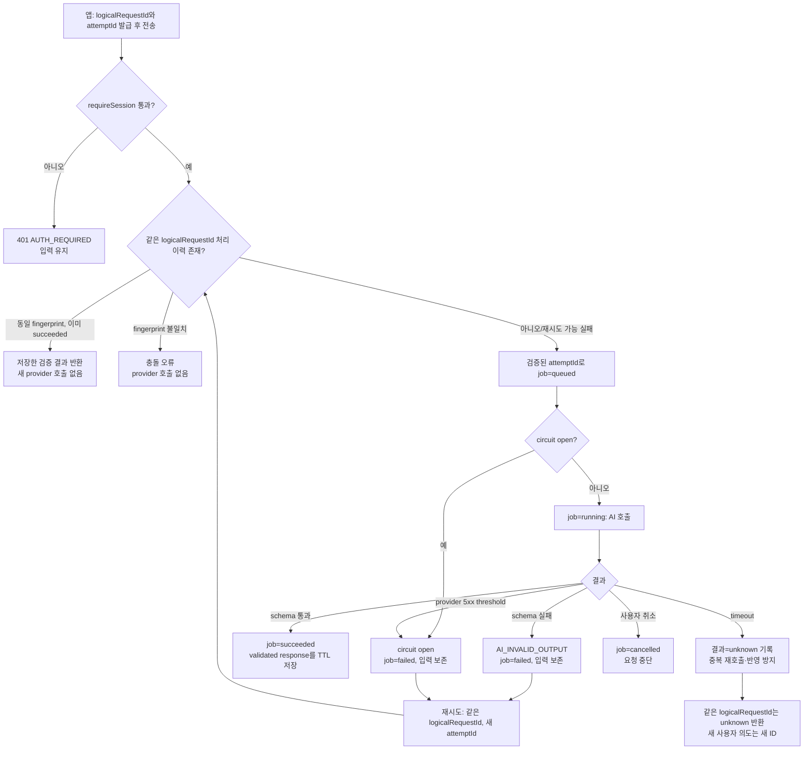

# CON-PR-01 — turn 수명주기

## Overview

**Status: in_progress.** `POST /api/blueprint/turn` 요청·응답 수명주기를 구현해 사용자 답변/자유 입력이 인증된 세션에서만 처리되고, 중복 요청이 안전하게 재생되며, 실패 시 입력을 잃지 않고 재시도할 수 있게 한다. AI-PR-01 merged as PR #13; this unit consumes its registries, schemas and per-request budget guard, and records sanitized attempt metadata in its lifecycle store.

## Background

This unit covers four independently testable contracts: (1) authenticated API boundary, (2) request lifecycle transitions, (3) `logicalRequestId`/`attemptId` deduplication and exact retry replay, and (4) input preservation and bounded retry on errors. Project AI-use consent (`CON-201`) belongs to `CON-PR-03`, where the first actual AI-send UI is introduced.

## Scope

### 포함

- `POST /api/blueprint/turn`의 FND-PR-02 canonical `turnRequest`/response schema 검증과 공통 `requireSession` 적용
- CON-202 요청 상태 머신(`idle → queued → running → succeeded/failed/cancelled`)
- `logicalRequestId`(사용자 의도 단위)와 `attemptId`(실행 시도 단위)의 client/app 발급값 검증 및 중복 처리 차단
- CON-206 오류별(네트워크, rate limit, schema 실패, 취소) 요청/응답 계약과 기존 입력·설계 보존
- AI-010(retry·circuit breaker) 서버 측 적용

### 제외

- 질문 카탈로그·선택 폼 UI(`CON-PR-02`)
- DisplayBlock 렌더링·진행 상태 표시(`CON-PR-03`)
- AI 모델 registry/token budgeter 자체 구현(`AI-PR-01`에서 선행, 이 PR은 소비만 함)

## 연결 근거

- 요구사항: `CONV-005`, `NFR-005`
- Delivery 작업: `docs/delivery/02-conversation-and-forms.md` CON-202, CON-206
- AI 실행 계약: `docs/delivery/ai-model-prompt-and-evaluation.md` AI-010
- 결정: `DEC-007`, `DEC-023`, `DEC-029`
- 화면 설계: `docs/ui/02-conversation-and-forms.md` `UI-CONV-004`, `docs/ui/screens/02-intake-and-discovery.md` I06
- 선행 PR: `AI-PR-01` merged (#13; model/prompt registry, request ledger), `AUTH-PR-01`~`03` merged (#3, #5, #6; session verification)

## 선행 조건 (Definition of Ready)

- `AI-PR-01` merged (#13); model, prompt/schema registry, budget and request ledger are available.
- `AUTH-PR-01`~`03` merged; the shared session guard and auth store are available.
- `FND-PR-02` merged; `turnRequest` includes client/app-provided `logicalRequestId` and `attemptId`, and `GenerationJob` status literals are defined.
- Production already uses the auth store's Upstash Redis configuration. Do not add a new provider or environment prerequisite. Production fails closed when existing Redis config is absent; local and focused tests use the memory adapter.

## 작업 단위별 구현 개요

### ① 인증 경계

- `POST /api/blueprint/turn`에 공통 `requireSession`을 적용해 비인증 요청을 401로 거절
- 세션에서 파생된 `ownerKey`만 request ledger와 idempotency/circuit keys에 사용(요청 본문의 임의 사용자 식별자 무시)

### ② 요청 수명주기 상태 전이

- `idle → queued → running → {succeeded|failed|cancelled}` 상태를 `GenerationJob`으로 관리
- Every retry carries the same client/app-created high-entropy `logicalRequestId` and a fresh client/app-created `attemptId`; server validates and records both. A successful logical ID returns the cached validated response without another provider call during the 24-hour record TTL. The client creates a new logical ID for every new intent and never retries an expired intent with its old ID.
- Reuse the existing auth-store abstraction, extending it with atomic turn-claim/read/finish and circuit-state operations. Redis is the shared production transient store; memory is only for local/focused tests.
- HMAC-hash the server-derived owner, project, and logical request identifiers for Redis namespaces. Store only lifecycle/attempt/job metadata, bounded timestamps and sanitized error codes, an HMAC request fingerprint over the canonical intent (excluding `attemptId`), and the minimum schema-validated proposal response needed for exact successful replay. Never store raw request/context, credentials, provider error bodies, or request ledger text.
- TTL and cleanup: processing claims expire after 120 seconds; successful replay results and ambiguous-timeout (`unknown`) tombstones expire after 24 hours; circuit counters use a 60-second rolling window and an open circuit expires after 60 seconds. Redis TTL performs automatic cleanup; the memory adapter prunes expired records on access. The 24-hour transient replay/tombstone retention must be disclosed in the CON-PR-03 first-send consent notice. Every new intent gets a fresh high-entropy logical ID. During the 24-hour tombstone TTL, an unknown ID is blocked; after expiry, the server cannot distinguish an old replay, so the client must not expose retry for that expired intent or reuse its ID.
- Circuit policy: open after 3 consecutive provider 5xx failures within the 60-second window; while open, fail before provider invocation. Permit one half-open probe after the 60-second open TTL; success clears the counter, another 5xx reopens it.
- Only return a schema-validated proposal result after full envelope and reference validation. The turn endpoint never mutates confirmed design; user approval remains a separate command in DSG-PR-01.
- Client cancellation aborts the active fetch/provider request where supported and records `GenerationJob=cancelled` and ledger `cancelled`; no partial response is returned. A disconnect/timeout whose provider outcome cannot be established records `GenerationJob=failed`, ledger `unknown`, and is not automatically resubmitted.

### ③ 중복 방지

- 앱은 사용자 의도마다 `logicalRequestId`를 발급하고 각 retry마다 fresh `attemptId`를 발급한다. 서버는 canonical schema와 함께 두 ID를 검증·기록한다.
- 서버는 같은 logical ID의 성공 replay를 감지하면 fingerprint가 일치하는지 확인한 뒤 저장한 검증 결과를 반환한다. fingerprint 불일치는 conflict 오류로 거절하며 provider를 호출하지 않는다.
- circuit breaker(AI-010): the shared TTL store coordinates consecutive provider 5xx failures across serverless instances; timeout outcome is `unknown` and cannot be applied twice

### ④ 오류별 입력 보존과 재시도

- `docs/delivery/02-conversation-and-forms.md` CON-206 오류 표(네트워크 실패/rate limit/schema 실패/취소)를 서버 오류 코드 → 클라이언트 처리 지침으로 구현
- 모든 오류 경로에서 fallback 제안/문서를 생성하지 않고 원래 입력과 기존 확정 설계를 유지

## 프로세스 / 상태 전이

## 데이터/API 영향

- Request/response shape is the `FND-PR-02` canonical HTTP schema; do not redefine `turnRequest` in this PR. App/client sends a fresh `attemptId` for each retry.
- `GenerationJob`, dedupe/replay metadata, and circuit state use the existing Upstash-backed auth-store abstraction with a memory implementation for tests/local development. No new env var/provider is added. Production missing Redis configuration fails closed with the existing `AUTH_STORE_NOT_CONFIGURED` path.
- Per-request task/token/output/cost limits are enforced before provider invocation. The API does not accept client-reported cumulative project usage as authoritative. Project-lifetime budget aggregation and complete usage/latency ledger persistence remain dependent on a trusted durable server usage source; the 24-hour transient lifecycle store does not claim to enforce the product's cumulative project budget.
- Redis values contain only HMAC-hashed identifiers/fingerprint, state, attempt/job metadata, bounded timestamps, sanitized error codes, and the minimum validated proposal response needed for exact replay; raw request/context is excluded. TTLs/automatic cleanup are specified above. No browser persistence of transient jobs is introduced.
- Error envelope uses existing architecture codes, including `AUTH_REQUIRED`, `AI_INVALID_OUTPUT`, `AI_RATE_LIMITED`, `AI_REQUEST_UNKNOWN`, and `NETWORK_ERROR`; never return provider raw errors. For `AI_REQUEST_UNKNOWN`, return the stable code and do not claim success. The API blocks reuse of the same logical ID during the 24-hour tombstone TTL; preserving the UI draft and presenting a safe recovery action are verified by the CON-PR-03 send UI.

## Acceptance Criteria

### Happy Path — ① 인증

- Given 유효한 Blueprint 세션 쿠키가 있을 때, when `/api/blueprint/turn`을 호출하면, then 요청이 정상 처리된다.

### Failure Case — ① 인증

- Given 세션이 없거나 만료된 상태, when `/api/blueprint/turn`을 직접 호출하면, then 401 `AUTH_REQUIRED`가 반환되고 어떤 side effect도 발생하지 않는다.

### Happy Path — ② 수명주기

- Given 정상 입력이 제출된 상태, when turn이 처리되면, then `queued→running→succeeded` 전이를 거쳐 검증된 proposal result가 한 번 반환되고, confirmed design은 변경되지 않는다.

### Failure Case — ② 수명주기

- Given 처리 중 사용자가 취소한 상태, when 취소 요청이 도착하면, then job이 `cancelled`로 종료되고 확정 설계는 변경되지 않는다.

### Happy Path — ③ 중복 방지

- Given 동일 `logicalRequestId`의 재요청에 fresh `attemptId`가 있는 상태, when 최초 요청이 이미 `succeeded`이고 24시간 record TTL이 유효하면, then Redis-backed replay returns the exact validated result with zero additional provider calls. This server API does not mutate or apply project state.

### Failure Case — ③ 중복 방지

- Given provider가 5xx를 연속 반환하는 상태, when circuit이 open되면, then 추가 provider 호출 없이 즉시 실패 처리되고 입력은 보존된다.

### Happy Path — ④ 입력 보존/재시도

- Given schema validation fails after the bounded server retry, when the transport returns its normalized error, then no proposal or confirmed-design state is changed; browser input preservation and user-initiated retry are verified by CON-PR-03's send UI.

### Failure Case — ④ 입력 보존/재시도

- Given network, rate-limit, schema, or cancellation failure occurs, when the transport returns its normalized error, then no fallback proposal or confirmed-design mutation is produced. Browser draft/current-question preservation is verified with the actual send UI in CON-PR-03.

### Boundary

- Given provider timeout leaves the outcome ambiguous, when the result is recorded, then the job is `failed`, ledger status is `unknown`, and `AI_REQUEST_UNKNOWN` is returned; the same logical request remains blocked for its 24-hour tombstone TTL and cannot trigger a second provider call. Success is not claimed. The later send UI preserves the input, requires state review before a new logical ID, and retires the old intent after 24 hours because the server record has expired.
- Given production Redis configuration is unavailable, when a turn request reaches transient-state initialization, then the API fails closed before provider invocation; local/focused tests exercise the same contract with the memory adapter.
- Given a turn request exceeds the registered task input/output or derived per-request cost limit, when the budget guard runs, then the API records a sanitized failed attempt and blocks before provider invocation. This does not claim to enforce cumulative project-lifetime limits.
- Given the 3rd consecutive provider 5xx occurs within 60 seconds, when the circuit opens, then it remains open for 60 seconds, blocks provider calls, and permits only one half-open probe after expiry.
- Given the same logical ID is retried with a different request fingerprint, when the server checks the idempotency record, then it returns a conflict without another provider call.
- Given a retryable failed attempt is retried with the same logical ID and a fresh attempt ID, when the fingerprint matches, then a new bounded attempt is allowed and only its validated response is returned.

## 예상 변경 파일

- `api/blueprint/turn.js` (canonical authenticated turn handler)
- `api/_lib/auth-store.js` (extend existing Redis and memory store contracts)
- `api/_lib/turn-lifecycle.js` (new; request claims, idempotency, TTL record transitions)
- `api/_lib/turn-circuit-breaker.js` (new; shared TTL state)
- `api/_lib/require-session.js` (reuse session and same-origin guard)
- `tests/contract/turn-api.test.js` (new; fake provider)
- `tests/unit/turn-lifecycle.test.js` and `tests/unit/turn-circuit-breaker.test.js` (new; memory adapter/fake clock)

## 테스트 계획

- Focused API contract tests: unauthenticated request returns 401; malformed canonical request is rejected; valid authenticated request succeeds through an injected fake provider and validates the response envelope.
- Lifecycle unit tests: every allowed `GenerationJob` transition and forbidden transition; client/app supplies fresh `attemptId` on retry.
- Memory-store contract tests: atomic claim, concurrent duplicate, exact successful replay, retryable failure, unknown tombstone, expiry/cleanup, and owner/project key isolation.
- Circuit tests with fake provider/store: 3 consecutive 5xx in 60 seconds opens breaker; no calls while open; one half-open probe after TTL; success resets it.
- API/transport failure tests: network abort, rate limit, schema failure, and cancel return stable sanitized error codes; no fallback proposal or confirmed-design mutation occurs. Preservation of the browser draft/current question is verified with the actual send UI in CON-PR-03.
- Independent QA exercises only the affected API/transport retry and no-mutation behavior using a fake provider. No screenshots or unrelated browser passes.
- No live OpenAI request is part of this PR's focused validation. A future provider-backed smoke/evaluation gate must first alert the user to configure server-only `OPENAI_API_KEY` in the active worktree root `.env.local`; never solicit the value in chat.

## UI 증거 계획 (해당 시)

This unit does not require screenshot evidence. QA is limited to behavior directly changed by the API and input-preservation/retry contract.

## 코드 리뷰·QA 체크리스트

- `requireSession` and same-origin mutation validation are applied before side effects
- `logicalRequestId` and a fresh `attemptId` are app/client supplied; storage is the shared TTL store in production
- dedupe/circuit operations are atomic across serverless instances; missing production Redis config fails closed
- TTL expiry cleans state; replay record contains no raw input/prompt/provider body
- 오류 코드가 `docs/product/06-architecture.md` 오류 모델과 이름이 일치하는지
- 로그에 사용자 원문/토큰이 없는지
- QA: use deterministic fake-provider failures to verify retry and input preservation; do not require offline UI screenshot evidence

## Done Checklist

- [ ] Requirements implemented
- [ ] Acceptance criteria verified
- [ ] 독립 코드 리뷰 pass
- [ ] 독립 QA pass
- [ ] Directly affected API/transport QA pass; browser draft preservation is verified in CON-PR-03 when the actual send UI exists
- [ ] 사용자 PR 머지 확인

## 실행 시 추가 문서

- 이 폴더에 구현 중/후 `test-results.md`, `review-notes.md`, `qa-report.md` 등을 추가로 생성한다(지금은 생성하지 않음).
