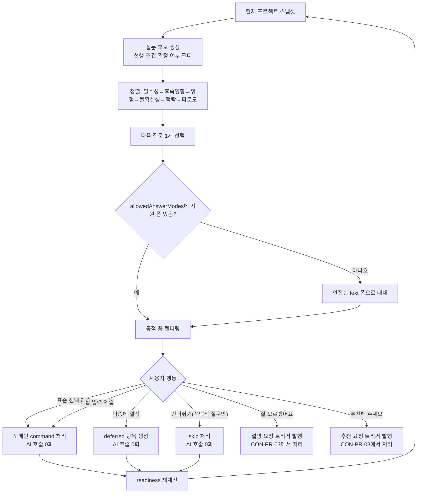

# CON-PR-02 — 질문·선택 폼

## Overview

12개 설계 영역의 질문 카탈로그와 선택 엔진, 7종 answer mode 동적 폼을 구현해 표준 선택·skip·defer가 AI 호출 없이 처리되고 조건에 맞는 질문만 이어지게 한다.

## Background

`CON-PR-01`이 turn 요청 수명주기를 완성한 뒤, 이 PR은 그 위에서 실제로 "무엇을 물어볼지"와 "어떻게 답을 받을지"를 구현한다. `docs/product/12-ai-orchestration-and-model-policy.md`의 결정론과 AI 경계 원칙(DEC-026)에 따라 질문 선택·표준 폼 처리는 코드가 담당하고 AI는 호출하지 않는다.

## Scope

### 포함

- CON-203 질문 카탈로그(12개 설계 영역, 선행 조건, 필수성, 허용 폼, 대상 item type)와 선택 엔진(정렬 규칙, 동점 처리)
- CON-204 7종 answer mode(`single`, `multiple`, `text`, `number`, `range`, `rank`, `confirm`) 폼과 공통 행동(직접 입력, 잘 모르겠어요, 추천해 주세요, 나중에 결정, 건너뛰기)
- AI-005 중 표준 선택/skip/defer 분기(AI 호출 없음 경로)

### 제외

- `잘 모르겠어요`→설명, `추천해 주세요`→추천 생성의 실제 AI 호출과 block 렌더링(`CON-PR-03`)
- turn 요청 자체의 인증/재시도/중복 방지(`CON-PR-01`에서 선행 완료)
- 제안 승인·설계 반영(`DSG-PR-01`~`03`)

## 연결 근거

- 요구사항: `CONV-001`, `FORM-001`~`FORM-004`
- Delivery 작업: `docs/delivery/02-conversation-and-forms.md` CON-203, CON-204
- AI 실행 계약: `docs/delivery/ai-model-prompt-and-evaluation.md` AI-005(표준 분기만)
- 결정: `DEC-006`, `DEC-026`
- 화면 설계: `docs/ui/02-conversation-and-forms.md` `UI-FORM-001`, 입력 유형별 구성 표; `docs/ui/screens/02-intake-and-discovery.md` D04~D09
- 선행 PR: `CON-PR-01`(turn 수명주기)

## 선행 조건 (Definition of Ready)

- `CON-PR-01` 기본 브랜치 병합 완료
- `AI-PR-01` 기본 브랜치 병합 완료; CON-PR-02는 AI-005의 호출 경계를 따르되 provider 호출을 구현하지 않는다.
- `FND-PR-01`에서 Blueprint 소유 semantic form controls와 `docs/template/` 시각 기준 확정 완료
- 질문 카탈로그 12개 영역의 콘텐츠(문구, 옵션)가 `FND-PR-01`/`02`에서 데이터로 확정됨
- 선행 PR의 merge 상태와 필요한 catalog/schema 산출물을 구현 착수 때 기본 브랜치에서 확인한다. 누락된 선행 산출물이 있으면 해당 항목을 특정해 `blocked`로 보고한다.

## 작업 단위별 구현 개요

### 질문 카탈로그와 선택 엔진 (CON-203)

- 12개 설계 영역별 후보 목록: `{ id, targetItemType, prerequisites, required, allowedAnswerModes }`
- 정렬 기준: 필수성 → 후속 영향 → 위험 → 불확실성 → 직전 맥락 → 피로도, 동점 시 문제/사용자/목표를 기능/기술보다 우선
- 이미 confirmed된 의미는 후보에서 제외, 로그인 불필요/데이터 불필요 시 관련 후속 질문 비활성화

### 동적 선택 폼 (CON-204)

- answer mode별 컴포넌트 매핑표 구현(`docs/ui/02-conversation-and-forms.md` 입력 유형별 구성 표 그대로 적용)
- 공통 행동: 직접 입력 병행, `잘 모르겠어요`(설명 요청 트리거만 발행, 실제 설명 렌더링은 `CON-PR-03`), `추천해 주세요`(추천 요청 트리거만 발행), `나중에 결정`(deferred 항목 생성), 선택적 질문의 `건너뛰기`
- 지원하지 않는 answer mode는 안전한 text 폼으로 대체(fallback이 아니라 명시적 안전 처리)

### 표준 분기 (AI-005 일부)

- 표준 선택/skip/defer 제출 시 AI 호출 없이 도메인 command로 직접 처리
- 제출 즉시 반영하지 않고 사용자가 별도 제출 행동을 완료해야 반영(선택만으로 자동 제출 금지)
- `잘 모르겠어요`/`추천해 주세요`는 PR-03이 처리할 명시적 요청으로 보존하고 전달한다. 이 PR에서 agent/API/provider를 호출하거나 설명·추천·proposal을 꾸며내지 않는다.

## 프로세스 / 상태 전이

## 데이터/API 영향

- 질문 카탈로그는 정적 데이터(코드/설정 파일)로 관리, 별도 API 없음
- 표준 선택/skip/defer는 기존 `POST /api/blueprint/turn`을 AI 분석 없이 도메인 command 경로로만 호출(요청 body에 `mode: "standard"` 등 구분 필드 추가는 구현 시 `FND-PR-02` schema와 조율)
- 새 도메인 상태: `DeferredAnswer`, `SkippedQuestion` 표시(설계 항목 자체는 생성하지 않고 질문 상태만 기록)

## Acceptance Criteria

### Happy Path

- Given 로그인 방식이 필요 없는 것으로 이미 확정된 상태, when 다음 질문을 계산하면, then 로그인 방식 질문이 후보에서 제외된다.
- Given 사용자가 `single` mode 질문에서 옵션을 선택하고 제출 버튼을 누르면, when 처리되면, then AI 호출 없이 도메인 command로 확정 답이 저장된다.
- Given `나중에 결정`을 선택하면, when 제출되면, then `deferred` 항목이 생성되고 다음 질문으로 진행 가능하다.

### Failure Case

- Given 클라이언트 catalog의 표시 전용 버전 불일치가 있는 상태, when 질문을 렌더링하면, then 답변을 자동 제출하지 않는 안전한 text control을 사용한다. Agent가 지원하지 않는 answerMode를 반환하면 질문 schema를 거부한다.
- Given 필수 항목을 선택하지 않은 상태, when 제출을 시도하면, then 제출이 차단되고 해당 필드에 오류가 연결된다.

### Boundary

- Given 이미 확정된 의미와 동일한 질문 후보가 남아있는 극단 케이스, when 후보를 재계산하면, then 해당 후보가 제외되어 반복 질문이 발생하지 않는다.
- Given 선택 옵션을 클릭만 하고 제출 버튼을 누르지 않은 상태, when 다른 화면으로 이동하면, then 자동 제출되지 않고 선택 상태만 유지된다.
- Given `잘 모르겠어요` 또는 `추천해 주세요`를 요청한 상태, when 해당 행동을 처리하면, then 의도가 보존되어 후속 PR로 전달되고 이 PR에서는 turn API/AI를 호출하지 않는다.
- Given 선행 질문 답이 바뀌어 종속 질문의 조건이 달라진 상태, when 후보를 다시 계산하면, then 종속 응답을 자동 삭제하지 않고 재검토가 필요한 상태로 둔다.

## 범위 경계

- 표준 답변·skip·defer 및 질문 상태는 현재 프로젝트 저장소 계약을 사용한다. 별도 backend/API 또는 AI provider 호출을 추가하지 않는다.
- 사용자 정의 답변/도움/추천의 실제 AI 처리와 block 표시, 그리고 refresh 뒤 미전송 composer draft 복구는 `CON-PR-03` 범위다. 이 PR은 후속 요청을 잃지 않는 데이터 경계까지만 제공한다.
- 제안 승인과 confirmed design 반영은 `DSG-PR-01`~`03`에서 처리한다. pending proposal이 있으면 다음 시스템 질문을 막는다.

## 예상 변경 파일

- `src/domain/blueprint/question-catalog.ts` (신규)
- `src/domain/blueprint/question-engine.ts` (신규 — `getCandidates`, `selectNext`, `evaluateReadiness`)
- `src/components/blueprint/question-card.tsx` (신규)
- `src/components/blueprint/answer-forms/*.tsx` (신규 — 7종 answer mode별 컴포넌트)
- `src/features/questions/submit-standard-answer.ts` (신규)
- `tests/unit/domain/question-engine.test.ts` (신규)
- `tests/component/answer-forms.test.tsx` (신규)

## 테스트 계획

- 질문 엔진 단위 테스트: 12개 영역의 catalog coverage, 후보 우선순위/동점, confirmed 의미 중복 방지, 조건부 로그인·저장 질문, pending proposal gate.
- 각 answer mode의 정상 입력과 관련 경계/오류만 단위 테스트: multiple min/max, text required/trim, number bounds, range 역전, rank 중복·누락, confirm 명시 선택, 미지원 Agent mode 거부 및 catalog 표시 버전 차이의 비제출 text 처리. 폼 입력은 키보드로 완료할 수 있어야 한다.
- 상호작용 테스트: 선택만으로 자동 제출되지 않음; 제출 후 값 저장; required 오류가 해당 입력과 연결됨; defer와 optional skip이 서로 다른 이력으로 남고 재검토 가능.
- 호출 경계 테스트: standard answer/skip/defer는 turn API 및 AI 호출 0회; unknown/recommend intent는 보존·전달되고 이 PR에서 호출 0회.
- UI에 대해서는 변경된 대표 폼 흐름 하나를 브라우저에서 검증하고, keyboard 제출 및 관련 viewport에서 입력/오류 가시성만 확인한다. 전체 viewport/state 매트릭스나 무관한 E2E는 실행하지 않는다.
- `git diff --check`; production/build 설정을 변경하면 `npm run build`도 실행한다.

## UI 증거 계획 (해당 시)

- `docs/template/README.md`의 매핑에 따라 `docs/template/image (16).png`와 `image (15).png`를 대화/질문 패널 참고 자료로 사용한다.
- 캡처는 선택 증거다. 필요할 때 변경된 대표 폼 상호작용만 기록하며 모든 mode·상태별 캡처를 merge gate로 요구하지 않는다.

## 코드 리뷰·QA 체크리스트

- 질문 카탈로그 데이터와 선택 엔진 로직이 분리돼 있는지(하드코딩된 순서 없는지)
- 표준 선택 제출 시 실제로 AI 호출이 발생하지 않는지 request ledger로 확인
- semantic form controls와 template reference 준수, 변경된 interaction의 keyboard/focus/오류 연결 및 영향받는 viewport만 확인
- QA는 구현자와 분리된 agent가 수행하고 직접 관련된 수용 기준 및 경계 테스트의 증거를 기록한다. 화면 캡처는 선택이다.

## Done Checklist

- [x] Requirements implemented
- [x] Acceptance criteria verified by focused unit and browser checks
- [x] 독립 코드 리뷰 pass
- [x] 독립 QA pass
- [x] 변경된 interaction과 직접 영향받는 접근성/반응형 동작 확인(캡처 선택)
- [ ] 사용자 PR 머지 확인

## 실행 결과 문서

- [test-results.md](./test-results.md): 구현자 자체 검증 결과
- [review-notes.md](./review-notes.md): 독립 코드 리뷰 결과와 수정 사항
- [qa-report.md](./qa-report.md): 독립 QA 결과와 검증한 소스 SHA
