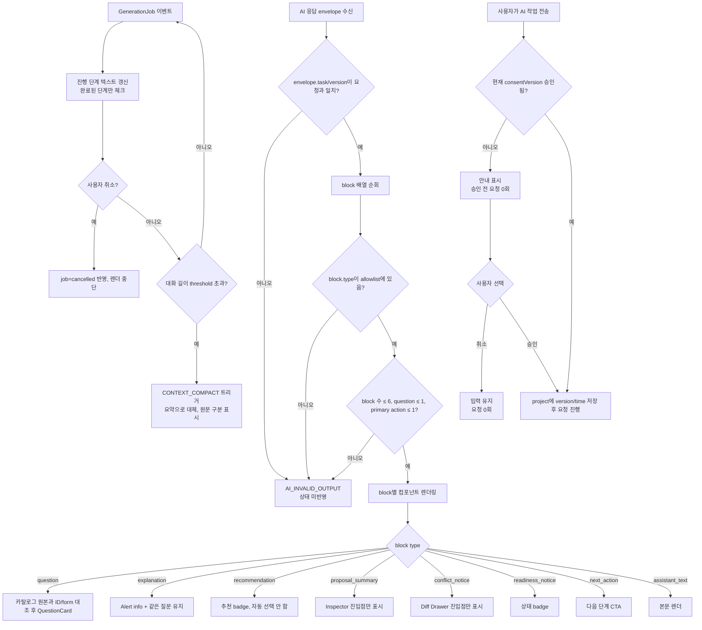

# CON-PR-03 — 메시지·AI block

**Status: in_progress.** Predecessors CON-PR-02 (#15, `4335ca1`) and AI-PR-01 (#13) are merged. This unit owns `CON-201` project-specific AI data-use consent because it introduces the UI that can initiate an actual AI request. Consent is checked before the first AI send and versioned in the local project aggregate.

## Overview

허용된 8종 `DisplayBlock`(assistant_text, question, explanation, recommendation, proposal_summary, conflict_notice, readiness_notice, next_action)의 allowlisted renderer와 `GenerationJob` 기반 진행 상태·취소·context compaction을 구현해, 자유 답변 하나에서 여러 block과 제안을 안전하게 표시한다.

## Background

`CON-PR-01`(수명주기)과 `CON-PR-02`(질문·폼)가 완성된 뒤, 이 PR은 AI가 실제로 반환하는 다형 응답(block + proposal)을 화면에 안전하게 조립하는 마지막 조각이다. 모델이 임의 HTML/component를 반환하지 못하게 하는 계약(`docs/product/13-prompt-and-response-contracts.md`)이 핵심이므로, 렌더러는 모델 출력의 `type` 필드를 그대로 신뢰하지 않고 allowlist로 검증한다.

## Scope

### 포함

- CON-201 project AI data-use consent: versioned disclosure, project-local acceptance timestamp/version, and no request when declined or stale
- CON-205 메시지 종류별 렌더링(사용자/Agent/질문/작업 상태/오류)과 오래된 대화의 구조화 요약 표시
- AI-004 8종 DisplayBlock schema 구현과 allowlisted renderer
- `GenerationJob` 기반 진행 상태 표시, 취소, `CONTEXT_COMPACT` 트리거

### 제외

- Turn API authentication, idempotency, circuit/retry lifecycle (`CON-PR-01`)
- 질문 카탈로그/선택 폼 자체(`CON-PR-02`에서 이미 완료)
- turn 요청 인증/재시도(`CON-PR-01`에서 이미 완료)
- 제안 승인·거절 UI(Inspector, Diff Drawer)는 `DSG-PR-01`~`03`에서 구현 — 이 PR은 `proposal_summary`, `conflict_notice` block이 그 화면으로 진입하는 지점까지만 담당

## 연결 근거

- 요구사항: `CONV-003`, `CONV-004`, `NFR-004`
- Delivery 작업: `docs/delivery/02-conversation-and-forms.md` CON-201, CON-205
- AI 실행 계약: `docs/delivery/ai-model-prompt-and-evaluation.md` AI-004
- 결정: `DEC-027`
- 화면 설계: `docs/ui/02-conversation-and-forms.md` `UI-CONV-002`, `UI-CONV-005`, 상황별 AI 응답 block 표; `docs/ui/screens/02-intake-and-discovery.md` I06, 도움·추천 block 변형
- 선행 PR: `CON-PR-02`(질문·선택 폼), `AI-PR-01`(prompt/schema registry)

## 선행 조건 (Definition of Ready)

- `CON-PR-02` 기본 브랜치 병합 완료(질문 트리거·표준 제출 경로 존재)
- `AI-PR-01` merged (#13); `DisplayBlock` JSON Schema is registered. Provider-backed live testing remains a later user-key gate.
- `FND-PR-01`에서 allowed block별 Blueprint-owned semantic renderer와 UI references가 확정됨
- `CON-PR-01` merged (#14): authenticated turn endpoint, idempotent attempt lifecycle, cancellation status, and transient replay behavior are available.
- No live provider call is required for acceptance or QA: use deterministic fixtures/fake provider for block, consent, progress, cancel, and compaction behavior. The production path uses the existing server-side AI router; preserve `DEFAULT=gpt-5-mini`. A configured key is needed only for optional live-provider verification, which is outside this PR's validation gate.

## 작업 단위별 구현 개요

### DisplayBlock allowlisted renderer (AI-004)

- 8종 block의 TypeScript discriminated union과 zod/JSON Schema 검증기 구현
- 알 수 없는 `type` 값은 렌더링하지 않고 `AI_INVALID_OUTPUT`으로 처리(텍스트로 추정 표시 금지)
- 한 응답 최대 6개 block, `question` block 최대 1개, primary action 최대 1개 제약을 렌더러 레벨에서도 재검증(서버 검증에만 의존하지 않음)
- `question` block은 카탈로그가 선택한 ID/form type을 변경하지 못하도록 클라이언트에서 원본 대조
- A question block whose ID, form mode, or stable option values conflict with the catalog is rejected as `AI_INVALID_OUTPUT`; never substitute model-owned identity or values.

### Project AI-use consent (CON-201)

- Before the project's first actual AI request, show the approved data-use disclosure describing data sent to the external AI provider, sensitive-data minimization, and cancel behavior.
- The disclosure must also state that temporary idempotency metadata and the minimum schema-validated response needed for exact retry replay may remain in the server's transient store for up to 24 hours. Raw request text/context and credentials are not retained there.
- The disclosure copy must accurately distinguish the external provider processing the sent context from the server's transient replay metadata, and recommend omitting sensitive information. Copy changes must not promise that data is never retained outside the specifically documented Blueprint transient record.
- Persist only `acceptedAt` and `consentVersion` in the project aggregate. Require acceptance for the current disclosure version before sending; a version change requires renewed acceptance.
- Declining/canceling preserves the draft and sends zero network requests. No consent is requested for catalog-only standard answer/skip/defer paths that make zero AI calls.

### 메시지·진행 상태 (CON-205)

- 사용자/Agent/질문/작업 상태/오류를 의미별 컴포넌트로 렌더링(Agent 메시지는 카드 없는 본문 흐름, 사용자 메시지는 우측 정렬 표면)
- `GenerationJob` 단계(예: "답변 분석 중 → 관련 사용자 후보 확인 → 기능 후보 정리 중")를 실제 완료된 단계만 체크 표시, 가짜 퍼센트 금지
- `CONTEXT_COMPACT` threshold 초과 시 오래된 메시지를 구조화 요약으로 대체하되 원문/요약을 시각적으로 구분
- 진행 중 작업의 취소 버튼과 `cancelled` 상태 반영(`CON-PR-01`의 job 상태 머신 소비)

## 프로세스 / 상태 전이

## 데이터/API 영향

- `AiResponseEnvelope.payload.blocks: DisplayBlock[]`를 클라이언트가 소비(서버 스키마는 `AI-PR-01`에서 정의, 이 PR은 클라이언트 검증·렌더링만 구현)
- 대화 메시지 저장 구조에 `summaryIds`/원문 구분 플래그 추가(IndexedDB 프로젝트 aggregate 내)
- 신규 API 없음 — 기존 `POST /api/blueprint/turn` 응답과 `GenerationJob` cancellation lifecycle을 소비
- Persist consent only in the owning project's local aggregate; do not add consent to browser auth/session storage, request logs, or server AI metadata.

## Acceptance Criteria

### Happy Path

- Given the project has not accepted the current AI disclosure, when the user starts its first AI request and accepts, then the project stores the disclosure version and acceptance timestamp before the request is sent.
- Given the consent disclosure is shown, when the user reads its data-handling details, then it clearly states the maximum 24-hour retention of replay metadata/validated result and that raw request/context and credentials are not stored in the transient request record.
- Given the project has accepted the current disclosure version, when the user sends another AI request, then no repeated consent prompt appears.
- Given persisting consent fails, when the user accepts, then no AI request is sent and the draft remains available.
- Given 자유 답변 하나에서 서버가 4개 block과 2개 proposal을 반환하면, when 렌더러가 처리하면, then 6개 이하 제약을 만족하는 모든 block이 올바른 컴포넌트로 표시된다.
- Given 작업이 정상 진행 중일 때, when GenerationJob 단계가 갱신되면, then 실제 완료된 단계만 체크 표시로 바뀐다.
- Given 대화가 threshold를 초과하면, when CONTEXT_COMPACT가 트리거되면, then 오래된 메시지가 요약으로 대체되고 원문/요약이 시각적으로 구분된다.

### Failure Case

- Given the user cancels the disclosure, when the dialog closes, then the draft remains unchanged and zero AI/network requests are sent.
- Given a previously accepted disclosure is superseded by a new version, when the user starts an AI request, then the updated disclosure is shown and no request is sent before acceptance.
- Given the turn API returns `AI_REQUEST_UNKNOWN`, when the user sees the error, then their draft/current question remain available, no success is claimed, and the recovery action requires checking current state before creating a new logical request ID. An expired 24-hour intent cannot be retried with its old ID.
- Given 서버가 allowlist 밖의 block type을 반환하면, when 렌더러가 처리하면, then 해당 block이 일반 텍스트로 추정 표시되지 않고 `AI_INVALID_OUTPUT`으로 처리되며 상태가 변경되지 않는다.
- Given 응답에 `question` block이 2개 이상 포함되면, when 렌더러가 검증하면, then 전체 응답이 거절 처리된다.
- Given 사용자가 진행 중 작업을 취소하면, when 취소가 반영되면, then job이 `cancelled`로 종료되고 부분 렌더링이 남지 않는다.

### Boundary

- Given 응답이 정확히 6개 block을 반환하면, when 렌더러가 검증하면, then 정상 렌더링된다(7개면 거절).
- Given `question` block의 ID, form type, or stable option value differs from the catalog selection, when the renderer validates it, then the response is rejected as `AI_INVALID_OUTPUT` and no question or project state is applied.
- Given a standard answer, skip, or defer path is catalog-only, when submitted, then consent is not shown and the AI request count remains zero.

## 예상 변경 파일

- `src/components/blueprint/display-blocks/*.tsx` (신규 — 8종 block별 컴포넌트)
- `src/features/conversation/block-renderer.ts` (신규 — allowlist 검증·조립)
- `src/features/conversation/generation-job-view.ts` (신규 — 진행 상태 텍스트 매핑)
- `src/features/conversation/context-compaction-view.ts` (신규)
- Focused unit/contract tests alongside existing `tests/contract/fnd-ai-schema.test.js`, `tests/contract/fnd-display-references.test.js`, and `tests/contract/turn-api.test.js` (extend only where this client behavior requires coverage)
- Focused component tests for consent gate, allowlisted block UI, job state/cancel, and compaction source display (file location to follow existing component test conventions)

## 테스트 계획

- Consent tests: first-send gate, acceptance persisted before send, persistence failure, current-version acceptance, changed-version re-consent, cancel preserves input and sends zero requests, catalog-only paths do not prompt.
- block schema fixture 기반 렌더링 테스트: 8종 각각 정상 렌더, 알 수 없는 type 거절
- 제약 테스트: 6개 초과 block, question 2개 이상, primary action 2개 이상 각각 거절
- GenerationJob 단계 텍스트 테스트: 완료 전/후 상태 반영, 가짜 퍼센트 없음 검증
- compaction tests: threshold crossing preserves confirmed/deferred/rejected facts and source message IDs and visibly separates summaries from originals (`docs/delivery/ai-model-prompt-and-evaluation.md` scenario 5)
- 취소 테스트: 취소 후 부분 렌더링 잔존 없음

## UI 증거 계획 (해당 시)

Screenshots are optional. Verify only the changed consent gate, block rendering, and cancel/progress behavior at relevant sizes; do not produce a fixed capture set. If browser behavior is needed, run only the focused CON-PR-03 Playwright spec in Chromium.

## 코드 리뷰·QA 체크리스트

- allowlist 검증이 서버 응답을 그대로 신뢰하지 않고 클라이언트에서도 재검증하는지
- block 수/question 수/primary action 수 제약이 실제 코드에 강제돼 있는지
- 진행률 텍스트가 실제 `GenerationJob` 이벤트에서만 파생되는지(하드코딩된 퍼센트 없는지)
- QA: fixture injects 7 blocks and mismatched catalog question; verify rejection with no state application. Exercise consent accept/cancel, cancel during a running job, and summary/original distinction. Check keyboard operation and mobile access only for changed controls.
- Run focused Node tests for changed modules (for example `node --test tests/contract/fnd-ai-schema.test.js tests/contract/fnd-display-references.test.js tests/contract/turn-api.test.js` plus new/affected unit tests); run the focused CON-PR-03 Playwright spec when UI/runtime behavior changes. Run `npm run build` because production code changes. Do not run the full suite without a direct affected-contract reason. Always run `git diff --check`.

## Done Checklist

- [x] Requirements implemented
- [x] Acceptance criteria verified
- [ ] 독립 코드 리뷰 pass
- [ ] 독립 QA pass
- [ ] Changed interaction QA pass; screenshots optional and only when they materially support a finding
- [ ] 사용자 PR 머지 확인

## 실행 시 추가 문서

- 이 폴더에 구현 중/후 `test-results.md`, `review-notes.md`, `qa-report.md` 등을 추가로 생성한다(지금은 생성하지 않음).
