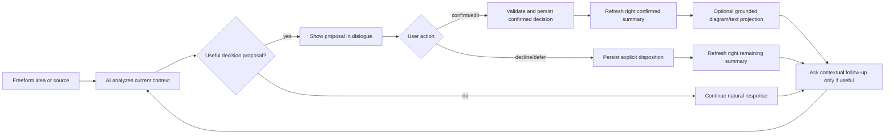

# CON-PR-04 — 대화형 설계·결정 요약 계약 재정립

**Status: ready for the documentation PR.** This planning artifact records the documentation unit and implementation design. The resolved recommendation-count contract is below. The follow-on implementation unit remains gated on this documentation PR being merged and its technical DoR being verified.

## Overview

대화 시안을 기준으로 제품·AI·프로세스·화면 문서를 한 계약으로 정리한다. 제품의 주 흐름은 자유 대화를 기본으로 하고, 필요할 때만 맥락형 선택 카드를 대화 안에 제시한다. 데스크톱은 왼쪽에 대화, 오른쪽에 `확정 내용`과 `남은 결정`을 보여주며, 각 결정은 출처 대화로 이동할 수 있어야 한다. 확정 데이터에서 파생한 요약과 선택적 도식 표현은 실제 결정 상태를 벗어나지 않아야 한다.

이 PR은 문서 계약과 실행 가능한 후속 구현 계획만 변경한다. 제품 코드·AI prompt/schema·데이터 구조·사용자 화면은 다음 implementation unit에서 바꾼다.

## Background and design review

- Latest base: `origin/main` at `005fcaeaa00898e89a74f14496d7fce08ae3598f`; PR #61 (conversation panel gutters) and PR #62 (development skill retirement) are merged.
- Primary reference: [`docs/blueprint-design/README.md`](../../blueprint-design/README.md), especially `회의실 예약 서비스 UI 캔버스.png` (freeform conversation, in-turn choice card, right summary with confirmed and remaining decisions) and `회의실 예약 서비스 설계 준비 대시보드.png` (five grouped, scanable domains).
- State fallback only: [`docs/template/README.md`](../../template/README.md). Template captures do not define the primary product flow.
- Existing UI redesign UIR-PR-03 implemented the conversation frame and Q cards, but preserves the older catalog-first interaction contract.
- The contract source of divergence predates the UI: `CON-PR-02` and `docs/process/03-question-and-answer-decisions.md` make deterministic catalog selection the source of the next question; `QUESTION_COMPOSE` may only phrase a preselected catalog question. `docs/ui/02-conversation-and-forms.md` further centers one `QuestionCard` as the primary interaction.
- The user confirmed this is the fixed-question design they rejected: current code and docs select fixed catalog questions/options before the AI phrases them. The target removes fixed recommendation/question content as the interaction source. A strict allowlisted renderer registry remains fixed by type; its per-turn content/options are generated from context and schema-validated.
- `docs/product/02-prd.md` says free input and structured questions both exist, but does not define conversational turn behavior, confirmed-vs-pending projection, or how a derived result is presented. The UI image alone cannot resolve those contracts.
- Document generation is an independent Requirements-ready → PRD pipeline (`docs/process/05-document-generation.md`). Keep that pipeline explicit and separate from in-conversation draft accumulation; the conversation summary must not falsely claim a generated document is ready.

### Current implementation evidence and risks for CON-PR-05

- [`AiTurnComposer.tsx`](../../../src/components/conversation/AiTurnComposer.tsx#L91) sends user freeform text as `answer.customText`, but always assigns `questionId: question?.id ?? free_${projectId}` in its payload (`:101-103`). Freeform turns are therefore represented as catalog answers instead of a distinct conversation turn.
- [`api/blueprint/turn.js`](../../../api/blueprint/turn.js#L16) routes only `TURN_ANALYZE`. `resultFromOutput` (`:128-135`) returns joined assistant block text and proposals/references, but not a generated follow-up question block or conversational turn structure.
- [`ProjectPage.tsx`](../../../src/pages/ProjectPage.tsx#L610) selects the next active prompt with `selectNextQuestion(aggregate)`; `:841-842` renders one active `QuestionCard` and then the composer. This makes the catalog the interaction driver even when the user types freely.
- [`ConversationSummary.tsx`](../../../src/components/conversation/ConversationSummary.tsx#L4) accepts a `thread.summary` prop and renders `summary.confirmedFacts`, `explicitUnknowns`, `unresolvedQuestions`, and rejected directions (`:6-9,18-21`). It does not project the current aggregate's confirmed design items, pending proposals, conflicts, or source links. The right panel can therefore be stale or disconnected from the live decision state.
- These are implementation risks for the subsequent `CON-PR-05`: model and API response contract, free-turn payload semantics, proposal source integrity, confirmed-state projection, right-panel update after persistence, and refresh/retry idempotency all need explicit end-to-end acceptance. Do not treat a visual summary list or a successful AI text response as a connected decision flow.

## Proposed PR unit

**Result:** one canonical, traceable specification that makes the approved conversational mock executable as a future product behavior and implementation sequence.

Canonical conversational behavior lives in `docs/product/04-conversation-process.md`; `docs/process/03-question-and-answer-decisions.md` is its executable state/schema companion.

**Requirements/delivery traceability:** existing `CONV-001`~`CONV-005`, `FORM-001`~`FORM-004`, `AI-004`/`AI-005`, `UIR-005`, `UIR-007`, `UIR-008`, and conversation delivery work `CON-201`~`CON-205`. Update their descriptions/ownership where needed rather than marking fixed-catalog behavior as the target. Add no new IDs until the accepted behavior is settled.

### Candidate file ownership for the documentation PR

The implementer owns only the documents below; exact edits are finalized during document scope review before implementation.

- Product contract: `docs/product/02-prd.md`, `docs/product/03-requirements.md`, `docs/product/04-conversation-process.md`, `docs/product/07-ui-design.md`, `docs/product/08-delivery-plan.md`, `docs/product/09-ui-reference-integration.md`.
- Process/AI contracts: `docs/process/README.md`, `docs/process/01-end-to-end-flow.md`, `docs/process/02-state-machine.md`, `docs/process/03-question-and-answer-decisions.md`, `docs/process/04-proposal-and-readiness.md`, `docs/process/05-document-generation.md`, `docs/process/07-process-test-spec.md`, `docs/product/12-ai-orchestration-and-model-policy.md`, `docs/product/13-prompt-and-response-contracts.md`, `docs/product/15-ai-prompt-template-spec.md`.
- UI contract, Korean user-facing document labels, and screen states: `docs/ui/00-visual-foundation.md`, `docs/ui/01-workspace-shell.md`, `docs/ui/02-conversation-and-forms.md`, `docs/ui/03-design-board-and-inspector.md`, `docs/ui/04-document-workspace.md`, `docs/ui/06-overlays-responsive-and-states.md`, `docs/ui/screen-state-matrix.md`, `docs/ui/screens/README.md`, `docs/ui/screens/01-home-and-start.md`, `docs/ui/screens/02-intake-and-discovery.md`, `docs/ui/screens/03-proposal-and-conflict.md`, `docs/ui/screens/04-design-and-readiness.md`, `docs/ui/screens/05-documents-and-guide.md`, `docs/ui/screens/06-generation-ready-and-errors.md`.
- Traceability/development order: `docs/delivery/02-conversation-and-forms.md`, `docs/delivery/ai-model-prompt-and-evaluation.md`, `docs/delivery/traceability.md`, `docs/delivery/development-pr-review-qa-workflow.md`, `docs/tasks/README.md`, and `docs/superpowers/plans/2026-10-22-blueprint-ui-overhaul.md`.
- Keep the approved image mapping in `docs/blueprint-design/README.md`; localize the user-facing document label there to `요구사항 명세`. Keep `docs/template/README.md` a fallback index.

### Out of scope

- Any React, API, domain, persistence, prompt, schema, model, or test-code change.
- Replacing the existing proposal approval transaction, readiness calculation, authentication, consent, AI budget, or document lifecycle.
- Building a general diagram editor, arbitrary canvas, wireframe generator, or template library.
- Removing the separate `요구사항 명세`/PRD artifacts or weakening document readiness gates. Product-facing Korean copy should say `요구사항 명세`; preserve established identifiers and technical/API terms.
- Treating a question/recommendation content catalog as the user's primary journey. The selection component type registry is fixed and allowlisted for safety; its question/options are generated from current context, not selected from a predefined content list.

## Target behavior to specify

1. User can describe the idea, correct it, add details, or attach supported source material through freeform turns at any point in the conversation.
2. Each AI turn uses the allowed project context to return a concise acknowledgement/analysis, zero or more evidence-linked decision proposals, and at most one contextually useful follow-up or choice card. The model can return only a strict-schema allowlisted component type plus bounded display data/options; no HTML, React, code, style, arbitrary component/action, or server IDs. Questions and options are generated from current context, not chosen from a fixed content catalog. A choice card is optional assistance inside the dialogue, not the controlling questionnaire.
3. AI may infer and propose. Only explicit user confirmation/edit/decline changes confirmed design. Standard deterministic validation, authorization, readiness, conflict, and document-ready decisions stay in code.
4. On desktop, the primary conversation remains left and the right panel groups actual aggregate data into `확정 내용` and `남은 결정`. Selecting a row reveals its current value/status, evidence/turn source, and a route back to edit or review. Proposal, confirmed, deferred, conflict, and rejected states remain distinct.
5. After a successful confirmation or edit, the right projection updates from the same persisted aggregate and revision. Failure, retry, refresh, or duplicate submission cannot create a phantom confirmed item or desynchronize the panels.
6. A scanable five-domain summary may group decisions using the design-readiness mock. Optional domain diagrams are projections of confirmed decisions only, with source links and an equivalent text/list view. Unconfirmed suggestions are visibly separate; unavailable or invalid diagram data falls back to text without inventing facts.
7. `요구사항 명세` and PRD generation remain explicit document actions with their existing readiness/version gates. A conversation turn may incrementally prepare source decisions, but it must not label a draft as a ready document.
8. On mobile, conversation remains first and the decision summary is available after it or through an accessible explicit toggle. Neither panel hides keyboard focus or the composer. Empty, loading, failure, retry, offline/persistence, conflict, stale, and completed states explain the next safe action.

## Status flow to include in the canonical contract

The process specification must distinguish AI-generated suggestions from persisted decisions and define how source IDs, revisions, proposal state, and retries are validated. The AI may formulate the next conversational response; it cannot confirm its own proposal, change readiness, bypass consent/budget, or mark a document ready.

## Acceptance criteria

### Contract coverage

- Product, AI, process, UI, and delivery documents describe the same primary behavior and link to one canonical source.
- All eight primary design image files and relevant states are mapped correctly; the conversation canvas and readiness mock are named as primary references. Template images are fallback states only.
- The old fixed catalog/question-first behavior is explicitly recorded as the current implementation and marked for replacement, not as the future acceptance target. The renderer's component type list stays fixed and allowlisted; all question, recommendation, and option content is per-turn context-derived and validated.
- The follow-on implementation plan cites and resolves the current code constraints recorded above: freeform composer payload, `TURN_ANALYZE` response, `selectNextQuestion`/single `QuestionCard`, and summary data source.
- User-facing copy uses `요구사항 명세`; existing `Requirements`, PRD, API, schema, and code identifiers are preserved where they are technical contracts.
- When the user explicitly asks for recommendations and context is sufficient, return exactly 11 candidates. Do not force 11 candidates on other conversational turns or pad insufficient contexts; ask a contextual follow-up first when evidence is insufficient.

### User journey / state linkage

- Plan includes an end-to-end sequence from freeform input through AI analysis, proposal confirmation, right-panel update, source navigation/edit, and optional document/diagram view.
- Every right-panel row has a specified aggregate source, status, source-turn link, and safe action. Its content updates only after persisted commands succeed.
- The five grouped domains are for scanability; their projection does not change existing readiness gates or replace the canonical ten source areas.
- A diagram is optional and derived only from confirmed data; the same result is available as readable text/list content with source references.

### Failure and boundary states

- Invalid AI output, no useful discovery, no confirmed data, provider timeout, request-unknown/retry, cancel, persistence failure, duplicate send, stale revision, conflicting edit, missing source, and unavailable diagram have explicit UI/process outcomes.
- User input and prior confirmed decisions survive retry/refresh and rejected responses; no silent fallback fabricates a proposal, decision, or diagram.
- No loading/progress status is shown as complete until the persisted state confirms it.

### Delivery readiness

- The documentation PR proposes a separate implementation unit with owned code/test surfaces, dependencies, explicit commands, browser fixtures, same-data screenshot requirements, and staged rollout/rollback.
- Cross-links and traceability tables identify the new unit and no longer direct developers to implement the catalog-first behavior as the primary flow.
- `npm run docs:check:mermaid`, Markdown link checks (repository script if available), and `git diff --check` pass. No browser screenshots are required for the documentation-only PR.

## Candidate implementation design for the next unit (not part of this PR)

**Proposed implementation unit:** `CON-PR-05 — 대화 주도 설계 발견과 결정 패널 동기화`.

- Use the existing authenticated/idempotent turn route, allowlisted response blocks, proposal transactions, aggregate persistence, generation jobs, and readiness/document guards as boundaries.
- Extend the turn response/renderer contract to support flexible conversational turns and optional in-turn choice cards without using `QUESTION_CATALOG` or predefined recommendation content as selection authority. Define strict schemas for the fixed allowlisted component-type registry, dynamic per-turn prompt/options/values, source evidence and server-assigned IDs. Selection creates a pending proposal; only user approval persists a confirmed decision. Model output never includes executable markup/code or arbitrary component/action data.
- Implement vertical end-to-end flow: send freeform turn → AI response/proposals → inspect/confirm/edit/decline → persist → right panel projection and source navigation → refresh/retry behavior. Do not ship an unconnected summary mock.
- Start diagrams as read-only domain projections from confirmed aggregate data, with source links and text fallback. Add new persisted schema only if the design review proves it necessary.
- Preserve consent, safe error codes, cancellation, idempotency, AI cost limits, history compaction, and document gates. Any provider call uses registered task/profile/schema and updated golden eval fixtures.
- Code ownership: `src/components/conversation/AiTurnComposer.tsx` and turn adapter for freeform request semantics; `api/blueprint/turn.js` and registered AI task/prompt/schema for response contract; shared domain validator/allowlisted selection renderer and `ProjectPage.tsx` for context-built cards; proposal command/aggregate projection and `ConversationSummary.tsx` for same-revision confirmed/remaining decision source. Keep authentication, persistence, idempotency, budget, readiness and document gates in their existing owners.
- Tests: turn contract/schema validation (valid types, unknown type/fields, option bounds, unique values, evidence refs, no HTML/code), no-catalog freeform flow, recommendation 11/insufficient-context behavior, proposal approval boundary, aggregate projection/source navigation, and API/e2e using deterministic fake provider. Cover persistence failure, stale revision, duplicate send, timeout/unknown, retry, cancel, refresh and no useful discovery. Playwright Chromium at 1440×900 and 390×844 must verify keyboard-only traversal, screen-reader names/live errors, focus return, composer with mobile virtual keyboard, left/right same-revision assertions and text fallback for diagrams. Capture empty, success, pending proposal, failure/retry and responsive final-HEAD states.
- AI schema/eval changes: version `TURN_ANALYZE` to accept a freeform `userTurn` without a catalog question ID and return assistant text, evidence-linked proposals, at most one optional context-derived follow-up, and allowlisted renderer data. Version `OPTION_RECOMMEND` for exactly 11 context-grounded candidates only on an explicit supported request; insufficient evidence produces a conversational follow-up. Add golden evals for dynamic values, supported renderer types, injection/markup rejection, no invented IDs/evidence, no padding, token-cap boundaries, approval separation, and preserved model/budget limits.
- Rollback: deploy the UI/API contract as one compatible release and keep the prior turn schema available for the rollback window. If the new flow fails, revert the UI/API change together, retain persisted messages/proposals/confirmed decisions, and never reinterpret pending proposals as confirmed. The repository has no feature switch today; add one only if implementation proves a staged rollout needs it.
- The implementation unit cannot start until this contract PR is merged and its DoR includes the resolved recommendation count and verified technical dependency map.

## Definition of Ready

**Resolved user decision — recommendation count:**

When the user explicitly asks for recommendations, return exactly 11 candidates if the current project context supports 11 distinct, grounded candidates. Do not force 11 on every turn, and do not pad an unclear or insufficient context with weak or invented candidates. If the context cannot support 11, ask a contextual follow-up before generating the recommendation set.

Decision status: **resolved from the user's explicit instruction, “11개 추천 안으로.”** This is an interaction-specific count, not a global response size or fixed question count.

Other DoR evidence:

- [x] PR #61 and PR #62 merged; rebased on the resulting latest `origin/main` SHA above.
- [x] Primary UI mock, template fallback, current conversation/process contracts, and development workflow inspected.
- [x] Candidate docs and code/test surfaces identified.
- [x] Recommendation count semantics confirmed: exactly 11 candidates for an explicit recommendation request when context is sufficient; ask a follow-up otherwise; never pad or apply the count to every turn.
- [x] Coordinator approves the exact docs-only diff scope; product/process/AI/UI contracts are reconciled before any code unit begins.

## Validation matrix for this documentation PR

| Check | Command | Pass condition |
| --- | --- | --- |
| Mermaid | `npm run docs:check:mermaid` | All diagrams render, exit 0 |
| Markdown links | repository link-check command, identified during implementation | No new broken local links |
| Whitespace | `git diff --check` | Exit 0 |
| Independent review | reviewer on exact base/head diff | No blocking contract/traceability inconsistency |
| Independent QA | separate QA reviewer compares documents to primary screenshots and listed acceptance | Same user flow and states are traceable across canonical docs; no implementation screenshots for docs-only PR |

## Risks and rollback

- Main risk: editing one document while leaving another source of truth contradictory. The PR must update linked contracts and traceability together, or explicitly delegate future code changes to the next unit.
- AI risk: free conversation must not weaken deterministic approval, readiness, consent, schema, or budget boundaries.
- Scope risk: diagram visualization can grow into a general editor. Limit this to read-only projections of confirmed data in the implementation design.
- Rollback: revert this documentation-only PR; no product state or schema changes are included.
