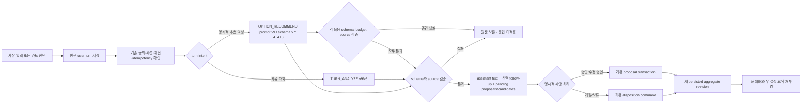

# CON-PR-05 — 대화 주도 발견과 결정 요약 연결

**Status: in_progress —** the conversation/recommendation reliability follow-up merged as PR #94 (`2135816d3a8881ee9f763e1e28c4a114c0d4e62f`) and is deployed to Production. Free turns use `TURN_ANALYZE` v9/schema v6; explicit recommendations use `OPTION_RECOMMEND` prompt v9/schema v7 in sequential 4/4/3 batches. Provider dispatches are budget-checked and recorded under the stable generation job; retry fingerprints ignore accounting changes, and aborted responses reconcile to owner-scoped server state. PR #97's current protected Preview HEAD and deterministic evidence are listed in [`test-results.md`](test-results.md). On the latest protected Preview after the user refreshed the Preview OpenAI key, authentication, a free turn, and the contextual recommendation follow-up returned 200; answering the follow-up still returned `AI_INVALID_OUTPUT` because the provider cited an assistant message as evidence. Current source updates both `TURN_ANALYZE` prompt v9 and `OPTION_RECOMMEND` prompt v9/schema v7 with the actual typed-context evidence IDs, recommendation type allowlist, batch count, and bounded retry corrections; if a conversation proposal still fails evidence or proposal-local domain validation after retry, the server drops only that proposal and preserves the valid conversational response. Local unit/contract, golden, build, and deterministic desktop/mobile browser checks pass; exact-HEAD Preview validation of this source, 11 live candidates, proposal approval, and Requirements-ready/download → same-revision PRD remain acceptance gates. Under UIR-PR-03A, full-canvas pixel similarity is diagnostic only; exact-HEAD anchor geometry follows [`docs/ui/07-visual-acceptance.md`](../../ui/07-visual-acceptance.md). Earlier checks are historical unless listed in the current verification section below. 선행 계약 PR #63은 `main`의 `df54aafa654142f11348321754c749588a2fbf9a`에 병합됐다. 본 계획은 사용자 대화 한 건이 AI 응답·맥락형 입력·pending 제안·명시적 승인·오른쪽 결정 요약까지 같은 저장 aggregate로 이어지는 vertical slice를 정의한다.

## 사용자 결과

사용자는 고정 질문 순서를 따라가지 않고 언제든 자유롭게 아이디어를 입력한다. Agent는 현재 대화·확정 설계·허용된 자료에 근거해 자연스럽게 응답하고, 유용할 때만 질문 또는 선택 카드를 대화 안에 제시한다. 선택이나 추천은 그 자체로 확정되지 않는다. 사용자가 기존 제안 검토 흐름에서 명시적으로 승인한 뒤에만 설계에 반영되며, 오른쪽 `확정 내용`과 `남은 결정`은 저장된 같은 aggregate에서 갱신된다.

## 근거와 추적성

- 선행 계약: [CON-PR-04](../CON-PR-04/plan.md), merged PR [#63](https://github.com/donghyunlee-dev/ai-agent-blueprint/pull/63), base `df54aafa654142f11348321754c749588a2fbf9a`.
- 요구사항: `CONV-001`~`CONV-003`, `FORM-001`~`FORM-004`, `AI-004`~`AI-005`, `PROP-001`~`PROP-003`, `UIR-005`, `NFR-004`, `NFR-006`.
- Delivery 작업: `CON-202`~`CON-205` 및 CON-PR-04가 연결한 turn lifecycle, renderer, 선택 입력, message, proposal/summary 경로.
- 정본 계약: [대화·결정 프로세스](../../product/04-conversation-process.md), [turn/API contract](../../process/03-question-and-answer-decisions.md), [proposal/readiness](../../process/04-proposal-and-readiness.md), [AI schema](../../product/13-prompt-and-response-contracts.md), [prompt template](../../product/15-ai-prompt-template-spec.md), [대화 UI](../../ui/02-conversation-and-forms.md), [첫 대화 화면 상태](../../ui/screens/02-intake-and-discovery.md).
- 주 시안: [Blueprint 화면 매핑](../../blueprint-design/README.md)의 `회의실 예약 서비스 UI 캔버스.png`. 이 화면은 왼쪽 대화와 입력창, 대화 안의 맥락형 선택 카드, 오른쪽 `확정 내용`/`남은 결정` 구성을 보여준다. 설계 준비 대시보드의 5개 묶음은 요약의 scanability 참고다. 새 시안에 없는 loading/error/empty state는 [template 인덱스](../../template/README.md)에서만 보완한다.
- 제품 용어: 사용자 화면에는 `요구사항 명세`를 사용한다. 기존 API, schema, type, function identifier는 변경하지 않는다.

## 구현 범위

### 포함

1. 카탈로그 ID 없이 자유 대화 turn을 전송·보존하고, 현재 context를 분석하도록 `TURN_ANALYZE` request/response, versioned prompt/schema와 도메인 validation을 연결한다.
2. allowlisted selection renderer를 유지하면서 질문 문구와 선택값은 매 turn context에서 생성한다. follow-up은 0~1개이며, 카드 제출은 새 user turn이다. `QUESTION_CATALOG`는 대화 진행 순서나 추천 콘텐츠의 선택 source가 되지 않는다.
3. provider의 proposal/evidence 참조를 검증한 뒤 application에서 안정 ID와 source link를 부여한다. 응답을 저장해도 제안은 모두 pending이며, 기존 proposal approve/edit/reject command만 확정 상태를 변경한다.
4. 추천은 사용자가 명시적으로 요청한 경우만 실행한다. 충분한 context에서는 서로 다른 근거 있는 후보를 정확히 11개 반환하며, 각 후보는 선택 전까지 미선택 상태다. 11개를 뒷받침할 근거가 부족하면 후보 목록을 채우지 않고 필요한 내용을 묻는다. 사용자가 고른 후보도 pending 제안 이후 기존 승인을 거친다.
5. 오른쪽 패널을 `thread.summary` 대신 현재 persisted aggregate revision의 confirmed item, pending/deferred/review/conflict 상태와 source reference에서 계산한다. 항목은 원본 message/proposal 위치로 이동하고 안전한 검토·편집 행동을 제공한다. 저장 실패 시 기존 revision을 표시한다.
6. 데스크톱 좌/우 구조와 모바일 대화 우선 순서를 지키고, keyboard 및 focus 이동을 제공한다. 선택 가능한 read-only 요약 도식은 확정 데이터에서만 파생한다. 관계를 뒷받침할 수 없으면 동일 사실을 source link가 있는 텍스트 목록으로 제공한다.
7. 승인된 대화 설계와 기존 readiness 계산을 이어 요구사항 명세를 생성하고, 그 문서가 현재 revision에서 ready가 된 후에만 PRD 생성으로 이동하는 기존 경로를 사용자 흐름에서 끝까지 연결·검증한다. PRD는 기존 plan/draft/review/선택적 repair 검증을 마친 `review_required` 문서로 제공한다. 기존 consent, server session, idempotency, 취소/unknown 복구, context compaction, AI budget과 generation contract를 보존한다.

### 제외

- 요구사항 명세 또는 PRD의 plan/draft/review/repair 알고리즘·schema 변경. 기존 생성 API와 ready gate는 수정하지 않고, 대화에서 승인된 설계가 해당 gate를 통해 두 문서 완료까지 도달하는 end-to-end 연결은 이 범위에 포함한다.
- Google OAuth 구현, 로그인 UI, Google 로그인 브라우저 테스트.
- 새 질문·추천 내용 catalog, 임의 UI/HTML/code/action 실행, 무제한 diagram editor, 새 persistence store 또는 추측한 추천/결정 데이터.
- model, profile, output-token limit, AI 비용 상한 증대.

## 기술 연결 지도 및 소유 파일

다음 표는 구현 전 baseline과 CON-PR-05의 변경 책임을 기록한다. 현재 versioned AI contract는 [prompt/response contract](../../product/13-prompt-and-response-contracts.md)와 [prompt template](../../product/15-ai-prompt-template-spec.md)에 기록한다. 구현자는 기존 module 경계를 유지하고 shared file 변경이 필요하면 PR 내에서 소유자를 하나로 정한다.

| 경계 | 현재 연결 | CON-PR-05 대상 |
| --- | --- | --- |
| 화면과 입력 | `src/pages/ProjectPage.tsx`는 `selectNextQuestion()`와 단일 `QuestionCard`를 진행 driver로 사용한다. `src/components/conversation/AiTurnComposer.tsx`는 자유 문장을 `answer.customText` 및 `questionId`로 구성한다. | `ProjectPage.tsx`, `AiTurnComposer.tsx`, `QuestionCard.tsx`, `ConversationWorkspace.tsx`; free turn와 response card를 같은 conversation에 렌더하고 catalog-driven next step을 제거한다. |
| AI route/schema | `api/blueprint/turn.js` dispatches ordinary free turns to `TURN_ANALYZE` v9/v6 and explicit recommendation requests to `OPTION_RECOMMEND` prompt v9/schema v7. | Validate bounded compact schemas, grounding, exactly 11 distinct candidates from 4/4/3 calls when context is sufficient, empty candidates plus a contextual follow-up otherwise, and server-generated pending proposal drafts. Preflight and record each provider dispatch against the project ledger. Normalize compact turn snapshots and recommendation fields to the existing UI contract. Prior conversation and recommendation schemas remain registered for compatibility. |
| 문서 AI 입력 | `api/blueprint/documents/generate.js` already passes task-specific plan/draft/sections/issues to PRD tasks. | Requirements draft receives the plan; review and re-review receive the plan plus the current draft; the one allowed repair receives the plan, affected sections, and review issues with repair instructions. Keep schemas, profiles, budgets, and repair count unchanged. |
| 렌더/폼 | `src/features/conversation/block-renderer.js`, `QuestionCard.tsx`, 기존 form component는 catalog QuestionSpec 기반이다. | 고정 renderer type registry에 context-generated prompt/option payload를 strict validate 후 넘긴다. unknown field/type, executable data, 중복 value 및 range violation은 fail closed한다. |
| 상태 저장/제안 | `src/features/conversation/conversationService.ts`, `src/features/proposals/proposal-commands.js`, `src/features/conversation/useConversationalBlueprint.ts`가 대화와 제안의 저장/transaction 경계다. | 자유 입력과 선택 응답을 같은 thread의 메시지 및 `logicalRequestId`에 연결한다. 승인 transaction 이후에만 새 aggregate revision을 내보내고 retry/duplicate를 재사용한다. |
| 요약/출처 | `src/components/conversation/ConversationSummary.tsx`는 `thread.summary`의 오래된 facts/unknown 목록을 직접 그린다. | `ProjectPage.tsx`에서 현재 aggregate를 project하고 `ConversationSummary.tsx`는 confirmed/remaining view, state 및 source navigation만 표시한다. summary는 persistence 성공 뒤 재계산한다. |
| 기존 테스트 | `tests/unit/conversation-question-engine.test.js`, `tests/contract/turn-api.test.js`, `tests/e2e/con-pr-02-question-form.spec.ts`, `tests/e2e/con-pr-03-conversation.spec.ts`, `tests/eval/golden/core.fixture.json`가 기존 계약을 확인한다. | catalog-first acceptance를 목표 계약으로 유지하지 않고 신규 unit/contract/eval/browser coverage로 대체·보강한다. 기존 질문 form이 다른 경로에서 쓰인다면 무관한 회귀는 보존한다. |

추가 저장 schema는 실제 source turn/proposal link를 기존 message/proposal/aggregate로 표현할 수 없다는 기술 증거가 있을 때만 제안한다. 승인 권한, readiness, 동의와 문서 상태는 AI 응답 값에서 가져오지 않는다.

## 상태 흐름

선택 제출은 대화 input일 뿐이며 설계를 확정하지 않는다. Provider timeout, 응답 schema 오류 또는 저장 실패에서 `K`는 수행되지 않는다.

## Acceptance criteria

### 대화와 응답

- 사용자가 빈 프로젝트와 진행 중인 대화 모두에서 자유 입력을 제출할 수 있고, 일반 turn에는 catalog `questionId`가 필요하지 않다.
- 사용자 원문은 한 번만 저장/표시되며, `recentMessages`에는 현재 입력을 중복해 전달하지 않는다.
- AI 응답은 0~여러 원자 proposals, assistant text, 선택적 contextual follow-up 최대 1개를 strict versioned schema로 반환한다. follow-up 없이 응답할 수 있다.
- follow-up content/options는 현재 context를 바탕으로 생성한다. renderer type만 allowlist에서 고른다. UI는 free text를 계속 허용하고 한 turn에서 카드 선택 또는 자유 대화를 모두 수행할 수 있다.
- explicit 추천 요청에서 충분한 근거가 있을 때만 정확히 11개의 서로 다른 candidate를 반환하고, 부족하면 candidates 없이 follow-up을 묻는다. 임의로 항목을 채우거나 모든 turn에 11개를 띄우지 않는다.
- API/provider request는 기존 registered model profile과 token budget을 사용하며, prompt/schema version과 generation job에 동일하게 기록된다.

### 제안과 summary consistency

- proposal/evidence target/source ID는 전달된 manifest/context 범위에 포함돼야 한다. invalid ID, unknown component, extra field, HTML/JS/code payload, duplicate option value 또는 bounds 위반은 전체 AI 응답을 적용하지 않는다.
- turn 성공은 proposal을 pending으로 만들 뿐이다. 카드 표시, candidate 선택, 응답 자체로 confirmed design/readiness/문서 상태가 바뀌지 않는다.
- 사용자가 승인/수정 승인/거절/보류할 때 기존 command의 revision/before-value/state 검증을 거치며, 승인 저장 성공 뒤에만 같은 persisted revision의 summary가 업데이트된다.
- 오른쪽 각 confirmed row는 current confirmed design item과 source turn/reference로 역추적할 수 있다. remaining row는 pending/deferred/review/conflict 상태 및 필요한 다음 행동으로 연결한다. stale `thread.summary`가 현재 aggregate보다 우선하지 않는다.
- source navigation은 올바른 thread message 또는 proposal로 이동하고 키보드 focus를 새 위치에 안내한다. source가 없거나 보관됐으면 broken route를 만들지 않고 안전한 설명을 제공한다.
- 새로고침 후 저장된 thread, pending proposal, revision, summary와 source 이동이 보존된다. 저장되지 않은 AI 결과는 성공처럼 표시하지 않는다.

### 오류·경계·보안

| 시나리오 | 기대 결과 |
| --- | --- |
| malformed output / unknown component / invalid evidence | user input 보존, AI 응답 미적용, 안전한 재시도 안내, aggregate/summary 불변 |
| provider timeout 또는 unknown request | 기존 lifecycle/중복 방지에 따른 회복 행동, user input 중복 없음 |
| 같은 logical turn 재요청 | 메시지·proposal 중복 생성 금지 |
| 저장 실패 | 기존 confirmed revision 유지, 입력/제안 재시도 가능, 우측 summary unchanged |
| proposal stale/conflict | 기존 confirmed 값 덮어쓰기 금지, 충돌 해결 경로 제공 |
| insufficient recommendation context | 후보를 만들지 않고 맥락형 확인 질문 제공 |
| 거절/보류 | confirmed projection에 넣지 않고 기존 disposition state를 오른쪽 `남은 결정`에 반영 |
| 모바일/좁은 viewport 및 keyboard | composer와 focus가 가려지지 않고 요약은 대화 뒤/명시적 accessible control로 접근 가능 |

### Requirements spec / PRD boundary

- 대화에서 확정된 설계 변경은 기존 aggregate/revision으로 저장되며 기존 요구사항 명세 준비도 및 PRD 생성 gate를 보존한다.
- 대화/선택/추천 응답은 요구사항 명세나 PRD가 `ready`라고 표시하거나 생성 API를 자동 실행할 수 없다.
- 대화 입력만으로는 문서가 생성되거나 `ready`가 되지 않는다. 충분한 정보를 사용자가 승인해 기존 readiness gate를 통과하면 `요구사항 명세` 생성이 가능해지고, 해당 문서가 현재 설계 revision에서 사용자 확인으로 ready가 된 뒤 PRD 생성으로 이동한다.
- REQUIREMENTS_REVIEW provider input contains the generated draft, REQUIREMENTS_REPAIR contains only selected affected sections and their repair instructions, and the follow-up review contains the repaired draft. The existing single-repair limit and user-review boundary remain unchanged.
- deterministic provider/browser fixtures로 자유 입력 → 승인된 설계 → 준비도 충족 → 요구사항 명세 draft/review/ready → 동일 revision의 PRD draft/review 완료(`review_required`) 흐름을 검증한다. 변경하지 않는 generation API의 기존 contract tests도 회귀 확인한다.

## Validation matrix

| 층위 | 실행/검증 | 합격 조건 |
| --- | --- | --- |
| Unit | `node --test tests/unit/conversation-question-engine.test.js tests/unit/con-pr-05-*.test.js tests/unit/turn-lifecycle.test.js tests/unit/dsg-pr-01-proposals.test.js tests/unit/dsg-pr-03-readiness.test.js tests/unit/doc-pr-02-requirements-ready.test.js` | dynamic turn normalization, schema/domain bounds, source projection, explicit approval, readiness gate, retry/stale behavior 통과. 실제 추가된 test path에 맞춰 glob 사용. |
| Contract | `node --test tests/contract/turn-api.test.js tests/contract/con-pr-05-*.test.js tests/contract/doc-pr-01-requirements-api.test.js tests/contract/doc-pr-02-prd-api.test.js tests/contract/doc-pr-02-ready-api.test.js` | current request/response, 11-candidate/insufficient-context, invalid output/reference, no-approval invariants와 두 문서의 기존 gate 통과. |
| Golden eval | `npm run test:golden` | dynamic follow-up, allowed component, grounded candidates, no padding/ID invention, injection/markup rejection, token cap boundary fixture 통과; profile/budget unchanged. |
| Browser | `npm run build && npx playwright test tests/e2e/con-pr-05-conversation-flow.spec.ts tests/e2e/doc-pr-01-requirements-generation.spec.ts tests/e2e/doc-pr-02-prd-readiness.spec.ts --project=desktop-chromium --project=mobile-chromium` | deterministic AI/API fixtures; E2E test session, no Google OAuth flow. Free turn → contextual card/recommendation → pending proposal → explicit approval → same-revision summary/source jump → refresh → readiness-gated requirements generation → requirements ready → same-revision PRD generation and reviewable draft. Error, duplicate and keyboard/mobile states included. |
| Visual | same route/data/state at 1440×900 and 390×844; PR artifacts final HEAD | mapped canvas comparison and affected empty/success/pending/error states captured. Anchor/layout gaps recorded; no screenshot substituted for interaction QA. |
| Integration | `npm run build` | TypeScript/Vite production build pass. |
| Diff | `git diff --check` | no whitespace errors or unrelated changes. |

The deterministic browser tests mock the authenticated test session and AI/document APIs. For opt-in real-provider acceptance, `POST /api/auth/session` can mint the fixed synthetic owner only when `VERCEL_ENV=preview`, a branch-scoped `PREVIEW_E2E_SESSION_TOKEN` exists, and that token is sent in `x-preview-e2e-session-token`; without that header the endpoint keeps its normal logout behavior. Production always keeps normal logout behavior. Keep that Preview branch's `APP_SESSION_SECRET` distinct from Production. Use protected-preview access without disabling deployment protection, and do not claim live-provider success from fixture tests.

## UI evidence requirements

- Desktop: `1440×900`, active conversation, left thread/composer, right confirmed/remaining summary.
- Mobile: `390×844`, conversation first, contextual card, composer, explicit summary access, virtual-keyboard/focus behavior.
- Required states: empty/no confirmed decisions; successful contextual follow-up; pending proposal before approval; after approval at the same aggregate revision; malformed/failed response and retry; refresh recovery; 11 grounded recommendation candidates and insufficient-context response.
- Reference image: `docs/blueprint-design/회의실 예약 서비스 UI 캔버스.png`. Compare source and output at matching CSS viewport/state. Record viewport, route, state, HEAD, artifact, and major anchor position/size deltas as required by [visual acceptance](../../ui/07-visual-acceptance.md). Use template captures only to fill a state absent from the redesign.

## Rollback

The route, schema/prompt registry, client renderer, persistence projection and related tests ship as one compatible PR. Keep prior schema versions readable for already queued jobs. If the new response cannot be rendered or verified, revert this PR's code together, leave stored messages/proposals/confirmed items intact, and never convert pending proposals into confirmed data. Do not add a feature flag or migration unless implementation evidence requires one.

## Done checklist

- [x] User freeform path is independent of `QUESTION_CATALOG`; dynamic component payload is schema/domain validated.
- [x] Explicit 11 recommendation path and insufficient-context follow-up pass current contract, golden, and deterministic desktop/mobile browser checks without increasing token caps.
- [ ] Live provider recommendation and document flow pass on the protected Preview without increasing token caps.
- [x] Pending/confirmed boundary, same-revision summary, source navigation and refresh/retry contracts pass.
- [x] Existing consent, idempotency, cancellation, budget, auth and document readiness gates remain intact.
- [x] Unit/contract (431), synthetic golden (57/57), and CI browser (314 passed, 5 skipped) checks pass on PR #97 HEAD `87d82baa22adee44a54f64c9a98372e267624f21`; build, bundle-secret scan, and production dependency audit pass. The existing >500 kB bundle warning remains.
- [x] On PR #97 deployed HEAD `6bc4c72453080a5985ba4a05b06366bee20b2455`, GitHub CI passed 434 unit/contract tests, 57/57 synthetic golden fixtures, and 315 browser tests with 5 skipped; build, bundle-secret scan, and `npm audit --omit=dev` (0 vulnerabilities) passed.
- [x] Exact-HEAD canvas comparison at `87d82baa22adee44a54f64c9a98372e267624f21` reports 94.0158% (1,479,200 / 1,573,352 matching pixels) at the 24-channel diagnostic threshold. Under UIR-PR-03A this score is diagnostic only; the test's measured anchor geometry passes the position and size tolerances in `docs/ui/07-visual-acceptance.md`. The report and screenshots are in `.pr-artifacts/UIR-PR-03/`.
- [ ] Live-provider 11-candidate recommendation and Requirements-ready/download → same-revision PRD remain unverified because the Preview provider returned `invalid_api_key` (HTTP 401).
- [ ] PR #94 protected Preview fixture QA and configured checks passed on HEAD `136ab30104d3717fb89dc4cfcf6c9dfa90a86f6a`, but it has no exact-head independent review record. A post-merge independent review found file evidence was lost during aborted-body recovery; PR #96 fixed and independently reviewed that path, with its focused protected Preview regression passing desktop and mobile (2/2). This follow-up does not retroactively establish a review of PR #94's exact head.
- [x] PR #94 merged to `main` as `2135816d3a8881ee9f763e1e28c4a114c0d4e62f`; live-provider acceptance remains open.
- [x] PR #96 recovery fix merged to `main` as `01eb994c76a52c6dd7ed102f14e9836ee61c99a1`; required CI passed (299 passed, 5 skipped), and the exact PR Preview regression passed on desktop and mobile (2/2) using deterministic fixtures.
