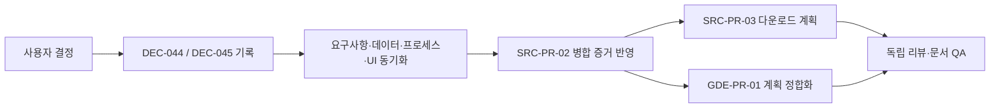

# DEC-PR-01 — 자료 수정·설정 가이드 완료 정책

**Status: ready.** Planning base: `origin/main` at `5a326055acc91b76ce33f3d5345579d5bffff3b0` (SRC-PR-02 merged as PR #26). This documentation-only PR records two user-approved policies and reconciles the merged SRC-PR-02 tracking records before GDE-PR-01 begins.

## Background

The source/guide delivery contract still listed two unresolved gates after the user selected policies. SRC-PR-02 had also merged as PR #26 while the task index and traceability still showed it in progress. These stale statements could lead to editing source data in-app, treating a draft guide as project completion, or using an inaccurate roadmap.

## 사용자 결과

사용자는 추출 결과를 앱 안에서 편집하지 않고 내려받아 외부에서 수정할 수 있다. 프로젝트는 설정 가이드가 사용자 승인 상태(`ready`)가 된 뒤에만 완료할 수 있다.

## 결정

- `DEC-044`: 추출 결과는 앱에서 읽기 전용이며 다운로드해 외부에서 수정할 수 있다. 다운로드 자체는 source와 근거를 변경하지 않는다.
- `DEC-045`: 프로젝트의 `completed` 전이는 설정 가이드가 존재하고 사용자가 승인해 `ready` 상태일 때만 허용된다. draft, review-required, stale 상태는 완료 조건을 충족하지 않는다.

## 범위

### 포함

- 결정 로그와 source/guide delivery 계약 반영
- 관련 요구사항, 데이터·프로세스·UI 계약 및 GDE-PR-01 계획과 수용 기준 정합화
- SRC-PR-02를 PR #26 병합 commit `5a326055acc91b76ce33f3d5345579d5bffff3b0` 기준으로 workflow·traceability·task index에 기록
- 신규 문서 PR unit `DEC-PR-01`을 task index와 delivery workflow에 등록

### 제외

- 설정 가이드 생성 API, AI task/prompt/schema, 모델 호출, UI 구현
- 추출 결과 다운로드 기능 구현
- SRC-PR-02 이후 GDE-PR-01 외의 미관련 문서 정리

## 연결 근거와 선행 조건

- 요구사항: `SRC-001`, `SRC-002`, `DOC-007`
- Delivery: `SRC-502`, `SRC-503`, `GDE-504`
- 기존 결정: `DEC-041`; 신규 결정: `DEC-044`, `DEC-045`
- 선행 PR: SRC-PR-02 merged (#26)
- Definition of Ready: 두 정책이 사용자가 직접 선택했으며, 대상 계약 문서와 병합 증거가 확인됨.

## 수용 기준

### 정상 경로

Given 추출이 끝난 자료가 있을 때, when 사용자가 결과를 확인하면, then 앱 내 미리보기는 읽기 전용이며 결과를 내려받아 외부에서 수정할 수 있다. 프로젝트는 현재 설계 revision의 설정 가이드를 사용자가 승인해 `ready`로 만든 뒤 완료할 수 있다.

### 실패 경로

Given 설정 가이드가 없거나 `draft`, `review_required`, stale 또는 conflict 상태일 때, when 프로젝트 완료를 요청하면, then 전환을 거부하고 가이드 생성·검토·최신 revision 갱신 중 필요한 행동을 안내한다.

### 경계 조건

Given 추출 결과 다운로드가 수행될 때, when 자료·근거 상태를 확인하면, then 다운로드는 기존 source, hash, evidence와 설계 항목을 변경하지 않는다. 외부에서 수정한 결과의 후속 사용 방법은 이번 결정에서 정의하지 않는다.

### 문서 정합성 및 추적

- 결정 로그, 요구사항, 데이터·프로세스·UI, delivery 및 GDE task plan의 정책이 일치한다.
- SRC-PR-02는 #26/merge SHA `5a326055acc91b76ce33f3d5345579d5bffff3b0`를 근거로 merged/done 처리된다.
- `SETUP_GUIDE_DRAFT` task/prompt/schema/eval 등록은 별도 차단 작업이 아니라 GDE-PR-01의 구현 범위로 기록한다.

## 작업 단위

1. `DEC-044`/`DEC-045`를 decision log와 연결 문서에 기록한다.
2. `SRC-PR-02` 병합 상태를 workflow, traceability와 task index에 연결한다.
3. 추출 결과 다운로드를 `SRC-PR-03`으로 계획하고 GDE-PR-01의 구현 범위를 정합화한다.

## 프로세스

## 데이터/API 영향

- 코드, 저장 schema와 API 변경 없음.
- 계약 문서는 현재 `BlueprintProject.status`, `GeneratedDocument.status`, `designRevision`과 section `syncStatus` 의미를 명확히 한다.

## 예상 변경 파일

- `docs/tasks/DEC-PR-01/plan.md`
- `docs/product/10-decision-log.md`
- `docs/product/02-prd.md`, `docs/product/03-requirements.md`, `docs/product/04-conversation-process.md`, `docs/product/05-data-spec.md`
- `docs/process/01-end-to-end-flow.md`, `docs/process/02-state-machine.md`
- `docs/delivery/05-sources-guides-export.md`, `docs/delivery/traceability.md`, `docs/delivery/development-pr-review-qa-workflow.md`
- `docs/ui/05-home-projects-and-files.md`, `docs/ui/04-document-workspace.md`, `docs/ui/screens/05-documents-and-guide.md`
- `docs/tasks/GDE-PR-01/plan.md`, `docs/tasks/README.md`
- `docs/tasks/SRC-PR-03/plan.md`

## 검증 계획

- 변경 문서의 DEC-044/045, read-only/download, setup-guide-ready completion guard를 상호 검색·대조한다.
- SRC-PR-02 병합 상태와 PR/commit 참조가 일치하는지 확인한다.
- `git diff --check`를 실행한다. Production code와 UI 구현은 변경하지 않으므로 build 및 browser QA는 적용하지 않는다.

## UI 증거와 리뷰 체크

- UI specification 문구만 변경하며 실제 화면 변경은 없다. 추가 캡처는 적용하지 않는다.
- [ ] DEC-044/045 문구가 사용자 결정 범위를 넘지 않음
- [ ] `BlueprintProject.status: completed`와 `BlueprintProcessState`를 혼동하지 않음
- [ ] SRC-PR-02 PR/merge SHA가 원격 기록과 일치함
- [ ] SRC-PR-03와 GDE-PR-01의 범위·순서가 명확함

## 완료 체크리스트

- [ ] 두 승인 정책이 decision log와 연결 계약에 기록됨
- [ ] GDE-PR-01 선행 문구가 최신 정책과 일치함
- [ ] SRC-PR-02 병합 추적이 갱신됨
- [ ] 독립 코드 리뷰 및 문서 QA 통과
- [ ] 관련 검증 통과
- [ ] 사용자 full PR lifecycle 승인이 있을 때만 merge
