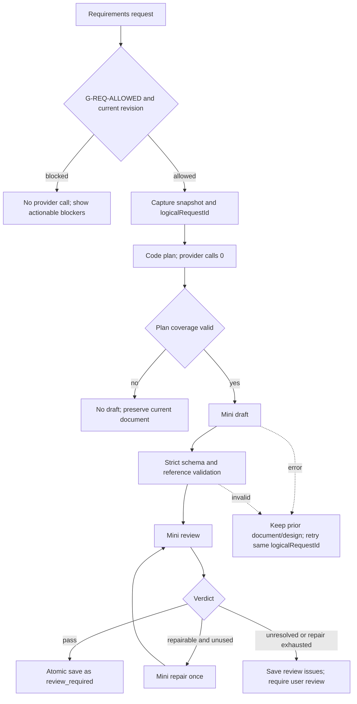

# DOC-PR-01 — Requirements 생성

**Status: in_progress.** Base: `origin/main` at `bf12d9b98fb7825a7f4e2d47458f25d15daff5d8` (DSG-PR-03, PR #19, merged 2026-10-15). This plan owns `DOC-401`, `DOC-402`, and `AI-006` only.

## Outcome

사용자가 준비된 설계 snapshot에서 Requirements를 생성하고, 근거와 요구사항 ID가 연결된 초안을 검토한다. Requirements 생성 결과는 `review_required`에서 멈춘다. AI review 통과나 생성만으로 `ready`가 되지 않는다.

## Traceability and linked contracts

- PR unit row 18: `DOC-PR-01`, delivery `DOC-401`, `DOC-402`, `AI-006`.
- Requirements: `DOC-001` same-design snapshot and explicit unknowns; `DOC-002` functional/non-functional, data, integration, permission, exception, deployment, traceable IDs, acceptance criteria, exclusions and open issues.
- Design handoff: `DES-002`, `DES-003`, `G-REQ-ALLOWED`; preserve the three readiness states and allow `workable` when only explicit deferred decisions remain.
- AI: `AI-006`; `DEFAULT=gpt-5-mini`, low reasoning for Requirements draft, review, and the optional single repair. Never use `FINAL`/Terra for Requirements.
- Decisions: `DEC-002` (explicitly deferred is allowed), `DEC-015` (Requirements ready is a later PRD gate), `DEC-028` (plan → draft → review → optional one repair), `DEC-031` (profile mapping), `DEC-032` (plan is deterministic and makes zero provider calls).
- Process: [`05-document-generation.md`](../../process/05-document-generation.md), [`04-proposal-and-readiness.md`](../../process/04-proposal-and-readiness.md), [`02-state-machine.md`](../../process/02-state-machine.md).
- Data/API: [`05-data-spec.md`](../../product/05-data-spec.md) (`GeneratedDocument`, `DocumentSection`, `GenerationJob`, `AiRequestLedgerEntry`, aggregate persistence); [`13-prompt-and-response-contracts.md`](../../product/13-prompt-and-response-contracts.md) (strict task payloads, envelope and source/reference validation); [`12-ai-orchestration-and-model-policy.md`](../../product/12-ai-orchestration-and-model-policy.md) (DEFAULT profile and token limits); [`14-ai-budget-evaluation-and-operations.md`](../../product/14-ai-budget-evaluation-and-operations.md) (pre-call budget checks, retries and ledger); [`15-ai-prompt-template-spec.md`](../../product/15-ai-prompt-template-spec.md) (requirements plan/draft/review/repair rules).
- Product journey: [`02-prd.md`](../../product/02-prd.md), journeys A/B, document readiness and failure policy.
- UI: [`04-document-workspace.md`](../../ui/04-document-workspace.md) `UI-DOC-001`–`003`; [`05-documents-and-guide.md`](../../ui/screens/05-documents-and-guide.md) `F-REQ-DRAFT`, R01/R02/R04/R05/R07/R09/R10 and Mobile; [`docs/template/README.md`](../../template/README.md).
- Visual references inspected: image 11 (conversation with Requirements entry), image 10 (hierarchical document overview), image 9 (selected requirement detail). They guide hierarchy and persistent context; the screen contract remains authoritative. Screenshots are optional evidence, not a pass gate.

## Definition of Ready

- [x] Previous unit DSG-PR-03 is merged: PR #19 `merged`, base `main`, merge commit `bf12d9b98fb7825a7f4e2d47458f25d15daff5d8`.
- [x] Foundation dependency FND-PR-02 is merged (#8); task/model/prompt/schema/context contracts exist in the repository.
- [x] Design prerequisites are implemented: DSG-PR-01/#17 proposal decisions, DSG-PR-02/#18 conflict resolution, DSG-PR-03/#19 readiness and Requirements entry gate.
- [x] Product decisions and persisted document/API contracts are specified; no open decision blocks this scope.
- [x] A conflict-free deterministic fixture can be prepared in tests; live OpenAI credentials are not a DoR requirement because provider calls can be stubbed at the adapter boundary.

## Scope

### Include

1. Deterministic `DocumentPlanBuilder` over one captured project/design revision. It maps all required Requirements sections, confirmed core items and acceptance criteria to sections, and explicit deferred items to open issues. It excludes pending/rejected proposals and never calls the provider.
2. Requirements generation through `POST /api/blueprint/documents/generate` with `documentType: "requirements"`, `designRevision`, and the existing authenticated owner context. The server rechecks the current revision, `G-REQ-ALLOWED`, duplicate-running logical request, schema, task/profile, budget, and every referenced item before applying output.
3. `REQUIREMENTS_DRAFT` → `REQUIREMENTS_REVIEW` → optional `REQUIREMENTS_REPAIR` once for repairable sections → one final review. Keep the existing model registry, strict schemas, request ledger, and budget guard; do not add inline prompts or a second AI abstraction.
4. Atomic aggregate persistence for document, ordered sections, source links, generation job and activity record only after full schema/domain validation. A stale response uses its original snapshot and is marked `review_required` with affected sections `stale`.
5. Requirements workspace empty, generating, and `review_required` states with heading/contents, requirement IDs, priority, description, acceptance criteria, source references, design revision, and actionable review issues. Keep conversation and selected design context available; support the specified mobile contents Drawer and semantic keyboard navigation.
6. Preserve the prior saved document and design on failure; expose a safe retry using the same `logicalRequestId` and a new attempt ID.

### Exclude

- Requirements ready confirmation, ready invalidation policy, and PRD lock/generation (`DOC-403`, `DOC-404`, `DOC-PR-02`).
- Section editing/impact preview (`DOC-405`, `DOC-PR-04`), partial AI patch and consistency review (`DOC-406`, `DOC-407`, `DOC-PR-03`).
- Setup guide, file extraction, Markdown export, broad visual redesign, model changes, and live-provider golden-eval reruns unrelated to the changed prompt/schema.

## State and failure behavior

Persisted `GeneratedDocument.status` remains `draft | review_required | ready`; this PR writes `review_required` after a generated result. Generating is a `GenerationJob`/process/UI state, not a persisted document status. Section synchronization uses `current | stale | conflict`; do not invent document status enum values for stale/conflict. The header may summarize section sync state for display without changing the persisted contract.

## Observable acceptance criteria

### Happy path

- With no missing core readiness items, unresolved conflicts, or pending proposals, and every core feature having a confirmed observable acceptance criterion, Requirements generation is allowed. Explicitly deferred decisions are retained as open issues; pending/rejected proposal content is absent.
- The deterministic plan covers all required sections and each core feature/acceptance criterion. It causes zero provider calls. Draft and review use DEFAULT (`gpt-5-mini`, low); the returned document has requirement IDs, traceable source IDs, P0 observable criteria, required sections, exclusions and open issues.
- A schema/reference/coverage-valid result is persisted atomically and displayed as `review_required` against its captured `designRevision`; it never becomes `ready` automatically.

### Failure paths

- Missing core information, missing core acceptance criteria, any unresolved conflict, or pending proposal blocks generation both in UI and API before a provider call, with actionable cause(s).
- Invalid plan coverage blocks draft. Provider/network/schema/budget/domain/storage failure leaves the prior document and design unchanged and provides safe retry with same `logicalRequestId`; no partial sections are stored.
- Unknown/pending/rejected/nonexistent source IDs, unsupported schema/version, and malformed payload reject the entire result; no subset is applied.
- A review verdict needing user judgment, or a repair that remains unresolved after the one allowed attempt and final review, produces explicit review issues and keeps `review_required`; no model escalation or repeated repair occurs.

### Boundaries and UI

- If the design revision changes while generation is running, the job remains tied to the captured snapshot; its result is never shown as current and affected sections are marked stale for review.
- Duplicate activation while the same logical request is running does not issue a second generation. A retry after failure keeps the logical request identity while using a fresh attempt identity.
- Desktop and mobile Requirements views expose document state, revision, section navigation and review issues. Mobile contents Drawer opens/closes by keyboard and returns focus to its trigger; generated requirement details remain readable without a forced wide table.

## Expected files

- `src/features/documents/document-plan.js` (+ `.d.ts`): deterministic plan and coverage validation.
- `src/features/documents/requirements-generation.js` (+ `.d.ts`): orchestration, domain validation and atomic result mapping.
- `api/blueprint/documents/generate.js`: authenticated endpoint and current-revision/readiness/idempotency guards, reusing the established AI adapter/registry.
- `src/components/blueprint/RequirementsDocument.tsx` and `src/styles/blueprint-workspace.css`: Requirements empty/progress/review UI (reuse existing project shell).
- `src/pages/ProjectPage.tsx`: connect document tab and requirements action to the service.
- `tests/unit/doc-pr-01-document-plan.test.js`, `tests/contract/doc-pr-01-requirements-generation.test.js`, and a focused `tests/e2e/doc-pr-01-requirements-generation.spec.ts` only if browser coverage is needed for the visible states.

These are expected locations based on the current architecture; reuse existing modules where equivalent behavior already exists and avoid creating duplicate types or schemas. No package/dependency changes are expected.

## Focused validation matrix

| Concern | Focused evidence | Command |
| --- | --- | --- |
| Deterministic plan | Required sections and coverage; explicit deferred; pending/rejected excluded; invalid coverage means provider call count zero | `node --test tests/unit/doc-pr-01-document-plan.test.js` |
| Generation/API contract | G-REQ-ALLOWED and revision guards; Mini profile/limits; strict envelope/reference validation; plan/draft/review/one repair call order; atomic save; idempotent retry; no partial state on injected failures | `node --test tests/contract/doc-pr-01-requirements-generation.test.js` (plus only directly affected existing process/schema tests) |
| Changed UI path | Empty/blocking → generating → review_required; actionable issue; desktop and mobile contents interaction and focus | `npx playwright test tests/e2e/doc-pr-01-requirements-generation.spec.ts --workers=1` (only if the UI changes) |
| Build and changed diagrams | TypeScript/Vite production build; Mermaid syntax for this plan's flow | `npm run build`; `npm run docs:check:mermaid`; `git diff --check` |

Use deterministic fixtures and a mocked provider; no full-suite run or broad screenshot matrix. Capture only if it clarifies a finding. Screenshots and Agent Browser are not gates.

## Risks / implementation notes

- `DOC-401` describes header states including stale/conflict while the canonical data model stores stale/conflict at section `syncStatus`, not document status. Keep persisted enums canonical and derive any header summary; do not broaden the domain enum in this PR.
- The UI screen contract contains controls for review, editing and ready state. Render only capabilities in this PR; ready confirmation and edit/patch actions belong to later units.
- Reuse `schemas.http.documentsGenerateRequest`, existing `AiTaskType` registry, budget guard, and process/readiness contracts from FND/DSG work. Do not fork them or use legacy `/requirements` fallback behavior as the new path.
- `AI-006` requires P0 acceptance-criteria coverage at 100%; a model review cannot substitute for deterministic ID, source, schema, and coverage validation.

## Done checklist

- [ ] Acceptance criteria have focused automated evidence and visible-flow evidence where applicable.
- [ ] `npm run build`, relevant focused tests, Mermaid check, and `git diff --check` pass as applicable.
- [ ] No credentials, user originals, provider raw errors, or temporary evidence are committed.
- [ ] Independent code review and focused independent QA pass on the same final HEAD.
- [ ] PR lifecycle gate passes and GitHub confirms merge before `DOC-PR-02` starts.
