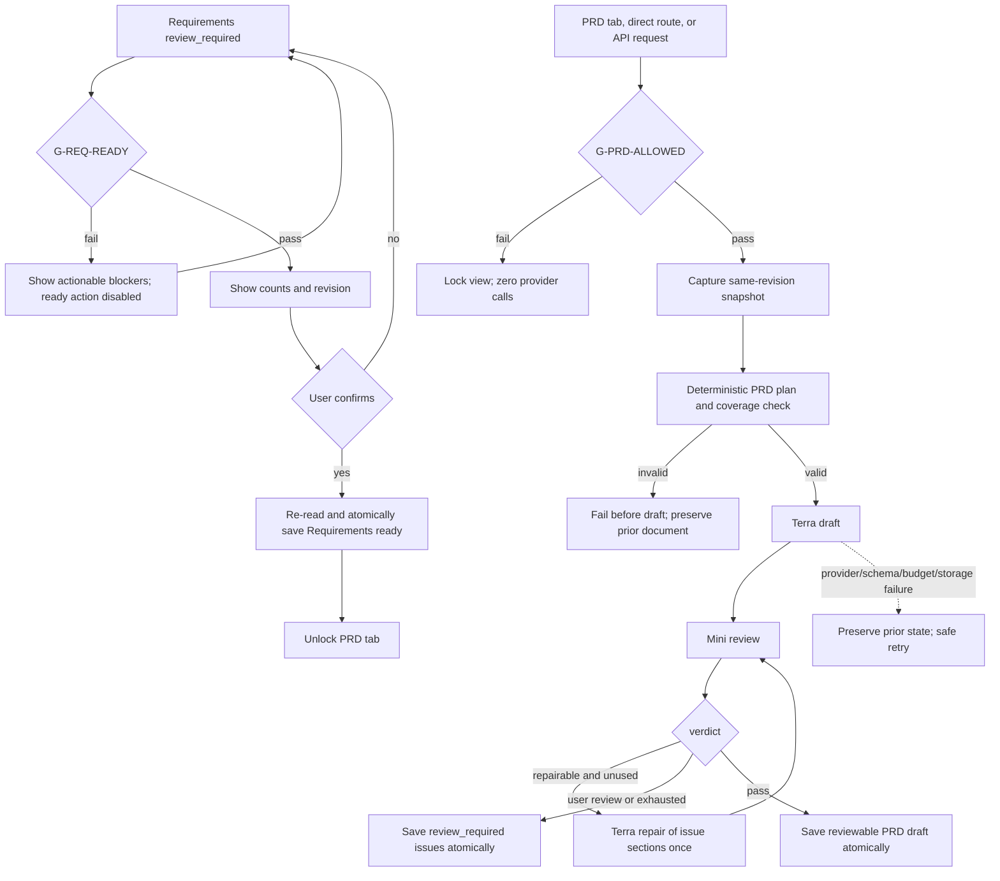

# DOC-PR-02 — Requirements ready와 PRD 생성

**Status: in_progress.** Planning base: `origin/main` at `6ded90838a415ee10f9a3ba0b518ebd0932c9618` (DOC-PR-01, PR #20, merged 2026-10-15). Scope: `DOC-403`, `DOC-404`, and `AI-007` PRD path.

## Outcome

사용자가 검토된 Requirements를 명시적으로 `ready`로 확정하고, 동일 design revision을 기준으로만 PRD를 생성할 수 있다. PRD는 plan → Terra draft → Mini review → 필요 시 Terra repair 1회 → Mini 재검토를 거쳐 검토 가능한 초안으로 저장된다. AI review만으로 Requirements가 ready가 되거나 PRD가 사용자 승인 상태가 되지 않는다.

## Traceability and contracts

- Delivery unit 18: `DOC-PR-02`; delivery tasks `DOC-403`, `DOC-404`; AI task `AI-007`.
- Product requirement: `DOC-003` — Requirements ready 선행, 동일 revision PRD, 제품 결과 중심 PRD structure.
- Decisions: `DEC-002` (명시적 미정은 open issue로 보존), `DEC-015` (Requirements ready 이후 PRD), `DEC-021` (ready 조건 계산은 코드, 사용자 명시 확인 필수), `DEC-028` (plan → draft → review → 선택적 repair 1회), `DEC-031` (FINAL은 PRD draft와 repair만 사용), `DEC-032` (결정론적 plan, provider 호출 없음).
- Delivery: [`04-documents.md`](../../delivery/04-documents.md) (`DOC-403`, `DOC-404`); [`ai-model-prompt-and-evaluation.md`](../../delivery/ai-model-prompt-and-evaluation.md) (`AI-007`).
- Process: [`05-document-generation.md`](../../process/05-document-generation.md) (`G-REQ-READY`, `G-PRD-ALLOWED`, transaction, failure invariants); [`02-state-machine.md`](../../process/02-state-machine.md).
- Data/API: [`05-data-spec.md`](../../product/05-data-spec.md) (`GeneratedDocument`, `DocumentSection`, `GenerationJob`; PRD only when Requirements is ready); authenticated `POST /api/blueprint/documents/generate` contract from FND-PR-02.
- AI: [`12-ai-orchestration-and-model-policy.md`](../../product/12-ai-orchestration-and-model-policy.md) (FINAL/DEFAULT profiles and limits); [`13-prompt-and-response-contracts.md`](../../product/13-prompt-and-response-contracts.md) (strict task schemas and references); [`14-ai-budget-evaluation-and-operations.md`](../../product/14-ai-budget-evaluation-and-operations.md) (budget before provider call and ledger); [`15-ai-prompt-template-spec.md`](../../product/15-ai-prompt-template-spec.md) (`prd.plan`, `PRD_DRAFT`, `PRD_REVIEW`, `PRD_REPAIR`).
- UI: [`04-document-workspace.md`](../../ui/04-document-workspace.md) `UI-DOC-006`; [`05-documents-and-guide.md`](../../ui/screens/05-documents-and-guide.md) `F-PRD-LOCKED`, `F-PRD-DRAFT`, ready actions and mobile behavior.
- Visual references read from [`docs/template/README.md`](../../template/README.md) and inspected: image 12 (completed document hierarchy), image 14 (generation in context), image 10 (structured requirements hierarchy). They inform hierarchy only; product contracts govern behavior. Screenshot attachment is optional under delivery workflow.

## Definition of Ready

- [x] Immediate predecessor DOC-PR-01 is merged: PR #20, base `main`, merge commit `6ded90838a415ee10f9a3ba0b518ebd0932c9618`.
- [x] Its Requirements generation artifacts and focused tests exist on `origin/main` (`requirements-generation`, API contract, fixtures, and browser spec).
- [x] Earlier design, readiness, model, prompt, schema, budget, and session contracts are present; fixture-based provider stubbing is available, so no live OpenAI credential is required for focused tests.
- [x] `G-REQ-READY` and `G-PRD-ALLOWED` specify all authorization conditions. No product decision or external setup blocks planning or implementation.
- [x] The UI screen contract and mapped reference captures are identified; no new UI design decision is needed.

## Scope

### Include

1. Requirements review summary and deterministic ready eligibility from the persisted document and sections: required sections present; every P0 requirement has an observable acceptance criterion; no unresolved review issue, stale/conflict section, or revision drift. Explicit deferred decisions remain open issues and do not independently block ready.
2. `Requirements 검토 완료` action enabled only when eligible. Confirmation shows P0 requirement count, acceptance-criteria count, open-issue count, and source design revision. On explicit confirmation, revalidate the latest aggregate and atomically persist `ready`, `readyAt`, and `readyDesignRevision`.
3. PRD tab lock state and actionable `Requirements 검토로 이동` screen. Direct URL navigation and the API are both guarded; client visibility is not authorization.
4. Shared `G-PRD-ALLOWED` validation before any provider call: Requirements status `ready`, its revision equals current design revision, no Requirements section stale/conflict, and no duplicate running generation for the same logical request.
5. Deterministic PRD plan with required product-oriented sections and requirement/source links. Invalid coverage or references stop before `PRD_DRAFT`.
6. PRD pipeline on the same immutable Requirements/design snapshot: `PRD_DRAFT` FINAL (`gpt-5.6-terra`, low, 40,000 input / 10,000 output max) → `PRD_REVIEW` DEFAULT (`gpt-5-mini`, low) → optional `PRD_REPAIR` FINAL once, for identified problem sections only → DEFAULT review again. Use registered tasks/schemas, budget guard, and ledger; no inline prompts or model fallback.
7. Validate requirement/source IDs, schema, and semantic alignment. Problem/goal/user/scope must match Requirements; new features, unsupported facts, fabricated metrics, and edits to healthy sections are rejected. Successful output is saved atomically with ordered sections, source links, job and activity. Leave it as a reviewable document; do not set it `ready` automatically.
8. Preserve prior documents and design on guard, plan, budget, provider, schema, or persistence failure. Surface actionable blocked reasons and keep safe retry semantics/idempotency from the existing generation contract.

### Exclude

- Requirements first generation, deterministic Requirements plan, and its Mini draft/review (`DOC-PR-01`, merged).
- Direct section editing/impact preview (`DOC-405`, `DOC-PR-04`), partial patch and cross-document consistency review (`DOC-406/407`, `DOC-PR-03`).
- New auth model, AI provider abstraction, model changes, broad document workspace redesign, export, setup guide, unrelated full regression, and live-provider golden evaluation.

## State and failure behavior

An in-flight revision change cannot silently produce a current document: compare the captured revision at the persistence boundary and mark affected sections stale / document `review_required` per the existing aggregate contract. Do not broaden `GeneratedDocument.status`; stale/conflict belongs to section `syncStatus`.

## Acceptance criteria

### Happy path

- When every `G-REQ-READY` condition is true, the confirmation action is available and reports the specified counts and revision. Only explicit user confirmation updates Requirements to `ready` and unlocks PRD.
- With ready Requirements at the current revision, valid deterministic plan/link coverage produces one FINAL PRD draft and one DEFAULT review; when review passes, the resulting PRD is traceable to requirement IDs and source IDs and remains reviewable, not automatically ready.
- Repairable review findings cause at most one FINAL repair of only affected sections followed by DEFAULT review.

### Failure paths

- Missing section, missing P0 acceptance criterion, unresolved review issue, stale/conflict section, or design revision drift disables/denies ready and explains the cause. Explicit deferred items stay visible as open issues without blocking on their own.
- Before Requirements is ready, after revision drift, while a relevant section is stale/conflicted, or on duplicate active request, PRD UI/API denies generation and provider-call count remains zero.
- Direct URL/API requests cannot bypass the same server-side guard. Invalid plan, schema, reference, semantic alignment, budget, or storage results never partially replace a prior document.
- If the one repair does not resolve issues or requires a user decision, persist/display review issues; do not perform another repair, upgrade models, or claim PRD quality pass.

### Boundary and UI

- System eligibility alone never writes `ready`; canceling confirmation leaves stored status unchanged.
- If revision/status changes between opening confirmation and submit, revalidation rejects the stale action without marking ready.
- Desktop and mobile affected views expose the lock reason and one clear return action; the confirmation is keyboard operable, has visible focus, and restores focus on dismissal. PRD contents remain readable at the affected viewport without a forced wide table.

## Expected implementation files

Use existing modules from DOC-PR-01 and the current architecture where equivalent behavior exists. Likely changes are the document readiness/PRD generation domain module, authenticated documents generation route, project document navigation/review UI and its local styles, plus focused unit/contract/browser tests. Do not duplicate the prior plan/schema/generation abstractions or change production files during this planning stage.

## Focused validation matrix

| Concern | Required focused evidence | Candidate command |
| --- | --- | --- |
| Ready eligibility and explicit confirmation | Each ready blocker; deferred-only allowed; no implicit ready; stale confirmation rejected | `node --test tests/unit/doc-pr-02-requirements-ready.test.js` |
| API guard and PRD pipeline | Not-ready/revision/stale/conflict/duplicate each causes zero provider calls; exact plan → FINAL draft → DEFAULT review → optional single FINAL repair → DEFAULT review sequence; valid links and semantic alignment; hard budget and atomic rollback | `node --test tests/contract/doc-pr-02-prd-generation.test.js tests/contract/doc-pr-02-prd-api.test.js` |
| Changed user flow | Confirmation, locked direct URL/API path, unlocked generation, review issue state; focused keyboard/focus and mobile behavior only if changed UI requires it | `npx playwright test tests/e2e/doc-pr-02-prd-readiness.spec.ts --workers=1` |
| Documentation integrity | Changed flowchart parses; whitespace clean | `npm run docs:check:mermaid` (if Mermaid changes); `git diff --check` |
| Build | Only if production code/build inputs change | `npm run build` |

Use synthetic fixtures and stubbed provider. No full suite, unrelated browser flow, mandatory screenshot set, or Agent Browser duplication. Exact test filenames may be adjusted to existing implementation conventions, but coverage above remains required.

## Risks and limits

- Ready confirmation and generation must share the canonical client aggregate contract while the API independently guards requests. The implementation should not claim server-authoritative design revision lookup if project aggregates remain browser-local.
- Requirements ready and PRD generation require atomic re-read/revalidation to avoid stale-confirmation and duplicate-request races.
- Terra is used only for PRD draft and one repair. Budget denial must happen before each corresponding provider request.
- Existing product design text says PRD should not be shown as ready when goals/users/scope diverge; deterministic validation must reject or leave it in review, never treat model verdict alone as authorization.

## Traceability checklist

| Requirement/task | Planned observable proof |
| --- | --- |
| `DOC-003` / `DOC-403` | Ready prerequisites, explicit confirmation, counts/revision, persisted timestamp/revision, blockers and revalidation |
| `DOC-003` / `DOC-404` | UI + server guard, same revision, deterministic PRD plan, required structure, no unauthorized generation |
| `AI-007` | Coverage stops draft; structured linked sections; review is non-mutating; problem-section-only repair at most once; no ready automation |

`docs/delivery/traceability.md` already maps `DOC-003` to `DOC-403`/`DOC-404` and `AI-007` to its pipeline tasks, so no traceability table change is required during planning.

## Done checklist

- [ ] Focused ready and PRD pipeline/API tests pass.
- [ ] Changed browser interaction and directly affected accessibility/responsive path pass where UI changed.
- [ ] Build passes if production code/build inputs changed; Mermaid check passes if the diagram changes; `git diff --check` passes.
- [ ] Independent review and QA pass on the same final HEAD; configured checks pass.
- [ ] PR lifecycle gate passes and GitHub confirms merge before DOC-PR-03 begins.
