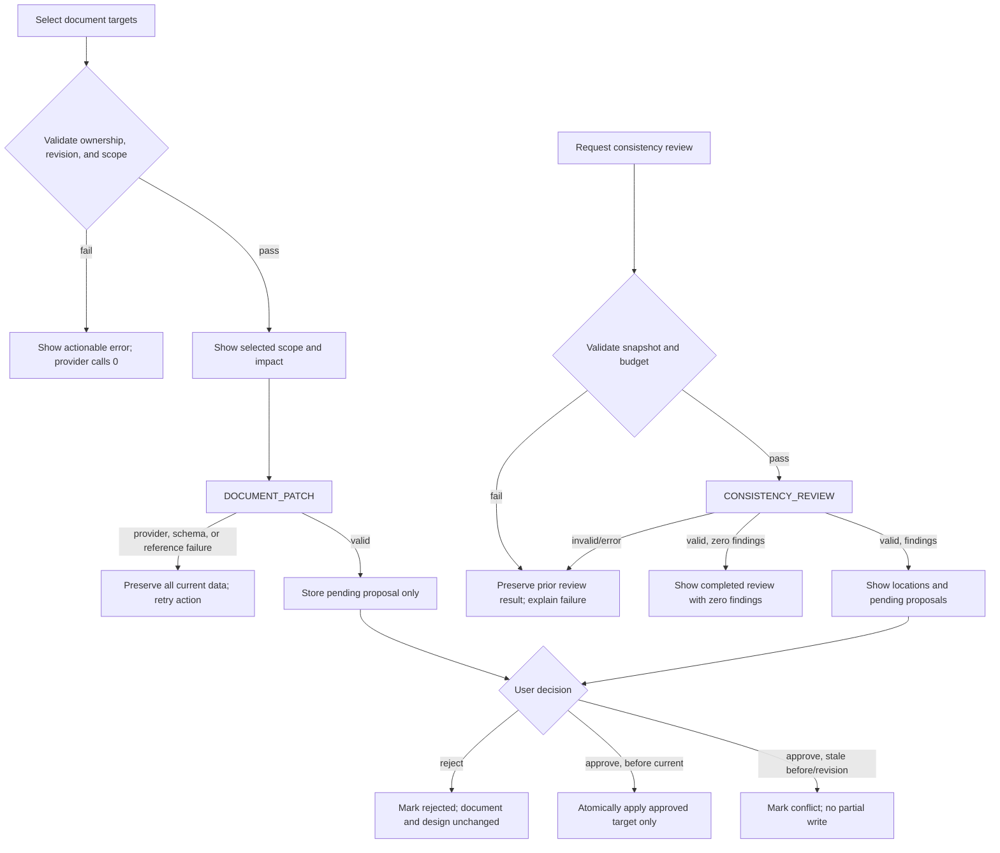

# DOC-PR-03 — 부분 보완·정합성 검토

**Status: ready.** Planning base: `origin/main` at `f0c922635ae0a620022f4a05d86fe6ea4fcc1ff9` (DOC-PR-02, PR #21, merged 2026-10-15). Scope: `DOC-406` and `DOC-407` (`DOC-005`, `DOC-006`).

## Outcome

사용자가 고른 Requirements/PRD 섹션 또는 requirement만 부분 보완을 요청하고, 시스템은 문서·확정 설계 간 불일치를 검토한다. 두 작업의 AI 결과는 문서나 설계를 직접 바꾸지 않고 추적 가능한 pending proposal로만 반환한다. 사용자가 proposal을 승인할 때에만 선택 대상이 갱신되고, 범위 밖 문서 섹션과 사용자 편집은 보존된다.

## Traceability and contracts

- Delivery unit 19: `DOC-PR-03`; tasks `DOC-406`, `DOC-407` in [`04-documents.md`](../../delivery/04-documents.md).
- Product requirements: [`DOC-005`](../../product/03-requirements.md#doc-005-부분-ai-보완--p1) (request scope, proposal before apply) and [`DOC-006`](../../product/03-requirements.md#doc-006-정합성-검토--p1) (locations, related design items, proposal only).
- Product outcomes: [`02-prd.md`](../../product/02-prd.md) document-refinement journey C and goals (same source of truth; no unapproved technical decisions).
- Decision: [`DEC-004`](../../product/10-decision-log.md) separates accepted/user-confirmed changes from generated document content. No new product decision is needed.
- Data: [`05-data-spec.md`](../../product/05-data-spec.md) `GeneratedDocument`, `DocumentSection`, `ChangeProposal`, evidence/source IDs, logical request idempotency, before-value conflict rule, and aggregate transactions. Existing section `version`, `origin`, `syncStatus` and `sourceItemIds` remain authoritative.
- AI: [`12-ai-orchestration-and-model-policy.md`](../../product/12-ai-orchestration-and-model-policy.md) routes `DOCUMENT_PATCH` and `CONSISTENCY_REVIEW` to `DEFAULT`, low, with 20k/4k and 32k/4k token caps. [`13-prompt-and-response-contracts.md`](../../product/13-prompt-and-response-contracts.md) requires strict task schemas and application-owned proposal fields. [`15-ai-prompt-template-spec.md`](../../product/15-ai-prompt-template-spec.md) defines `document.patch.v1` and `consistency.review.v1`; patch is scoped and never directly applied, while consistency findings include location, related IDs, severity, and next action and never auto-fix. [`14-ai-budget-evaluation-and-operations.md`](../../product/14-ai-budget-evaluation-and-operations.md) requires the budget guard before each provider call and sanitized request ledger entries. Existing `AI-009` synthetic evaluation is the relevant task-level gate if either prompt/schema changes.
- Process: [`05-document-generation.md`](../../process/05-document-generation.md) generation snapshot and atomic-save/failure invariants; [`04-proposal-and-readiness.md`](../../process/04-proposal-and-readiness.md) proposal state, explicit approval, stale-before handling. Proposal acceptance must use existing domain/repository conventions and must not invent a second approval state machine.
- UI: [`04-document-workspace.md`](../../ui/04-document-workspace.md) `UI-DOC-003/004` for section selection/actions, keyboard reveal and responsive document navigation; [`05-documents-and-guide.md`](../../ui/screens/05-documents-and-guide.md) for document hierarchy and working/error states.
- Visual references: read [`docs/template/README.md`](../../template/README.md) and inspected image 12 (document outline/content) and image 10 (structured requirements hierarchy). They inform hierarchy only; no screenshot set is a gate. Current implementation screenshots are optional when they help review the changed interaction.
- Dependency: DSG-PR-03 PR #19 (`bf12d9b`), DOC-PR-01 PR #20 (`6ded908`), and DOC-PR-02 PR #21 (`f0c9226`) are all merged to `main`. No open PR is present. Focused document generation tests, registered task/profile/schema/prompt, and proposal domain infrastructure exist on this base; patch/review endpoint and flow do not.

## Definition of Ready

- [x] Selected delivery row is unit 19, after Requirements generation and same-revision PRD generation.
- [x] Dependencies are verified in GitHub and `origin/main` at `f0c922635ae0a620022f4a05d86fe6ea4fcc1ff9`; no open PR blocks the unit.
- [x] Scope and observable acceptance criteria are defined by `DOC-005/006`, `DOC-406/407`, data, process and prompt contracts above.
- [x] Required task model profiles, budgets, prompt IDs, schema registry, authenticated API pattern, storage aggregate and synthetic fixture infrastructure exist.
- [x] UI states and reference hierarchy are identified. This UI change can be verified with focused Playwright Chromium tests; no live OpenAI call, Vercel deployment, or fixed screenshot set is required.
- [x] No unresolved product decision, external setup, or required tool blocks planning or implementation.

## Scope

### Include

1. **DOC-406 partial patch:** accept one or more selected section IDs or requirement IDs for an existing Requirements or PRD document plus an optional instruction. Validate ownership, document type/status, target existence, and target/version snapshot before any provider request. Show the selected scope and known impacted item/document IDs before request. Send only the selected content and the contract-required relevant source context to `DOCUMENT_PATCH` (`DEFAULT`, low; max input 20,000 / output 4,000). Validate all returned references and strict proposal schema. Return pending proposals with before/after, rationale/evidence, and affected IDs; do not mutate document sections, versions, design revision, or source items on request, provider, validation, or rejection.
2. **DOC-407 consistency review:** review confirmed design plus current Requirements and PRD for goal/user/scope mismatch, core feature coverage, P0 acceptance criteria/success metrics, stale/conflict sections, unsupported or deferred facts, and revision/source-ID consistency as specified by the delivery and prompt contracts. Use `CONSISTENCY_REVIEW` (`DEFAULT`, low; max input 32,000 / output 4,000), strict schema and source-backed validation. Return finding location, related source/design IDs, severity, next action, and an optional pending proposal. A clean run displays a distinct “0 findings” result; never-run/loading/failed is a separate state.
3. Authenticated server routes following existing API conventions: `POST /api/blueprint/documents/patch` and `POST /api/blueprint/review` as named in this unit specification. The request must be bound to the authenticated owner/project and a captured document/design revision; do not trust client readiness, actor, ownership, source IDs, or proposal status.
4. Explicit proposal approval through the existing proposal command/repository boundary. Apply only approved target content and its supported design/item links atomically; preserve every out-of-scope section/version and every user-edited section. Rejected proposals leave documents/design unchanged. Before-value or revision drift returns stale/conflict for review and applies nothing. Do not add DOC-405's direct-edit impact-preview flow.
5. Focused UI action and proposal/finding display in the existing document workspace, including target/impact preview, loading, empty/zero-finding, success, validation/provider error, stale/conflict, and rejected states. Keep semantic controls, keyboard reachability/visible focus, and the existing responsive document layout.
6. Task-scoped tests and synthetic golden-eval assertions for the registered patch and consistency contracts. No live provider request.

### Exclude

- First Requirements generation and PRD generation/ready behavior (`DOC-PR-01/02`, merged).
- Direct document editing, save-impact preview, and user-edit source mapping (`DOC-405`, `DOC-PR-04`).
- Setup guide, export, file extraction, new authentication/session design, new AI provider/model profile, broad document workspace redesign, unrelated full regression, live-provider evaluation, mandatory captures, and changes to unrelated PRD sections.
- Automatically applying model output, automatically approving a proposal, or allowing model output to set readiness/status/revision.

## State and failure behavior

Invariants: no provider call before auth/scope/snapshot/budget checks; AI output is strictly schema/reference validated before display or proposal storage; no partial update on validation, storage, or stale failure; duplicate logical requests do not duplicate apply; a completed zero-finding review is distinguishable from not run or failed. The data contract has no persisted review-run entity, so the displayed review result is transient UI state; do not invent a new persistent review model in this unit. Existing aggregate transaction and document version rules govern any approved apply.

## Acceptance criteria

### Patch happy path

- Given a Requirements/PRD section or requirement is selected, the UI and request identify exactly that target set and show the possible affected items before dispatch.
- Given the provider returns a valid scoped patch, only a pending proposal is stored. Before user approval, section Markdown/version/origin/sync status, document version, design revision, and confirmed design values are unchanged.
- Given the user approves against the captured current before-value/revision, only the approved target and directly linked supported design items update atomically; unrelated sections and user-edited sections remain byte-for-byte/version-identical.
- Given no consistency discrepancies exist, a successful review records completed status with zero findings, visibly distinct from never run.

### Failure paths

- Missing/foreign document, invalid or empty target set, unselected target in AI output, invalid source/design ID, unsupported document state, or stale snapshot is rejected before provider call or persistence as appropriate; show an actionable error and preserve current data.
- Provider timeout/error, budget denial, malformed/additional schema fields, or failed local save leaves documents/design unchanged; a retry does not double-apply a result. A failed review is never rendered as a successful zero-finding result.
- Rejecting or dismissing a patch/finding proposal changes no document section or confirmed design item. Model output never directly updates readiness, `ready`, `review_required`, design revision, or document version.
- Approval with changed before-value or revision returns a conflict requiring review; no proposal target, section, revision, or activity is partially applied.
- Consistency output marks unsupported, missing, or unknown source support as non-pass finding; findings contain accurate location and valid source/design item IDs. Never treat incomplete/failed review as zero findings.

### Boundary and UI

- A patch of one target leaves all non-target section Markdown and version unchanged, including generated sections and `user_edited` sections.
- Repeated submission with the same logical request/target does not create duplicate effective proposals or apply twice.
- Patch controls and review findings are keyboard operable with visible focus; loading/error/zero findings/finding states remain legible in the affected desktop and narrow/mobile layout. No forced wide table is introduced.

## Expected implementation files

Inspect existing DOC-PR-01/02 and DSG modules first; reuse their API auth, provider, ledger, schema validation, repository transaction, and UI conventions. Likely scoped additions/changes:

- `src/features/documents/document-patch.*`, `src/features/documents/consistency-review.*`
- `api/blueprint/documents/patch.js`, `api/blueprint/review.js`
- registered strict schemas, prompt validation, and task-specific synthetic fixtures/eval only where current schema/output does not satisfy the linked contracts
- existing document workspace/review components and directly relevant styles
- focused `tests/unit`, `tests/contract`, and `tests/e2e` for these flows

These are candidates, not a requirement to create parallel abstractions where an existing equivalent is present. Keep implementation and tests within this unit; do not edit `DOC-PR-04` behavior.

## Focused validation matrix

| Concern | Required focused evidence | Candidate command |
| --- | --- | --- |
| Patch domain/scope isolation | Exact selected IDs; outside section and user-edited version unchanged; pending-only; accept/reject; stale conflict and duplicate logical request | `node --test tests/unit/doc-pr-03-document-patch.test.js` |
| Patch API and failure safety | Auth/owner/document/target/snapshot/budget checks; only target context sent; invalid/foreign model refs rejected; provider/schema/storage failure preserves prior state | `node --test tests/contract/doc-pr-03-document-patch.test.js` |
| Consistency task contract | Goal/user/scope, core feature coverage, P0 criterion/metric, stale/conflict, deferred/unsupported claims, revision/source IDs; accurate locations and proposal-only output; zero vs not-run vs failure | `node --test tests/contract/doc-pr-03-consistency-review.test.js` |
| UI interaction | Focused patch request and proposal approve/reject/stale; run review and distinguish zero/findings/failure; keyboard and affected responsive layout | `npx playwright test tests/e2e/doc-pr-03-document-refinement.spec.ts --workers=1` |
| Prompt/schema evaluation | Run only if prompt/schema changes; relevant synthetic fixture asserts strict fields, task scope and no auto-apply | `node --test tests/unit/ai/golden-eval.test.js` plus the task-specific focused fixture/test |
| Documentation integrity | Mermaid parse only if diagram changed; whitespace always | `npm run docs:check:mermaid` (if Mermaid changes); `git diff --check` |
| Build | Run because expected production code/API/types change | `npm run build` |

Use stubbed providers and synthetic fixtures; no OpenAI key or live call. Do not run full test suites or unrelated browser journeys. Exact test filenames may follow existing conventions, but the listed behavioral coverage is required.

## UI evidence and QA

- Relevant visual basis: template image 12 for document outline/content and image 10 for structured requirement hierarchy; product contracts control behavior.
- QA checks only the changed refinement/review interactions at desktop and one narrow/mobile viewport, including keyboard focus where changed controls are used. Test loading, one successful patch proposal, reject/approve, stale conflict, findings, zero findings, and failure where applicable to the changed code. Mark unrelated states N/A.
- Playwright Chromium is the direct browser validation path. Screenshots are optional review aids and not a gate; do not add a fixed screenshot checklist or duplicate browser tooling.

## Risks and limits

- Patch approval crosses document sections and source design; use one existing aggregate transaction and preserve version/before-value checks, or narrow the patch target rather than partially applying.
- Requirements/PRD are client IndexedDB aggregates today. API auth does not make a server copy authoritative; bind requests to the authenticated project and signed/captured exact snapshot according to existing DOC-PR-01/02 conventions, and recheck local revision at apply time. State this limitation in the PR if a remote operation cannot observe concurrent local edits.
- Consistency review is model-assisted semantic judgment, not proof. Source IDs and schema are code-validated; semantic support is surfaced as review findings, never authorization.
- Token limits and the existing request ledger must be enforced before both task calls. No fallback model or automatic `FINAL` escalation.

## Traceability checklist

| Requirement/task | Planned observable proof |
| --- | --- |
| `DOC-005` / `DOC-406` | Selected target/impact before call; selected context only; valid pending proposal; no pre-approval mutation; accept applies only approved target; reject/stale/failure preserves data |
| `DOC-006` / `DOC-407` | Cross-document findings with precise location and related IDs; optional proposal only; no auto-fix; zero findings distinct from not run/error |
| `AI-006` / `AI-008` | Correct DEFAULT profile/token cap; hard budget checked before call; sanitized request ledger; no extra call on denial |
| `AI-009` | If prompt/schema changes, scoped synthetic cases reject invalid IDs/schema and automatic application; no live eval in this unit |

`docs/delivery/traceability.md` already maps `DOC-005` → `DOC-406` and `DOC-006` → `DOC-407`; planning does not change implementation status, so the traceability table needs no edit yet.

## Done checklist

- [ ] Focused unit and API contract tests pass.
- [ ] Focused Playwright Chromium QA passes for changed flows and affected keyboard/responsive behavior.
- [ ] Prompt/schema synthetic eval passes if those artifacts changed; build and `git diff --check` pass.
- [ ] Independent code review and independent QA pass on the same final HEAD; configured checks pass.
- [ ] PR lifecycle gate passes; GitHub confirms merge to `main` before DOC-PR-04 begins.
