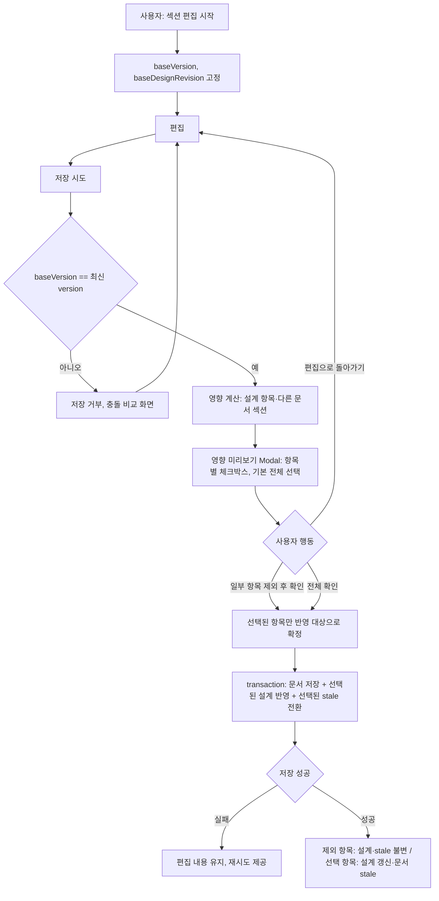

# DOC-PR-04 — 직접 편집 영향

**Status: in_progress.** Planning base: `origin/main` at `94bdf704e1909d49813a9e3592dcf056c8e9f3cb` (DOC-PR-03, PR #22, merged 2026-10-15). Scope: `DOC-405` (`DOC-004`).

## Overview

사용자가 문서 섹션을 직접 편집해 저장할 때, 저장 전 영향받는 공통 설계 항목과 다른 문서의 stale 전환을 미리 보여주고, 사용자가 영향받는 항목을 **항목별로 선택 제외**할 수 있게 한다(`DEC-040`). 확인 후에는 편집 내용, 공통 설계 반영, 문서 version을 하나의 transaction으로 저장한다.

## Background

이 PR은 원래 "영향 미리보기의 부분 제외 허용 여부"가 결정되기 전까지 `blocked` 상태였다. `docs/product/10-decision-log.md`의 `DEC-040`(2026-09-16)으로 "사용자는 영향받는 항목 중 일부를 선택적으로 제외하고 저장할 수 있다"가 확정되면서 `planned`로 전환됐다. `DEC-004`(직접 편집은 사용자 확정 변경으로 공통 설계에 자동 반영), `DEC-012`(저장 전 영향 미리보기)와 함께 구현한다.

## Scope

### 포함

- 섹션 편집 시작 시 기준 version·design revision 고정(`DOC-405`)
- F-DOC-IMPACT 화면 계약을 `DEC-040`에 맞게 갱신해 항목별 선택 제외 동작을 명시
- 저장 전 영향받는 source item, 다른 문서, stale 전환 계산 및 미리보기 표시
- 영향받는 항목 개별 선택 제외 UI와 로직(`DEC-040`)
- 제외하지 않은 항목만 하나의 로컬 IndexedDB transaction으로 공통 설계·문서 version에 반영
- 연결 항목이 여러 개인 편집은 기존 항목 설명을 보존하고 선택 항목과 연결된 `document_section` 정합성 검토 기록을 생성
- 오래된 편집본(다른 사용자/탭이 먼저 저장) 충돌 비교와 저장 실패 시 편집 내용 보존

### 제외

- 부분 AI 보완(`DOC-PR-03`, 이미 완료)
- 문서 최초 생성(`DOC-PR-01`, `DOC-PR-02`, 이미 완료)

## 연결 근거

- 요구사항: `DOC-004`
- Delivery 작업: `DOC-405`
- 결정: `DEC-004`, `DEC-012`, `DEC-040`
- 화면 설계: [문서 작업 공간](../../ui/04-document-workspace.md) `UI-DOC-004`, `UI-DOC-005`, [문서 청사진 F-DOC-IMPACT](../../ui/screens/05-documents-and-guide.md)
- 선행 PR: `DOC-PR-03`(순서 19)

## 선행 조건 (Definition of Ready)

- `DOC-PR-03`이 사용자에 의해 머지됨
- `DEC-040`이 항목별 영향 제외를 확정했고 DOC-004/DOC-405, 데이터·아키텍처 계약이 이를 뒷받침함
- 현재 UI 설계의 F-DOC-IMPACT 두 곳에 DEC-040 이전 문구가 남아 있음. 별도 제품 결정은 필요하지 않으며, 구현 전에 이 PR의 범위에서 문구와 Modal 계약을 갱신한다.

## 작업 단위별 구현 개요

**DOC-405 직접 편집과 영향 미리보기**
- 편집 시작 시 `baseVersion`, `baseDesignRevision`을 고정해 세션 동안 비교 기준으로 사용
- 저장 시도 시 현재 `sourceItemIds`, 영향받는 공통 설계 항목(before/after 또는 기존 설명 보존), 영향받는 다른 문서 섹션(stale 전환 대상)을 계산
- source 항목이 하나면 유일하게 대응되는 설명만 갱신한다. source 항목이 여러 개면 원본 설명은 유지하고 제외되지 않은 source ID만 연결한 `document_section` 기록을 `review_required` 상태로 생성한다. 편집된 대상 섹션은 새 기록만 source로 가리킨다.
- 영향 미리보기 Modal에 각 영향 항목을 체크박스로 표시하고 기본값은 전체 선택; 변경 전·후, 연관 문서 섹션, 저장 후 상태를 함께 표시
- 사용자가 일부 항목의 체크를 해제하면 해당 항목은 공통 설계에 반영하지 않고, 그 항목을 참조하는 문서 섹션도 stale로 전환하지 않음
- "확인하고 저장" 시 (편집된 markdown, 선택된 공통 설계 변경/섹션 기록, 선택된 stale 전환)을 하나의 IndexedDB `ProjectRepository.transact`로 저장. 이 흐름에 서버 API는 없다.
- `baseVersion`이 최신이 아니면 저장하지 않고 최신 내용과의 충돌 비교를 제공
- 저장 실패 시 편집 내용을 입력 상태로 유지(자동 되돌리지 않음)

## 프로세스 / 상태 전이

## 데이터·아키텍처 영향

- API 변경 없음. `ProjectPage`가 전달하는 직접 편집 명령은 `ProjectRepository.transact`로 IndexedDB aggregate를 원자 저장한다.
- 단일 source item만 연결된 편집은 그 항목의 description/evidence만 갱신한다.
- 복수 source item 편집은 기존 설명을 보존한다. 제외하지 않은 source IDs와 편집 markdown을 새 `document_section` DesignItem에 담고, `status: review_required`, `user_edit` 근거, `attributes.sourceSectionId`, `attributes.consistencyReviewRequired: true`, `attributes.reviewRequiredReason`로 정합성 검토를 표시한다. 이 app-authored type은 AI proposal이나 readiness 필수 항목이 아니다.
- 다중 항목 편집 대상 섹션의 `sourceItemIds`는 생성한 section-level item만 가리킨다. revision은 선택 항목이 있을 때 증가하며 제외 항목만 참조하는 다른 섹션은 stale로 바꾸지 않는다. 모두 제외하면 설계 항목을 생성하지 않는다.

## Acceptance Criteria

### Happy Path
Given 사용자가 여러 설계 항목에 연결된 섹션을 편집하고 영향 항목 중 하나의 체크를 해제했을 때, when "확인하고 저장"을 누르면, then 기존 설계 항목 설명은 보존되고 제외되지 않은 항목만 section-level 정합성 검토 기록에 연결되며, 선택 항목을 참조하는 문서만 stale로 전환되고 제외 항목만 참조하는 문서는 유지된다.

### Failure Case
Given IndexedDB 저장 오류가 발생했을 때, when 저장이 실패하면, then 편집 내용은 입력 상태로 유지되고 공통 설계·다른 문서는 변경되지 않으며 재시도가 제공된다.

### Boundary
Given 다른 세션이 같은 섹션을 먼저 저장해 `baseVersion`이 오래됐을 때, when 사용자가 저장을 시도하면, then 저장이 거부되고 최신 내용과의 충돌 비교가 표시되며 사용자의 편집 원문은 유지된다.

## 예상 변경 파일

- `src/features/documents/document-edit-transaction.js` 및 `.d.ts`(미리보기, 선택 제외, 원자 aggregate 변경)
- `src/components/blueprint/DocumentSectionEditor.tsx`(편집 모드와 영향 확인)
- `src/features/design/DesignBoard.tsx`(section-level 정합성 검토 항목을 열 수 있는 후속 영역)
- `src/domain/blueprint/types.d.ts` 및 `docs/product/05-data-spec.md`(앱이 생성하는 `document_section` 항목 계약)
- `docs/product/06-architecture.md`(IndexedDB transaction과 DEC-040 동작)
- `docs/ui/screens/05-documents-and-guide.md`, `docs/ui/04-document-workspace.md`(F-DOC-IMPACT 문구를 `DEC-040` 기준으로 갱신 — 이 PR의 선행 작업으로 포함)
- `tests/domain/impactPreview.test.ts`, `tests/e2e/document-edit-impact.spec.ts`

## 테스트 계획

1. 미리보기 확인 전 공통 설계 미변경(unit)
2. 항목별 제외 시 제외 항목은 설계·stale 모두 불변, 나머지는 반영(unit — DEC-040 핵심 시나리오)
3. 오래된 편집본 저장 거부와 충돌 비교(contract)
4. 저장 실패 시 편집 내용 보존(component)
5. 전체 선택(제외 없음) 시 기존 동작과 동일(회귀)
6. 데스크톱·모바일에서 영향 미리보기 열기, 항목 제외, 취소/확인, 성공/실패 상태의 핵심 상호작용(E2E)

## Focused validation matrix

| Concern | Required evidence | Candidate command |
| --- | --- | --- |
| Impact calculation and exclusions | Before/after preview; selected vs excluded design items and dependent stale sections; no changes before confirmation | `node --test tests/unit/doc-pr-04-impact-preview.test.js` |
| Save transaction and stale edits | Current base version saves atomically; stale base is rejected with latest-content comparison; failure preserves editor content and all persisted values | `node --test tests/contract/doc-pr-04-document-edit.test.js` |
| User interaction | Edit → preview → deselect an impact → confirm; cancel and save failure preserve draft; desktop and narrow viewport behavior | `npx playwright test tests/e2e/doc-pr-04-direct-edit-impact.spec.ts --workers=1` |
| Production integration | TypeScript and production bundle compile | `npm run build` |
| Diff hygiene | No whitespace errors | `git diff --check` |

Use deterministic fixtures; no live provider call. Run only these task tests and build needed for production changes. Do not run unrelated suites or require screenshot artifacts. If a Mermaid diagram changes, also run `npm run docs:check:mermaid`.

## UI 증거 계획

- 문서 작업 공간의 선택 섹션 편집 → 영향 미리보기 → 항목 제외 → 저장 흐름을 Playwright Chromium으로 검증한다.
- 데스크톱과 좁은 화면에서 체크박스·Modal 조작, 취소/실패 후 편집 내용 보존, 저장 후 영향 상태를 확인한다.
- 이미지 캡처는 선택 증거이며 merge gate가 아니다. `docs/template/README.md` 기준 관련 문서 레이아웃 참고는 image (12) (문서 개요/목차)로 한정하며 영향 Modal 전용 레퍼런스는 없다.

## 코드 리뷰·QA 체크리스트

- [ ] IndexedDB transaction aggregate에서 제외 항목이 설계 연결·stale 계산에서 빠지는지 확인
- [ ] 다중 연결 section edit가 각 DesignItem 설명을 보존하고 새 section record를 만들며, 단일 연결 edit만 기존 설명을 갱신하는지 확인
- [ ] transaction이 원자적인지(부분 실패 시 일부만 반영되는 경우가 없는지) 확인
- [ ] `docs/ui/*` 문서가 이번 PR에서 `DEC-040` 기준으로 실제로 갱신됐는지 확인

## Done Checklist

- [x] Requirements implemented
- [x] Acceptance criteria verified by implementer tests
- [ ] 독립 코드 리뷰 pass
- [ ] 독립 QA pass
- [x] 변경된 편집·영향 미리보기 흐름을 데스크톱·좁은 화면에서 구현자 검증 (캡처는 선택 증거)
- [ ] 사용자 PR 머지 확인

## 구현자 검증 증거

- `test-results.md`에 구현자 단위·브라우저·build 결과를 기록했다. 로컬 IndexedDB 트랜잭션에서 생성 section-level 기록이 aggregate 저장과 DesignBoard 후속 검토 목록에 표시되는 것도 확인했다. 독립 코드 리뷰와 QA는 아직 완료되지 않았다.

## 실행 시 추가 문서

- 이 폴더에 구현 중/후 `test-results.md`, `review-notes.md`, `qa-report.md` 등을 추가로 생성한다(지금은 생성하지 않음).
