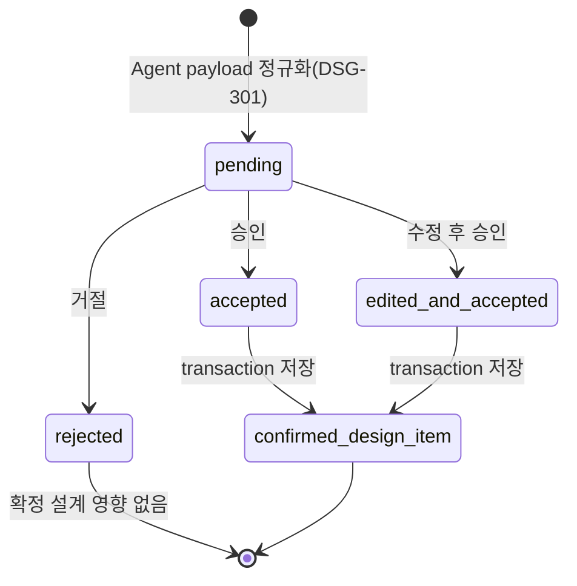
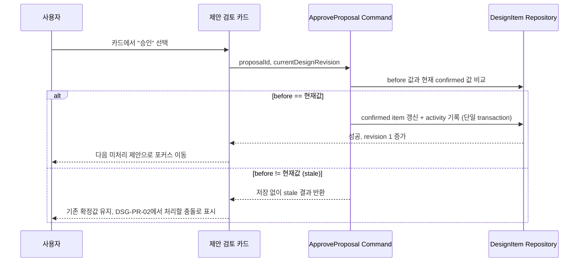

# DSG-PR-01 — 제안 검토·확정

**Status: in_progress.** Started from `main` at CON-PR-03 merge commit `ecbb7e0402f4a81f5fa1c184916a776a0723a38c` (PR #16, `Add consented AI conversation blocks`).

## Overview

한 사용자 답변이나 첨부 자료에서 추출된 여러 ChangeProposal을 사용자가 카드 단위로 개별 검토하고, 승인·수정 후 승인·거절할 수 있게 한다. 승인된 값만 확정 설계(DesignItem)에 반영하고, 승인 전 제안값이 확정값처럼 보이지 않게 한다.

## Background

2단계(`CON-PR-*`)에서 `TURN_ANALYZE`가 여러 atomic proposal을 반환하도록 이미 완성되지만, 사용자가 그 제안들을 실제로 승인/거절/수정하는 검토 UI와 저장 로직은 아직 없다. `docs/product/02-prd.md`의 여정 A/B/C는 "사용자가 추출된 항목을 승인하거나 수정한다"를 핵심 경험으로 명시하므로, 이 PR 없이는 대화가 끝나도 설계가 전혀 누적되지 않는다.

## Scope

### 포함

- ChangeProposal 정규화(DSG-301): target/operation 단일화, 중복 제거, 근거 없는 추론 표시
- 제안 검토 카드 UI(DSG-302): 변경 전/후 비교, 근거, 영향, 거절/수정 후 승인/승인 행동
- 승인·수정 저장 로직(DSG-303): 승인 시 현재 값 재비교, 수정값만 confirmed 저장, 삭제는 `archivedAt`으로 소프트 삭제, 상태 변경과 activity를 단일 transaction으로 처리

### 제외

- 충돌 감지·해결 UI(DSG-304), 의존 항목 재검토(DSG-305) — `DSG-PR-02`
- 설계 보드 전체 화면과 readiness 계산(DSG-306) — `DSG-PR-03`
- 일괄 처리(DSG-307) — `DSG-PR-02`

## 연결 근거

- 요구사항: `PROP-001`, `PROP-002`
- Delivery 작업: `DSG-301`, `DSG-302`, `DSG-303` (`docs/delivery/03-proposals-and-design.md:28-73`)
- 데이터/API 계약: `docs/product/05-data-spec.md` (`DesignItem`, `EvidenceRef`, `ChangeProposal`, `ActivityEntry`, aggregate transaction), `docs/product/13-prompt-and-response-contracts.md` (`ProposalPayload` strict schema and application-owned fields), `docs/process/04-proposal-and-readiness.md` (proposal transitions and atomic apply), `docs/product/15-ai-prompt-template-spec.md#turn_analyze--turnanalyzev1` (single-target proposals, evidence and pending-only)
- 결정: `DEC-002`(미정 허용), `DEC-004`(문서 편집 자동 반영과의 경계), `DEC-006`(현재 질문 관련 제안 처리 후 다음 질문), `DEC-026`(승인은 코드와 사용자 행동으로 결정)
- 화면 설계: `docs/ui/03-design-board-and-inspector.md` (`UI-PROP-001`), `docs/ui/screens/03-proposal-and-conflict.md` (F-PROPOSAL, P01~P11)
- 선행 PR: `CON-PR-03`(메시지·AI block, 제안 요약 block과 proposal payload 수신)

## 선행 조건 (Definition of Ready)

- `CON-PR-03` PR #16이 main에 병합됐으며 이 작업 기준 commit은 `ecbb7e0402f4a81f5fa1c184916a776a0723a38c`
- `ProposalPayload`, `DesignItem` 타입 계약이 `FND-PR-02`에서 확정됨
- `PROP-001`, `PROP-002`, `DEC-002`, `DEC-004`, `DEC-006`, `DEC-026`와 UI-PROP-001이 작업 범위를 결정하기에 충분함
- 미결정 차단 항목 없음(충돌 해결·의존 재검토·일괄 처리는 제외 범위이며 DSG-PR-02가 담당)

## 작업 단위별 구현 개요

| 작업 | 내용 |
| --- | --- |
| DSG-301 | Agent 응답의 `proposals: ProposalPayload[]`를 받아 target/operation 단일 제안으로 분리·검증하는 정규화 계층 구현. `requestId`+target 조합 중복 제거. |
| DSG-302 | `docs/ui/03-design-board-and-inspector.md`의 Inspector `proposed` footer(거절 ghost / 수정 후 승인 secondary / 승인 primary)와 `docs/ui/screens/03-proposal-and-conflict.md`의 F-PROPOSAL 레이아웃(P01~P11)을 구현. 단일 제안은 Inspector, 복수 제안은 전체 높이 Drawer/Modal. stale 감지는 mutation을 막고 DSG-PR-02의 conflict review로 넘기며 충돌 해결 UI는 여기서 만들지 않는다. |
| DSG-303 | 승인 command: before 재비교 → confirmed 저장. 수정 후 승인 command: 수정값만 저장. 거절 command: proposal을 `rejected`로 표시하고 confirmed 설계에 영향 없음. 삭제 승인은 `archivedAt` 기록 후 소프트 삭제. 저장은 상태 변경 + activity 기록을 하나의 repository transaction으로 처리. |

## 프로세스 / 상태 전이

## 데이터/API 영향

- 신규 저장 엔터티: `ChangeProposal`(status: pending/accepted/edited_and_accepted/rejected/superseded), `DesignItem`(archivedAt 포함)
- `POST /api/blueprint/turn` 응답의 `proposals`를 읽기 전용 입력으로 사용(신규 API 엔드포인트 추가 없음, 기존 계약 재사용)
- 승인/거절/수정은 클라이언트 도메인 command + IndexedDB repository 저장이며 서버 API 호출 없음(AI 호출과 분리)

## Acceptance Criteria

### Happy Path

Given 한 자유 답변에서 사용자·기능·제약 3개의 proposal이 반환된 상태, when 사용자가 각각을 개별 카드에서 승인하면, then confirmed 설계에 3개 항목이 모두 반영되고 각 승인마다 revision이 정확히 1씩 증가한다.

### Failure Case

Given 제안 승인 저장 중 repository transaction이 실패한 상태, when 사용자가 승인을 재시도하면, then proposal은 `pending`으로 유지되고 confirmed 설계와 이전 상태가 변경되지 않으며 오류 안내가 표시된다.

### Boundary

Given 같은 proposal에 대해 승인 command가 중복 실행된 상태(더블 클릭 등), when 두 번째 요청이 처리되면, then confirmed item의 revision은 한 번만 증가한다(`DSG-303` 성공 조건).

Given proposal의 `before`가 현재 confirmed 값과 다른 상태, when 승인 또는 수정 후 승인이 실행되면, then 어떤 proposal·DesignItem·revision·activity도 변경하지 않고 stale 결과를 반환한다. 충돌 비교·선택 해결은 DSG-PR-02 범위다.

## 실패·경계 조건 및 범위 경계

- ProposalPayload schema/ID/evidence 검증 실패는 저장하지 않고 안전한 오류로 반환한다. 존재하지 않는 대상의 update/delete도 확정 상태를 바꾸지 않는다.
- IndexedDB project aggregate transaction 실패는 proposal 상태, DesignItem, revision 및 ActivityEntry 변경을 모두 rollback하고 사용자가 재시도할 수 있게 오류를 표시한다.
- 이미 처리된 proposal에 대한 중복 command는 멱등 처리한다. 재시도에 따른 중복 적용·revision 증가·activity 생성이 없어야 한다.
- 승인 전 제안은 pending 상태로만 표시하고 DesignItem/document confirmed 값으로 투영하지 않는다. reject는 revision을 증가시키지 않는다.
- 이 단위에서는 여러 항목의 의존성 계산, 충돌 해결 선택, atomic bulk action 및 readiness board를 구현하지 않는다.

## 예상 변경 파일

- `src/domain/blueprint/proposal.ts` (신규): ChangeProposal 상태 모델과 정규화 규칙
- `src/features/proposals/normalize-proposals.ts` (신규): DSG-301 정규화 로직
- `src/features/proposals/approve-proposal.command.ts`, `reject-proposal.command.ts`, `edit-and-approve-proposal.command.ts` (신규)
- `src/components/blueprint/review-panel.tsx` (수정): 제안 카드 목록과 Inspector 승인 footer
- `src/infrastructure/storage/design-item-repository.ts` (수정): confirmed 저장 transaction

## 테스트 계획

- 단위: 정규화(중복 제거, target/operation 분리), 승인/거절/수정 command의 상태 전이
- 계약: `ProposalPayload` 스키마 검증(존재하지 않는 대상 update/delete 거절)
- 컴포넌트: 제안 카드 키보드 조작, 승인 후 다음 미처리 제안 포커스 이동
- 통합: transaction 실패 시 rollback, 중복 승인 시 revision 1회 증가

## UI 증거 계획 (해당 시)

- `docs/template/README.md`의 설계/검토 관련 mapped reference를 구현 전에 확인한다.
- 검증은 변경된 검토·수정·승인/거절 흐름과 직접 영향받는 keyboard/focus 및 desktop/mobile 배치만 대상으로 한다. 캡처는 설명에 도움이 될 때 최종 HEAD의 선택 증거로 첨부하며 고정 캡처 세트는 요구하지 않는다.
- 관련 상태: pending 제안, 수정 유효성 오류, 저장 실패, stale 승인 차단, 승인/거절 완료.

## 코드 리뷰·QA 체크리스트

- [ ] Blueprint semantic HTML/CSS와 관련 `docs/template/` references를 사용하고 접근성 및 상태를 검증함
- [ ] 승인 전 제안값이 확정값 화면에 노출되지 않음
- [ ] 저장 실패 시 proposal/confirmed item 상태 보존 확인
- [ ] 키보드만으로 카드 선택 → 승인/거절/수정 전체 흐름 가능

## Done Checklist

- [ ] Requirements implemented
- [ ] Acceptance criteria verified
- [ ] 독립 코드 리뷰 pass
- [ ] 독립 QA pass
- [ ] 직접 영향받는 desktop/mobile 동작 및 접근성 검증 완료(캡처 선택)
- [ ] 사용자 PR 머지 확인

## 실행 시 추가 문서

- 이 폴더에 구현 중/후 `test-results.md`, `review-notes.md`, `qa-report.md` 등을 추가로 생성한다(지금은 생성하지 않음).

## 집중 검증 순서

- 정규화/command/repository 변경: 해당 신규 unit 및 project aggregate transaction 관련 contract 테스트만 실행한다. 최소 대상은 proposal 정규화, 개별 승인·수정·거절, stale 차단, duplicate command, rollback이다.
- schema/reference 검증 변경 시 `node --test tests/contract/fnd-ai-schema.test.js tests/contract/fnd-display-references.test.js`를 포함한다.
- UI 변경 시 proposal 전용 Playwright Chromium spec을 추가해 승인 전 비확정 표시, 수정/검증 오류, 승인·거절, keyboard/focus, 저장 오류를 검증하고 relevant desktop/mobile layout을 확인한다. UI와 production code 변경이면 `npm run build`도 실행한다.
- 항상 `git diff --check`; 전체 suite/golden eval은 직접 변경 계약이 요구하지 않는 한 실행하지 않는다.
- OpenAI live key/provider call은 필요하지 않다. Proposal data는 schema-valid fake fixtures를 사용하며 AI 호출/출력은 DSG-PR-01 대상이 아니다.
