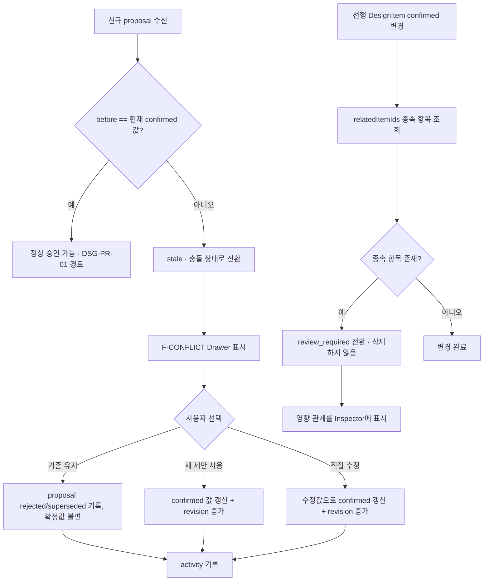
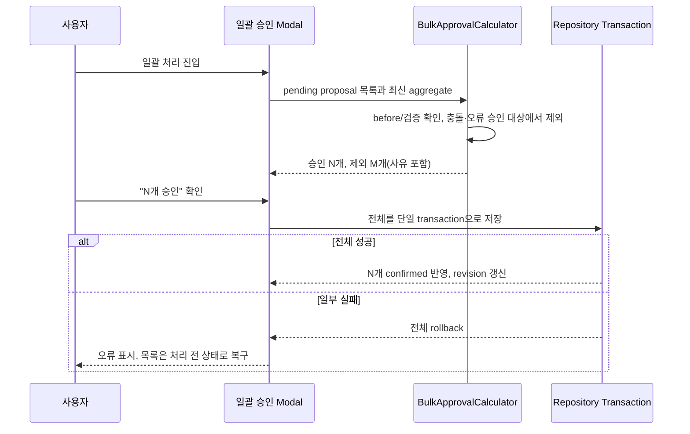

# DSG-PR-02 — 충돌·의존·일괄 처리

**Status: in_progress.** Starts from `main` at DSG-PR-01 merge commit `e33212d2de305f571db287631fb9256eda0196eb` (PR #17, `Add proposal review and approval`). Definition of Ready is satisfied; no product decision or live provider setup blocks implementation.

## Overview

DSG-PR-01의 제안 검토 흐름에서 `before`가 현재값과 달라지면 충돌 검토로 전환한다. 사용자가 기존값 유지, 새 값 적용, 직접 수정 중 선택할 때까지 확정값을 보존한다. 확정된 선행 항목의 변경은 직접 연결된 종속 항목을 삭제하지 않고 `review_required`로 전환하며, 충돌·검증 오류 없는 제안은 일괄 승인하고 여러 pending 제안은 일괄 거절할 수 있게 한다.

## Background

PR #17 (`e33212d2de305f571db287631fb9256eda0196eb`)에서 DSG-PR-01의 proposal 정규화, 개별 승인·수정·거절 및 저장 transaction이 병합되었다. 그 command는 stale `before`를 감지해 변경 없이 실패 처리하지만, 사용자가 충돌을 해결하는 흐름과 설계 의존 관계를 갱신하는 흐름은 아직 없다. 요구사항 PROP-004는 일괄 승인과 일괄 거절을 모두 요구한다. Delivery DSG-307은 특히 충돌·검증 오류 proposal이 일괄 승인에 섞이지 않도록 제한한다.

## Scope

### 포함

- 충돌 해결(DSG-304): proposal의 저장된 `before`와 최신 target 비교. 불일치 시 `conflict_review`로 진입시키고 기존 유지/새 값 적용/수정 적용을 제공한다. 충돌 해결의 proposal·DesignItem·revision·activity 변경은 원자적으로 저장한다.
- 의존 항목 재검토(DSG-305): 확정 변경 후 `relatedItemIds`에서 직접 연결된 confirmed 종속 항목을 찾아 `review_required`로 전환하고 원래 값 및 선행 변경 이유를 노출한다. 항목은 삭제하지 않는다.
- 일괄 처리(DSG-307): pending proposal 중 최신 before 일치 및 검증 성공한 제안만 일괄 승인 대상으로 계산한다. 개수와 제외 사유를 확인시킨다. 선택된 pending proposal은 일괄 거절 가능하다. 각 일괄 행동은 단일 aggregate transaction이며 실패하면 전체 원상 복구한다.

### 제외

- 단일 제안 승인/거절/수정 UI 자체 — `DSG-PR-01`에서 이미 완성
- 설계 보드 전체 화면과 readiness 계산 — `DSG-PR-03`

## 연결 근거

- 요구사항: `PROP-003`, `PROP-004`
- Delivery 작업: `DSG-304`, `DSG-305`, `DSG-307` (`docs/delivery/03-proposals-and-design.md:75-106,136-146`)
- 데이터/API: `docs/product/05-data-spec.md` (ChangeProposal.before, DesignItem.relatedItemIds/status, aggregate transaction; 신규 field/entity/API 불필요)
- 프로세스: `docs/process/02-state-machine.md` (`proposal_review → conflict_review → proposal_review`) 및 `docs/process/04-proposal-and-readiness.md` (충돌 해결, dependency recheck, bulk atomic apply)
- 결정: `DEC-002`(미해결 충돌은 문서 생성 차단), `DEC-012`(영향 확인 원칙)
- 화면 설계: `docs/ui/03-design-board-and-inspector.md` (`UI-PROP-002`), `docs/ui/screens/03-proposal-and-conflict.md` (F-CONFLICT와 일괄 승인 Modal), `docs/ui/06-overlays-responsive-and-states.md` 및 `docs/ui/component-contracts.md` (Drawer/Modal/keyboard/focus/error contracts)
- 시각 참고: `docs/template/README.md`를 읽었다. 이 task에 명시된 F-CONFLICT/Proposal layout의 구현 전용 reference 캡처는 없으므로 관련성 낮은 캡처를 강제하지 않는다. UI는 해당 문서 화면 구조와 기존 Blueprint 디자인을 따른다. 캡처는 선택 증거다.
- 선행 PR: `DSG-PR-01` PR #17, merge commit `e33212d2de305f571db287631fb9256eda0196eb` (proposal types, stale guard, approve/reject/edit commands, aggregate transaction merged)

## 선행 조건 (Definition of Ready)

- `DSG-PR-01` PR #17이 `main`에 병합됨; 현재 작업 branch base는 merge commit `e33212d2de305f571db287631fb9256eda0196eb`.
- `ChangeProposal.before`, pending/accepted/edited_and_accepted/rejected 전이, aggregate 저장 transaction과 stale 승인 거부가 코드·테스트로 존재함.
- `DesignItem.relatedItemIds`와 `review_required`, process `conflict_review`, aggregate transaction이 타입·data/process 계약에 존재함.
- PROP-003/004, DSG-304/305/307 및 F-CONFLICT/일괄 확인 UI 계약에서 이 task 결과를 결정할 수 있음. 미결정 차단 항목 0건.
- 테스트는 실제 AI 호출 없이 schema-valid project aggregate fixture와 저장 transaction failure fixture로 검증한다. OpenAI key/provider는 필요하지 않다.

## 작업 단위별 구현 개요

| 작업 | 내용 |
| --- | --- |
| DSG-304 | DSG-PR-01의 approve command가 반환하는 최신 before 불일치 경로에서 최신 aggregate로 충돌을 재구성한다. 기존/제안값과 양쪽 근거 및 영향 item을 표시한다. 선택 전 적용은 불가. 기존 유지(rejected 또는 superseded), 최신값 적용, 입력값 검증 후 직접 수정의 결과를 repository transaction으로 기록한다. 해결 전 확정값/revision/activity는 그대로 둔다. 성공 시 conflict count/process state를 갱신한다. |
| DSG-305 | DesignItem 변경 후 `relatedItemIds`를 참조하는 confirmed dependents를 `review_required`로 바꾼다. 바뀐 선행 항목과 영향 이유를 저장된 관계에서 표시하고 원래 값과 관계를 보존한다. 변경 command와 dependency transition은 같은 transaction에 포함한다. 범위는 직접 참조 관계이며 추론 기반 의미 의존성은 추가하지 않는다. |
| DSG-307 | 최신 aggregate에서 pending proposal을 평가한다. approve 후보는 target이 존재하고 before가 최신값과 일치하며 기존 schema/domain validation을 통과한 항목만 포함하며 충돌/오류별 제외 수와 사유를 계산한다. UI는 수를 확인한 뒤 일괄 승인한다. 별도의 명시 선택으로 여러 pending proposal을 일괄 거절한다. 각각 project aggregate 단일 transaction으로 상태/DesignItem/revision/activity를 저장하고 실패 시 전부 rollback한다. |

## 프로세스 / 상태 전이

## 데이터/API 영향

- 신규 엔터티/필드/API 없음. 기존 `ChangeProposal.before/status`, `DesignItem.relatedItemIds/status`, aggregate `project.designRevision`, `activityEntries`를 사용한다.
- 충돌 해결·dependents 상태 전이 및 bulk operations는 클라이언트 도메인 command와 IndexedDB aggregate transaction이다. AI/provider 호출은 하지 않는다.
- 한 개의 충돌 해결/변경/일괄 action당 revision은 한 번만 증가하며, 거절은 confirmed item/revision을 변경하지 않는다. failure는 proposal, DesignItem, revision, activity의 전체 rollback이다.

## Acceptance Criteria

### Happy Path

Given 현재 확정값 A와 proposal.before A/after B가 있는 상태, when 사용자가 F-CONFLICT에서 새 값 B를 적용하면, then B만 confirmed되고 revision은 1 증가하며 선택 결과가 activity에 기록된다. 새 값 적용으로 직접 관련된 항목은 `review_required`가 되고 연결 이유와 원래 값이 남는다.

### Failure Case

Given 유효한 일괄 승인 3개 중 저장 도중 하나가 실패하거나 일괄 거절 transaction이 실패한 상태, when transaction이 실패하면, then 선택 대상의 proposal 상태, confirmed 설계, revision, activity가 모두 처리 전 상태로 복구되고 부분 성공을 표시하지 않는다.

Given pending 제안 중 stale 또는 검증 오류가 있는 상태, when 일괄 승인 대상을 계산하면, then 해당 항목은 적용 수에 포함되지 않고 제외 수와 이유가 표시된다. 일괄 거절은 사용자가 명시적으로 선택한 pending 항목만 대상으로 한다.

### Boundary

Given proposal.before와 최신 target이 다르고 연결 dependents 또는 충돌 제외 대상이 있는 상태, when bulk approval 후보를 계산하거나 충돌을 취소하면, then 충돌 proposal은 승인 후보에서 빠지고 기존 확정값/revision이 유지되며 종속 항목은 삭제되지 않고 선행 변경 원인을 확인할 수 있다.

Given stale proposal을 검토하는 상태, when 사용자가 기존값 유지를 선택하면, then confirmed item과 revision은 유지되고 선택 결과만 proposal/activity에 기록된다. 새 값 또는 유효한 수정값을 선택한 경우에만 변경이 원자적으로 반영된다.

## 예상 변경 파일

- `src/features/proposals/` existing commands/repository integration: conflict resolution, dependent re-evaluation, bulk candidate calculation and atomic approve/reject commands.
- Existing proposal review UI in `src/pages/ProjectPage.tsx` and `src/styles/workspace-shell.css`, or a focused extracted conflict/bulk component if reuse warrants it.
- `tests/unit/` focused conflict, dependency and bulk command tests; `tests/e2e/` focused DSG-PR-02 user-flow spec.
- Final paths follow DSG-PR-01 repository conventions; this plan does not prescribe module names that do not yet exist.

## 테스트 계획

- Unit: before/current match and stale conflict; existing/accept/edit conflict commands; direct related-item transition; bulk eligible/excluded counts and reject selection; idempotent resolution.
- Contract: `ChangeProposal` and `DesignItem` schema invariants; project aggregate revision, conflict count/process transition and activity result.
- Repository integration: conflict resolution, dependent review and bulk approve/reject each commit atomically; injected storage failure preserves proposal, confirmed items, revision and activity.
- Focused Playwright Chromium spec: conflict choice is required before apply; existing value stays unchanged on cancel; selected choices resolve and persist; bulk counts/exclusion reasons; bulk approve/reject success/failure; keyboard/focus and relevant desktop/mobile layout.
- Run only focused DSG-PR-02 tests (expected commands: `node --test tests/unit/dsg-pr-02-*.test.js tests/contract/dsg-pr-02-*.test.js`; `npx playwright test tests/e2e/dsg-pr-02-*.spec.ts --workers=1`). Run `npm run build` because production code/UI changes, then `git diff --check`. No full suite or AI golden eval unless direct changed-contract dependency is discovered.
- Test data uses deterministic fixtures; there are no live OpenAI/provider calls or key dependency.

## UI 증거 계획 (해당 시)

- No fixed screenshot set. If a final-HEAD capture explains behavior, attach it optionally. QA evidence is the focused browser verification of the changed conflict and bulk actions at relevant responsive layouts.

## 코드 리뷰·QA 체크리스트

- [ ] 해결 전 기존 확정값이 어떤 경로로도 변경되지 않음
- [ ] 종속 항목이 review_required로만 전환되고 삭제되지 않음
- [ ] 일괄 처리 부분 실패 시 전체 rollback, 부분 성공 상태 노출 없음
- [ ] conflict choice controls and bulk dialog are semantic and keyboard operable; validation/error descriptions, focus return, and relevant responsive layout follow `docs/ui/component-contracts.md` and overlay contracts

## Done Checklist

- [ ] Requirements implemented
- [ ] Acceptance criteria verified
- [ ] 독립 코드 리뷰 pass
- [ ] 독립 QA pass
- [ ] changed desktop/mobile behavior and directly affected accessibility verified (screenshots optional)
- [ ] 사용자 PR 머지 확인

## 실행 시 추가 문서

- 이 폴더에 구현 중/후 `test-results.md`, `review-notes.md`, `qa-report.md` 등을 추가로 생성한다(지금은 생성하지 않음).
