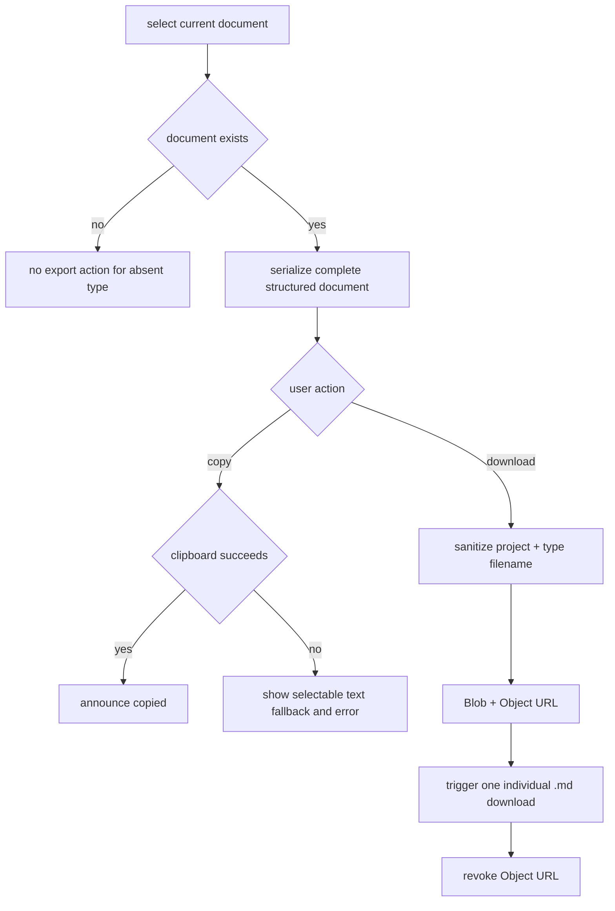

# EXP-PR-01 — 문서 복사·다운로드

**Status: in progress.** Planning base: `origin/main` at `f169cf7da310dc446fdb02b7006817c65703ea12` (SRC-PR-01, PR #24, merged 2026-10-15). Scope: `EXP-505` (`EXP-001`).

## 사용자 결과

사용자는 현재 존재하는 Requirements와 PRD를 개별 Markdown으로 복사하거나 다운로드할 수 있다. 설정 가이드도 동일한 export contract로 지원하며, 가이드가 아직 생성되지 않은 상태에서는 해당 문서의 동작만 제공하지 않는다. 다운로드 파일명은 프로젝트명과 문서 유형을 포함하고 안전하게 정제한다.

## 요구사항·delivery 추적

- Requirement: `EXP-001` in `docs/product/03-requirements.md`.
- Delivery task: `EXP-505` in `docs/delivery/05-sources-guides-export.md`.
- PR unit row 24: `EXP-PR-01`; `DOC-PR-01` and `DOC-PR-02` are merged. `GDE-PR-01` is later in the delivery order and is not a precondition for exporting the existing two document types.
- Decision: `DEC-008` allows document-by-document Markdown copy/download and excludes package/ZIP export.
- Data/API: `GeneratedDocument`, `DocumentSection` and typed requirements in `docs/product/05-data-spec.md`; document responses remain structured section/requirement records, not a single API Markdown payload, per `docs/product/06-architecture.md`.
- UI: `UI-DOC-001` in `docs/ui/04-document-workspace.md`; `F-REQ-READY`, `F-PRD-DRAFT`, `F-GUIDE-DRAFT` in `docs/ui/screens/05-documents-and-guide.md` and `F-REQ-READY` in `docs/ui/screens/06-generation-ready-and-errors.md`.
- Visual references: read `docs/template/README.md`; inspected `image (12).png` for document outline/readability and `image (9).png` for a detail inspector. Use the established compact document header and calm content hierarchy; controls must stay outside exported Markdown. No screenshot artifacts are required by this plan.
- Existing implementation patterns: document-specific views in `src/components/blueprint/RequirementsDocument.tsx` and `src/pages/ProjectPage.tsx`; legacy clipboard/download behavior in `src/features/survey/useSurveyForm.ts` is not the canonical structured-document serializer and should not be reused as its payload source.

## Definition of Ready

- [x] PR unit, requirement, delivery task, scope, and observable acceptance are identified.
- [x] `DOC-PR-01` and `DOC-PR-02` provide the two currently available document types on current main.
- [x] `GDE-PR-01` is not required to build the generic export contract. The view/actions remain unavailable when `setup_guide` does not exist; GDE-PR-01 will connect those actions to its generated guide when that task adds the guide view. `EXP-001` remains in progress until all three types are integrated.
- [x] `DEC-008` resolves document-by-document versus bundle export.
- [x] Structured serialization source is identified: ordered `DocumentSection.markdown`, plus the structured Requirements records rendered in their linked section; guide serialization uses the same section-based document contract.
- [x] UI surfaces and visual references are identified. Only directly affected copy/download behavior and responsive/keyboard behavior are in scope.
- [x] No server/API, storage migration, or product decision is required.

## Scope

### Included

- Pure client serializer for one document at a time, derived from canonical `GeneratedDocument` + its matching sections (never from rendered DOM).
- Requirements Markdown contains sections ordered by `DocumentSection.order`; within a section it includes the linked requirement IDs, priority, title, description, and acceptance criteria that the existing view renders. Include open issues in their existing dedicated section. Avoid duplicating a structured requirement across sections beyond the existing view's source-item linkage behavior.
- PRD and setup guide Markdown contain their ordered section heading and authored Markdown. Preserve code fences, tables, lists, and Korean text byte-for-byte apart from deliberate heading/separator joining. Include the setup guide's required draft notice at the beginning while its document is draft, as required by `F-GUIDE-DRAFT`.
- Copy the current complete document; on Clipboard API absence/rejection, expose a focused/selectable text fallback and a clear status message. Do not silently claim success.
- Download each document individually as UTF-8 `text/markdown`; filename contains sanitized project title and stable document type (`requirements`, `prd`, `setup-guide`) with `.md` extension. Remove or replace path separators, control characters and traversal-like dot-only segments; use a safe fallback if no project-title characters remain.
- Create an Object URL for the Blob, trigger a single download, and revoke the URL after the browser has consumed the click, including cleanup if trigger setup fails.
- Provide actions for each document view that exists; do not render disabled setup-guide export actions when the guide document is absent. A reusable action component/function may be integrated by GDE-PR-01 when that view exists.

### Excluded

- ZIP, “all documents” bundle, bulk download, or exporting only a selected section (`DEC-008`, `EXP-505`).
- Document generation, approval/readiness decisions, guide content, PDF export, server APIs, persistence, and changes to document schemas.
- Changing how the on-screen document is rendered, except the small action/fallback UI needed for copy and download.
- Broad accessibility, responsive, or full-app QA outside the affected action and fallback.

## Implementation outline

1. Add a pure serializer/filename helper with stable input types and tests for ordered sections, structured Requirements content, guide draft notice, control-free output, and path/control-character edge cases.
2. Add client copy/download actions with injectable clipboard/URL/document seams where needed for deterministic tests; handle success, failure, selectable fallback, and URL cleanup.
3. Integrate into the existing Requirements and PRD document headers using semantic buttons, visible focus, and accessible status/fallback labels. Export all existing sections regardless of the currently selected section.
4. Exercise both available document types in a focused Playwright flow at desktop and mobile layout; use synthetic fixture documents for the generic setup-guide serializer contract, without asserting that guide generation exists.

## Process and failure states

## Acceptance criteria

### Happy path

Given a stored Requirements or PRD with multiple sections, when the user copies or downloads it, then the complete document is exported in stored section order with the same structured requirement content the view presents; Korean, tables, lists, and fenced code remain intact, and the downloaded name contains the project title and document type. A setup-guide fixture uses the same section serializer and draft notice.

### Failure case

Given Clipboard API is unavailable or rejects the write, when the user chooses copy, then an accessible error is announced and the complete Markdown is placed in a selectable fallback; the UI does not report copy success. If download setup throws, the failure is visible and any created Object URL is revoked.

### Boundary

Given the project title contains `/`, `..`, NUL/control characters, separators, or only unsafe characters, when any document type is downloaded, then the resulting basename is safe (no path traversal or control characters), includes a safe project-name fallback and the type, and ends in `.md`. Repeated sections retain stable order; no ZIP or all-document action is exposed.

## Focused validation matrix

| Concern | Focused check | Required result |
| --- | --- | --- |
| Serialization | Unit tests for ordered sections, empty section, Korean text, fenced code, tables/lists, Requirements IDs/priority/AC/open issues, guide draft notice | Stable Markdown matches canonical document content and contains no buttons, modal copy, badges, or UI labels |
| Filename/download | Unit tests for separators, `..`, control characters, blank/unsafe titles, type mapping, and URL lifecycle on success/failure | Safe per-document `.md` basename; one trigger; every created URL eventually revoked |
| Copy behavior | Component/unit tests for clipboard success, missing API/rejection, selectable fallback, accessible error/status | Success only on resolved write; fallback text exactly matches serializer output |
| Browser behavior | One scoped Playwright spec for Requirements and PRD copy/download, fallback, file contents/name, and mobile action usability | Only existing document types are exposed; whole document downloads and can be reopened/read without formatting loss |
| Build and diff | `npm run build`; `git diff --check` | Both pass |

No live AI calls, source/guide pipeline tests, broad suite, or screenshot set is required. Scope all tests to serialization and the visible export interaction.

## Data/API impact

- No server API, schema, or persisted project data changes. Export is derived locally from the current saved `GeneratedDocument` and related `DocumentSection` records.
- The source of truth remains structured records. Do not scrape UI DOM or expose generated control elements in output.
- Filename metadata is only the project title and document type; do not include owner identity, secrets, or local paths.

## Risks

- Requirements contain both authored sections and structured requirement records. Serializing only `section.markdown` would omit content that the current Requirements view renders; keep serializer mapping aligned to that view and cover it with fixtures.
- Clipboard permissions vary by browser/context; fallback must remain selectable and keyboard reachable.
- Revoking the Object URL synchronously may cancel a browser download. Revoke after the click has been consumed and test lifecycle deterministically.
- `GDE-PR-01` has not run yet. Keep the serializer generic and test its setup-guide data shape, but do not claim a guide screen is usable until GDE-PR-01 wires it.

## Review and QA checklist

- [ ] Current Requirements/PRD content and generic guide document are serialized in canonical order.
- [ ] Structured requirement fields and guide draft notice are included as specified.
- [ ] UI controls, modal text, transient statuses, and unrelated sections are not omitted/included incorrectly.
- [ ] Copy fallback is accessible and never claims unconfirmed success.
- [ ] Filenames are safe and include project/type; one document per action only.
- [ ] Object URLs are revoked after completion/error.
- [ ] Focused unit and Playwright checks pass at exact final SHA; screenshots are optional.

## Done checklist

- [x] `EXP-001` available-document behavior and focused acceptance checks pass.
- [x] Implementer self-validation/build results recorded.
- [ ] Independent code review passes on final SHA.
- [ ] Independent focused QA passes on the same SHA.
- [ ] User-authorized PR lifecycle gate passes and GitHub confirms merge.
- [ ] `EXP-001` stays `in_progress` until GDE-PR-01 adds setup-guide view integration and the same actions are verified there.

## Execution artifacts

During implementation, add `test-results.md`, `review-notes.md`, and `qa-report.md` to this task folder with exact commands, same-SHA review/QA evidence, and focused outcomes. Do not create them in planning stage.
