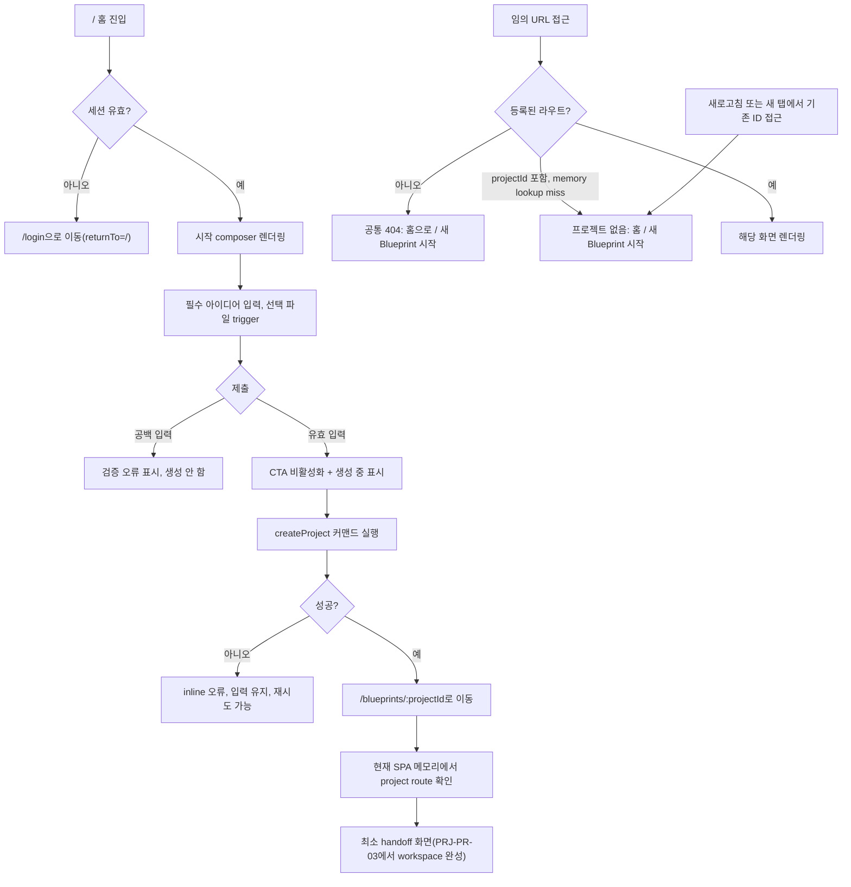

# PRJ-PR-01 — 라우팅·프로젝트 생성

## Overview

Blueprint의 핵심 라우트(`/`, `/blueprints/new`, `/blueprints/:projectId`, `/blueprints/:projectId/:documentType`)를 구성하고, 홈 화면의 시작 composer에서 아이디어 또는 파일로 새 프로젝트를 생성해 작업 공간으로 진입하는 흐름을 완성한다. 존재하지 않는 경로와 존재하지 않는 프로젝트 ID를 구분된 화면으로 처리한다.

## Background

1단계(프로젝트와 저장)의 첫 PR 단위다. 인증 선행 단계 `AUTH-PR-01~03`이 병합되어 있고, `AuthProvider`가 인증 확인 후 `ownerKey`를 제공한다. 리빌드 이전 `/survey`, `/prd` 경로는 마이그레이션하지 않고(`DEC-017`, `DEC-018`) 공통 404로 처리한다. 현재 앱은 `/`, `/login`, catch-all만 등록했고 홈은 안내용 placeholder이며 프로젝트 도메인/라우트는 아직 없다. FND-PR-02가 제공한 타입과 FND-PR-03의 `test:unit`, Playwright Chromium 및 `test:ci` 기반을 사용한다.

## Scope

### 포함

- `/`, `/blueprints/new`, `/blueprints/:projectId`, `/blueprints/:projectId/:documentType` 라우트 구성
- 일반 404 화면, 프로젝트 없음 화면
- 홈 시작 composer(필수 아이디어 입력 + 예시 채우기 + 파일 선택 trigger), 홈의 최근 프로젝트 빈 상태, 새 프로젝트 생성 커맨드
- 제목 없을 때 첫 설명을 100자 이내 임시 제목으로 변환
- 중복 제출 방지(빠른 연속 클릭 시 프로젝트 1개만 생성)

### 제외

- IndexedDB 영속 저장소와 `ProjectRepository`/`BlueprintAggregate` persisted envelope (`PRJ-PR-02`에서 정의·구현)
- 최근 프로젝트 목록, 20/21개 제한(`PRJ-PR-02`)
- 이전 browser storage key 분리/미마이그레이션(`PRJ-PR-02`); `PJT-005`에서 이번 PR은 이전 경로의 404 동작만 담당
- 작업 공간 셸의 3패널 레이아웃(`PRJ-PR-03`)
- 파일 텍스트 추출 자체(`SRC-PR-01`) — 이번 PR은 파일 첨부 UI 트리거만 연결

## 연결 근거

- 요구사항: `PJT-001` 전체, `PJT-005`의 legacy route 404 부분만 (legacy storage namespace/migration과 PJT-005 전체 완료는 PRJ-103 포함)
- Delivery 작업: `PRJ-101`, `PRJ-102` (`docs/delivery/01-project-lifecycle.md`)
- 결정: `DEC-017`(마이그레이션 없음), `DEC-018`(구 경로 404)
- 화면 설계: `docs/ui/screens/01-home-and-start.md`(H01~H11, F-HOME-EMPTY), `docs/ui/05-home-projects-and-files.md`(UI-HOME-001, UI-ERR-404)
- 데이터/프로세스 근거: `docs/product/05-data-spec.md`의 `BlueprintProject`, `ConversationThread`, `ConversationMessage`, `ReadinessSummary`; `docs/process/02-state-machine.md`의 `PS_HOME → PS_PROJECT_CREATING → PS_INTAKE`; `src/domain/blueprint/types.d.ts` 및 `src/domain/blueprint/process.js`
- 선행 PR: `AUTH-PR-01` #3, `AUTH-PR-02` #5, `AUTH-PR-03` #6, `FND-PR-01` #7, `FND-PR-02` #8, `FND-PR-03` #9 모두 최신 `origin/main`에 병합됨

## 선행 조건 (Definition of Ready)

- [x] `AUTH-PR-03` identity owner context 선행 구현이 기본 브랜치에 병합됨 (`ownerContext`/`AuthProvider`); IndexedDB 접근 격리의 실제 list/get/save/delete 검증은 `PRJ-PR-02` 소유다.
- [x] `AuthProvider`는 인증 성공 뒤에만 `ownerKey`를 제공하고 logout/expiry/account switch에 폐기한다. 프로젝트 command는 이 인증 context를 입력으로 받고 email을 namespace로 사용하지 않는다.
- [x] `FND-PR-01~03` 병합 완료. React Router, Blueprint 도메인 타입, 상태 전이 함수, 단위/계약/E2E 명령이 현재 기본 브랜치에 있다.
- [x] 아키텍처 경로 표 및 프로세스 상태와 일치: aggregate 생성 성공 상태는 `intake`; `PS_PROJECT_CREATING`은 일시 앱/프로세스 상태이며 프로젝트의 persisted `processState`에 저장하지 않는다.
- [x] UI 계약과 기준 캡처 확인: `docs/ui/05-home-projects-and-files.md`의 UI-HOME-001/UI-ERR-404, `docs/ui/screens/01-home-and-start.md`의 H01–H11/F-HOME-EMPTY 및 `docs/template/image (17).png`.

**Definition of Ready: READY.** 실제 저장 구현은 이 PR의 선행 조건이 아니다. PRJ-01은 canonical `BlueprintProject`, `ConversationThread`, 첫 `ConversationMessage` 값을 생성하고, 현재 SPA 실행 중 라우트 진입을 검증하는 ephemeral in-memory lookup만 사용한다. persisted `BlueprintAggregate` envelope와 `ProjectRepository` interface/구현은 정의가 불완전하므로 이번 PR에서 추측해 만들지 않고 PRJ-02가 저장 계약을 명시하면서 정의한다. PRJ-01의 새로고침/새 탭 이후 기존 ID 직접 접근은 memory lookup miss로 프로젝트 없음 화면을 보이는 것이 계약이며, 복구/최근 목록은 PRJ-02 소유다.

## 작업 단위별 구현 개요

**PRJ-101 라우팅과 404**

- React Router에 `/`, `/blueprints/new`, `/blueprints/:projectId`, `/blueprints/:projectId/:documentType`를 등록한다. `/`는 기존 인증 가드 아래 둔다. 허용 문서 타입은 canonical `DocumentType`만 받으며 잘못된 type은 공통 404로 처리한다.
- `/survey`, `/prd` 및 미정의 경로는 현재 URL을 유지한 채 공통 404로 연결한다(자동 redirect 금지).
- 프로젝트 ID가 라우트 파라미터로 들어오지만 리포지토리에 없는 경우 일반 404와 다른 "프로젝트 없음" 컴포넌트 렌더링(자동 리다이렉트 금지)
- 브라우저 뒤로/앞으로가기와 직접 URL 접근을 검증한다. 보호 경로는 기존 세션 가드로 처리하며 존재하지 않는 프로젝트는 인증 우회 없이 프로젝트 없음 상태로 구분한다.

**PRJ-102 홈과 새 프로젝트 생성**

- `docs/template/image (17).png`와 UI-HOME-001에 근거한 첫 화면 composer를 구현한다: idea textarea, 예시 채우기, 파일 선택 trigger, submit, 접근 가능한 검증/작업/실패 상태. 이 PR은 파일 추출·저장·ready SourceDocument 생성은 하지 않으며 첫 설명은 필수다.
- 제출 시 애플리케이션 command `createProject(input, ownerKey)`를 호출한다. ownerKey는 현재 인증 context에서만 전달한다.
- 생성 command는 `docs/product/05-data-spec.md`의 canonical 필드를 갖춘 `BlueprintProject`, `ConversationThread`, 첫 `ConversationMessage`를 만든다: 고유 IDs, ownerKey, schemaVersion, title, `active` status, `activeDocumentType: "design"`, `activeThreadId`, `processState: "intake"`, insufficient 초기 ReadinessSummary, created/updated/lastOpened 시각. 프로젝트당 thread 1개이며 첫 설명은 `role: "user", kind: "text"` Message로 한 번만 기록한다. 앱 상태 `PS_PROJECT_CREATING`은 프로젝트 data로 만들지 않는다.
- 제목이 없으면 첫 설명을 사용자에게 읽을 수 있는 안전한 임시 제목(공백 정리, markup/control character 제거, 최대 100자)으로 만든다. 명시한 title도 canonical 1–100자 trim 규칙을 지킨다.
- command 자체가 동시 중복 요청을 원자적으로 한 번만 반영하며 UI submit은 처리 중 비활성화한다. UI 잠금만으로 중복 생성 방지를 대체하지 않는다.
- command가 생성하는 세 canonical entity는 현재 session 내 ephemeral memory lookup에 등록해 방금 생성한 ID의 route 진입만 지원한다. 이 registry는 persistence API가 아니며 `BlueprintAggregate` envelope 또는 `ProjectRepository`를 구현/정의하지 않는다. IndexedDB·저장 계약·복구는 PRJ-PR-02에 남긴다.

## 프로세스 / 상태 전이

## 데이터/API 영향

- 서버 API 변경 없음. 인증 보호는 기존 `ProtectedRoute`를 확장해 유지한다.
- `BlueprintProject`/thread/message 타입은 FND-PR-02가 반영한 data spec 타입을 사용한다. 새 부분 aggregate 타입을 별도로 만들어 canonical 필수 필드를 생략하지 않는다.
- ephemeral registry는 route lookup 동안 projectId를 세 canonical entity에 연결할 뿐이다. 저장소 interface, `BlueprintAggregate` persisted envelope와 IndexedDB key/schema는 이 PR에서 선언하지 않는다. ownerKey 전달/비인증 접근 차단을 검증하며 ownerKey는 URL, DOM, browser storage, user-visible logs에 노출하지 않는다. durable cross-owner isolation·migration·quota/transaction 실패는 PRJ-PR-02 acceptance로 이관한다.

## Acceptance Criteria

### Happy Path

Given ownerKey가 준비된 인증 사용자가 홈에 있고, when 유효한 첫 설명을 제출하면, then canonical aggregate 하나가 `intake`로 생성되고 `/blueprints/:projectId`로 이동하며 첫 설명은 단일 사용자 메시지로 기록된다.

Given 제목 없이 첫 설명만 입력한 경우, when 프로젝트가 생성되면, then markup/control character가 제거되고 공백이 정리된 100자 이하 임시 제목이 부여된다.

### Failure Case

Given 사용자가 빈 입력으로 제출을 시도하면, when 검증이 실행되면, then 프로젝트를 생성하지 않고 인라인 오류만 표시한다.

Given 사용자가 등록되지 않은 URL에 직접 접근하면, when 라우트가 매칭되지 않으면, then 공통 404 화면을 표시하고 자동 리다이렉트하지 않는다.

Given 사용자가 존재하지 않는 `projectId`로 접근하면, when 리포지토리 조회가 실패하면, then 일반 404가 아니라 "프로젝트 없음" 화면을 표시한다.

Given 새로고침이나 새 탭에서 이전 ephemeral `projectId`로 접근하면, when memory lookup이 miss이면, then 프로젝트 없음 화면으로 처리하고 영속 복구를 약속하지 않는다(PRJ-PR-02에서 구현).

Given 익명/세션 확인 중 사용자가 보호 프로젝트 경로에 접근하면, when 기존 인증 guard가 session을 판정하면, then 프로젝트 composer/detail을 노출하지 않고 기존 로그인/checking 동작과 safe returnTo를 유지한다.

### Boundary

Given 사용자가 제출 command를 동시에 여러 번 시작하면, when 첫 command가 처리 중이면, then 중복 처리는 무시되고 프로젝트/thread/첫 메시지가 각각 정확히 1개만 생성된다.

Given 인증 사용자에게 owner context가 없거나 폐기되었으면, when command 실행을 시도하면, then 생성은 거절되고 프로젝트 메모리/화면 상태를 남기지 않는다.

## 예상 변경 파일

- `src/app/router.tsx`, `src/app/App.tsx` (기존 app shell에서 route wiring / auth preservation)
- `src/pages/HomePage.tsx` 및 필요 시 신규 project-start, not-found, project-not-found pages (현재 `HomePage` placeholder 교체)
- `src/features/projects/` create command and ephemeral project lookup registry (신규; no persisted repository interface)
- `src/components/blueprint/` home composer (신규) 및 해당 component/page CSS
- `tests/unit/` project create command tests, `tests/contract/` route/domain contract tests, `tests/e2e/prj-pr01.spec.ts` (실제 파일 경로는 FND-PR-03 conventions 유지)

## 테스트 계획

- Unit/contract: title present/derived/sanitize/length, blank rejection, UUID/time/canonical fields, `intake` + insufficient readiness, single thread/message, `ownerKey` required and passed only from authenticated context. Verify ownerKey is absent from rendered DOM, URL, browser storage, and user-visible logs.
- Unit/contract: concurrent duplicate `createProject` calls produce one project/thread/first message in the ephemeral registry; failure leaves command retryable and does not navigate.
- Route integration: four supported route shapes, valid/invalid documentType, `/survey`, `/prd`, unknown route (URL retained), just-created/existing-in-memory ID, unknown ID, refresh/new-tab lookup miss, browser back/forward, route rendering not leaking stale previous project.
- E2E: unauthenticated protected route checks current auth guard; authenticated happy path idea → submit → project route; blank validation; pending submit/rapid double click; create failure preserves input and retry; missing project and generic 404; keyboard operation and focus/error announcement.
- UI evidence: screenshots for 1440×900 and 390×844 for home empty, typing/validation, creating, create failure, 404, and project missing as applicable. Capture final implementation HEAD; all generated evidence in `.pr-artifacts/PRJ-PR-01/` and attach to PR.
- Commands: `npm run test:unit`, `npm run test:e2e:ci -- tests/e2e/prj-pr01.spec.ts`, `npm run build`, `git diff --check`; before review run aggregate `npm run test:ci` (unit → E2E → build). No command is considered passed unless executed on the implementation HEAD.
- Agent Browser: check current tool catalog and executable availability; if unavailable, record both checks and run the same complete QA flow in Playwright Chromium per root AGENTS policy.

## UI 증거 계획

- desktop 1440×900 and mobile 390×844: home empty, input/validation, pending, failure, generic 404, project missing. For states that cannot fit naturally on one viewport, use full-page capture plus viewport screenshot.
- Playwright Chromium: verify DOM, accessible names/errors, focus order, tab/keyboard submit, width overflow, and each state on final HEAD. Verify same flow with Agent Browser if available; otherwise record tool/executable checks and use Playwright as documented.

## 코드 리뷰·QA 체크리스트

- [ ] `/survey`, `/prd` 접근 시 리다이렉트 없이 404인지 확인 (DEC-018)
- [ ] 임시 제목 생성 시 HTML/제어문자가 섞이지 않는지 확인
- [ ] 중복 클릭 방지가 네트워크 지연 상황에서도 유지되는지 확인
- [ ] 관련 template images 반영, semantic controls, CSS consistency, keyboard/responsive 검증
- [ ] 프로젝트 없음 화면과 일반 404 화면이 시각적으로 구분되는지 확인

## Done Checklist

- [ ] Requirements implemented
- [ ] Acceptance criteria verified
- [ ] `npm run test:ci` and `git diff --check` pass on final implementation HEAD
- [ ] 독립 코드 리뷰 pass
- [ ] 독립 QA pass
- [ ] desktop/mobile final-HEAD screenshots attached (1440×900, 390×844; required states)
- [ ] 사용자 PR 머지 확인

## 실행 시 추가 문서

- 이 폴더에 구현 중/후 `test-results.md`, `review-notes.md`, `qa-report.md` 등을 추가로 생성한다(지금은 생성하지 않음).
