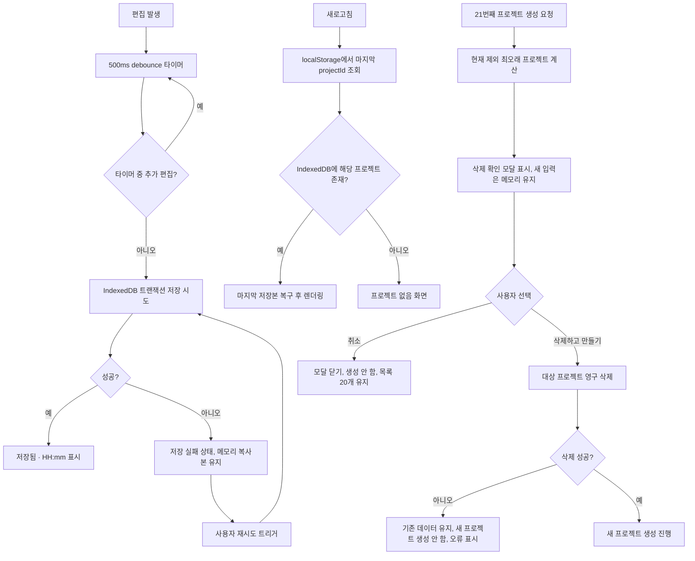

# PRJ-PR-02 — 저장·최근 목록

## Overview

프로젝트를 사용자별 IndexedDB namespace에 실제로 영속화하고, 새로고침 후 마지막 상태를 복구하며, 최근 프로젝트를 최근 사용 순으로 최대 20개까지 유지한다. 21번째 생성 시 가장 오래된 프로젝트의 삭제를 사용자에게 확인받고, 저장 실패 시 데이터를 잃지 않고 재시도할 수 있게 한다.

## Background

`PRJ-PR-01`은 생성 중 transient canonical entities와 ephemeral route lookup만 제공한다. 이 PR이 저장 계약을 정의하고 IndexedDB repository를 구현하며, `DEC-001`/`DEC-011`(20개 제한과 확인 후 삭제)을 완성한다. 서버 DB가 없는 MVP 구조이므로(`docs/product/06-architecture.md`) 저장 실패·quota 초과·저장 중 새로고침 같은 실패 경로를 이 PR에서 견고하게 다뤄야 이후 단계(대화, 문서 생성)가 데이터 유실 위험 위에서 쌓이지 않는다.

## Scope

### 포함

- `ProjectRepository` 인터페이스의 IndexedDB 구현(namespace, `schemaVersion`, 트랜잭션)
- 프로젝트 aggregate + activity 단일 트랜잭션 저장, 500ms debounce 자동 저장
- 현재 프로젝트 화면에서 canonical `BlueprintProject.title` 편집과 500ms debounce 자동 저장 제공. 다른 UI 전용 필드는 저장 aggregate에 추가하지 않는다.
- 최근 프로젝트 목록(수정 시간순, 최초 6개 + 전체 보기, 최대 20개)
- 21번째 생성 시 삭제 확인 모달과 승인된 삭제 후 생성 처리
- 새로고침 후 마지막 프로젝트/저장 상태 복구(localStorage에는 마지막 projectId·활성 탭·UI 설정만)

### 제외

- 작업 공간 셸의 3패널 레이아웃과 탭 전환 UI(`PRJ-PR-03`)
- 대화 메시지 자체의 도메인 규칙(`CON-PR-01` 이후)
- 이전 앱(설문 서비스)의 저장 데이터 마이그레이션(`DEC-017`에 따라 하지 않음 — 명시적으로 스코프 밖)

## 연결 근거

- 요구사항: `PJT-002`, `PJT-003`, `PJT-004`
- Delivery 작업: `PRJ-103`, `PRJ-104` (`docs/delivery/01-project-lifecycle.md`)
- 결정: `DEC-001`, `DEC-011`, `DEC-017`
- 화면 설계: `docs/ui/05-home-projects-and-files.md`(UI-HOME-002, UI-PRJ-001), `docs/ui/screens/01-home-and-start.md`(F-HOME-RECENT, F-PROJECT-LIMIT)
- 선행 PR: `PRJ-PR-01` (머지 완료 필요)

## 선행 조건 (Definition of Ready)

- `PRJ-PR-01` PR #10이 `ef5acebb48f06808e622e0af8508a59326603e21`로 기본 브랜치에 병합됐다. 이 선행 PR은 `BlueprintProject`, `ConversationThread`, 첫 `ConversationMessage` 생성과 ephemeral route lookup까지만 소유한다.
- `AUTH-PR-03` PR #6이 병합됐고, 인증 `ownerContext`는 검증된 identity에서 ownerKey를 제공하고 로그아웃·만료·계정 전환 때 폐기한다. 이 PR은 해당 context를 저장소 호출 경계에서 사용한다.
- 현재 `docs/product/06-architecture.md`의 `ProjectRepository`가 참조하는 `BlueprintAggregate`와 `ProjectSummary`의 타입 shape은 정의되지 않았다. 이는 명시적으로 이 PR의 contract deliverable로 해결한다. 구현 전에 아래 최소 shape와 저장 범위를 제품 데이터 명세 및 architecture에 기록한 후 직렬화와 저장소를 구현한다.
  - `BlueprintAggregate`는 `project: BlueprintProject`, `thread: ConversationThread`, `messages: ConversationMessage[]`, `answers: QuestionAnswer[]`, `sources: SourceDocument[]`, `designItems: DesignItem[]`, `proposals: ChangeProposal[]`, `documents: GeneratedDocument[]`, `sections: DocumentSection[]`, `generationJobs: GenerationJob[]`, `requestLedgerEntries: AiRequestLedgerEntry[]`, `contextManifests: ContextManifest[]`, `activityEntries: ActivityEntry[]`를 포함한다. 이 이름들은 `docs/product/05-data-spec.md`에 정의된 canonical entity를 가리키며, persistence contract 작업은 실제 스키마 정의와 대조해 저장 가능한 범위를 기록한다. entity 의미/필드 변경, 인증 정보, ownerKey 외 사용자 프로필, 브라우저 UI 상태는 추가하지 않는다. 미생성 collection은 빈 배열로 표현한다.
  - `ProjectSummary`는 홈 카드와 정렬에 필요한 `id`, `title`, `updatedAt`, `lastOpenedAt`, `readiness`, `activeDocumentType`만 갖는다. `readiness`와 현재 문서 값은 canonical `BlueprintProject`에서 파생하며 별도 의미를 만들지 않는다.
- 저장 경계는 기존 계약을 따른다: aggregate와 ActivityEntry 변경은 project 단위 IndexedDB 트랜잭션으로 함께 반영하고, 기존 앱 저장소를 읽지 않는다. PRJ-01의 transient create 값은 최초 저장 성공 후에만 영속 프로젝트로 열 수 있도록 연결한다.

**Definition of Ready: READY.** 선행 PR과 ownerKey 규칙이 확정되어 있다. Aggregate/summary shape을 정의하는 일은 이 PR 계획과 범위에 이미 포함된 계약 작업이며, 그 전에 구현을 시작하지 않는 순서로 해결할 수 있다. 저장소 인터페이스, canonical entity 의미 또는 사용자 삭제 의미를 이 계획 밖에서 새로 결정할 필요는 없다.

## 작업 단위별 구현 개요

**PRJ-103 IndexedDB 저장소**

- Before storage implementation, define the exact `BlueprintAggregate` and `ProjectSummary` interfaces in `docs/product/05-data-spec.md` and align the `ProjectRepository` documentation in `docs/product/06-architecture.md` with those canonical entity references. Verify every project-owned entity in the data spec appears in the persisted envelope and add round-trip/validation fixtures for the shape. Do not alter entity semantics or add speculative fields.
- `ownerKey` 기준 namespace와 `schemaVersion`을 가진 IndexedDB 스토어를 연다.
- 모든 `list/get/save/delete`는 활성 인증 context의 `ownerKey`로 제한한다. 서로 다른 owner 간 프로젝트 ID를 공유하지 않으며 다른 owner의 직접 `get`은 `null`을 반환한다.
- 계정 전환 때 이전 owner context를 재사용하지 않고, 늦은 이전 owner의 list/get/save 결과는 새 owner 화면이나 저장에 반영하지 않는다. 이를 검증할 수 있는 owner-context test seam은 ownerKey를 DOM, localStorage, 로그에 기록하지 않는다.
- project aggregate와 ActivityEntry 저장을 하나의 IndexedDB 트랜잭션으로 묶는다. 첫 프로젝트 생성은 `docs/process/01-end-to-end-flow.md`의 생성 transaction 경계(프로젝트, thread, 첫 message)를 보존하고, 저장 성공 전에는 새 route로 이동하지 않는다.
- 편집 발생 시 500ms debounce 후 저장을 예약하고, 저장 중 추가 편집이 들어오면 최신 상태로 재예약한다.
- quota 초과 또는 트랜잭션 실패 시 메모리의 작업 복사본을 유지하고 저장 실패 상태로 전환한다(자동 롤백하지 않음).
- 이전 앱의 storage key를 읽거나 변환하지 않는다.

**PRJ-104 최근 프로젝트와 20개 제한**

- 목록을 `lastOpenedAt` 내림차순으로 조회하고 최초 6개 + `전체 보기`로 노출한다.
- 21번째 생성 요청 시 현재 프로젝트를 제외한 최오래 프로젝트를 계산해 삭제 확인 모달에 표시한다.
- `취소`: 새 프로젝트 입력을 메모리에 유지한 채 모달만 닫는다.
- `삭제하고 만들기`: 사용자가 확인한 대상만 영구 삭제하고, 삭제 성공 후 새 프로젝트 생성을 시도한다. 삭제 실패면 생성하지 않는다. 제품 문서는 삭제와 후속 생성을 하나의 rollback 가능한 원자 연산으로 요구하지 않으며 현재 `ProjectRepository`도 이를 표현하지 않으므로 atomic delete-create를 약속하지 않는다. 삭제 후 새 프로젝트 저장이 실패하면 새 입력을 보존하고 저장 오류/재시도를 제공하며, 사용자가 영구 삭제에 동의한 기존 프로젝트를 자동 복원했다고 표시하지 않는다.
- 삭제 처리 중에는 모달을 닫거나 중복 실행할 수 없다.

## 프로세스 / 상태 전이

## 데이터/API 영향

- `ProjectRepository`(`list`, `get`, `save`, `delete`, `migrate`) IndexedDB 구현 확정. `docs/product/06-architecture.md`의 인터페이스와 동일해야 한다.
- IndexedDB 스키마: `projects` object store(`ownerKey` + `id` 복합 키 또는 별도 namespace DB), `schemaVersion` 필드로 마이그레이션 대비.
- localStorage에는 `lastProjectId`, `activeTab`, UI 환경설정만 저장하고 프로젝트 본문은 저장하지 않는다.

## Acceptance Criteria

### Happy Path

Given 사용자가 프로젝트를 편집하고, when 500ms 동안 추가 입력이 없으면, then 자동 저장이 실행되고 저장 상태가 `저장됨 · HH:mm`으로 바뀐다.

Given 사용자가 프로젝트 화면에서 canonical title을 편집하면, when 입력이 500ms 동안 멈추면, then 최신 title이 저장되고 화면에 저장 상태가 표시되며, 저장 실패 시 입력을 유지하고 재시도할 수 있다.

Given 사용자가 저장된 프로젝트에서 새로고침하면, when 앱이 다시 부팅되면, then 마지막 프로젝트와 마지막 저장 상태가 복구된다.

### Failure Case

Given IndexedDB 트랜잭션이 quota 초과로 실패하면, when 저장이 시도되면, then 메모리의 현재 편집 내용을 잃지 않고 저장 실패 상태와 재시도 버튼을 표시한다.

Given 삭제 확인 모달에서 삭제 요청이 실패하면, when 삭제 처리가 실패하면, then 새 프로젝트를 생성하지 않고 기존 20개 목록을 그대로 유지한다.

Given 사용자가 삭제를 확인해 기존 프로젝트 삭제는 성공했지만 새 프로젝트 저장에 실패하면, when 저장 오류가 발생하면, then 새 입력은 보존되고 오류/재시도가 가능하며 이전 프로젝트가 자동 복구됐다고 표시하지 않는다.

Given owner A와 owner B가 같은 프로젝트 ID를 가진 데이터를 저장하면, when 각 owner가 목록과 프로젝트를 조회하면, then `list/get/save/delete`가 각 owner 범위에만 적용되고 다른 owner의 데이터는 반환되지 않는다.

Given owner A의 프로젝트 조회가 지연된 상태에서 B로 계정을 전환하면, when 늦은 A 조회가 완료되면, then B 화면과 저장소에는 A의 프로젝트가 표시되거나 적용되지 않는다.

Given owner A의 저장 요청이 지연된 상태에서 B로 전환하면, when A 요청이 완료되면, then 쓰기는 A namespace 안에서만 끝나거나 stale context로 거부되고 B의 list/get/state에 반영되지 않는다.

### Boundary

Given 사용자가 정확히 20개의 프로젝트를 가지고 있으면, when 21번째 프로젝트를 생성 요청하면, then 삭제 확인 모달이 표시된다.

Given 사용자가 19개 이하의 프로젝트를 가지고 있으면, when 새 프로젝트를 생성하면, then 삭제 확인 없이 즉시 생성된다.

## 예상 변경 파일

- `src/infrastructure/storage/indexeddb-project-repository.ts` (신규)
- `src/infrastructure/storage/schema-migration.ts` (신규)
- `src/features/projects/recent-projects-query.ts` (신규)
- `src/features/projects/enforce-project-limit.ts` (신규)
- `src/components/blueprint/project-limit-modal.tsx` (신규)
- `src/pages/blueprint-home-page.tsx` (최근 목록 연결, `PRJ-PR-01`에서 만든 파일 수정)

## 테스트 계획

- 계약 단위: `BlueprintAggregate`/`ProjectSummary` 필수 canonical entity와 홈 카드 필드, 직렬화 round-trip, schema validation
- 단위: debounce 저장 타이밍, 저장 실패 시 메모리 상태 보존, 저장 중 새 변경 재예약과 오래된 snapshot 덮어쓰기 방지
- 단위: 20/21개 경계 계산 로직(19→생성, 20→생성, 21→모달)
- 통합: aggregate+ActivityEntry 단일 IndexedDB transaction 성공/부분 실패 rollback, schema migration 및 unknown/newer schema 안전 실패
- 계약/통합: 두 owner의 같은 project ID에 대해 `list/get/save/delete` 범위 격리, cross-owner `get`의 `null` 반환
- 통합/E2E: A list/get/save를 각각 지연시킨 채 B로 전환한 뒤 늦은 A 결과가 B에 표시·저장되지 않는 race 검증; ownerKey가 DOM/localStorage/log에 나타나지 않는지 확인
- E2E: 프로젝트 생성 저장 성공 전 route 이동 방지, 새로고침 후 마지막 완료 저장본 복구, 21번째 생성 취소/삭제/삭제 실패/삭제 후 생성 저장 실패 각각 검증
- E2E: 저장 중 추가 편집이 유실되지 않는지 확인

### Validation commands

- `npm run test:unit` — unit/contract suite
- `npm run test:e2e:ci -- <focused PRJ-02 specs>` — focused Chromium browser paths; use `--workers=1` if the environment shows worker contention
- `npm run test:ci` — full unit/contract suite, desktop/mobile Playwright suite, then production build
- `git diff --check`

## UI 증거 계획

- desktop 1440×900: 최근 프로젝트 0/6/20개 목록, 21번째 삭제 확인 모달, 프로젝트 title editor의 저장 중/저장됨/저장 실패 상태
- mobile 390×844: 최근 프로젝트 목록, 삭제 확인 모달, project title editor와 저장 상태
- Playwright Chromium으로 모달 포커스 트랩과 취소/확인 키보드 동작을 검증한다. Agent Browser tool과 실행 파일의 사용 가능 여부를 확인해 기록하고, unavailable이면 workflow 정책대로 Playwright 결과를 사용한다.
- 최종 HEAD 캡처는 `.pr-artifacts/PRJ-PR-02/`에 수집해 PR에서 확인 가능하게 첨부한다. 1440×900 및 390×844에서 실제 0/6/20개·modal·저장 상태를 확인한다.

## 코드 리뷰·QA 체크리스트

- [ ] 저장 실패 시 자동으로 마지막 저장본으로 되돌리지 않는지 확인(현재 편집 보존 원칙)
- [ ] 삭제 실패 시 새 프로젝트가 생성되지 않고, 삭제 성공 후 생성 저장 실패 시 보존된 입력과 명시적 오류/재시도가 동작하는지 확인(두 작업 전체의 atomic rollback을 주장하지 않음)
- [ ] 이전 앱 storage key를 읽지 않는지 코드 검색으로 확인
- [ ] localStorage에 프로젝트 본문이 저장되지 않는지 확인
- [ ] 목록이 항상 정확히 최대 20개로 제한되는지 확인

## Done Checklist

- [ ] Requirements implemented
- [ ] Acceptance criteria verified
- [ ] 독립 코드 리뷰 pass
- [ ] 독립 QA pass
- [ ] 화면 변경 시 desktop/mobile 캡처 완료
- [ ] 사용자 PR 머지 확인

## 실행 시 추가 문서

- 이 폴더에 구현 중/후 `test-results.md`, `review-notes.md`, `qa-report.md` 등을 추가로 생성한다(지금은 생성하지 않음).
