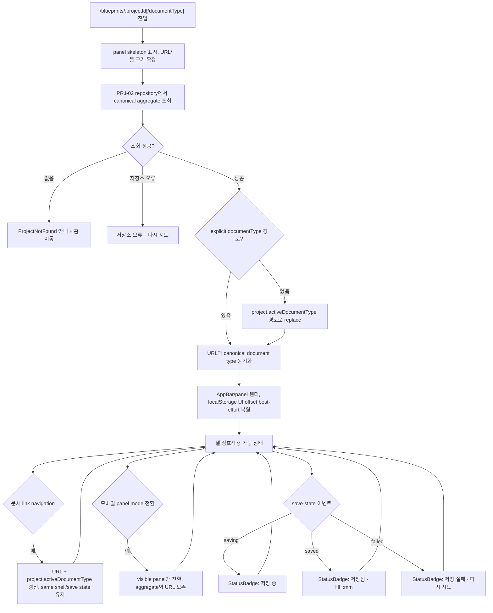
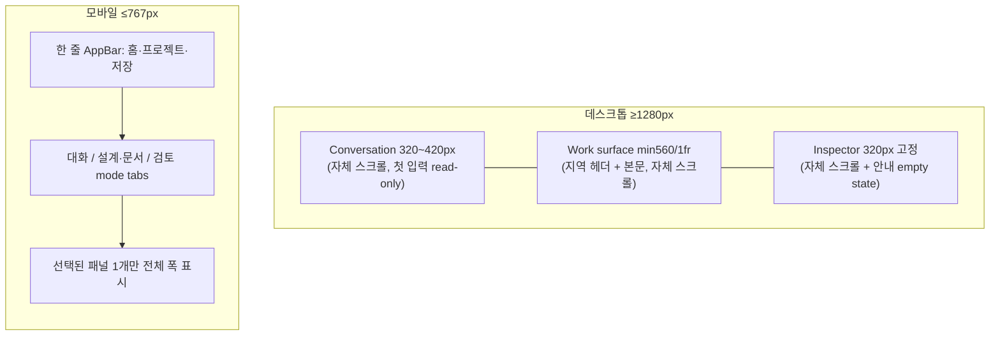

# PRJ-PR-03 — 작업 공간 셸

## Overview

프로젝트 작업 공간에 상단 AppBar(프로젝트명, 문서 탭, 저장 상태, 내보내기)와 대화·중앙 작업·상세 3패널 레이아웃을 구성하고, 데스크톱과 모바일에서 각각 반응형으로 동작하게 한다. 새로고침 후 마지막 문서 탭과 대화 스크롤 위치를 복구한다.

## Background

`PRJ-PR-01`은 라우팅과 생성, `PRJ-PR-02`는 영속 저장과 최근 목록을 완성했다. 이 PR은 그 위에서 실제 작업 공간 셸을 구성하는 마지막 1단계 PR이며, 이후 2단계(대화·폼)부터는 이 셸 안에 기능을 채워 넣기만 하면 되므로 셸 자체를 바꾸지 않는 것이 이번 PR의 완료 기준이다(`docs/product/08-delivery-plan.md` 1단계 종료 조건).

## Scope

### 포함

- 데스크톱 3패널(대화/작업 영역/상세) 레이아웃과 그리드, 패널별 독립 스크롤
- 대화 패널 폭 resize (320~420px, keyboard arrow 지원), 상세 Drawer 열기/닫기
- AppBar(홈 이동, 프로젝트명, 문서 탭, 저장 상태 배지, 내보내기 진입점, 사용자 메뉴)
- 첫 아이디어 메시지를 읽기 전용으로 표시하고, 나머지 대화·작업 영역·상세 패널의 다음 행동이 안내된 빈 상태 구성
- URL과 canonical `BlueprintProject.activeDocumentType`에 따른 문서 탭 복구, 프로젝트별 대화 스크롤 위치 UI preference 복구
- 반응형 분기(1280 이상 / 1024~1279 / 768~1023 / 767 이하)와 모바일 하단 탭 전환
- 모바일 panel-mode 전환은 project data를 바꾸지 않으며, document navigation만 canonical `activeDocumentType`을 갱신하고 기존 save-state/retry를 유지

### 제외

- 대화 메시지 생성·전송·AI 도메인 로직과 실제 질문 폼(`CON-PR-*`)
- 설계 보드·문서 본문 내용(`DSG-PR-*`, `DOC-PR-*`)
- Inspector 내부 제안 검토/변경 동작
- IndexedDB schema/repository 변경. UI preference만 기존 localStorage의 UI-state 허용 범위에 저장한다.
- 실제 내보내기 기능(`EXP-PR-01`); AppBar 진입점은 disabled state와 설명을 제공하고 다운로드를 흉내 내지 않는다.

## 연결 근거

- 요구사항: `PJT-002`(재개), `PJT-003`(복구), `NFR-001`(keyboard/accessibility), `NFR-002`(desktop/tablet/mobile responsive shell)
- Delivery 작업: `PRJ-105` (`docs/delivery/01-project-lifecycle.md`)
- 결정: `DEC-003`(숫자 점수 없는 준비도 — 상세 패널 상태 표시에 적용)
- 화면 설계: `docs/ui/01-workspace-shell.md`(UI-SHELL-001, AppBar 해부, panel sizing/scroll, responsive/accessibility), `docs/template/README.md`의 [image (11).png](../../template/image%20(11).png) (대화와 work surface 공존), [image (8).png](../../template/image%20(8).png) (work surface 빈 상태)
- 선행 PR: PRJ-PR-01 PR #10 및 PRJ-PR-02 PR #11이 기본 브랜치에 병합됨 (`4581d4619125fcd23227a65fe71a2dc0b0d4d48c`)

## 선행 조건 (Definition of Ready)

- PRJ-PR-02 #11은 latest main `4581d4619125fcd23227a65fe71a2dc0b0d4d48c`에 병합되었다. Repository의 `get/save(ownerKey, aggregate)`와 `BlueprintAggregate`는 그대로 사용하며 새로운 저장 필드/schema를 추가하지 않는다.
- `BlueprintProject.activeDocumentType`은 canonical project data이고 문서 유형은 URL에 반영된다. 문서 탭은 기존 `design`/`requirements`/`prd` 경로를 통해 선택·복구하며, 프로젝트 aggregate의 UI 상태는 추가하지 않는다.
- 대화 `scrollTop`과 대화 패널 폭은 UI preference다. localStorage에 project ID로 한정된 숫자 scroll offset 및 브라우저 패널 폭만 저장하고, ownerKey·대화 내용·aggregate는 저장하지 않는다. 스크롤은 복구 시 현재 scrollable range로 clamp한다. localStorage 읽기/쓰기가 불가해도 shell 동작과 프로젝트 저장은 계속되어야 한다.
- `docs/template/README.md`와 image (11)/(8)을 직접 확인했다. URL이 바뀌는 문서 이동은 anchor/link semantics, URL을 바꾸지 않는 모바일 panel-mode 전환은 accessible tablist semantics로 구분한다.

**Definition of Ready: READY.** PRJ-02의 persisted aggregate/repository와 owner isolation 계약은 기본 브랜치에 있고, active document는 canonical project field와 URL로, scroll/width는 UI preference로 보존한다. 그 결과 새 IndexedDB 필드, schema migration, product decision 없이 구현을 시작할 수 있다.

**Current delivery status: `ready_to_merge` (focused implementation validation, independent code review, and scoped independent Playwright QA passed on the current PR head).**

## 작업 단위별 구현 개요

**PRJ-105 작업 공간 셸과 복구**

- AppBar order: 홈 link, 프로젝트명(한 줄 ellipsis 및 전체 title을 accessible tooltip로 제공), 설계/Requirements/PRD document links, 기존 저장 상태 badge 및 retry action, 비활성 export entry, 기존 user menu. 저장 상태는 색상만으로 구분하지 않는다.
- Document links는 URL navigation이다. 링크는 각각 `/blueprints/:id/design`, `/blueprints/:id/requirements`, `/blueprints/:id/prd`를 사용한다. explicit document route는 해당 값을 선택하고 canonical `project.activeDocumentType`을 기존 repository saver로 저장한다. base project route(`/blueprints/:id`)로 들어오면 canonical `activeDocumentType` 경로로 replace 이동해 RecentProjects의 기존 continue link도 마지막 문서로 복귀시킨다. Browser back/forward, 새로고침은 URL과 동기화한다. `setup_guide` document behavior/navigation is outside PRJ-03; preserve the route value if supplied without adding a top-level tab.
- Conversation panel은 PRJ-01/02가 저장한 첫 user message를 읽기 전용으로 보여주고, 실제 composer/AI behavior는 구현하지 않는다. Work surface는 선택 탭에 따른 empty-state container만, Inspector는 이름과 다음 단계 안내가 있는 empty state만 제공한다.
- 각 visible panel은 자체 scroll container다. body는 `100dvh` shell 밖으로 스크롤되지 않는다. desktop에서 header/composer는 지정된 위치에 고정하고 content만 스크롤한다.
- Conversation panel resizer는 320~420px 범위로 제한하고, 충분한 pointer hit area와 ArrowLeft/ArrowRight 조작을 제공한다. 대화 폭은 브라우저 UI preference에만 저장한다.
- Breakpoints: ≥1280 three panels; 1024–1279 conversation 34% + work surface 66%, inspector right Drawer; 768–1023 conversation/work surface mode tabs + inspector Drawer; ≤767 compact one-row AppBar + bottom tabs (conversation/work surface/review). Mobile mode switch is in-place and preserves unsaved project state; first entry shows work surface because current document selection is the canonical URL state.
- Project load 중은 panel skeleton, project missing은 project-not-found 안내, repository error는 retry 안내를 보인다. Tab/panel 전환은 `ProjectPage`의 현재 aggregate/save-state와 unsaved input을 버리지 않는다. Save badge는 PRJ-02의 existing saving/saved/error state를 구독하고, failed state와 retry는 탭 전환 후에도 보인다.
- Conversation scroll offset은 해당 project id의 numeric UI preference로 저장한다. Panel content가 복원된 뒤 저장 offset을 현재 가능한 범위로 clamp해 적용하고, 저장소가 막히면 scroll restoration만 생략한다. Scroll/content, ownerKey, aggregate는 localStorage에 저장하지 않는다.
- 상세 Drawer는 열릴 때 내부 첫 control로 focus, Tab을 내부에 유지하고 Escape/닫기 시 trigger로 focus를 돌려준다. 숨긴 panel/mode는 focus order 및 accessibility tree에서 제외한다.

## 프로세스 / 상태 전이

## 데이터/API 영향

- 서버 API, IndexedDB schema와 `ProjectRepository` 변경 없음.
- URL이 있는 `/blueprints/:projectId/:documentType`는 현재 탭을 복구하는 URL state이며, 해당 document type은 canonical `BlueprintProject.activeDocumentType`에도 반영한다. Aggregate에 `activeTab` 필드를 추가하지 않는다. `/blueprints/:projectId` continue route는 저장된 canonical type으로 replace 이동한다.
- `conversationScrollTop`은 프로젝트별 숫자 UI preference로 localStorage에 저장하고, conversation content가 그려진 뒤 restore한다. 패널 폭은 320~420px 숫자 browser UI preference로 localStorage에 저장한다. 이 두 값 외 aggregate/content와 `ownerKey`는 브라우저 storage에 쓰지 않는다. Storage unavailable/invalid value는 preference 복구만 생략하고 프로젝트 저장·route behavior에 영향 주지 않는다.
- UI preference의 근거: `docs/delivery/01-project-lifecycle.md`의 “last project ID, active tab, UI preferences만 localStorage”와 `docs/product/06-architecture.md`의 URL/UI/client state 구분. canonical project fields, 특히 `activeDocumentType`은 `docs/product/05-data-spec.md`를 따른다.

## Acceptance Criteria

### Happy Path

Given 사용자가 이전에 PRD 탭을 열어둔 상태로 새로고침하면, when 작업 공간이 다시 로드되면, then PRD 탭이 선택된 채로 복구된다.

Given 홈의 Continue link가 base project route를 열면, when canonical `activeDocumentType`이 `prd`이면, then route는 `/blueprints/:projectId/prd`로 replace 이동하고 PRD를 선택한다.

Given 사용자가 문서 탭을 선택하면, when navigation이 완료되면, then URL과 canonical `activeDocumentType`이 일치하고 browser back/forward가 같은 값을 복원한다.

Given user selects the design document link, when navigation completes, then the explicit `/blueprints/:projectId/design` URL selects design and can be reopened from browser history without redirecting to the previously selected document.

Given 데스크톱 1440px 뷰포트에서, when 작업 공간을 열면, then 대화·중앙·상세 3패널이 각각 소유권이 구분된 채로 표시된다.

Given a PRJ-01 project with its initial user message, when the workspace loads, then the message text is rendered once as read-only context; no composer submission or AI call is exposed in this PR.

Given owner 또는 project route가 바뀌면, when 새 aggregate가 확인되기 전까지, then 이전 프로젝트 title/message가 새 route에 flash하지 않고 skeleton/loading state만 보인다.

Given 사용자가 document route를 바꾸거나 mobile panel mode를 전환하면, when 저장이 pending/failed이면, then 같은 `ProjectPage` 작업 복사본, unsaved title draft, save state와 retry가 유지된다.

Given localStorage가 unavailable 또는 preference data가 invalid이면, when shell이 복구되면, then 안전한 기본 scroll offset/panel width를 사용하고 repository save/load는 계속 동작한다.

### Failure Case

Given 저장 상태가 실패로 전환되면, when 사용자가 document link 또는 mobile mode tab으로 전환해도, then 미저장 입력과 저장 실패 badge/retry가 유지된다(자동으로 사라지지 않음).

Given 삭제되었거나 존재하지 않는 프로젝트로 진입하면, when 셸이 초기화를 시도하면, then 3패널 대신 project-not-found 안내와 홈/최근 목록 행동을 표시한다.

Given IndexedDB open/get이 실패하면, when 셸이 초기화되면, then 저장소 오류와 다시 시도 행동을 보여주며 project missing으로 오인하지 않는다.

### Boundary

Given viewport가 1280px 이상이면, when shell을 열면, then 세 패널이 표시되고 panel scroll은 서로 독립이며 body horizontal/vertical scrolling은 없다.

Given viewport가 1024~1279px이면, when shell을 열면, then conversation/work surface가 지정된 34/66 layout을 사용하고 inspector는 right Drawer로 열린다.

Given viewport가 768~1023px이면, when shell을 열면, then conversation/work surface mode를 한 번에 하나만 보이고 inspector는 Drawer이며 숨겨진 panel은 tab order에서 제외된다.

Given viewport가 767px 이하이면, when shell을 열면, then compact one-row AppBar와 bottom conversation/work/review tabs를 표시하고 horizontal overflow가 없다.

Given viewport가 320px 이상이면, when shell content가 긴 한글/URL 포함 문자열을 렌더링하면, then page-wide horizontal overflow가 없다.

Given user opens the inspector Drawer or adjusts the conversation resizer by keyboard, when focus moves or width changes, then focus is contained/restored for the Drawer, hidden controls are not focusable, the resizer exposes `role=separator` with name/min/max/current value, and the conversation width stays in 320~420px bounds.

## 예상 변경 파일

- `src/pages/ProjectPage.tsx` (PRJ-02 route/page를 persistent shell로 교체)
- `src/components/blueprint/WorkspaceShell.tsx`, `AppBar.tsx`, conversation/work/inspector panels and drawer (new, UI-only surfaces)
- `src/features/projects/workspacePreferences.js` + declaration/test (new; scroll/width preferences only)
- `src/styles/workspace-shell.css` (new; local CSS using existing app variables)
- `src/app/router.tsx` only if required for base-route canonical document resolution; reuse current `/blueprints/:projectId[/documentType]` paths

## 테스트 계획

- 단위: UI preference parser/writer, invalid/blocked localStorage fallback, numeric scroll clamping, panel-width clamp 320~420.
- 컴포넌트: AppBar order/accessible project title, document links, export disabled state, saving/saved/failed status and retry.
- 컴포넌트/브라우저: breakpoint thresholds 1279/1280, 1023/1024, 767/768; 4 layout families and no page-wide horizontal overflow.
- 통합/E2E: route document link ↔ `activeDocumentType` synchronization, base route Continue fallback, browser back/forward, reload to active document.
- 통합/E2E: restore project-specific conversation scroll after content mount and clamp after viewport/content-size change; independent panel scrolling must not scroll body or another panel.
- 통합/E2E: missing-project vs repository-error rendering, retry; owner/project change shows skeleton until current owner's aggregate is ready and never flashes prior title/first message.
- 통합/E2E: save pending/failed with title draft survives document URL navigation and mobile mode switch; retry reflects the current project save state.
- 접근성: document routes are links (not fake tabs); in-place mobile modes use tablist semantics with Arrow/Home/End keyboard navigation; hidden panels are removed from focus order; Drawer traps/restores focus and supports Escape; resizer has an accessible name/value and Arrow key operation; status communicates text/icons as well as color.
- Existing repository contract tests remain with PRJ-02; this PR must not add IndexedDB schema or repository tests for UI preferences.

### Validation commands

- Run only tests that cover PRJ-03 behavior and directly affected contracts:
  - focused workspace preference unit tests (valid/invalid/unavailable storage, scroll clamp and panel-width bounds)
  - focused route/component tests for document URL synchronization, save-state retention, responsive modes and accessible controls
  - `npm run test:e2e:ci -- tests/e2e/prj-pr03.spec.ts` for the changed workspace flows, including breakpoint families, route/history, scroll isolation/restoration, missing/error states and keyboard behavior
- Run `npm run build` because this PR changes production code. It is not a blanket requirement for docs-only changes in other PR units.
- Run `npm run docs:check:mermaid` only if a changed Mermaid diagram requires it; run `git diff --check` for the final diff.
- Do not run the full test suite unless a focused result identifies a cross-cutting risk that needs broader confirmation; record the specific reason if expanded.

## UI 검증 및 선택적 증거

- Verify the changed shell at representative widths for each required layout family (≥1280, 1024–1279, 768–1023, ≤767) and check the declared breakpoint edges and 320px minimum-width overflow boundary. Preserve the NFR-002 responsive behavior; the separate QLT-602 delivery remains responsible for its full quality matrix.
- Independently verify the changed user paths with Playwright Chromium: URL/history and document selection, save-state retention, scroll isolation/restoration, missing/error recovery, drawer focus behavior, resizer keyboard bounds, hidden-panel focus exclusion, and responsive overflow/layout.
- Screenshots are optional supporting evidence, not an acceptance gate. If useful, capture only the state/viewport that explains a finding or user-visible result; there is no mandatory five-viewport capture set or requirement to capture every state.
- Use `docs/template/README.md` and mapped images 11/8 as visual references; they inform hierarchy and empty-state layout, not screenshot proof requirements.

## 코드 리뷰·QA 체크리스트

- [ ] `activeDocumentType`/URL만 canonical doc selection이며 aggregate에 `activeTab` or UI state를 추가하지 않았는지 확인
- [ ] `conversationScrollTop` and width contain no ownerKey, project contents or credentials and remain local UI preferences
- [ ] Representative viewport in each of four layout families and relevant breakpoint edges verify expected layout; no horizontal overflow at 320px+
- [ ] 767px 이하 compact AppBar and bottom mode tabs; 768–1023 mode tabs + inspector Drawer; 1024–1279 inspector Drawer; ≥1280 three panels
- [ ] Existing save failure, unsaved title draft, retry and prior owner's content remain correct across document routes/mode switches/account changes
- [ ] Reference images 11 and 8 were used for hierarchy/empty-state; URL links and in-place mode tabs use distinct semantics
- [ ] Keyboard order excludes hidden panels; Drawer focus trap/restore/Escape and resizer arrow-key bounds are verified
- [ ] Stored scroll restoration runs after panel content mount, clamps to valid range, and does not move body/other panels

## Done Checklist

- [x] Requirements implemented
- [x] Acceptance criteria verified
- [x] 독립 코드 리뷰 pass
- [x] 관련 동작의 focused validation 및 독립 QA pass (캡처는 필요할 때만 선택적으로 첨부)
- [ ] 사용자 PR 머지 확인

## 실행 증거 문서

- Implementation stage creates `test-results.md`, `review-notes.md`, and/or `qa-report.md` when execution begins.
- Do not advance PRJ-03 to `ready_to_merge` until relevant implementation validation, independent review and scoped independent QA pass. Screenshots are optional evidence; do not mark the PR merged before GitHub confirms merge.
