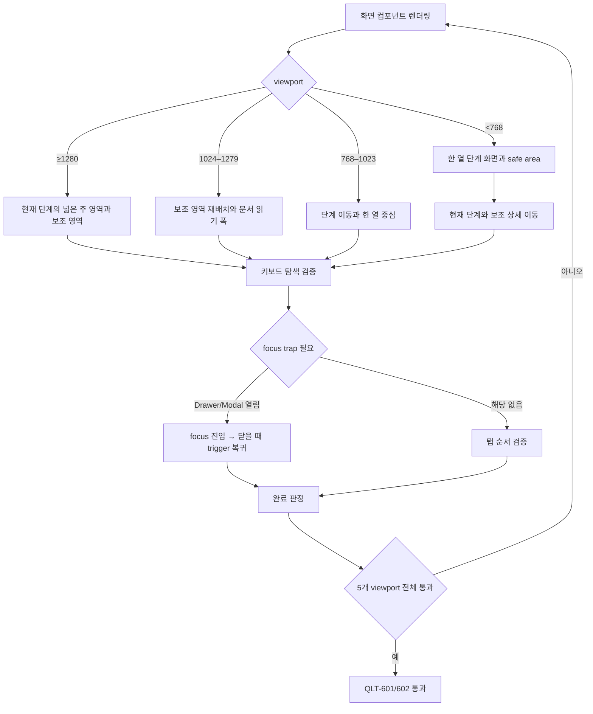

# QLT-PR-01 — 접근성·반응형·성능

## Overview

6단계 통합 품질 단계의 첫 PR이다. `QLT-601`(접근성), `QLT-602`(반응형), `QLT-603`(성능) 세 작업 단위를 검증해 지정된 5개 viewport와 키보드 경로에서 제품이 사용 가능하고, 초기 로드와 긴 입력에서 응답성을 유지함을 증명한다. 이 PR은 새 기능을 추가하지 않고 0~5단계에서 이미 구현된 화면을 대상으로 접근성·반응형·성능 결함을 찾아 고친다.

## Background

`docs/product/08-delivery-plan.md` 6단계 목표는 "정상 흐름과 실패 흐름, 접근성, 반응형과 운영 안전성을 출시 가능한 수준으로 검증"하는 것이다. `docs/delivery/06-quality-and-release.md`는 QLT-601~608 여덟 개 작업 단위를 정의하는데, 이 중 접근성·반응형·성능 세 개는 서로 독립적으로 검증 가능하고(다른 QLT 작업의 보안/전체 E2E/AI eval과 성격이 다름) 반드시 화면이 이미 존재해야 실행할 수 있으므로 0~5단계 완료 후에만 시작 가능하다. `docs/ui/06-overlays-responsive-and-states.md`와 `docs/ui/07-visual-acceptance.md`가 화면별 완료 게이트를 규정하지만 지금까지는 화면 단위 PR에서 부분적으로만 검증됐고, 이 PR에서 전체 화면을 가로질러 일관성을 재검증한다.

## Scope

### 포함

- `QLT-601` 접근성: landmark/heading, 폼 label 연결, Drawer/Modal focus trap, live region, WCAG AA 대비, reduced motion
- `QLT-602` 반응형: 390×844, 768×1024, 1024×768, 1280×800, 1440×900의 5개 기준 viewport와 360×800 경계 확인
- `QLT-603` 성능: 초기 앱 셸 인터랙티브 2.5초 목표, 긴 대화/문서 렌더링, 10MB 파일 추출, 자동 저장 중 입력 응답성

### 제외

- 보안 점검(`QLT-604`), 전체 E2E 시나리오(`QLT-605`), AI 품질 회귀(`QLT-608`) — `QLT-PR-02`
- 사용자 검증(`QLT-606`), 출시 정리(`QLT-607`) — `QLT-PR-03`
- 새로운 화면/기능 추가 — 발견된 결함은 이 PR 범위에서 수정하되 새 기능은 별도 PR로 분리

## 연결 근거

- 요구사항: `NFR-001`(키보드/이름/대비), `NFR-002`(5개 viewport), `NFR-003`(셸/긴 콘텐츠/입력 응답)
- Delivery 작업: `docs/delivery/06-quality-and-release.md` QLT-601, QLT-602, QLT-603
- 결정: 없음(신규 결정 불필요, 기존 화면 명세를 그대로 검증)
- 화면 설계: `docs/ui/06-overlays-responsive-and-states.md`, `docs/ui/07-visual-acceptance.md`, `docs/ui/screen-state-matrix.md`
- 선행 PR: 현재 `origin/main` `a0c6546`에는 단계 0~5와 화면 구현 `UIR-PR-01`~`UIR-PR-06`이 병합돼 있다. 구체적으로 UIR-PR-03 #41/#44, 제안 검토 #49/#50, 준비도 #52, 문서 #54/#55/#56, 대화 후속 #61이 병합됐다. 설정 가이드 GDE-PR-01도 #29로 병합됐다. GitHub에서 확인한 현재 상태를 기준으로 하며, 탐색용 표의 낡은 상태는 선행 작업 미완료의 근거로 사용하지 않는다.
- 시안 기준: UIR-PR-03A가 전체 캔버스 95%를 진단값으로 낮추고 [`docs/ui/07-visual-acceptance.md`](../../ui/07-visual-acceptance.md)의 anchor 위치·크기 한도와 직접 비교로 판정하도록 정리했다. 과거 93.8854% 값은 traceability에 남아 있으므로 QLT 증거에는 이를 숨기지 않고, 현재 화면의 anchor 차이와 함께 기록한다. 마스크 없는 픽셀 점수만으로 현재 구현을 합격 처리하거나 실패 처리하지 않는다.
- 브라우저 범위: `NFR-002`에 지원 브라우저 범위가 따로 확정되어 있지 않다. Playwright Chromium viewport 검증만 수행하고 다른 브라우저 지원을 주장하지 않는다. 이 미결정은 이번 viewport/접근성/성능 검증의 차단 조건이 아니다.

## 선행 조건 (Definition of Ready)

- 0~5단계와 `UIR-PR-01`~`UIR-PR-06`이 병합됨
- 현재 main에서 관련 병합 PR을 확인함: #29, #41, #44, #49, #50, #52, #54, #55, #56, #61
- `docs/ui/screen-state-matrix.md`의 인증된 P0 화면 상태와 실제 경로·기존 브라우저 fixture를 대조하고, 아래 coverage map의 미검증 상태를 실행 전 확인함
- Google OAuth 로그인·callback·logout은 이번 목표에서 제외한다. 보호된 제품 화면은 기존 E2E의 테스트 session fixture로 진입한다.
- 검증 범위는 Playwright Chromium이다. 다른 브라우저 지원 범위의 미결정은 명시적으로 남기고 이 PR을 막지 않는다.

## 작업 단위별 구현 개요

1. **QLT-601 접근성 감사**: Google 로그인·로그아웃 브라우저 흐름을 제외하고, 인증 fixture로 진입하는 홈·프로젝트·대화·제안 검토·설계·Requirements·PRD·자료 흐름에서 landmark 순서, heading 위계, 폼 label/description/error 연결, Radio/Checkbox 의미, Dialog/Drawer focus trap·focus 복귀, live region, 대비, reduced motion을 점검하고 결함을 수정한다.
2. **QLT-602 반응형 감사**: `docs/ui/06-overlays-responsive-and-states.md`의 단계별 주·보조 영역, 목차, 질문 옵션, 비교, 요구사항 목록을 5개 기준 viewport에서 확인하고, 브레이크포인트 전환 시 현재 입력·선택·스크롤 위치가 초기화되지 않는지 검증한다.
3. **QLT-603 성능 측정**: 앱 셸 상호작용 가능까지의 시간, 긴 대화/문서 렌더링, 10MB 파일 검증·추출, 자동 저장 중 입력 응답을 측정한다. UI 성능 수치에는 사용자 원문을 포함하지 않는다. AI profile latency·비용과 model/prompt 평가는 QLT-PR-02 범위다. 번들 크기 경고는 기록만 하고 별도 근거 없이 의존성이나 빌드 구성을 바꾸지 않는다.
4. 결함 수정은 화면별로 별도 커밋하되 이 PR 안에서 처리한다(새 PR로 분리하지 않음 — 회귀 수정이므로).

## 기존 화면 상태와 테스트 연결

테스트 이름만으로 상태를 추정하지 않고, QLT 실행에서 fixture 상태와 테스트를 명시적으로 연결한다. 기존 E2E는 인증된 사용자 fixture와 IndexedDB/API fixture를 사용하므로 Google OAuth 없이 보호 화면을 검증할 수 있다.

| 화면 상태 | 기존 Playwright 증거 | QLT 범위 |
| --- | --- | --- |
| `F-HOME-EMPTY`, `F-HOME-RECENT`, `F-PROJECT-LIMIT` | `prj-pr01.spec.ts`, `prj-pr02.spec.ts`, `uir-pr-02-shell-home.spec.ts` | 포함 |
| `F-INTAKE`, `F-EXTRACTING`, `F-DISCOVERY` | `con-pr-02-question-form.spec.ts`, `con-pr-03-conversation.spec.ts`, `con-pr-05-conversation-flow.spec.ts` | 포함 |
| `F-PROPOSAL`, `F-CONFLICT` | `dsg-pr-01-proposal-review.spec.ts`, `dsg-pr-02-conflict-bulk.spec.ts`, `uir-pr-04-proposal-review.spec.ts` | 포함 |
| `F-DESIGN-WORKABLE` | `dsg-pr-03-design-readiness.spec.ts`, `uir-pr-05-design-readiness.spec.ts` | 포함 |
| `F-REQ-GENERATING`, `F-REQ-DRAFT`, `F-REQ-READY`, `F-PRD-LOCKED`, `F-PRD-DRAFT` | `doc-pr-01-requirements-generation.spec.ts`, `doc-pr-02-prd-readiness.spec.ts`, `doc-pr-03-document-refinement.spec.ts`, `doc-pr-04-direct-edit-impact.spec.ts` | 포함 |
| `F-DOC-IMPACT`, `F-DOC-STALE`, `F-GUIDE-DRAFT` | `doc-pr-03-document-refinement.spec.ts`, `doc-pr-04-direct-edit-impact.spec.ts`, `gde-pr-01-setup-guide.spec.ts` | 포함 |
| `F-SAVE-ERROR`, `F-404` | `prj-pr01.spec.ts`, `prj-pr02.spec.ts`, `prj-pr03.spec.ts`, `smoke.spec.ts` | 포함 |
| `F-AI-ERROR` | `con-pr-03-conversation.spec.ts`, `con-pr-05-conversation-flow.spec.ts` 일부 재시도·취소 상태 | 포함; 전체 오류·복구 회귀는 QLT-PR-02에 남김 |
| `F-AUTH-CHECK`, `F-SESSION-EXPIRED` | `auth-provider.spec.ts`, `auth.spec.ts` | 인증 UX는 이번 여정에서 제외; 보호 API/상태 회귀는 기존 인증 테스트와 분리 |
| `F-LOGIN`, `F-AUTH-REDIRECT`, `F-AUTH-ERROR` | `auth.spec.ts`, `smoke.spec.ts` | Google 로그인·callback 동작은 제외 |

이 표는 기존 test coverage의 출발점이다. QLT 전용 suite는 포함 상태가 각 지정 viewport에서 실제 렌더링되는지 확인하고, 빠진 상태만 최소 추가한다. 이미 있는 상태 흐름을 중복 구현하는 대규모 회귀 suite는 만들지 않는다.

## 프로세스 / 상태 전이

## 데이터/API 영향

없음. 이 PR은 화면 렌더링과 상호작용만 다루며 도메인 데이터 구조나 API 계약을 변경하지 않는다. 성능 측정을 위한 계측 코드(latency 기록)를 추가할 경우 `docs/product/06-architecture.md`의 request ledger 스키마를 그대로 사용하고 새 필드를 만들지 않는다.

## Acceptance Criteria

### Happy Path

Given 테스트 session fixture로 보호된 홈에 진입해 있고 기존 핵심 화면이 구현돼 있다
When 키보드만으로 전체 흐름을 수행한다
Then 프로젝트 생성부터 문서 다운로드까지 마우스 없이 완료된다
And 5개 기준 viewport(390×844, 768×1024, 1024×768, 1280×800, 1440×900) 모두에서 레이아웃이 깨지지 않는다
And 실제 Google OAuth 로그인·callback·logout 요청은 발생하지 않는다

### Failure Case

Given Drawer 또는 Modal이 열려 있다가 닫혔다
When 사용자가 Tab 키로 이동한다
Then 닫힌 오버레이 내부 요소가 Tab 순서에 남아있지 않다

### Boundary

Given 320px 폭의 매우 작은 화면이다
When 페이지를 렌더링한다
Then 페이지 전체 수평 스크롤이 발생하지 않는다

## 예상 변경 파일

- `src/components/**/*.tsx` (접근성/반응형 결함 수정 대상, 실제 파일은 감사 결과에 따라 결정)
- `src/styles/*.css` (반응형 breakpoint 보정)
- 새 파일 생성 없음(원칙적으로 기존 화면 수정만)

## 테스트 계획

- Playwright Chromium: 현재 설정의 desktop/mobile projects 외 추가 viewport는 `page.setViewportSize()`로 지정한다. 각 단계의 정상 상태를 390×844, 768×1024, 1024×768, 1280×800, 1440×900에서 확인하고 360×800과 320px를 경계로 확인한다.
- 인증된 fixture로 프로젝트 생성→질문 응답→제안 승인→설계/Requirements/PRD 이동→문서 다운로드를 키보드로 수행한다. Google OAuth/login redirect/logout은 호출하거나 주장하지 않는다.
- 접근성 도구 의존성은 추가하지 않는다. DOM 기반 이름·label·heading/landmark·focus/숨김·live region 검사와 계산된 전경/배경 WCAG 대비 측정을 Playwright assertion 및 수동 검토로 수행한다.
- 앱 셸 상호작용 시간은 페이지 이동 시작부터 홈의 첫 주요 행동이 표시되고 활성화되는 시점까지 같은 환경에서 5회 측정해 각 측정값·median·worst를 기록한다. 목표 2.5초는 Preview/배포 환경 수치에 적용하고, 로컬 실행 수치를 해당 목표의 증명으로 대체하지 않는다.
- 긴 메시지/문서와 10MB 파일 fixture의 렌더·검증·추출 시간은 기록한다. autosave/API 응답을 지연시킨 상태에서도 입력이 업데이트되고 키보드 입력이 비동기 응답을 기다리지 않는지 확인한다. latency 목표가 명세되지 않은 측정치는 합격 threshold를 새로 만들지 않고 결과와 환경을 보고한다.
- 현재 도구 환경에서 Agent Browser 사용 가능성을 tool catalog와 executable로 확인한다. 사용 불가 시 이를 기록하고 Playwright Chromium으로 독립 QA 흐름을 검증한다.

## UI 증거 계획

- 각 적용 화면의 1440×900·390×844 캡처, 1280×800·1024×768·768×1024 viewport 전환 증거; 360×800·320px 경계는 가로 overflow를 확인
- Drawer/Modal 열림·닫힘 focus 상태 캡처
- 대화 요약은 768–1279px에서도 명시적 control로 열 수 있고 닫은 뒤 trigger로 focus가 돌아오는지 768×1024, 1023×768, 1024×768, 1279×800에서 확인
- reduced-motion 설정에서의 전환 캡처
- Requirements/PRD의 정상·잠금·오류 상태, 대화의 질문·proposal gate, 모바일 composer 및 200% zoom 증거
- 변경 화면은 [현재 주 시안](../../blueprint-design/README.md)과 동일 viewport/state의 렌더 anchor `x/y/width/height`를 기록한다. 전체 캔버스 점수는 필요 시 진단값으로 남기되 기준 판정은 `docs/ui/07-visual-acceptance.md`를 따른다.

## 필요 시 적용할 리뷰·QA 체크리스트

- [ ] semantic controls와 관련 `docs/blueprint-design/` 주 시안·필요한 `docs/template/` 상태 fallback이 사용됐는지, 중복된 로컬 component 없이 접근성 계약을 만족하는지
- [ ] 접근성 수정이 기존 확정 동작(다른 요구사항)을 깨지 않았는지
- [ ] 5개 viewport 모두에서 실제 캡처로 확인했는지 (문서상 주장이 아니라 증거)
- [ ] 성능 계측이 사용자 원문/대화 내용을 기록하지 않는지

## Done Checklist

- [ ] Requirements implemented
- [ ] Acceptance criteria verified
- [ ] 리뷰나 QA를 요청한 경우 결과를 기록하고 적용할 finding을 처리
- [ ] 화면 변경 시 desktop/mobile 캡처 완료
- [ ] 사용자 PR 머지 확인

## 실행 시 추가 문서

- 필요한 경우에만 이 폴더에 테스트 결과, 리뷰 메모, QA 결과 등을 기록한다.
