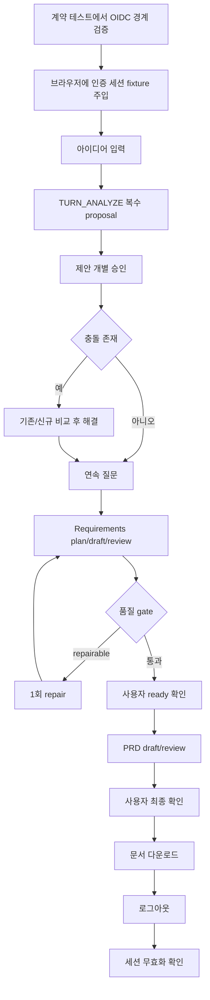

# QLT-PR-02 — 보안·전체 회귀·AI eval

## Overview

`QLT-604`(보안·개인정보), `QLT-605`(통합 회귀), `QLT-608`(AI 품질 회귀) 세 작업 단위를 하나의 PR로 검증한다. 프로세스 명세의 21개 PATH, 출시 계획의 17개 사용자 흐름, 제품 계획의 8개 통합 시나리오는 서로 다른 추적 계층이며 일부는 같은 흐름을 표현한다. 테스트 단위는 PATH별 파일 21개를 만드는 방식이 아니라, 기존 계층별 테스트와 end-to-end journey를 연결하는 추적표로 관리한다. 브라우저 검증은 인증 완료 세션을 mock하고 Google 로그인 자체는 브라우저에서 실행하지 않는다.

## 현재 상태

구현과 로컬 검증을 완료했다. 전체 결과와 남은 검증 한계는 [`test-results.md`](./test-results.md), 독립 검토와 별도 QA 상태는 각각 [`review-notes.md`](./review-notes.md), [`qa-report.md`](./qa-report.md)에 기록한다. 실제 AI provider 호출 검증은 `OPENAI_API_KEY`가 없어 실행하지 않았다.

## Background

인증 선행 단계부터 5단계까지 각 PR은 자신의 범위 안에서만 검증됐다. 그러나 여러 기능이 상호작용할 때(예: 세션 만료 중 문서 생성, AI 실패 중 파일 첨부)의 통합 회귀는 어떤 개별 PR도 검증하지 않는다. `docs/process/07-process-test-spec.md`에는 21개 PATH가 있으며 `docs/delivery/06-quality-and-release.md`의 17개 QLT-605 흐름 및 제품 계획의 8개 시나리오와 중복 관계를 명시적으로 추적해야 한다. Google OIDC의 시작·callback 동작은 계약 테스트에서 검증하고 브라우저 테스트는 로그인 없이 인증 fixture를 사용한다. 보안 항목(`QLT-604`)과 AI 품질 회귀(`QLT-608`)도 여러 단계에 걸쳐 있어 이 PR에서 통합한다.

## Scope

### 포함

- `QLT-604` 보안: 비밀값 미노출, API 인증 경계, `returnTo`/토큰 재사용 차단, 로그 안전성, Markdown sanitization, 행동 분석 미전송
- `QLT-605` 통합 회귀: 프로세스 명세 21개 PATH를 17개 사용자 흐름과 8개 상위 시나리오에 추적. 브라우저는 로그인 완료 세션 fixture를 사용하고 OAuth 브라우저 상호작용은 제외
- `QLT-608` AI 품질 회귀: provider-free golden fixture, coverage/정합성 fixture, prompt injection/schema 실패 fixture. 현행/후보 model·prompt pairwise 비교는 provider 자격 증명이 제공된 환경에서 별도 실행하며 기본 CI에서 완료로 주장하지 않음

### 제외

- 접근성/반응형/성능 세부 결함 수정 — `QLT-PR-01`에서 선행 완료돼야 함(이 PR은 그 결과를 전제로 회귀만 확인)
- 사용자 인터뷰, release checklist 정리 — `QLT-PR-03`

## 연결 근거

- 요구사항: `NFR-004`(안내·최소 전송·비밀 보호), `NFR-005`(비식별 오류·지연), `NFR-007`(행동 이벤트 미전송), `AI-006`(golden eval), 그리고 인증/AI 파이프라인에 걸친 모든 P0
- Delivery 작업: `docs/delivery/06-quality-and-release.md` QLT-604, QLT-605, QLT-608
- 프로세스 근거: `docs/process/07-process-test-spec.md`(21개 PATH, Given/When/Then 시나리오), `docs/process/06-failure-and-recovery.md`(오류별 복구 계약, idempotency)
- 결정: `DEC-007`(fallback 없는 재시도), `DEC-019`(행동 분석 미수집), `DEC-029`(원장·budget), `DEC-030`(golden eval gate)
- 선행 조건: `QLT-PR-01` 완료(공유 화면의 접근성/반응형 결함이 회귀 테스트 결과를 오염시키지 않아야 함), 인증 선행~5단계 전체 PR 머지

## 선행 조건 (Definition of Ready)

- `QLT-PR-01`이 머지되어 화면 결함이 이 PR의 E2E 테스트 실패 원인이 되지 않음
- 인증, AI, 문서, 자료 각 단계의 계약 fixture(`docs/process/07-process-test-spec.md`의 fixture 계약)가 코드로 존재함
- golden fixture 세트(`docs/delivery/ai-model-prompt-and-evaluation.md` 참고)가 버전 관리되고 있음

## 작업 단위별 구현 개요

1. **QLT-604 보안 점검**: 빌드 번들에서 현재 설정된 secret 값 스캔, 각 보호 API의 비인증 401 및 provider/store side effect 0건, debug 로그의 모델 반환 식별자 미노출, 파일·대화 원문 로그 미포함, 분석 endpoint 전송 미발생을 검증한다.
2. **QLT-605 인증 계약**: `PATH-AUTH-SUCCESS`, `PATH-AUTH-DENIED`, `PATH-AUTH-EXPIRED`, `PATH-AUTH-API-BYPASS`, `PATH-AUTH-USER-SWITCH`를 API/identity 계약 계층에서 검증한다. OAuth 로그인 브라우저 흐름은 실행하지 않는다.
3. **QLT-605 제품 흐름**: `PATH-HAPPY-IDEA`, `PATH-HAPPY-FILE`, `PATH-PARTIAL-FILE`, `PATH-CUSTOM-ANSWER`, `PATH-RECOMMEND`, `PATH-DEFERRED`, `PATH-HELP`, `PATH-CONFLICT`, `PATH-PRD-LOCK`, `PATH-DOC-EDIT`, `PATH-AI-RETRY`, `PATH-SAVE-RETRY`, `PATH-REFRESH`, `PATH-AI-BUDGET`, `PATH-AI-BLOCKS`, `PATH-DOC-PIPELINE`을 기존 테스트 계층에 매핑한다. 통합 브라우저 journey는 실제 AI provider 대신 결정론적 응답을 사용한다.
4. **QLT-608 AI 품질 회귀**: 질문/추출/설명/추천/compaction golden fixture, Requirements/PRD coverage fixture, prompt injection과 잘못된 참조 ID fixture, schema 실패 fixture를 실행한다. 현행/후보 model·prompt pairwise 실행은 provider 자격 증명과 비용이 허용되는 별도 실행으로 보고한다.
5. flaky 없이 기본 실행에서 통과하도록 결정론적 fixture(시간·UUID·Agent 결과 고정)를 사용한다.

## PATH와 사용자 흐름 추적

각 PATH는 동작을 검증하는 계층을 지정한다. 인증 관련 PATH는 API/identity 계약으로 검증하고, 제품 브라우저 경로는 인증 세션 fixture를 주입한다. Google 로그인 시작·callback을 실제 브라우저에서 수행하지 않는다.

| 프로세스 PATH | 검증 위치 | 핵심 근거 |
| --- | --- | --- |
| `PATH-AUTH-SUCCESS` | contract | `tests/contract/auth-google-oidc.test.js` |
| `PATH-AUTH-DENIED` | contract | `tests/contract/auth-google-oidc.test.js` |
| `PATH-AUTH-EXPIRED` | contract + browser session fixture | session/API guard contracts; authenticated browser journeys |
| `PATH-AUTH-API-BYPASS` | contract | `tests/contract/blueprint-auth-guard.test.js`, `tests/contract/turn-api.test.js` |
| `PATH-AUTH-USER-SWITCH` | browser identity fixture | `tests/e2e/prj-pr02.spec.ts`: A/B owners sharing a project ID see only their own project after session identity refresh |
| `PATH-HAPPY-IDEA` | browser | `tests/e2e/qlt-pr-01-keyboard-flow.spec.ts` |
| `PATH-HAPPY-FILE` | browser | `tests/e2e/con-pr-05-conversation-flow.spec.ts`: file extraction → file-grounded proposal → edit/approval → Requirements → PRD |
| `PATH-PARTIAL-FILE` | browser | `tests/e2e/src-pr-01-sources.spec.ts` |
| `PATH-CUSTOM-ANSWER` | browser + contract | `tests/e2e/con-pr-05-conversation-flow.spec.ts`, `tests/contract/turn-api.test.js` |
| `PATH-RECOMMEND` | browser + golden | `tests/e2e/con-pr-03-conversation.spec.ts`, `tests/e2e/qlt-pr-01-keyboard-flow.spec.ts` |
| `PATH-DEFERRED` | contract | design-readiness domain and document open-issue contracts |
| `PATH-HELP` | browser + golden | `tests/e2e/con-pr-05-conversation-flow.spec.ts` freeform explanation turn, synthetic explanation fixture |
| `PATH-CONFLICT` | browser + contract | `tests/e2e/dsg-pr-02-conflict-bulk.spec.ts` |
| `PATH-PRD-LOCK` | browser + contract | `tests/e2e/doc-pr-02-prd-readiness.spec.ts` |
| `PATH-DOC-EDIT` | browser + contract | `tests/e2e/doc-pr-04-direct-edit-impact.spec.ts` |
| `PATH-AI-RETRY` | browser + contract | `tests/e2e/con-pr-03-conversation.spec.ts`, turn lifecycle contracts |
| `PATH-SAVE-RETRY` | browser + unit | `tests/e2e/prj-pr02.spec.ts`, project persistence unit tests |
| `PATH-REFRESH` | browser | project, conversation, source, and document journey reload assertions |
| `PATH-AI-BUDGET` | contract + golden | `tests/contract/fnd-budget.test.js`, AI request ledger tests |
| `PATH-AI-BLOCKS` | contract + golden | turn response schema and golden fixture tests |
| `PATH-DOC-PIPELINE` | contract + browser | requirements/PRD generation and readiness contracts |

The 17 QLT-605 flows group these paths into user journeys. The eight delivery-plan scenarios are release-level combinations of the same journeys, so the suite links their IDs to this table instead of creating duplicate tests. Existing stage-specific tests remain useful regression coverage but do not by themselves prove an integrated journey.

## 프로세스 / 상태 전이

## 데이터/API 영향

- 로그 진단은 사용자/모델 입력을 출력하지 않고 고정 오류 코드만 남긴다.
- production dependency `pdfjs-dist`를 보안 수정 버전으로 올린다. 해당 버전의 parser API 계약은 PDF 추출 회귀 테스트로 확인한다.
- 테스트와 빌드 후 현재 설정된 서버 secret이 `dist`에 포함되지 않는지 검사하는 스크립트를 추가한다.
- 로그·request ledger 검증을 위한 fixture 서버(계약 테스트용)를 `tests/` 하위에 추가할 수 있다.

## Acceptance Criteria

### Happy Path

Given 모든 인증/문서/AI 파이프라인 계약 fixture가 준비돼 있다
When 인증 fixture를 사용해 현재 제품 경로의 통합 journey를 실행한다
Then 아이디어→동적 대화 추천·승인→요구사항 명세→PRD 및 파일 근거→요구사항 명세→PRD가 실제 화면과 저장 결과로 검증되고 Google 로그인은 실행되지 않는다

### Failure Case

Given 프로젝트가 AI hard budget에 도달했다
When 사용자가 추가 AI 보완을 요청한다
Then provider 호출이 발생하지 않고 확정 설계와 기존 문서가 그대로 유지된다

### Boundary

Given 사용자 A가 로그아웃하고 사용자 B가 로그인한다
When B가 프로젝트 목록을 조회한다
Then A의 프로젝트가 하나도 노출되지 않는다

## 예상 변경 파일

- `tests/e2e/**` (제품 흐름별 Playwright coverage와 PATH 추적)
- `tests/contract/**` (AI/인증/문서 계약 fixture)
- `tests/golden/**` (AI golden eval fixture)
- 보안 점검 스크립트(예: `scripts/check-bundle-secrets.mjs`, 신규 파일 필요 시)

## 테스트 계획

- Playwright: 현재 대화·문서·파일 흐름을 fixture 대상으로 실행; Google 로그인 없이 세션 주입
- 계약 테스트: 인증/AI/문서 API의 정상·오류 fixture
- golden eval: provider-free fixture와 coverage gate 실행. live pairwise 상태는 별도 기록
- 보안: 번들 grep, 네트워크 요청 감사(외부 analytics 미호출 확인)

현재 환경에는 `OPENAI_API_KEY`가 제공되지 않아 live model/prompt pairwise 비교는 실행할 수 없다. 이 제한을 synthetic golden 결과와 구분해 보고한다.

## UI 증거 계획

- 이 PR 자체는 새 화면을 만들지 않으므로 필수 UI 캡처는 없음. 단, 시나리오 7(모바일) 재생 중 실패가 발견되면 해당 화면의 desktop/mobile 캡처를 첨부한다.

## 코드 리뷰·QA 체크리스트

- [x] 모든 fixture가 실제 OpenAI 상태에 의존하지 않는지
- [x] request ledger/원장에 사용자 원문이 기록되지 않는지
- [x] golden eval 실패 시 배포를 막는 gate가 실제로 CI에서 동작하는지
- [x] 인증 우회, secret 노출 관련 발견 사항이 즉시 Critical로 분류됐는지

## Done Checklist

- [x] Requirements implemented
- [x] Acceptance criteria verified (deterministic browser/API fixtures)
- [x] 기존 구현과 후속 CSS·브라우저 수정 독립 검토 통과 (세부 결과: `review-notes.md`)
- [x] 로컬 CI와 deterministic desktop/mobile QA 통과
- [ ] 최종 변경 desktop/mobile Preview 캡처 검토
- [ ] PR Preview 검증 완료
- [ ] 사용자 PR 머지 확인

## 실행 시 추가 문서

- 이 폴더의 `test-results.md`, `review-notes.md`, `qa-report.md`에 실행 결과와 검토 상태를 갱신한다.
