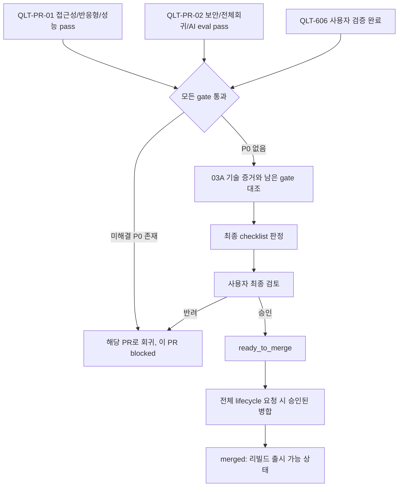

# QLT-PR-03 — 사용자 검증·최종 출시 판정

## Overview

최종 사람 중심 검증과 출시 판정 unit이다. 기술 레거시 정리, 설치·배포 문서와 근거 목록은 선행 [QLT-PR-03A](../QLT-PR-03A/plan.md)에서 준비한다. 이 PR은 `QLT-606` 신규 사용자 관찰과 성공 지표 대조, P0 판단 및 03A checklist의 최종 판정만 수행한다. 실제 참여자 결과가 없으면 출시 가능으로 표시하지 않는다.

## Background

`docs/product/08-delivery-plan.md`는 6단계 완료 조건으로 "지원 브라우저에서 핵심 흐름 수동 확인"과 "알려진 P0 결함 없음"을 요구한다. QLT-606은 행동 analytics 없이 신규 사용자 관찰·인터뷰로 성공 지표를 검증한다. 자동화로 확인할 수 있는 QLT-607 기술 정리는 QLT-PR-03A에서 끝내고, 여기서는 그 증거와 사람 세션 결과를 함께 최종 판정한다.

## Scope

### 포함

- `QLT-606` 사용자 검증: 첫 입력~첫 제안 확정, AI 제안과 확정 정보 구분, 부족 영역 이해, requirements ready/PRD 잠금 이해, 문서 편집 영향 이해, 오류 후 복구 이해에 대한 관찰·인터뷰 기반 검증
- QLT-PR-03A release checklist에 연결된 기술 증거와 QLT-606 세션 결과 대조
- 관찰에서 발견한 P0/P1을 분류하고, P0가 없을 때에만 최종 checklist와 `docs/delivery/traceability.md`를 갱신

### 제외

- QLT-607의 레거시 코드 제거와 README·환경 변수·배포 가이드 작성 — [QLT-PR-03A](../QLT-PR-03A/plan.md) 범위
- 새로운 자동화 테스트 작성 — QLT-PR-01/02 및 03A의 기술 경로 검증에서 다룸
- 새 기능 추가 또는 버그 아닌 개선 — 발견된 P0 결함 수정만 이 PR에 포함하고, P1 이하 개선은 후속 작업 ID로 분리

## 연결 근거

- 요구사항: `NFR-006`(한글 UI·응답·문서), 모든 P0 요구사항의 최종 확인
- Delivery 작업: `docs/delivery/06-quality-and-release.md` QLT-606, QLT-607
- 결정: `DEC-017`(마이그레이션 없음), `DEC-018`(`/survey`, `/prd` 404), `DEC-019`(analytics 미수집)
- 선행 조건: `QLT-PR-01`, `QLT-PR-02`, `QLT-PR-03A` 병합 및 자동화/기술 증거 확보
- 참고: `docs/product/02-prd.md` "성공 지표"(사용성/결과 품질/신뢰성) 절과 "출시 조건" 절 전체

## 선행 조건 (Definition of Ready)

- `QLT-PR-01`(접근성·반응형·성능), `QLT-PR-02`(보안·전체 회귀·AI eval)가 모두 사용자에 의해 머지됨
- `QLT-PR-03A`(기술 출시 준비)가 병합되고 release checklist에 증거가 연결됨
- `docs/delivery/traceability.md`에 blocked 상태로 남은 P0 요구사항이 없음
- 사용자 검증에 참여할 대상자와 시나리오가 준비됨(신규 프로젝트 사용자 다수 대상 관찰)

## 작업 단위별 구현 개요

1. **QLT-606 사용자 검증 세션 진행**: `docs/product/02-prd.md` 핵심 사용자 여정(여정 A/B/C)을 따라 관찰 세션을 진행하고, 다음을 개인 원문 없이 요약 기록한다 — 첫 제안 확정까지 도움 필요 여부, AI 제안/확정 구분 인지, 부족 영역 이해도, 요구사항명세서 ready→PRD 잠금 이해, 문서 편집 영향 인지, 오류 후 복구 행동.
2. **성공 지표 대조**: 관찰 결과를 `docs/product/02-prd.md` 성공 지표(80% 이상 도움 없이 첫 제안 확정, 중앙값 60초 이내 첫 제안, 반복 질문 5% 이하 등)와 대조하고 미달 항목을 P0/P1로 분류한다.
3. **기술 증거와 release gate 검토**: QLT-PR-03A checklist의 각 검증 결과를 실제 링크와 대조하고, 사람 세션·지원 브라우저·live provider·로그인 운영 설정처럼 미검증인 조건은 완료로 바꾸지 않는다.
4. **최종 상태 갱신**: 모든 사람 검증 지표와 P0 차단 조건을 판정한 뒤 `docs/delivery/traceability.md`와 release checklist에 근거와 함께 결론을 기록한다.

## 프로세스 / 상태 전이

## 데이터/API 영향

없음. `/survey`, `/prd`의 404 동작과 기술 증거는 QLT-PR-03A에서 확인한다.

## Acceptance Criteria

### Happy Path

Given `QLT-PR-01`, `QLT-PR-02`가 모두 머지됐다
When 신규 사용자 관찰 세션을 진행한다
Then 80% 이상의 참가자가 도움 없이 첫 제안을 확정한다
And 확정까지 중앙값 60초 이내에 첫 제안이 표시된다

### Failure Case

Given 사용자 검증에서 P0 사용성 문제가 발견됐다
When release checklist를 작성한다
Then 해당 문제는 출시 차단으로 기록되고 `ready_to_merge`로 표시하지 않는다

### Boundary

Given QLT-PR-03A의 기술 gate 증거와 준비된 신규 사용자 세션이 있다
When 관찰 결과와 성공 지표를 최종 판정한다
Then 해결되지 않은 P0가 없을 때에만 출시 가능으로 기록하고, 미검증 gate는 명시적으로 남긴다

## 예상 변경 파일

- `docs/delivery/traceability.md` (최종 상태 갱신)
- QLT-PR-03A의 release checklist에 사용자 관찰 요약과 최종 판정 추가

## 테스트 계획

- 자동 테스트: 필요하면 QLT-PR-03A의 변경 영역에 직접 관련된 테스트만 다시 실행
- 사용자 검증: 관찰 세션 기록(원문 미포함 요약)

## UI 증거 계획

- 세션에 포함된 브라우저와 viewport, 사용자 원문/식별 정보 없는 관찰 증거

## 코드 리뷰·QA 체크리스트

- [ ] 사용자 검증 기록에 개인 식별 정보나 원문이 없는지
- [ ] QLT-PR-03A checklist의 완료 항목마다 실제 증거 링크가 있고 미검증 조건이 구분되어 있는지
- [ ] `docs/delivery/06-quality-and-release.md` 출시 차단 조건 12개가 모두 해소 확인됐는지

## Done Checklist

- [ ] Requirements implemented
- [ ] Acceptance criteria verified
- [ ] 독립 코드 리뷰 pass
- [ ] 독립 QA pass
- [ ] 화면 변경 시 desktop/mobile 캡처 완료
- [ ] 사용자 PR 머지 확인

## 실행 시 추가 문서

- 이 폴더에 구현 중/후 `test-results.md`, `review-notes.md`, `qa-report.md` 등을 추가로 생성한다(지금은 생성하지 않음).
