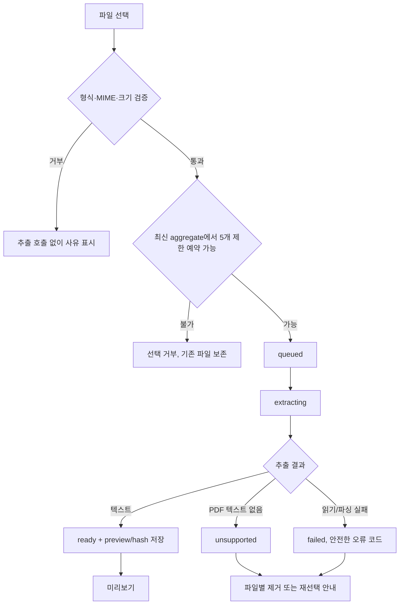

# SRC-PR-01 — 파일 제한·추출

**Status: merged.** PR #24 merged 2026-10-15 at `f169cf7da310dc446fdb02b7006817c65703ea12`; final head `8fa05f6b4032713c1d30c6bb0da2b7f706704233`. Scope: `SRC-501` and `SRC-502` (`SRC-001`). Focused unit tests 13/13, Playwright 6/6 across desktop/mobile Chromium, build, and diff-check passed; independent review/QA gates passed.

## 사용자 결과

사용자는 프로젝트 시작 또는 프로젝트 작업 공간에서 TXT, Markdown, 텍스트 PDF를 첨부하고, 제한에 걸린 파일은 추출 전에 이유를 확인하며, 지원 파일은 추출된 텍스트를 미리 본다. 한 파일의 형식·추출·저장 실패는 다른 파일이나 기존 프로젝트 데이터를 제거하지 않는다.

## 요구사항·delivery 추적

- Requirement: `SRC-001` (`docs/product/03-requirements.md`); task plan `SRC-501`, `SRC-502` (`docs/delivery/05-sources-guides-export.md`).
- PR unit row 22: `SRC-PR-01`; workflow order follows merged DOC-PR-01~04.
- Decisions: `DEC-005` (TXT/Markdown/text PDF, 10 MB/file, 5 active files/project), `DEC-009` (sensitive-data reminder per file), `DEC-013` (PDF paragraph reading order, flatten tables, no OCR), `DEC-020` (project-level AI consent remains a later send gate).
- UI: `UI-FILE-001` and file rows in `docs/ui/05-home-projects-and-files.md`; corresponding upload-entry reference is [`docs/template/image (17).png`](../../template/image%20(17).png). Workspace frame and responsive behavior follow the existing ProjectPage shell; this PR adds only the source upload/list/preview interaction.
- Data: canonical `SourceDocument` and `BlueprintAggregate.sources` in `docs/product/05-data-spec.md`; project storage is the existing owner-isolated IndexedDB `ProjectRepository` in `docs/product/06-architecture.md` and `src/infrastructure/storage/`.
- Dependencies: PRJ-PR-01/02 (project creation and persistence), FND-PR-01 (file-picker and semantic error primitives), and DSG-PR-03 (workspace/design entry) are merged. DOC-PR-01/02/03/04 are merged as PR #20 `6ded90838a415ee10f9a3ba0b518ebd0932c9618`, #21 `f0c922635ae0a620022f4a05d86fe6ea4fcc1ff9`, #22 `94bdf704e1909d49813a9e3592dcf056c8e9f3cb`, and #23 `1178050576338245d1b5bdbd913e3b19cff669df`. There are no open PRs on the current base.

## Definition of Ready

- [x] PR unit, requirement, delivery tasks, scope, and observable acceptance are identified.
- [x] Required decisions are present: supported formats and limits (`DEC-005`), extraction policy (`DEC-013`), per-file notice (`DEC-009`).
- [x] Project repository and source aggregate collection exist; owner isolation and aggregate validation are already enforced.
- [x] Predecessor units are merged on current `main`; no open PR blocks this unit.
- [x] UI reference and applicable viewport/accessibility behavior are identified.
- [x] Existing PDF parsing dependency is absent. A browser-compatible PDF text parser is directly required by `SRC-502`; implementation may add the smallest necessary dependency and a text-only fixture. No external service or API is required.
- [x] No unresolved product decision blocks the scoped outcome.

## Scope

### Included

- Accept `.txt`, `.md`, `.markdown`, and text-layer `.pdf`; validate type, extension, MIME compatibility, file size, and project count before extraction.
- Enforce a 10 MiB inclusive per-file boundary and a maximum of five non-archived `SourceDocument` rows per project. Failed and unsupported attached files continue to occupy a slot until removed; archived rows do not. Reserve allowed rows through `ProjectRepository.transact` before asynchronous extraction so concurrent selections cannot exceed the cap.
- Persist source rows in the existing `BlueprintAggregate.sources` collection and owner-isolated IndexedDB project record. Do not create a parallel `sourceDocuments` store or persist original binary data.
- Provide queued → extracting → ready/unsupported/failed states, stable user-facing error codes/messages, preview, remove, file metadata, and per-file sensitive-data reminder. Independent files may finish with different outcomes.
- Detect invalid UTF-8 for TXT/Markdown (BOM is accepted); extract PDF text in reading order, flatten table cells into ordinary text, and report image-only PDFs as unsupported. Malformed/unreadable files fail without exposing parser exceptions.
- Keep extracted text out of logs and do not include any source in AI requests in this PR. Only ready-source excerpt transport is owned by SRC-PR-02.
- Integrate selection at project creation and upload in the existing project workspace. Reuse existing semantic controls and local CSS conventions; no UI framework or design-system dependency.

### Excluded

- Evidence/source excerpt linking, source removal impact on design items, and including excerpts in Agent requests (SRC-PR-02).
- OCR, image-only PDF, Office formats, source text editing, remote file upload, server API, and long-term binary storage.
- Guide generation (GDE-PR-01), export (EXP-PR-01), unrelated workspace redesign, and full regression QA.

## Implementation sequence

1. Add focused file metadata/limit validation and extractor contracts. Reject invalid files before invoking a parser and keep a stable application error code separate from internal exceptions.
2. Add PDF text extraction using the minimal browser-compatible dependency required by this repository; fixture tests cover reading order, table flattening, no-text PDF, and parser failure. Keep OCR out.
3. Add a source upload command that transactionally reserves permitted rows in `aggregate.sources`, enforces five active files against the latest aggregate, extracts each independently, and persists each terminal state without replacing unrelated aggregate data.
4. Connect project-start selected files to the newly created project and add an upload/list/preview/remove section to the existing project workspace.
5. Add the focused browser flow for invalid preflight, successful preview/persistence, unsupported PDF, and partial success; keep assertions scoped to this interaction.

## Process and failure states

Successful or failed file rows remain independently visible. A storage failure must preserve the last saved aggregate and show a retryable user message; it must not replace a successful sibling result with a batch-level failure. Project creation must preserve the idea and allow the user to continue after invalid attachments are rejected.

## Acceptance criteria

### Happy path

Given a project with no active sources, when a valid 8 MiB UTF-8 Markdown file is selected, then it is reserved and transitions `queued → extracting → ready`, its extracted text and SHA-256 hash are persisted in that project, and its preview is available after reopening the project.

### Failure cases

- An image-only PDF is shown as `unsupported` with a user-facing no-text explanation; a malformed/read failure is shown as `failed`. Neither UI nor logs contain raw parser exception details or file contents.
- Unsupported type, extension/MIME contradiction, and invalid UTF-8 are rejected or marked failed before becoming AI-eligible; validation failures do not invoke the extractor.
- If one file in a multi-file selection fails, successful siblings and previously saved sources remain unchanged and visible.
- If IndexedDB save fails, the previously saved aggregate remains intact and the user can retry; no success state is claimed for an unpersisted row.

### Boundaries

- A 10 MiB file is accepted; a file larger than 10 MiB is rejected before extraction.
- Five non-archived rows, including failed/unsupported rows, consume all slots. A sixth is rejected before extraction; removing/archiving a row permits one replacement.
- Concurrent selections are checked against the latest project aggregate inside the repository transaction; the final active count never exceeds five.
- A `.pdf` with a valid text layer yields reading-order text with flattened table content. A PDF without text is unsupported; no OCR attempt occurs.

### UI and accessibility

- Accepted formats and limits appear before file selection. Input has an accessible name, multiple selection, keyboard-visible focus, and associated rejection/status text.
- Each row shows filename, type/size, status, preview/remove actions, and the per-file sensitive-data notice. Long filenames do not hide their extension.
- The upload and source list remain usable at the existing mobile layout breakpoint; focused browser validation covers the changed control and status list at desktop and mobile sizes, without screenshot deliverables.

## Expected files (candidates)

- Existing `src/features/prd/fileExtraction.ts` may be replaced or narrowed into the supported TXT/Markdown/PDF extractor; remove its broad format behavior only where directly used by this feature.
- `src/features/sources/` for validation, extraction, and repository commands; `src/domain/blueprint/types.d.ts` only if the canonical source fields need typing.
- `src/components/projects/ProjectComposer.tsx`, `src/pages/ProjectPage.tsx`, and directly related local CSS.
- Focused unit/contract tests and one scoped Playwright spec under existing `tests/unit/`, `tests/contract/`, and `tests/e2e/` conventions.
- `package.json` / lockfile only if the selected PDF parser is required.
- On merge, update only directly relevant workflow/task/traceability status rows with merged PR and test evidence, including correcting the already merged DOC-PR-01..04 rows; do not reopen or alter their product scope.

## Focused validation matrix

| Concern | Focused check | Required result |
| --- | --- | --- |
| Preflight rules | Unit tests for supported/unsupported extensions, MIME agreement/contradiction, empty MIME fallback, exact 10 MiB and one-byte-over, 5/6 active rows, archived-row replacement | Inclusive boundary accepted; over-limit and sixth file rejected before extractor invocation |
| Text/PDF extraction | Unit tests for UTF-8/BOM, invalid UTF-8, Markdown, text PDF order/table flattening, image-only PDF, malformed PDF | Correct terminal state, normalized preview/hash; no OCR; stable error code |
| Persistence/ownership | Focused repository/command tests for reservation transaction, concurrent sixth-file race, reopen, owner/project isolation, storage failure preservation, sibling partial success | At most five active rows; no cross-project writes or lost aggregate data |
| UI flow | One Playwright spec for file chooser/preflight, ready preview after reload, unsupported PDF reason, mixed success/failure; run at desktop and mobile layout | Accessible status and recovery action work; no unrelated project journey assertions |
| Build and diff | `npm run build`; `git diff --check` | Both pass |

No OpenAI call, broad test suite, screenshot set, or Agent Browser run is required. If an existing project creation/workspace e2e test has to be adjusted by this change, run only that spec plus the new scoped spec.

## Risks and mitigations

- **PDF parser bundle/runtime behavior:** choose a browser-compatible parser that works in Vite and add only the parser worker/config needed for this import; test the production build and a small fixture. Keep serverless API route count unchanged.
- **IndexedDB capacity:** five 10 MiB source files can exceed browser quota after text expansion. Catch quota errors, preserve prior aggregate state, report a stable retry/remove-files message, and never silently truncate text or report ready before persistence. If a separate large-text storage strategy proves necessary, stop and request a scoped data-contract decision rather than inventing a second store.
- **MIME variability:** browser MIME can be empty or generic for Markdown. Use extension-based fallback only when MIME is absent/generic; reject a clear contradictory MIME. Cover supported browser MIME cases in unit tests.
- **Atomic cap under concurrent selections:** reserve all accepted rows in one `transact` against latest aggregate; do not rely only on a stale React count.
- **PII exposure:** previews are local; do not log names/content beyond what the UI needs, and do not send content to any API in this unit.

## Review and QA checks

- [ ] Limits and MIME/extension validation run before parser work.
- [ ] Latest-aggregate reservation enforces five active rows under concurrent selection.
- [ ] Original binary is not persisted; only extracted text/preview/hash and safe metadata are stored.
- [ ] Parser exception text and file contents do not reach UI logs or console logs.
- [ ] Partial failure and storage failure preserve existing and successful sibling rows.
- [ ] Keyboard naming/focus and the changed mobile upload/status layout are verified.
- [ ] Review and QA use the exact same final PR SHA; only scoped tests are run.

## Done

- [x] `SRC-001` behavior and focused acceptance checks pass.
- [x] Implementer self-validation and build pass; results are recorded in `test-results.md`.
- [x] Independent code review gate passed on the final PR SHA (merge gate evidence tracked in the delivery matrix).
- [x] Independent focused QA gate passed on the final PR SHA (merge gate evidence tracked in the delivery matrix).
- [x] PR lifecycle gate passed; GitHub confirms PR #24 merged at `f169cf7da310dc446fdb02b7006817c65703ea12`.
