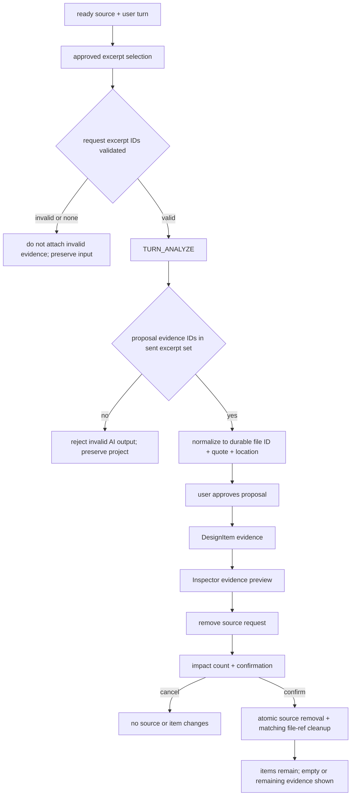

# SRC-PR-02 — 근거 연결

**Status: in_progress — implementation and self-validation complete; independent review and QA pending.** Planning base: `origin/main` at `aee5afddcdf32d4da7d46e1aebf260522670a780` (PR #25, verified 2026-10-21). Scope: `SRC-503` (`SRC-002`). The user approved the excerpt and citation-mapping decisions recorded below.

## 사용자 결과

사용자는 AI 제안으로 확정된 설계 항목에서 연결된 자료 파일, 인용 발췌와 위치를 확인한다. 자료를 제거할 때 영향을 받는 고유 설계 항목 수를 먼저 확인하고, 취소하면 데이터가 그대로 유지되며, 확인하면 자료 근거만 원자적으로 제거되고 설계 항목은 남는다.

## 요구사항·delivery 추적

- Requirement: `SRC-002` in `docs/product/03-requirements.md`.
- Delivery task: `SRC-503` in `docs/delivery/05-sources-guides-export.md`.
- PR unit row 23: `SRC-PR-02`; predecessor `SRC-PR-01` merged as PR #24.
- Decisions/contracts: `DEC-005`, `DEC-009`, `DEC-013`, `DEC-020`; `SourceDocument`, `DesignItem.evidence`, `EvidenceRef`, `ContextManifest`, `SourceExcerpt` in `docs/product/05-data-spec.md` and `docs/product/06-architecture.md`.
- UI: `UI-FILE-001` in `docs/ui/05-home-projects-and-files.md`; `UI-INS-001` and deleted-evidence state in `docs/ui/03-design-board-and-inspector.md`. Read `docs/template/README.md`; use its existing calm workspace hierarchy as reference, since it has no dedicated source-evidence inspector capture. Do not require screenshot artifacts.
- Existing implementation: `SourceDocuments` / `removeSource`, `AiTurnComposer.sendDraft`, `normalizeProposals`, `proposal-commands`, `EvidenceRef`, and the existing design Inspector.

## Definition of Ready

- [x] SRC-PR-01 is merged on current main; project source storage and `DesignItem.evidence` already exist.
- [x] DSG-PR-01~03 and the design-item Inspector are merged.
- [x] Scope, requirement, delivery task, normal/failure/boundary outcomes, affected UI, and focused validation are identified.
- [x] User approved the bounded excerpt-selection policy and deterministic implementation semantics below.
- [x] User approved request-local excerpt IDs for citation validation and canonical `EvidenceRef.sourceId = SourceDocument.id` persistence, with exact quote and location.

## Approved excerpt and citation policy

- Include excerpts only from ready `SourceDocument` records belonging to the current project.
- Prioritize paragraphs relevant to the current turn and question. The implementation uses deterministic lexical relevance; ties preserve source/document order.
- Include at most 2 paragraphs and 1,200 characters per source, and at most 6,000 excerpt-text characters per request. The character limit counts excerpt text only, excluding metadata and separators.
- Omit overflow rather than relying on provider truncation. If a paragraph exceeds the remaining per-source character budget, omit that paragraph intact to preserve quote fidelity.
- Assign each request excerpt a unique request-local `SourceExcerpt.id` for model citation validation. Preserve its canonical `SourceDocument.id`, exact text, and source location in the request mapping.
- Validate every returned file citation against the request-local excerpt IDs actually sent. On proposal normalization, persist `EvidenceRef.sourceType = "file"`, `EvidenceRef.sourceId = SourceDocument.id`, and the exact cited excerpt and location.
- The lexical relevance rule, stable ordering, intact-paragraph omission, and text-only character accounting are implementation semantics under the user-approved caps; they do not expand the approved product behavior.

## Scope

### Included

- Build request excerpts exclusively from ready project sources and include only the approved bounded selection in `TURN_ANALYZE`; keep non-ready, removed, and other-project sources out.
- Validate model evidence against the exact excerpts sent; persist file evidence on accepted/edited-and-accepted design items, preserving quote and location for preview.
- Show a source evidence preview in the selected design item Inspector with filename, quote, and location; retain an explicit empty/deleted-evidence state.
- Before removal, count unique active design items whose evidence refers to that source and show the count in a confirmation dialog.
- Cancel leaves source and evidence unchanged. Confirm atomically removes the source and its matching file evidence from design items and their acceptance criteria; retain every design item and all unrelated evidence.
- Keep excerpts, file contents, and private values out of logs; no API routes, server persistence, or live provider test unless the approved policy makes an existing contract insufficient.

### Excluded

- Upload, extraction, OCR, source text editing, remote/binary storage, or new source-storage service (`SRC-PR-01`).
- User-editing evidence, restoring removed files/evidence, generic evidence management, or redesign of proposal review.
- Requirements/guides/exports and unrelated AI context changes.

## Implementation outline

1. Add a focused excerpt projection/selection function implementing the approved relevance, limits, stable ordering, omission, and location semantics, without persisting duplicate source text.
2. Wire the selected ready-source excerpts into `AiTurnComposer`'s existing `TURN_ANALYZE` payload; validate returned request-local excerpt IDs and normalize them to canonical source IDs and exact `EvidenceRef` quote/location before proposals can be saved.
3. Add evidence preview to the existing Inspector and make missing file references render a clear deleted-evidence state without hiding other evidence.
4. Add a source-removal impact preview and confirmation. Recompute impact and remove matching refs inside the same latest-aggregate `ProjectRepository.transact`; do not delete design items or partially save.
5. Add direct unit/contract and one focused Playwright flow. Keep AI provider mocked; no unrelated suite or screenshot set.

## Process and failure states

## Acceptance criteria

### Happy path

Given ready sources and a user turn, when the user sends it, then only relevant, policy-bounded paragraphs from that project’s ready sources are included; an accepted proposal citing one of the request-local excerpt IDs stores the canonical source filename reference, exact quote, and location, and the Inspector preview shows all three after reload.

### Failure cases

- A proposal referencing an excerpt ID that was not sent is rejected before persistence; the existing aggregate and user input remain available, with no citation silently attached to another source.
- When source removal is canceled, the source, design item evidence, and acceptance-criterion evidence remain byte-for-byte unchanged.
- If the transactional removal fails, the latest source and all its evidence remain intact and the UI reports a recoverable error.
- When a source is removed, unrelated message/file evidence remains visible; the design item itself is never removed.

### Boundary

Given one source is referenced by five distinct design items (including duplicate evidence refs and any nested criteria), when removal is requested, then the confirmation shows exactly five affected design items; confirmation removes all matching refs atomically and retains all five items. The empty-evidence state appears only for an item with no remaining evidence.

## Focused validation matrix

| Concern | Focused check | Required result |
| --- | --- | --- |
| Excerpt policy | Unit/contract tests for ready-state and project filtering, deterministic lexical ranking and source-order ties, 2-paragraph/1,200-character per-source and 6,000-character request boundaries, intact-paragraph overflow omission, and exact location | Approved policy is enforced; non-ready/foreign/over-limit material is never sent and excerpt text is not altered |
| Evidence validation | Unit tests for request-local IDs actually sent, unknown/stale/unsent IDs, canonical source mapping, and exact quote/location normalization | Unknown IDs fail closed; valid citations map to the exact source and excerpt |
| Removal transaction | Unit/repository tests for unique impact count, duplicate refs, nested criteria, cancellation, transaction failure, and preservation of unrelated refs/items | Correct count; atomic cleanup; no design item loss or unrelated evidence mutation |
| Inspector/removal UI | One scoped Playwright spec for evidence preview, impact dialog, cancel, confirm, and visible no-evidence state at desktop and mobile layout | Filename/quote/location and exact affected count are accessible; cancel/confirm outcomes persist after reload |
| Build and diff | `npm run build`; `git diff --check` | Both pass |

Do not run a broad suite, live OpenAI request, full-app QA, or screenshot capture. Keep test execution limited to the changed evidence behavior and direct contracts.

## Data/API impact

- Expected canonical storage remains existing `SourceDocument`, `DesignItem.evidence`, `AcceptanceCriterion.evidence`, and `EvidenceRef`; no schema migration is expected if approved mapping fits the current shape.
- The existing `/api/blueprint/turn` contract already accepts `SourceExcerpt[]`; no new endpoint/API route is expected. A policy that requires a new persisted entity or incompatible `EvidenceRef` fields must be replanned before implementation.
- Source removal must update `sources`, design-item evidence and criterion evidence in one client-side IndexedDB transaction. Pending proposal behavior must not be broadened unless a product contract explicitly requires it.

## Risks

- Relevance ranking can select different paragraphs if normalization or tie ordering changes; tests must lock the deterministic ordering and ensure quote text is preserved exactly.
- Excerpt ID versus source ID mismatch can either reject valid model citations or attach a citation to the wrong file; tests must exercise the complete request-to-persisted-reference mapping.
- Concurrent/stale UI state can undercount impacts; compute count and cleanup against the latest aggregate inside the transaction, and require confirmation against the displayed latest count.
- A source may support several items and have duplicate/nested refs; count unique design items, remove only matching file refs, and retain other evidence.

## Review and QA checklist

- [ ] Approved excerpt selection and durable-ID mapping implemented exactly.
- [ ] Only ready, project-owned, bounded excerpts enter `TURN_ANALYZE`; content is not logged.
- [ ] Model evidence must refer to a sent excerpt; normalization cannot bind arbitrary or removed sources.
- [ ] Inspector shows filename, quoted excerpt, location, and empty/deleted state accessibly.
- [ ] Removal previews unique impacted design-item count and recomputes atomically; cancel/failure preserve state.
- [ ] Confirmed removal retains items, nested unrelated evidence, and all unrelated aggregate fields.
- [ ] Focused unit/contract and Playwright checks pass on the exact final SHA.

### Implementer validation — 2026-10-21

- `node --test tests/unit/src-pr-02-source-evidence.test.js tests/contract/fnd-context-validation.test.js tests/unit/dsg-pr-01-proposals.test.js tests/contract/turn-api.test.js tests/unit/ai/prompt-registry.test.js tests/unit/ai/golden-eval.test.js` — 51 passed, 0 failed.
- `npx playwright test tests/e2e/src-pr-02-evidence-linking.spec.ts --workers=1` — 2 passed (desktop Chromium and mobile Chromium). Installed the configured Playwright Chromium binaries with `npx playwright install chromium`.
- `npm run build` — passed (`tsc -b` and Vite production build).
- `git diff --check` — passed.

## Done checklist

- [x] Missing product contract resolved and Definition of Ready complete.
- [x] `SRC-002` behavior and focused acceptance checks pass.
- [x] Implementer self-validation and build pass; exact results recorded.
- [ ] Independent code review passes on final SHA.
- [ ] Independent focused QA passes on the same SHA.
- [ ] User-authorized PR lifecycle gate passes and GitHub confirms merge.
