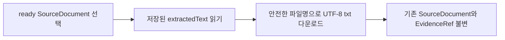

# SRC-PR-03 — 추출 결과 다운로드

## Overview

사용자는 첨부 자료의 추출 결과를 앱에서 읽기 전용으로 확인하고 텍스트 파일로 다운로드할 수 있다. 앱 내 편집은 제공하지 않는다(`DEC-044`).

## Background

SRC-PR-01은 텍스트 추출과 preview를 제공하고 원본 바이너리 장기 보관은 보장하지 않는다. 사용자는 추출 결과를 외부에서 수정할 수 있도록 다운로드가 필요하다. 이 계획은 DEC-PR-01에서 확정한 정책을 구현 가능한 단위로 분리한다.

## Scope

### 포함

- 추출 상태가 ready인 source의 추출 텍스트를 UTF-8 `.txt` 파일로 다운로드
- 파일명은 source 파일명을 안전하게 정제하고 `.txt` 확장자를 사용
- preview는 계속 읽기 전용이며 다운로드는 source, hash, evidence, design item에 부수 효과를 주지 않음

### 제외

- 앱 안에서 추출 텍스트 편집
- 원본 binary 복구·다운로드

## 연결 근거

- 요구사항: `SRC-001`, `SRC-002`
- Delivery 작업: `SRC-502`, `SRC-503`
- 결정: `DEC-044`, `DEC-043`
- 선행 PR: `SRC-PR-01`, `SRC-PR-02`, `DEC-PR-01`

## Definition of Ready

- `DEC-PR-01`이 병합되어 read-only 및 다운로드 정책이 기본 브랜치에 있음
- SRC-PR-01의 기존 제한·추출 동작과 SRC-PR-02의 근거 보존 계약이 병합되어 있음

## 작업 흐름

## Acceptance Criteria

### Happy Path

Given 추출이 ready인 파일에서, when 사용자가 `추출 결과 다운로드`를 선택하면, then 저장된 추출 문자열이 UTF-8 텍스트 파일로 다운로드되고 앱 내 preview는 읽기 전용으로 유지된다.

### Failure Case

Given source가 추출 중, 실패 또는 unsupported 상태일 때, when 사용자가 파일 행을 확인하면, then 다운로드 action이 비활성화되거나 제공되지 않으며 잘못된/빈 결과 파일을 만들지 않는다.

### Boundary

Given 다운로드가 완료되면, then 다운로드 동작은 기존 source의 추출 텍스트, hash, EvidenceRef와 연결된 설계 항목을 변경하지 않는다.

## 예상 변경 파일

- Source file row / extracted text download action
- source download helper and focused unit/contract tests
- source upload browser tests for ready, unavailable, and no-mutation flows
- 관련 UI 명세 및 acceptance evidence

## 데이터/API 영향

- `SourceDocument` schema 변경이나 서버 API는 필요하지 않다.
- 브라우저 저장된 extracted text로 Blob을 생성하고 기존 안전한 download 흐름을 재사용한다.
- 다운로드는 기존 source와 EvidenceRef를 변경하지 않는 순수 읽기 동작으로 수행한다.

## 검증 계획

- 다운로드된 Blob의 UTF-8 텍스트가 추출 결과와 byte-for-byte 일치
- ready 전 상태에서는 다운로드 불가
- 다운로드 동작 전후 source, hash, evidence와 design item이 불변
- desktop/mobile에서 keyboard accessible action과 파일명 확인
- focused tests, Playwright, production build, `git diff --check`

## UI 증거 계획

- desktop 1440×900, mobile 390×844에서 source row와 다운로드 action 확인
- ready, extracting/failed 상태에서 action 활성 여부 확인
- download 후 preview 및 linked evidence가 변하지 않음을 확인

## 코드 리뷰·QA 체크리스트

- [ ] 원본 파일과 추출 결과 파일을 사용자가 구분할 수 있음
- [ ] 비-ready source의 결과를 다운로드하지 못함
- [ ] 파일명 정제가 경로 traversal / OS 구분자 입력을 차단함
- [ ] 다운로드가 기존 source, hash, evidence와 design item을 변경하지 않음
- [ ] desktop/mobile keyboard access와 focus state 검증

## Done Checklist

- [ ] 다운로드 정책 구현과 오류/경계 테스트 통과
- [ ] 독립 코드 리뷰와 QA 통과
- [ ] CI 필수 check 통과
- [ ] final-head 증거와 traceability 갱신

## 상태

planned. 구현 전 최신 기본 브랜치에서 `$pr-development-loop`를 수행한다.
