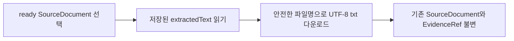

# SRC-PR-03 — 추출 결과 다운로드

## Overview

사용자는 첨부 자료의 추출 결과를 앱에서 읽기 전용으로 확인하고 텍스트 파일로 다운로드할 수 있다. 앱 내 편집은 제공하지 않는다(`DEC-044`).

## Background

SRC-PR-01은 텍스트 추출과 preview를 제공하고 원본 바이너리 장기 보관은 보장하지 않는다. 사용자는 추출 결과를 외부에서 수정할 수 있도록 다운로드가 필요하다. 이 계획은 DEC-PR-01에서 확정한 정책을 구현 가능한 단위로 분리한다.

## Scope

### 포함

- 추출 상태가 ready인 source의 추출 텍스트를 UTF-8 `.txt` 파일로 다운로드
- 파일명은 source 파일명을 안전하게 정제하고 `.txt` 확장자를 사용
- preview는 계속 읽기 전용이며 다운로드는 source, hash, evidence, design item에 부수 효과를 주지 않음

### 제외

- 앱 안에서 추출 텍스트 편집
- 원본 binary 복구·다운로드

## 연결 근거

- 요구사항: `SRC-001` in `docs/product/03-requirements.md`.
- Delivery 작업: `SRC-502` in `docs/delivery/05-sources-guides-export.md`. `SRC-503`/`SRC-002` 근거 연결은 SRC-PR-02에서 완료됐으며 이 PR 범위가 아니다.
- 결정: `DEC-044` in `docs/product/10-decision-log.md`.
- 데이터/UI 계약: `SourceDocument`와 `EvidenceRef` in `docs/product/05-data-spec.md`; `UI-FILE-001` in `docs/ui/05-home-projects-and-files.md`.
- 선행 PR: SRC-PR-01 (#24, 파일 제한·추출), SRC-PR-02 (#26, 근거 연결), DEC-PR-01 (#27, 읽기 전용·외부 수정 정책). 모두 현재 `main`에 병합됐다.
- 시각 참고: `docs/template/README.md`의 `image (17).png`를 파일 첨부 진입점의 정보 위계 참고로 사용한다. 이 이미지는 작업 공간 파일 행을 보여 주지 않으므로 구현 증거를 대체하지 않는다.

## Definition of Ready

- [x] SRC-PR-01 (#24), SRC-PR-02 (#26), DEC-PR-01 (#27)이 현재 기본 브랜치에 병합되어 있다.
- [x] `SRC-001`/`SRC-502` 범위, `DEC-044` 읽기 전용 결정, SourceDocument/EvidenceRef 불변 경계와 관찰 가능한 정상·실패·경계 수용 기준이 확인됐다.
- [x] UI-FILE-001, 데스크톱·모바일 동작, 키보드 접근성 및 최종 화면 증거 기준이 확인됐다.
- [x] 데이터 schema/API 변경이 필요하지 않으며 미결정 제품 정책이 없다. 다운로드한 외부 수정본의 앱 재가져오기 동작은 이 PR에서 정의하지 않는다.

## 작업 흐름

## Acceptance Criteria

### Happy Path

Given 추출이 ready인 파일에서, when 사용자가 `추출 결과 다운로드`를 선택하면, then 저장된 추출 문자열이 UTF-8 텍스트 파일로 다운로드되고 앱 내 preview는 읽기 전용으로 유지된다.

### Failure Case

Given source가 추출 중, 실패 또는 unsupported 상태일 때, when 사용자가 파일 행을 확인하면, then 다운로드 action이 비활성화되거나 제공되지 않으며 잘못된/빈 결과 파일을 만들지 않는다.

### Boundary

Given 다운로드가 완료되면, then 다운로드 동작은 기존 source의 추출 텍스트, hash, EvidenceRef와 연결된 설계 항목을 변경하지 않는다.

## 예상 변경 파일

- `src/components/projects/SourceDocuments.tsx`의 ready source 행과 read-only preview/download action 및 직접 관련된 local style.
- `src/features/sources/`의 다운로드 helper와 선언 파일(필요한 경우), helper unit/contract tests.
- `tests/e2e/`의 SRC-PR-03 범위 브라우저 검증: ready 다운로드, non-ready 불가, 다운로드 전후 데이터 불변.
- `docs/ui/05-home-projects-and-files.md`는 구현으로 기존 명세가 불완전하거나 부정확해지는 경우에만 필요한 범위로 갱신한다.
- 최종 HEAD의 화면 캡처는 저장소에 커밋하지 않고 `.pr-artifacts/SRC-PR-03/` 또는 PR artifact에 둔다.

## 데이터/API 영향

- `SourceDocument` schema 변경이나 서버 API는 필요하지 않다.
- 브라우저 저장된 extracted text로 Blob을 생성하고 기존 안전한 download 흐름을 재사용한다.
- 다운로드는 기존 source와 EvidenceRef를 변경하지 않는 순수 읽기 동작으로 수행한다.

## 검증 계획

- focused unit/contract tests: UTF-8 Blob 내용이 저장된 `extractedText`와 byte-for-byte 일치, 파일명 정제(경로 구분자/제어 문자/빈 이름), URL 생성·회수 실패 처리를 확인한다.
- ready 상태만 다운로드 가능하며 queued/extracting/failed/unsupported 및 archived source에는 action이 없거나 비활성이고 파일이 생성되지 않는다.
- Playwright Chromium: 실제 다운로드 파일명과 byte 내용을 확인하고 다운로드 전후 `SourceDocument`, `textHash`, `EvidenceRef`, 연결된 `DesignItem` snapshot이 동일함을 검증한다. 추출 결과 preview는 read-only여야 한다.
- desktop 1440×900 및 mobile 390×844에서 다운로드 action의 키보드 조작, 접근 가능한 이름, visible focus, 긴 파일명과 행 배치를 확인한다.
- `npm run build`와 `git diff --check`를 실행한다. OpenAI 요청은 필요하지 않다.

## UI 증거 계획

- 최종 PR HEAD에서 `.pr-artifacts/SRC-PR-03/` 또는 PR artifact로 데스크톱 1440×900과 모바일 390×844 캡처를 첨부한다.
- 각 viewport에서 ready 다운로드 action, non-ready(extracting 및 failed/unsupported 중 영향받는 상태) action 상태, 키보드 focus 상태를 캡처하거나 증거로 설명한다.
- 다운로드 후 read-only preview와 linked evidence 화면이 그대로임을 같은 데이터와 viewport 흐름에서 확인한다. 캡처는 실제 검증 증거이며 template 참조 이미지를 대체물로 사용하지 않는다.
- Agent Browser와 Playwright Chromium이 모두 사용 가능하면 둘 다 검증한다. Agent Browser를 쓸 수 없으면 tool catalog와 실행 파일 확인 결과를 기록하고 Playwright Chromium으로 동일 흐름을 검증한다.

## 코드 리뷰·QA 체크리스트

- [ ] 원본 파일과 추출 결과 파일을 사용자가 구분할 수 있음
- [ ] 비-ready source의 결과를 다운로드하지 못함
- [ ] 파일명 정제가 경로 traversal / OS 구분자 입력을 차단함
- [ ] 다운로드가 기존 source, hash, evidence와 design item을 변경하지 않음
- [ ] preview가 read-only이고 외부 수정본의 앱 재가져오기 동작을 임의로 추가하지 않음
- [ ] desktop 1440×900/mobile 390×844의 ready, non-ready, keyboard/focus 증거가 final HEAD에서 확인됨

## Done Checklist

- [x] 다운로드 정책 구현과 오류/경계 테스트 통과
- [ ] 독립 코드 리뷰와 QA 통과
- [ ] CI 필수 check 통과
- [ ] final-head 증거와 traceability 갱신

## 상태

fix_required. 독립 리뷰가 비동기 object URL 정리 결함을 찾아 수정과 회귀 검증을 진행 중이다.
