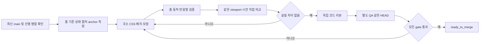

# UIR-PR-02B — 홈 화면 시안 배치 보정

## 결과와 배경

홈의 지원 기능과 사용자 흐름을 유지하면서 주 시안의 정보 위계와 배치를 구현한다. UIR-PR-02 구현을 실제 Preview와 대조했을 때 본문 폭이 좁고 제목·composer·최근 프로젝트가 세로로 크게 어긋났다. UIR-PR-02A가 병합한 직접 비교 gate를 처음 적용해 홈의 주요 anchor를 기준 시안에 맞춘다.

기준 시안은 [`docs/blueprint-design/README.md`](../../blueprint-design/README.md)의 `윈드소프트 모던 SaaS 대시보드.png`(1672×941)다. `docs/template/README.md`는 시안에 없는 입력·로딩·실패 상태에만 참고한다. 디자인 이미지의 로고·사진·샘플 데이터·미지원 메뉴/기능을 제품에 가져오지 않는다.

PR #35 Preview를 1672×941로 캡처한 이전 관찰값은 main의 홈 CSS가 같음을 확인한 참고 baseline이다(이전 Preview의 화면 표현 인증 mock을 사용했으며 인증 검증 근거가 아님).

| Anchor | 이전 Preview 관찰 | 주 시안 관찰 | 보정 목표 |
| --- | ---: | ---: | --- |
| 주 콘텐츠 폭 | 약 1120px | 약 1319px | 실제 shell content 안에서 시안의 여백·폭 관계에 근접 |
| 제목 상단 | 약 y=167px | 약 y=217px | viewport 기준 50px 차이 해소 |
| composer | x≈480, y≈316, 960×273px | x≈413, y≈345, 985×171px | 폭·위치·높이 차이를 기준 gate 안으로 축소 |
| 최근 프로젝트 시작 | 약 y=668px | 약 y=570px | composer와 섹션 간격을 포함해 시안 배치에 근접 |

이 값은 눈금이 없는 시안에서 캡처로 읽은 초기 참고값이다. 구현자는 검토 시 원본과 최신 main의 실제 렌더를 같은 CSS viewport에서 측정하고, 확정 anchor 수치와 예외를 기록한다. 수용 판정의 단일 수치 문턱은 [`docs/ui/07-visual-acceptance.md`](../../ui/07-visual-acceptance.md)의 5% 위치·10% 크기 기준이다.

## 선행 조건과 요구사항 추적

- 선행 PR: UIR-PR-01, UIR-PR-02 (#35), UIR-PR-02A (#36)는 모두 `main`에 병합됐다. 구현은 최신 `origin/main` `285197bf1e754e5d46007646cbf11da1388a0ccf`에서 분기했다.
- 연결 요구사항: UIR-002(지원 범위 보존), UIR-003(공통 셸·홈), UIR-010(홈 반응형·접근성). 새 제품 기능 또는 요구사항은 만들지 않는다.
- 연결 계약: `docs/product/02-prd.md`의 프로젝트 시작·로컬 보관·파일 제한, `docs/product/07-ui-design.md`의 로그인 후 홈, `docs/ui/05-home-projects-and-files.md`(UI-HOME-001/002, UI-PRJ-001, UI-FILE-001), `docs/ui/screens/01-home-and-start.md`(F-HOME-EMPTY/RECENT/F-PROJECT-LIMIT), `docs/ui/screen-state-matrix.md`, `docs/ui/07-visual-acceptance.md`.
- Delivery 표에서 UIR-PR-02A를 `merged (#36, 285197b)`로 정정했고 UIR-PR-02B를 UIR-PR-03 앞에 등록했다. UIR-PR-03의 선행 조건은 UIR-PR-02B 병합으로 갱신했다.

## 범위

### 포함

- 현재 홈 route의 주 시안 기준 배치 보정: 홈 주 콘텐츠의 폭·정렬, 제목/설명과 composer 간격, composer의 시각 높이, 최근 프로젝트 영역 시작 위치와 폭.
- 첨부 제한 안내와 첨부, 실제 예시를 입력에 채우는 동작, 생성/검증/오류 처리, 최근 프로젝트/빈 상태/재시도/20개 제한 dialog를 그대로 유지하며 컴팩트하게 재배치.
- 데스크톱의 최근 프로젝트 목록과 모바일 첫 화면의 읽기·행동 순서 유지.
- 직접 비교를 위한 홈 전용 browser assertion/evidence 및 필요한 국소 CSS 조정.

### 제외

- 전역 셸/인증/프로젝트 작업 공간 및 다른 UIR 단계.
- route, API, storage schema, AI 동작, 사용자 데이터 의미 변경.
- 디자인 시안에만 등장하는 사진·브랜드 로고·샘플 프로젝트, Templates/Knowledge Library/Settings/알림, 음성 입력, 새 시작 카드/검색/필터/대시보드.
- 새 디자인 system, UI library, 전역 token 체계 또는 다른 화면 정리.

시안에 없는 `전체 보기`를 새로 추가하지 않는다. 기존 프로젝트 목록의 펼침 동작을 제거·변경하려면 제품 계약과 사용자 데이터 접근에 영향을 주므로 이 PR에서 임의 변경하지 않고 reviewer가 현 계약과 대조한다.

## 구현 경계와 작업 단위

1. **기준 렌더 측정:** 최신 `origin/main`에서 인증된 홈 route를 재현하고, empty 및 recent fixture 상태를 원본 1672×941 시안과 같은 CSS viewport로 캡처한다. 홈 화면 표현용 인증 mock을 쓰면 명시하고, 진짜 로그인 검증으로 주장하지 않는다. rail/header가 주 시안에서 제품 범위 제외 요소를 포함하므로 비교 anchor로 필요한 경계만 잡고 해당 차이를 기록한다.
2. **홈 geometry 보정:** `HomePage`와 `ProjectComposer` DOM의 지원되는 동작은 유지하고 `home.css`/`project-composer.css`의 국소 규칙을 우선 조정한다. 높이 맞춤을 위해 필수 안내·에러·첨부 행을 숨기거나 기능 상태를 삭제하지 않는다. JSX 조정이 필요한 경우 중복 안내 문구나 불필요한 래퍼에 한정하고 접근 가능한 이름/설명 관계를 유지한다.
3. **회귀 및 증거:** 홈 전용 Playwright 검증을 추가/갱신해 anchor geometry, create/attach/error/recent 핵심 행동과 반응형을 검증한다. 최종 HEAD 캡처·시안 대조표를 PR 증거로 남긴다.

## 수용 기준

### Happy path

- 1672×941에서 홈 title, composer, recent section의 위계·폭·세로 위치가 주 시안의 실제 지원 가능한 배치와 맞는다. Composer 높이는 주 시안 약 171px보다 커도 `docs/ui/screens/01-home-and-start.md` H05의 최소 4행 입력 계약이 우선이므로 예외를 허용한다. 최종 높이와 차이를 비교 기록에 적고 코드 리뷰와 QA가 예외를 각각 승인해야 한다. 그 밖의 적용 anchor는 visual acceptance 수치 문턱을 통과한다.
- 1440×900과 390×844 최종 캡처를 제공한다. 1672×941은 주 시안과 정확히 같은 CSS viewport의 직접 비교 artifact로 추가한다.
- 아이디어 입력 후 `Blueprint 시작`으로 기존 프로젝트 생성·이동을 완료한다. 예시를 누르면 입력만 채워지고 자동 제출되지 않는다.
- 최근 목록은 실제 데이터만 표시하고 이어서 작업으로 이동한다. 빈 상태의 링크/행동은 입력에 포커스한다.

### Failure / boundary

- 입력 검증, 생성 실패, 첨부 파일 선택/지원 제한 안내, 최근 프로젝트 로딩/오류 재시도, 프로젝트 20개 제한 dialog 및 취소 후 입력 보존이 보정 전과 동일하게 동작한다.
- 첨부 제한 문구(지원 형식, 파일당 10 MiB, 프로젝트당 최대 5개)는 파일 선택 행동 전에 읽을 수 있고 responsive 화면에서도 잘리거나 composer 밖의 혼동되는 위치로 이동하지 않는다.
- 빈 목록과 실제 최근 목록(최소 1개 및 6개)의 desktop/mobile 레이아웃에서 수평 overflow, 겹침, 첫 화면에서 시작 행동 손실이 없다. 6개 목록에서도 composer는 첫 viewport에서 사라지지 않는다.
- 모바일 첫 viewport에서 제목, 설명, 입력 영역의 시작, 주요 CTA가 인지 가능하고 composer footer의 첨부·제출 행동은 한 줄로 유지된다.
- H05의 4행 입력 높이가 desktop·mobile 모두 유지되고, 해당 계약으로 인한 composer 높이 차이는 위치·폭 차이와 분리해 기록한다.
- 200% 확대, 키보드 순서, focus indicator와 create/validation/error의 focus 이동이 유지된다.

### 제외 범위 확인

- 사진 배경, 브랜드 로고, 미지원 전역 메뉴/기능, 예시 프로젝트 데이터 또는 미지원 시작 카드가 추가되지 않는다.
- 기존 route/API/storage/AI 계약은 변경되지 않는다.

## 예상 변경 파일

- Modify: `src/styles/home.css`, `src/styles/project-composer.css` (변경 최소화; 다른 파일 변경은 필요성이 diff에서 명확할 때만)
- Create or modify: `tests/e2e/uir-pr-02b-home-visual-parity.spec.ts` (기존 UI regression test 경로/fixture와 중복 여부를 먼저 확인)
- PR artifact only (커밋 금지): `.pr-artifacts/UIR-PR-02B/` desktop/mobile/state screenshots 및 비교 기록

route/API/storage/data 영향은 없다. 국소 CSS와 테스트 추가로 rollback할 수 있다.

## 검증 계획

| 검증 | 명령/절차 | 통과 조건 |
| --- | --- | --- |
| 관련 기존 홈·프로젝트 동작 | `npx playwright test tests/e2e/uir-pr-02.spec.ts tests/e2e/prj-pr01.spec.ts tests/e2e/prj-pr02.spec.ts --project=chromium --workers=1` (실제 존재 파일을 시작 시 확인해 최신 main 경로에 맞춰 실행) | 입력, 생성, 최근 목록, 첨부, 제한 modal 회귀 없음 |
| 홈 시각·responsive assertion | `npx playwright test tests/e2e/uir-pr-02b-home-visual-parity.spec.ts --project=chromium --workers=1` | 1672×941 anchor와 1440×900·390×844 overflow/주요 행동 assertions pass |
| Build | `npm run build` | exit 0 |
| 전체 unit/contract | `npm run test:unit` | exit 0, 변경과 관련한 사전 실패 별도 기록 |
| diff 품질 | `git diff --check` | exit 0 |
| 직접 시안 비교 | 주 시안과 최종 HEAD를 같은 1672×941 CSS viewport·동일 fixture로 나란히 검토, 1440×900·390×844 화면도 확인 | anchor별 x/y/w/h 및 px/% 기록; 설명되지 않은 visual acceptance 초과 0 |
| 독립 QA | Playwright Chromium 핵심 flow, desktop/mobile, 영향을 받은 attachment/validation/recent/limit/error state와 artifact | 실제 브라우저 동작·접근성 확인; 모든 비교 artifact가 동일 final HEAD |

Agent Browser가 현재 사용 가능하면 동일 경로를 수행한다. 불가 시 도구 목록·실행 파일 확인을 기록하고 Playwright Chromium으로 전체 QA 흐름을 수행한다. 보호된 Vercel Preview를 evidence로 쓸 경우 deployment HEAD가 검토 HEAD와 같아야 하며 기존 보호 접근 절차를 따른다. Preview를 못 쓰면 같은 HEAD의 로컬 렌더 비교로 한정했음을 명시한다.

## 리뷰·QA 체크리스트

- [ ] 독립 reviewer가 `UIR-002/003/010`과 홈 계약을 기준으로 scope, 동작 보존, semantic structure, CSS 반응형, 제외 시안 요소를 검토한다.
- [ ] reviewer가 주 시안·렌더 쌍 및 anchor table을 직접 보고 시각 차이와 예외를 판정한다.
- [ ] 독립 QA가 reviewer와 다른 context에서 동일 최종 HEAD의 empty/recent/create/validation/attachment/mobile 경로를 실행한다.
- [ ] 캡처의 viewport·상태·fixture가 browser test 및 비교 기록과 일치하고 mock auth는 표현 증거로만 명시된다.
- [ ] finding 수정 후 관련 Playwright·build·unit 검증, 새로운 HEAD 시안 비교, re-review, 같은 HEAD re-QA를 순서대로 수행한다.

## Definition of Ready

- [x] PR unit ID, 목표와 포함/제외 범위 확정.
- [x] 연결 요구사항·화면 계약 및 선행 UIR 단위 명시.
- [x] 관찰 가능한 수용 기준, 실패·경계 상태, validation/evidence 목록 작성.
- [x] 수치 판정의 기준 문서(`docs/ui/07-visual-acceptance.md`) 및 주 시안 경로 명시.
- [x] Coordinator가 delivery 표와 상위 UI 계획의 UIR-PR-02A 병합 상태를 정정하고 UIR-PR-02B를 UIR-PR-03 앞에 등록했다.
- [x] Implementation 시작 시점의 최신 `origin/main` SHA와 UIR-PR-02A GitHub merged 상태를 확인했다.

Definition of Ready를 충족했다. 제품 결정 누락은 없다.
