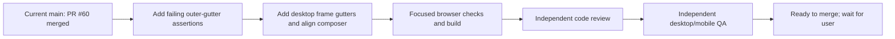

# UIR-PR-03G — Add visible outer gutters to conversation panels

## Overview

- **Outcome:** The conversation card and summary card have a visible 26px outer gap from the stage's left and bottom edges, matching the existing desktop right gutter.
- **Requirements:** `UIR-005` (conversation and summary), `UIR-010` (responsive/accessibility).
- **Predecessor:** PR #60 merged to `main` at `9b81e9f`; branch from latest `origin/main`.
- **Primary reference:** `docs/blueprint-design/회의실 예약 서비스 UI 캔버스.png`; conversation state fallback: `docs/template/image (15).png` and `docs/template/image (16).png`.
- **Affected route/state:** `/blueprints/:projectId`, conversation step with the deterministic meeting-room aggregate.

## Background and root cause

Production is serving current `main`; PR #59's 26px right gutter and PR #60's neutral input surface are present in the live CSS. The old gutter check measured 25px padding inside `.workspace-conversation-content` and a 25px pseudo-element at the end of its scroll content. Those preserve message inset and scroll reach but do not move the outer conversation card away from the stage's left/bottom edges. The summary card already has 25px internal bottom padding, but its outer border still reaches the stage bottom. This task adds the missing outer frame spacing without changing those inner content insets.

## Scope

### Include

- At desktop widths, add 26px left and bottom outer padding to `.conversation-stage-layout`, retaining its 26px right gutter and top alignment.
- Keep the conversation and summary cards within the stage frame; both card bottoms must sit 26px above the stage bottom.
- Reposition the fixed composer with the adjusted conversation card so it retains the existing visual inset inside the card and stays clear of the bottom edge.
- Add browser assertions for outer card geometry, composer alignment, scroll reach, and overflow at desktop and responsive breakpoints.
- Capture and compare final-HEAD desktop and mobile screenshots.

### Exclude

- Conversation content's existing 25px left inset and end spacer, summary's existing 25px internal bottom padding, composer dimensions/appearance, conversation behavior, API/data, and other stages.
- Changes to mobile's stacked 10–12px stage padding unless testing identifies a regression.

## Acceptance criteria

1. At 1440×900, the conversation card's left edge is inset 26px (±1px) from the conversation stage's left edge.
2. At 1440×900, the conversation and summary card bottoms are inset 26px (±1px) from the stage bottom.
3. The fixed composer remains fully inside the conversation card with its existing 30px left and 10–11px bottom inset; the content end remains reachable by scrolling.
4. The existing 26px right gutter and inner conversation/summary padding remain unchanged.
5. At 1024px, the two-column layout remains usable without horizontal overflow or composer overlap. At 390×844, the stacked conversation/summary flow, safe-area clearance, and existing 10px outer inset remain intact.
6. Selection, answer submission, API calls, and scroll ownership do not change.

## Process

## Data and API impact

None. This is a CSS and browser-test-only change.

## Validation matrix

| Area | Cases | Evidence |
| --- | --- | --- |
| Outer geometry | Desktop 1440×900; 1024px transition | Bounding boxes for stage, conversation card, summary card, and composer; 26px ±1px gutters and preserved composer inset |
| Responsive | Mobile 390×844 | Existing stacked layout, 10px stage inset, no horizontal overflow or composer/content occlusion |
| Scroll | Long conversation content | Last message and question remain reachable after the new outer bottom gap |
| Visual | Default conversation with summary | Final-HEAD same-data screenshots at 1440×900 and 390×844; desktop comparison against the mapped Blueprint canvas |
| Build and patch | TypeScript/Vite and whitespace | `npm run build`; `git diff --check` |

## Expected files

- `src/styles/workspace-shell.css`
- `tests/e2e/uir-pr-03g-conversation-outer-gutters.spec.ts` (or focused update to the current gutter spec)
- `docs/tasks/UIR-PR-03G/plan.md` and delivery tracking/evidence for this unit

## Review and QA checklist

- Reviewer checks only scoped CSS/test changes, including cascade and breakpoint behavior.
- QA uses Playwright Chromium with deterministic authentication/data and independently measures the rendered outer gutters and composer bounds at desktop/mobile.
- Agent Browser availability is checked and recorded; Playwright is used if unavailable.
- Review and QA evidence identify the exact final HEAD. No merge or production deploy is part of this task.

## Done checklist

- [ ] Browser regression assertion fails before the CSS change and passes after it.
- [ ] Desktop/mobile focused tests and `npm run build` pass.
- [ ] Matched desktop reference/render evidence and responsive screenshots are attached.
- [ ] Independent code review and QA pass on the exact final HEAD.
- [ ] Required CI checks pass; PR is left open at `ready_to_merge`.
