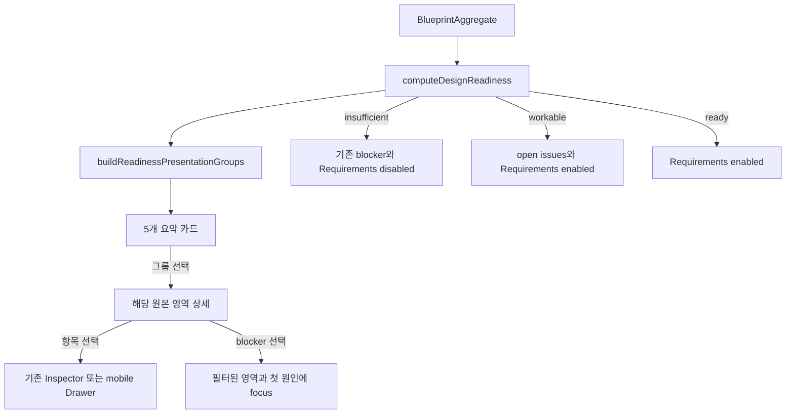

# UIR-PR-05 설계 준비 화면 구현 계획

> **For agentic workers:** REQUIRED SUB-SKILL: Use superpowers:subagent-driven-development or superpowers:executing-plans to implement this plan task-by-task. Steps use checkbox syntax for tracking.

**Goal:** 기존 설계 준비 계산과 Requirements gate를 유지하면서, 10개 원본 설계 영역을 시안의 5개 요약 카드와 10개 상세로 탐색할 수 있게 한다.

**Architecture:** computeDesignReadiness()와 DESIGN_SECTIONS를 그대로 source of truth로 둔다. 새 순수 함수 buildReadinessPresentationGroups()가 DesignReadiness를 5개 표현 그룹으로 투영하고, DesignBoard가 결과와 기존 원본 영역·항목·Inspector를 조립한다. UI 상태는 준비도를 다시 계산하거나 저장하지 않는다.

**Tech Stack:** React, TypeScript, JavaScript, local CSS, Node test runner, Playwright Chromium.

**Spec:** docs/superpowers/plans/2026-10-22-blueprint-ui-overhaul.md의 UIR-007/UIR-PR-05, docs/ui/screens/04-design-and-readiness.md, docs/ui/03-design-board-and-inspector.md, docs/blueprint-design/README.md 및 설계 준비 시안, docs/template/README.md.

## 개요와 Definition of Ready

설계 화면은 이미 10개 DESIGN_SECTIONS, 준비 상태, blocker 목록, Requirements gate, 항목 선택과 Inspector를 지원한다. 이 PR은 현재 상세 목록을 없애지 않고, 그 위에 5개 요약 카드를 두어 원본 영역으로 들어가는 경로를 제공한다.

선행 화면 PR은 병합됐다: PR #49 제안 검토, PR #50 요약 아이콘·이전 화살표. 계획 기준 최신 main SHA는 0e27da5f5ccd4289309ac348e5340959e7f2a5b5다. 현재 docs/tasks/UIR-PR-05/plan.md가 없어 이 파일로 구현 전 계획을 제공한다.

- UIR-007이 소유 요구사항이며 UIR-002/010 범위·반응형 계약을 따른다.
- 시안과 화면 계약에 mapping, 상태 우선순위, 10개 영역과 gate가 정의돼 있어 제품 결정이 필요하지 않다.
- 샘플 데이터·live provider·route/API/storage/schema 변경 없이 fixture로 상태를 만들 수 있다.
- 구현은 별도 isolated worktree에서 시작하고 PR #50이 병합된 최신 main SHA를 확인한다.

## 전역 제약과 범위

- computeDesignReadiness()가 insufficient/workable/ready와 canGenerateRequirements의 유일한 기준이다.
- 5개 그룹은 표현 계층이다. 시안의 4/5, 퍼센트, 진행 점수로 gate를 만들지 않는다.
- 기존 10개 DESIGN_SECTIONS, item state, blocker, deferred, conflict, review-required, evidence, Inspector, Requirements 진입을 보존한다.
- 제안 동작, Requirements 생성, 데이터/API/route 변경, 새 UI library/dependency는 제외한다.
- 상태는 텍스트와 선택 아이콘으로 표현하며 색상만으로 구분하지 않는다.
- keyboard, visible focus, mobile content order, Drawer focus return과 safe area 계약을 유지한다.

### 포함

1. 기존 준비 상태를 다섯 고정 그룹으로 순수 투영한다.
2. 다섯 overview 카드와 열 개 원본 영역 상세를 함께 제공한다. 그룹 선택은 관련 원본 영역과 원인·항목으로 이동한다.
3. 기존 blocker focus, collapse, item selection, Inspector, Requirements CTA를 유지한다.
4. empty, insufficient, workable, ready, conflict, review-required를 aggregate fixture로 검증한다.
5. 설계 단계에서는 참고 자료 첨부 패널을 준비 요약·상세 뒤에 배치한다. 파일 첨부, 저장과 결과 알림은 그대로 동작하고 다른 단계의 순서는 바꾸지 않는다.
6. 공통 프레임의 중복 설계 제목을 제거하고 상태 제목과 본문 간격을 압축한다. 설계 항목 Inspector는 기본 상태에서 280px 열을 예약하지 않으며 항목 선택 또는 상세 제어로 열린다.

### 제외

- 준비도 계산 재작성 또는 네 번째 readiness state.
- 새 점수·퍼센트·허구 제안·샘플 제품 데이터.
- broad accessibility audit이나 다른 화면의 재설계.

## 그룹 투영 계약

| 순서 | key | 화면 제목 | 원본 영역 |
|---:|---|---|---|
| 1 | product_and_problem | 제품과 문제 | product, problem, outcomes |
| 2 | users | 사용자 | users, scenarios |
| 3 | features_and_scope | 기능과 범위 | features, scope |
| 4 | data_and_integrations | 데이터와 연동 | data |
| 5 | security_and_operations | 보안 | identity, operations |

각 areaKey는 정확히 한 번 포함한다. itemIds는 원본 영역 순서와 각 영역 내 기존 순서를 유지하고 중복을 제거한다. 그룹 상태는 아래 순서 중 가장 높은 우선순위 상태다.

conflict → review_required → missing → proposed → deferred → confirmed → not_applicable → not_required

대표 상태와 별개로 각 child 영역의 상태, blocker, conflict 이유와 deferred 상태를 확인할 수 있어야 한다. not_applicable과 not_required는 서로 다른 의미로 남긴다.

## 컴포넌트·데이터 경계

새 projection 모듈은 React, DOM, repository, API를 import하지 않는다.

**Interface**
- ReadinessGroupKey: product_and_problem | users | features_and_scope | data_and_integrations | security_and_operations
- ReadinessPresentationGroup fields: key: ReadinessGroupKey; title: string; areaKeys: string[]; status: DesignReadinessArea['status']; itemIds: string[]; blockers: DesignReadinessBlocker[]
- buildReadinessPresentationGroups(readiness: DesignReadiness): ReadinessPresentationGroup[]

DesignBoard가 기존 readiness를 projection에 전달한다. Card activation은 기존 area filter/focus 경로를 호출하며 detail은 readiness.areas/DESIGN_SECTIONS에서 렌더링한다. projection은 입력을 변경하지 않는다.

## Review Focus

- 하나의 원본 영역이 빠지거나 두 그룹에 중복 포함되면 안 된다. unit test에서 exact 10-key set과 순서를 검사한다.
- 한 그룹에 서로 다른 child status가 섞여도 status precedence를 지켜야 한다. 각 우선순위 경계와 conflict 우선 사례를 unit test로 검증한다.
- item/blocker ID가 여러 child 영역에 나타나도 순서가 안정되고 입력 readiness가 바뀌면 안 된다. dedupe와 deep immutability를 unit test로 검사한다.
- 조건부 영역의 not_required/not_applicable과 필수 영역의 missing/deferred를 혼동하면 안 된다. 기존 readiness unit test와 projection status test로 경계를 확인한다.
- 전역 proposal/conflict blocker가 group detail로 억지 투영돼 완료 상태가 바뀌면 안 된다. existing readiness E2E에서 CTA gate와 실제 blocker action을 확인한다.

## Implementation Tasks

### Task 1: 순수 readiness projection

**Files:** Create src/features/design/readiness-presentation.js, src/features/design/readiness-presentation.d.ts, tests/unit/ui-readiness-presentation.test.js.

- [ ] projection test를 먼저 작성한다: 고정된 group 순서와 10-area 완전/비중복 mapping, 각 priority pair, item/blocker dedupe 순서, 입력 불변성을 검증한다.
- [ ] node --test tests/unit/ui-readiness-presentation.test.js를 실행해 새 테스트가 projection 미구현 때문에 실패하는지 확인한다.
- [ ] buildReadinessPresentationGroups(readiness)와 선언 파일을 구현한다. 기존 readiness 계산은 호출하거나 바꾸지 않고 전달된 결과만 projection한다.
- [ ] 새 테스트와 node --test tests/unit/ui-readiness-presentation.test.js tests/unit/dsg-pr-03-readiness.test.js를 실행한다.

### Task 2: overview와 원본 detail 연결

**Files:** Modify src/features/design/DesignBoard.tsx, src/pages/ProjectPage.tsx, and src/styles/workspace-shell.css (the stylesheet currently owning DesignBoard styles); modify tests/e2e/dsg-pr-03-design-readiness.spec.ts; create tests/e2e/uir-pr-05-design-readiness.spec.ts.

- [ ] seeded empty/insufficient fixture에서 다섯 카드, 기존 열 개 상세와 현재 Requirements gate를 확인하는 새 E2E assertion을 쓴다.
- [ ] 데스크톱에서는 카드 뒤에 원본 영역 상세를 유지한다. 카드 선택은 해당 그룹의 areaKeys만 보이게 하고 첫 영역 heading에 focus하며, 전체 보기로 filter를 초기화한다.
- [ ] 기존 blocker action은 해당 item/area를 필터링하고 실제 blocker target에 focus한다. group projection의 대표 status로 blocker를 합성하지 않는다.
- [ ] item selection은 기존 Inspector를 열고, mobile Drawer close는 기존 trigger로 focus를 반환한다.
- [ ] 설계 단계에서만 DesignBoard가 SourceDocuments보다 먼저 표시된다. 파일 첨부 저장 결과와 saved status를 검증하며 Requirements/PRD 등 다른 단계의 순서는 변하지 않는다.
- [ ] empty/workable/ready/conflict/review-required fixture로 화면·gate·group/area status를 검증한다.

### Task 3: 반응형·접근성 및 증거

**Files:** modify the UIR-PR-05 E2E spec and local workspace-shell styles only where a verified issue requires it.

- [ ] 모든 카드·area detail·blocker·CTA를 keyboard로 이용하고 visible focus를 확인한다.
- [ ] 1440×900, 1280×800, 1024×768, 768×1024, 390×844에서 overflow와 CTA 접근을 검사한다. 200% zoom에서 잘림이 없고 reduced-motion 상태에서도 필수 정보가 즉시 읽히는지 확인한다.
- [ ] 1440×900과 390×844에서 영향을 받는 준비 상태를 캡처한다. 주 시안 원본 크기인 1586×992 CSS viewport에서도 직접 비교한다.
- [ ] 지정 Playwright, 관련 unit tests, npm run build, git diff --check를 순서대로 실행하고 결과를 기록한다.

## 흐름과 상태 전이

## 예상 파일과 책임

- Create src/features/design/readiness-presentation.js: 고정 mapping, 순수 grouping, precedence, 안정 dedupe.
- Create src/features/design/readiness-presentation.d.ts: group key와 return type.
- Create tests/unit/ui-readiness-presentation.test.js: mapping, precedence, dedupe, immutability.
- Create tests/e2e/uir-pr-05-design-readiness.spec.ts: 그룹 탐색, 상세, 상태, focus, responsive.
- Modify src/features/design/DesignBoard.tsx: 5개 카드와 10개 detail 조립, card selection을 기존 filter/focus에 연결.
- Modify src/pages/ProjectPage.tsx: 설계 stage의 SourceDocuments를 DesignBoard 뒤에 렌더링하고 다른 stage 순서는 유지.
- Modify src/styles/workspace-shell.css: 카드 overview와 반응형 배치. 현재 DesignBoard styles are loaded from this stylesheet.
- Modify tests/e2e/dsg-pr-03-design-readiness.spec.ts: 10개 영역·blocker·Inspector·Requirements gate regression.
- Modify tests/e2e/uir-pr-05-design-readiness.spec.ts: source panel ordering, attachment/save notification preservation, and reference viewport visibility.
- Do not modify src/features/design/readiness.js/readiness.d.ts, API, storage, schema.

## Acceptance

### 정상 흐름

- ready: 핵심 영역과 관찰 가능한 acceptance criteria가 준비되고 blocker/proposal/conflict가 없으면 준비 완료를 표시하고 Requirements entry를 활성화한다.
- workable: 허용되는 명시적 deferred가 있으면 열린 이슈를 표시하면서 Requirements entry를 활성화한다.
- 다섯 그룹은 위 순서와 정확한 원본 영역을 쓴다. overview 아래 열 개 상세 영역도 계속 탐색할 수 있다.
- 1586×992 기준 viewport에서 다섯 overview 카드가 첫 화면에 모두 보이고, 설계 단계의 참고 자료 패널은 그 아래에 온다. 파일 추가 동작과 저장 알림을 유지하며 다른 문서 단계는 기존 순서를 사용한다.
- 1586×992에서 다섯 카드 grid top이 시안 y≈462와 49px 이내(화면 높이의 5%)이고 폭이 기준 grid와 근접한다. 기본 설계 화면에서 Inspector 열이 본문 폭을 예약하지 않으며 선택 항목 상세는 기존처럼 Inspector로 연다.
- 그룹 선택은 해당 원본 영역과 원인/항목까지 이동시킨다. 기존 Inspector/Drawer focus return을 유지한다.

### 실패와 빈 상태

- 필수 정보 부족, acceptance criteria 부재, pending proposal, conflict, review_required는 기존 규칙대로 insufficient/blocker를 유지하고 Requirements를 막는다.
- 빈 aggregate에서도 다섯 그룹과 열 개 영역을 표시하고 빈 영역에서 대화로 결정하는 기존 경로를 제공한다.
- blocker 선택은 기존 필터를 적용하고 첫 관련 항목/영역에 focus한다. 숨김/접힘 상세로 focus하지 않는다.
- disabled Requirements action은 generation 경로를 호출하지 않는다.

### 경계와 불변식

- not_applicable은 누락이나 deferred가 아니다. not_required는 조건부 영역에 필요한 결정이 없음을 뜻한다.
- 같은 item/blocker ID는 안정된 순서로 한 번만 노출하며 입력 readiness를 변경하지 않는다.
- 그룹 상태를 합산해 readiness나 Requirements gate를 다시 계산하지 않는다. 4/5는 score/progress로 렌더링하지 않는다.
- 1440×900, 1280×800, 1024×768, 768×1024, 390×844에서 주요 정보와 CTA 접근을 유지한다. Mobile overview는 단일 열이고 콘텐츠·CTA·safe area가 겹치지 않는다.
- 그룹 선택, blocker 이동, item 선택, Drawer 닫기는 keyboard로 가능하고 focus indicator/return을 유지한다.
- 200% zoom에서 card title/status, 원본 detail, Requirements CTA가 잘리지 않는다. prefers-reduced-motion에서는 동작 완료에 필요한 대기 애니메이션을 강제하지 않는다.

## 테스트·검증 계획

1. Projection 실패 테스트를 먼저 작성하고 실행한다:
   - node --test tests/unit/ui-readiness-presentation.test.js
   - 정확한 group 순서/10-area coverage, status precedence, item/blocker stable dedupe, 입력 불변성을 검증한다.
2. Projection 구현 뒤 unit 회귀를 실행한다:
   - node --test tests/unit/ui-readiness-presentation.test.js tests/unit/dsg-pr-03-readiness.test.js
   - 기존 computeDesignReadiness contract가 변하지 않았는지 확인한다.
3. Playwright Chromium serial:
   - npx playwright test tests/e2e/uir-pr-05-design-readiness.spec.ts tests/e2e/dsg-pr-03-design-readiness.spec.ts tests/e2e/uir-pr-04-proposal-review.spec.ts --project=desktop-chromium --project=mobile-chromium --workers=1
   - group-to-detail, blocker focus, empty/workable/ready/conflict/review-required, Inspector/Drawer return, Requirements gate, stage-specific source panel order, and upload/save notification are verified.
4. Playwright 뒤 npm run build와 git diff --check를 순서대로 실행한다. Build와 Playwright를 병렬 실행하지 않는다.
5. 1440×900/390×844에서 insufficient, workable, ready, empty, conflict/review-required, Inspector/gate 상태를 캡처하고 시안과 직접 비교한다. 또한 시안의 정확한 CSS viewport 1586×992에서 다섯 카드를 확인하고 anchor delta를 기록한다. 1280×800, 1024×768, 768×1024는 overflow·CTA 접근을 확인한다.
6. Agent Browser가 없으면 도구 카탈로그와 executable 확인을 기록하고 Playwright Chromium으로 같은 흐름을 검증한다.
7. Self-validation 뒤 PR을 열고 exact base/head SHA를 기록한다. 독립 review와 별도 QA는 같은 final HEAD에서 한다. Full lifecycle 요청이 없으면 모든 gate 통과 후 ready_to_merge에서 멈춘다.

## 리뷰·QA 체크리스트

- [ ] 5 group/10 area mapping, priority, dedupe, immutability가 정확하다.
- [ ] readiness calculator, aggregate, storage/API, Requirements gate 의미가 바뀌지 않았다.
- [ ] overview→area→item에서 blocker focus, selection, Inspector, mobile focus return이 남는다.
- [ ] empty/insufficient/workable/ready/conflict/review-required에 텍스트 상태가 있다.
- [ ] 지정 5 viewport, mobile CTA/safe area, keyboard/focus를 확인했다.
- [ ] 1440×900/390×844 캡처와 시안 비교가 PR artifact에 있다.
- [ ] exact PR HEAD 기준 독립 code review와 QA가 pass다.

## Done Checklist

- [x] projection unit tests 및 기존 readiness 회귀 통과
- [x] UI 상태·반응형·keyboard Playwright 통과
- [x] build와 git diff --check 통과 (build에 chunk-size advisory 경고 있음)
- [x] 시안 비교와 최종 화면 evidence 준비 (docs/delivery/evidence/UIR-PR-05/README.md, exact viewport anchor thresholds)
- [ ] 독립 review·QA pass 후 ready_to_merge
