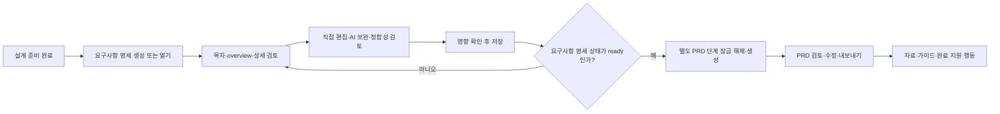

# UIR-PR-06 — 요구사항 명세·PRD와 지원 흐름

## 목표와 근거

요구사항 명세 화면을 주 시안의 위계와 카드 밀도에 맞추고, 기존 11개 실제 문서 섹션을 개별로 탐색하며 관련 기능을 정상 연결한다. 사용자에게 보이는 화면·접근성 이름·상태·행동에는 영문 `Requirement(s)`를 쓰지 않고 `요구사항 명세` 또는 문맥에 맞는 한국어를 사용한다. 현재 단계는 요구사항 명세 route이며 PRD는 별도의 다음 단계로 유지한다. 표현과 탐색을 바로잡되 문서 aggregate, 생성 gate, 편집·부분 보완 transaction, 내보내기 및 완료 정책은 유지한다.

주 시안은 [Blueprint 시안 매핑](../../blueprint-design/README.md)의 [요구사항 대시보드](../../blueprint-design/회의실%20예약%20서비스%20요구사항%20대시보드.png)다. 1586×992 기준 이미지의 제목·설명·문서 상태·기반 설계 정보, 단계 표시, 왼쪽 목차, 가로 정보가 있는 요약 카드와 하단 검토 행동을 1440×900 구현과 직접 비교한다. PRD 이미지와 locked template은 PRD 후속 단계 동작 검증에만 사용한다. 사용자가 선택한 표시 방식은 **11개 원본 섹션을 유지**하는 것이다. 시안의 샘플 문구·사용자·사진·알림·5개 샘플 그룹은 데이터나 제품 기능으로 복사하지 않는다.

새 시안에 없는 상태는 [기존 template 매핑](../../template/README.md)의 Requirements 진입/overview/detail (`image (11).png`, `(10)`, `(9)`) 및 PRD 생성/완료/다음 행동 (`image (14).png`, `(12)`, `(13)`)을 보조 참고로 삼는다. 오류·빈 상태의 동작은 제품/UI 계약과 화면 상태 매트릭스를 따른다.

## 추적 및 선행 조건

- PR unit: `UIR-PR-06`; 사용자 결과: 요구사항 명세 단계에서 11개 실제 문서 섹션과 연계 행동을 한국어 UI로 탐색·실행하고, ready 이후 별도 PRD 단계와 기존 지원 흐름을 이어서 사용한다.
- 요구사항: `UIR-008` (Requirements·PRD), `UIR-009` (자료·정합성·내보내기·가이드·완료), 직접 영향받는 `UIR-002` (기능 범위 보존), `UIR-010` (반응형·접근성).
- Delivery 작업: `DOC-401`~`DOC-407`, `SRC-501`~`SRC-503`, `EXP-505`, `GDE-504`; UI 변경의 회귀 범위는 이미 병합된 해당 delivery PR을 기준으로 한다.
- 선행 UIR PR: UIR-PR-01~05 병합. UIR-PR-05는 PR #52, merge commit `73f616be34aac006a545d91afbb1dc5f6deb9824`다. UIR-PR-06 원 PR #54도 merge commit `42f5bc763f76a571329f0d9bfd600be11ed01f39`로 `main`에 병합됐다. 이 후속 보정 PR은 최신 `origin/main`에서 시작하며 시각 피드백과 UI 표기·기능 회귀만 다룬다.
- 연결 계약: [UI 문서 작업 공간](../../ui/04-document-workspace.md), [홈·자료 화면 계약](../../ui/05-home-projects-and-files.md), [화면 상태 매트릭스](../../ui/screen-state-matrix.md), [화면별 문서·가이드 상태](../../ui/screens/05-documents-and-guide.md), [제품 PRD](../../product/02-prd.md), [제품 UI 설계](../../product/07-ui-design.md), [문서 delivery 계약](../../delivery/04-documents.md), [자료·가이드·내보내기 delivery 계약](../../delivery/05-sources-guides-export.md), [결정 로그](../../product/10-decision-log.md), [시각 검수](../../ui/07-visual-acceptance.md).
- 현재 `docs/delivery/traceability.md`는 UIR-PR-05를 `done`으로, UIR-008/009를 `in_progress`로 기록한다. Coordinator는 후속 보정 PR의 정확한 상태만 갱신하고 새 도메인 작업으로 확대하지 않는다.

## 범위

### 포함

- 요구사항 명세와 PRD의 상태 헤더·목차·섹션 요약/상세를 주 시안의 위계에 맞게 조립한다. 목차 선택, overview 카드와 상세 진입, 현재 섹션 표시·포커스 이동·복귀를 연결한다. 화면 상단은 문서 제목·설명·상태·기반 설계 revision을, 단계 표시에는 현재 활성 4단계 `요구사항 명세`와 별도 다음 PRD 단계를 구분해 표시한다.
- 기존 11개 canonical section을 하나씩 유지한다: `overview`, `functional`, `non_functional`, `data`, `integration`, `permissions`, `exceptions`, `deployment`, `operations`, `exclusions`, `open_issues`. 원본 문서 section, patch target 및 저장 ID는 변경하지 않는다. key 값이 그대로 노출될 때는 화면에 한국어 이름(개요, 기능 요구사항, 비기능 요구사항, 데이터, 연동, 권한, 예외, 배포, 운영, 제외 범위, 미결정·열린 이슈)을 사용한다. 이미 한국어인 생성 section title은 보존한다.
- 문서 요약 카드는 시안처럼 제목/요약, 실제 본문 내용, 원본 데이터에 있는 section 동기화 상태 또는 연결된 요구사항 상태와 도달 가능한 행동을 가로 위계로 구성한다. 없는 상태·내용을 추론하거나 모델을 다시 호출해 시안 샘플을 만들지 않는다. 11개 실제 section은 목차와 카드에 각각 한 번만 포함하고 긴 목록은 본문 스크롤로 제공한다.
- 기존 문서 화면 및 inline PRD를 재사용 가능한 문서 프레젠테이션으로 정리한다. `PrdDocument`는 기존 props, gate와 callback 동작을 보존하고 요구사항 명세 화면이 PRD route/status로 오인되지 않게 한다.
- 사용자에게 노출되는 제목, 버튼, 오류, 비어 있음, aria-label, role/status, 보조 설명에서 영문 `Requirement(s)`를 제거하고 `요구사항 명세`, `요구사항`, `요구사항 ID` 등 한국어 표현을 사용한다. API/domain field 이름·컴포넌트 파일명·fixture key·프로토콜 데이터는 변경하지 않는다.
- 문서 생성 중 기존 문서를 유지하고 로딩/오류/재시도 상태를 표시한다. draft, ready, stale, conflict, open issue, review-required, PRD 잠금 상태와 설명을 보존한다.
- 섹션 직접 편집과 AI 부분 보완, 검토와 영향 preview, 저장 충돌, 취소 및 저장 실패의 입력 보존을 유지한다.
- Markdown 복사/다운로드 동작을 문서 헤더에서 찾기 쉽게 한다. 출력에 화면 전용 UI 문구가 포함되지 않는 기존 계약을 보존한다.
- 자료 업로드/추출/근거/제거/추출 결과 다운로드, 정합성 검토, 설정 가이드 검토·승인/내보내기, 프로젝트 완료 행동을 지원 영역 또는 현재 화면의 보조 행동에서 계속 접근하게 한다.
- 단계별 시각 구조에 맞춰 `ProjectPage`, 문서/지원 화면, 앱 소유 CSS를 최소한으로 조정하고 통합 E2E 회귀를 추가한다.

### 제외

- 문서 생성·준비도·stale/conflict 판정, AI prompt/model/budget, API, storage schema, 저장 transaction 또는 프로젝트 완료 guard 변경.
- 새 route, 전역 메뉴, 문서 편집기 기능, 지원되지 않는 시안 메뉴/알림, 새 샘플 데이터·브랜드 자산, 외부 UI package/design system/dependency.
- 요구사항 생성 내용·문서 섹션·파일 원문 또는 설정 가이드 명령/버전의 도메인 변경.
- QLT-PR-01이 소유하는 전체 앱 5개 viewport 통합 감사.

## 사용자 흐름과 상태

요구사항 명세가 ready가 아니면 PRD direct URL 진입도 기존 잠금 이유와 요구사항 명세 검토로 돌아가는 행동을 보여야 한다. 현재 선택 route는 `/requirements`이고, PRD는 별도의 다음 단계로 활성화하거나 gate가 있으면 잠금 사유를 제공한다. 설정 가이드는 PRD 이후 산출물로 유지하고 다섯 번째 단계로 만들지 않는다.

## 화면 구성 및 시각 수용 기준

- 상단 문서 헤더는 `요구사항 명세` 제목, 실제 문서 상태 설명, 설계 기준 revision을 갖는다. 현재 generic work-panel 제목과 반복/충돌하는 제목을 노출하지 않는다.
- 기준 이미지에 있는 설명 문장 위치, 문서 상태와 기준 설계 정보의 균형을 구현하되, 실제 status/revision 값이 있을 때만 표시한다. 새 profile, 알림 또는 fixture 내용은 만들지 않는다.
- 데스크톱의 단계 표시 아래에는 왼쪽 실제 section 목차와 오른쪽 요약 카드 목록을 배치한다. 왼쪽 목차 폭·첫 카드의 시작 위치·카드 폭/높이·하단 검토 행동을 기준 이미지 1586×992와 렌더 1440×900에서 같은 비율로 기록한다.
- 요약 카드는 아이콘/번호·섹션 이름과 설명·실제 section body의 읽기 가능한 요약·상태 표시·상세/수정 행동을 한 행의 위계로 구성한다. 데이터가 부족하면 해당 section에서 확인 가능한 내용과 기본 empty 안내만 사용한다.
- 사용자가 선택한 11개 목차 행은 모두 도달 가능하고 화면에는 한국어 section label만 노출한다. 시안의 5개 예시 행은 그룹화 기준으로 적용하지 않는다.
- 동일 route/fixture/viewport로 변경 전후·시안 직접 비교를 남기고, 주요 anchor의 unexplained position delta 5% 초과 또는 크기 delta 10% 초과가 없어야 한다. 화면 계약 때문에 다른 경우에는 예외 근거를 기록한다.
- desktop 1440×900, 직접 영향받는 breakpoint 1024px, mobile 390×844에서 목차·본문·상태·하단 행동이 읽히고 사용할 수 있어야 한다. 모바일에서는 실제 목차 목록을 별도 제어로 열고 hidden control을 Tab 순서에서 제거한다.

## 수용 기준

### 정상 흐름

- 요구사항 명세/PRD 화면에서 상태·revision·미해결 항목을 구별하고, 사용자는 목차와 overview에서 섹션 상세로 이동할 수 있다. 문서 제목 및 본문 heading 계층은 중복 h1 없이 유지한다.
- 요구사항 명세 UI, accessible name, status/error/button copy에는 영문 `Requirement(s)`가 0건이며 문서 화면이 요구사항 명세 단계(4단계)로 활성 표시된다. PRD는 별도 5단계다.
- 11개 실제 section의 목차·요약 카드·상세가 대응하며 항목이 누락·중복되지 않는다. canonical key가 사용자 화면에 그대로 노출되지 않는다.
- 시안의 상단 제목·설명·상태/기준 설계 요약, 왼쪽 목차, 가로 요약 카드, 하단 검토 행동의 정보 위계가 반영되고 기준 anchor 비교에서 unexplained material delta가 없다.
- 요구사항 명세가 준비되지 않은 동안 PRD 잠금과 사유, `요구사항 명세 검토로 이동` 행동이 표시된다. ready 확인은 기존 사용자 승인 동작을 거친 뒤에만 잠금을 해제한다.
- 섹션 편집·AI 보완·정합성 검토·영향 미리보기·복사/Markdown 다운로드가 기존 callback과 데이터 동작으로 완료된다.
- 자료와 설정 가이드는 문서 흐름에서 계속 도달할 수 있고, 승인된 현재 revision의 `ready` 설정 가이드가 있을 때만 프로젝트 완료가 가능하다.
- desktop 1440×900 및 mobile 390×844에서 문서와 지원 행동을 사용할 수 있고, 모바일에는 잘린 목차/숨은 focusable control/수평 overflow가 없다.

### 실패·경계 흐름

- 문서 생성 실패·재시도 중 기존 문서와 사용자 입력을 보존하고, 원래 문서 단계에서 오류와 다음 행동을 알린다.
- stale 문서는 읽을 수 있고 영향 섹션 경고를 표시한다. conflict section의 편집은 잠기며 충돌 해결 안내를 제공한다.
- 낙관적 저장 충돌, schema/validation 오류, AI 보완 실패, 저장 실패 시 편집 원문과 영향 선택을 잃지 않는다. 취소 시 dirty 입력 보호를 유지한다.
- 문서 복사/다운로드는 화면 chrome을 내보내지 않는다. 추출 결과는 읽기 전용이며 다운로드가 source/evidence를 변경하지 않는다.
- 미승인·stale·conflict 설정 가이드는 ready/완료로 오인되지 않는다. 완료 불가 이유와 안내는 프로젝트 상태를 변경하지 않는다.
- 200% 확대, 키보드 전용 목차/상세/대화상자 동작, 포커스 이동·복귀 및 reduced motion을 확인한다.
- 테스트 데이터와 스크린샷에는 synthetic fixture만 사용한다. 실제 파일 본문, 개인 이메일, secret 또는 provider payload를 노출하지 않는다.

## 예상 변경 파일

- Modify: `src/components/blueprint/PrdDocument.tsx`, `tests/e2e/uir-pr-06-documents-supported-flows.spec.ts`.
- Modify as needed: `src/pages/ProjectPage.tsx`, `src/components/blueprint/BlueprintStageNav.tsx`, `src/components/blueprint/RequirementsDocument.tsx`, `src/components/blueprint/DocumentSectionEditor.tsx`, `src/components/blueprint/DocumentExportActions.tsx`, `src/components/blueprint/SetupGuideDocument.tsx`, `src/components/projects/SourceDocuments.tsx`, `src/styles/blueprint-workspace.css`, `src/styles/setup-guide.css`, `src/styles/source-documents.css`.
- Update directly affected regression tests only: `tests/e2e/doc-pr-01-requirements-generation.spec.ts`, `doc-pr-02-prd-readiness.spec.ts`, `doc-pr-03-document-refinement.spec.ts`, `doc-pr-04-direct-edit-impact.spec.ts`, `exp-pr-01-document-export.spec.ts`, `gde-pr-01-setup-guide.spec.ts`, `src-pr-01-sources.spec.ts`, `src-pr-02-evidence-linking.spec.ts`, `src-pr-03-source-result-download.spec.ts`.
- Update delivery/traceability status for UIR-PR-05 and UIR-PR-06 when publishing the PR. Do not change unrelated historic rows. Attach the final screenshot set at `docs/delivery/evidence/UIR-PR-06/` for direct PR review.
- Raw screenshots, recordings and comparison artifacts remain under `.pr-artifacts/UIR-PR-06/`. The final review screenshot set is copied to [`docs/delivery/evidence/UIR-PR-06/`](../../delivery/evidence/UIR-PR-06/README.md) for direct PR access; these are documentation evidence, not product assets.

## 검증 및 증거 행렬

| 검증 대상 | 검증 방법 | 통과 조건 |
| --- | --- | --- |
| 문서/지원 사용자 여정 | `npx playwright test tests/e2e/uir-pr-06-documents-supported-flows.spec.ts tests/e2e/doc-pr-01-requirements-generation.spec.ts tests/e2e/doc-pr-02-prd-readiness.spec.ts tests/e2e/doc-pr-03-document-refinement.spec.ts tests/e2e/doc-pr-04-direct-edit-impact.spec.ts tests/e2e/exp-pr-01-document-export.spec.ts tests/e2e/gde-pr-01-setup-guide.spec.ts tests/e2e/src-pr-01-sources.spec.ts tests/e2e/src-pr-02-evidence-linking.spec.ts tests/e2e/src-pr-03-source-result-download.spec.ts --workers=1` | 새 계층/reachability assertions 및 configured desktop/mobile project의 기존 직접 영향 회귀 모두 pass. mock auth는 화면 검증으로만 기록. |
| 한국어 UI copy·11-section mapping | 변경 전후 visible text/accessible name scan + browser DOM assertion | UI의 영문 `Requirement(s)` 0건; 11개 key가 누락/중복 없이 대응 한국어 label로 탐색됨. |
| Actions/callback wiring | Playwright end-to-end: TOC ↔ detail, direct edit/save/cancel/impact, partial patch proposal, ready confirmation/gate, PRD lock/unlock/generate, export, source/support and guide | 모든 활성 action이 기존 실제 callback/transaction에 연결되고 완료·실패 상태를 표시. conflict section direct/AI patch 금지 유지. |
| unit/contract 회귀 | `npm run test:unit` | 관련 회귀가 통과한다. 관련 없는 기존 실패가 있으면 원인·기준 branch 결과를 분리 기록. |
| production build | `npm run build` | exit 0. |
| 반응형·접근성 | Playwright Chromium; 1440×900, 1024px 전환 경계, 390×844, keyboard, focus return, 200% zoom, reduced motion | 문서/지원 행동 도달, overflow/가림/숨은 tab stop 없음. |
| 직접 시안 비교 | Requirements 주 이미지와 최종 HEAD의 요구사항 명세 overview를 같은 CSS viewport·ready/current synthetic 상태로 나란히 비교; template은 시안에 없는 동작 상태에만 사용 | 제목/설명, 상태/기준 설계 요약, stage rail, ToC, section-card layout, footer action anchor의 px/%를 기록. 설명되지 않은 위치 >5% 또는 크기 >10% 차이 0건. |
| 최종 증거 | 1440×900·390×844, loading, draft, ready, stale/conflict, PRD locked, editor/impact overlay, source/guide 관련 변경 상태 캡처 | 모든 artifact가 같은 최종 HEAD와 synthetic fixture에 연결되고, screenshot과 test state가 일치. |
| diff 품질 | `git diff --check` | exit 0. |

Agent Browser를 사용할 수 있으면 같은 흐름을 확인한다. 사용할 수 없으면 도구 목록과 실행 파일 확인을 기록하고 Playwright Chromium으로 요구 흐름 전체를 QA한다. Preview를 증거로 쓸 경우 배포 HEAD가 검토 HEAD와 일치해야 하며, 불가하면 로컬 렌더만 사용했음을 명시한다.

## 독립 리뷰 및 QA 체크리스트

- [ ] Reviewer가 `UIR-008/009`, 관련 product/UI/data/API contracts와 exact base/head diff를 검토한다. 문서 gate·transaction·export/source immutability·completion 정책이 변경되지 않았음을 확인한다.
- [ ] Reviewer가 Requirements/PRD 시안·렌더 쌍과 anchor 표를 직접 보고 material delta와 예외를 기록한다.
- [ ] 별도 QA context가 exact reviewed HEAD에서 문서 생성/잠금·수정/보완·stale/conflict·export, source 및 setup guide/complete 흐름을 수행한다.
- [ ] QA가 desktop/mobile, keyboard/focus, 200% zoom, reduced motion 및 주요 failure/retry 상태를 검증한다.
- [ ] 수정이 있으면 영향 테스트/build 및 새 시안 비교를 수행하고, 새로운 HEAD에서 fresh review와 QA를 반복한다.

## Definition of Ready

- [x] 결과, 포함/제외 범위, 관찰 가능한 acceptance criteria 확정.
- [x] 요구사항·delivery 작업·product/UI contracts와 주/보조 시안 연결.
- [x] 정상, 오류, stale/conflict, lock, 편집, 내보내기 및 지원 흐름 테스트 경로 작성.
- [x] 선행 UIR-PR-05 병합 확인됨 (PR #52, merge `73f616be34aac006a545d91afbb1dc5f6deb9824`); branch-start 직전 최신 main 재확인 필수.
- [x] 기존 route/API/storage/domain contracts를 보존하며 신규 제품 결정은 필요하지 않음.
- [x] Coordinator가 workflow/traceability의 UIR-PR-05 상태를 PR #52 병합 기록과 동기화하고 UIR-PR-06을 `in_progress`로 표시.

구현과 자체 검증이 끝났다. 후속 PR은 최신 `origin/main` `42f5bc763f76a571329f0d9bfd600be11ed01f39`에서 시작했으며, 현재 독립 리뷰·QA gate를 진행한다. 보정으로 user-visible English/ARIA 표기를 함께 검사하고 11개 canonical section·기존 callback·저장 규칙을 보존한다.
