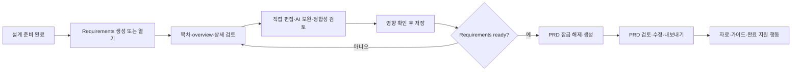

# UIR-PR-06 — Requirements·PRD와 지원 흐름

## 목표와 근거

문서 화면을 Requirements/PRD 시안의 위계로 정리하고, 이미 구현된 문서 및 지원 기능을 현재 작업 단계 안에서 계속 사용할 수 있게 한다. UI 표현과 탐색을 변경하되 기존 문서 aggregate, 생성 gate, 편집·patch transaction, 다운로드 및 완료 정책은 유지한다.

주 시안은 [Blueprint 시안 매핑](../../blueprint-design/README.md)의 [요구사항 대시보드](../../blueprint-design/회의실%20예약%20서비스%20요구사항%20대시보드.png)와 [PRD 대시보드](../../blueprint-design/한국어%20PRD%20대시보드%20화면.png)다. 두 이미지는 문서 상태 헤더, 단계 위치, 목차, 섹션 overview와 선택 상세의 위계를 참고한다. 시안의 샘플 문구·사용자·사진·알림은 제품 데이터나 기능으로 가져오지 않는다.

새 시안에 없는 상태는 [기존 template 매핑](../../template/README.md)의 Requirements 진입/overview/detail (`image (11).png`, `(10)`, `(9)`) 및 PRD 생성/완료/다음 행동 (`image (14).png`, `(12)`, `(13)`)을 보조 참고로 삼는다. 오류·빈 상태의 동작은 제품/UI 계약과 화면 상태 매트릭스를 따른다.

## 추적 및 선행 조건

- PR unit: `UIR-PR-06`; 사용자 결과: Requirements와 PRD를 요약·상세로 탐색하고 문서와 기존 지원 흐름을 이어서 사용한다.
- 요구사항: `UIR-008` (Requirements·PRD), `UIR-009` (자료·정합성·내보내기·가이드·완료), 직접 영향받는 `UIR-002` (기능 범위 보존), `UIR-010` (반응형·접근성).
- Delivery 작업: `DOC-401`~`DOC-407`, `SRC-501`~`SRC-503`, `EXP-505`, `GDE-504`; UI 변경의 회귀 범위는 이미 병합된 해당 delivery PR을 기준으로 한다.
- 선행 UIR PR: UIR-PR-01~05 병합. UIR-PR-05는 PR #52, merge commit `73f616be34aac006a545d91afbb1dc5f6deb9824`다. 구현은 이 계획을 작성하는 기준인 최신 `main`에서 시작한다. 브랜치 생성 직전에 `origin/main`과 선행 PR 병합 상태를 다시 확인한다.
- 연결 계약: [UI 문서 작업 공간](../../ui/04-document-workspace.md), [홈·자료 화면 계약](../../ui/05-home-projects-and-files.md), [화면 상태 매트릭스](../../ui/screen-state-matrix.md), [화면별 문서·가이드 상태](../../ui/screens/05-documents-and-guide.md), [제품 PRD](../../product/02-prd.md), [제품 UI 설계](../../product/07-ui-design.md), [문서 delivery 계약](../../delivery/04-documents.md), [자료·가이드·내보내기 delivery 계약](../../delivery/05-sources-guides-export.md), [결정 로그](../../product/10-decision-log.md), [시각 검수](../../ui/07-visual-acceptance.md).
- 현재 저장소의 workflow/traceability에는 PR #52 병합 상태가 아직 갱신되지 않았다. Coordinator는 이번 PR에 정확한 병합 상태를 기록하되, 선행 문서 구현의 누락이나 새 도메인 작업으로 확대하지 않는다.

## 범위

### 포함

- Requirements와 PRD의 상태 헤더·목차·섹션 overview/상세를 화면 시안에 맞게 조립한다. 목차 선택, 문서 스크롤 및 현재 섹션 표시를 연결하고, 좁은 화면에서는 본문을 우선하며 목차를 별도 조작으로 연다.
- 기존 Requirements 화면 및 inline PRD를 재사용 가능한 문서 프레젠테이션으로 정리한다. `PrdDocument`는 기존 props, gate와 callback 동작을 보존한다.
- 문서 생성 중 기존 문서를 유지하고 로딩/오류/재시도 상태를 표시한다. draft, ready, stale, conflict, open issue, review-required, PRD 잠금 상태와 설명을 보존한다.
- 섹션 직접 편집과 AI 부분 보완, 검토와 영향 preview, 저장 충돌, 취소 및 저장 실패의 입력 보존을 유지한다.
- Markdown 복사/다운로드 동작을 문서 헤더에서 찾기 쉽게 한다. 출력에 화면 전용 UI 문구가 포함되지 않는 기존 계약을 보존한다.
- 자료 업로드/추출/근거/제거/추출 결과 다운로드, 정합성 검토, 설정 가이드 검토·승인/내보내기, 프로젝트 완료 행동을 지원 영역 또는 현재 화면의 보조 행동에서 계속 접근하게 한다.
- 단계별 시각 구조에 맞춰 `ProjectPage`, 문서/지원 화면, 앱 소유 CSS를 최소한으로 조정하고 통합 E2E 회귀를 추가한다.

### 제외

- 문서 생성·준비도·stale/conflict 판정, AI prompt/model/budget, API, storage schema, 저장 transaction 또는 프로젝트 완료 guard 변경.
- 새 route, 전역 메뉴, 문서 편집기 기능, 지원되지 않는 시안 메뉴/알림, 새 샘플 데이터·브랜드 자산, 외부 UI package/design system/dependency.
- 요구사항 생성 내용·문서 섹션·파일 원문 또는 설정 가이드 명령/버전의 도메인 변경.
- QLT-PR-01이 소유하는 전체 앱 5개 viewport 통합 감사.

## 사용자 흐름과 상태

요구사항이 ready가 아니면 PRD direct URL 진입도 기존 잠금 이유와 Requirements로 돌아가는 행동을 보여야 한다. 설정 가이드는 PRD 이후 산출물로 유지하고 다섯 번째 단계로 만들지 않는다.

## 수용 기준

### 정상 흐름

- Requirements/PRD 문서에서 상태·revision·미해결 항목을 구별하고, 사용자는 목차와 overview에서 섹션 상세로 이동할 수 있다. 문서 제목 및 본문 heading 계층은 중복 h1 없이 유지한다.
- Requirements가 준비되지 않은 동안 PRD 잠금과 사유, `Requirements 검토로 이동` 행동이 표시된다. ready 확인은 기존 사용자 승인 동작을 거친 뒤에만 잠금을 해제한다.
- 섹션 편집·AI 보완·정합성 검토·영향 미리보기·복사/Markdown 다운로드가 기존 callback과 데이터 동작으로 완료된다.
- 자료와 설정 가이드는 문서 흐름에서 계속 도달할 수 있고, 승인된 현재 revision의 `ready` 설정 가이드가 있을 때만 프로젝트 완료가 가능하다.
- desktop 1440×900 및 mobile 390×844에서 문서와 지원 행동을 사용할 수 있고, 모바일에는 잘린 목차/숨은 focusable control/수평 overflow가 없다.

### 실패·경계 흐름

- 문서 생성 실패·재시도 중 기존 문서와 사용자 입력을 보존하고, 원래 문서 단계에서 오류와 다음 행동을 알린다.
- stale 문서는 읽을 수 있고 영향 섹션 경고를 표시한다. conflict section의 편집은 잠기며 충돌 해결 안내를 제공한다.
- 낙관적 저장 충돌, schema/validation 오류, AI 보완 실패, 저장 실패 시 편집 원문과 영향 선택을 잃지 않는다. 취소 시 dirty 입력 보호를 유지한다.
- 문서 복사/다운로드는 화면 chrome을 내보내지 않는다. 추출 결과는 읽기 전용이며 다운로드가 source/evidence를 변경하지 않는다.
- 미승인·stale·conflict 설정 가이드는 ready/완료로 오인되지 않는다. 완료 불가 이유와 안내는 프로젝트 상태를 변경하지 않는다.
- 200% 확대, 키보드 전용 목차/상세/대화상자 동작, 포커스 이동·복귀 및 reduced motion을 확인한다.
- 테스트 데이터와 스크린샷에는 synthetic fixture만 사용한다. 실제 파일 본문, 개인 이메일, secret 또는 provider payload를 노출하지 않는다.

## 예상 변경 파일

- Create: `src/components/blueprint/PrdDocument.tsx`, `tests/e2e/uir-pr-06-documents-supported-flows.spec.ts`.
- Modify as needed: `src/pages/ProjectPage.tsx`, `src/components/blueprint/BlueprintStageNav.tsx`, `src/components/blueprint/RequirementsDocument.tsx`, `src/components/blueprint/DocumentSectionEditor.tsx`, `src/components/blueprint/DocumentExportActions.tsx`, `src/components/blueprint/SetupGuideDocument.tsx`, `src/components/projects/SourceDocuments.tsx`, `src/styles/blueprint-workspace.css`, `src/styles/setup-guide.css`, `src/styles/source-documents.css`.
- Update directly affected regression tests only: `tests/e2e/doc-pr-01-requirements-generation.spec.ts`, `doc-pr-02-prd-readiness.spec.ts`, `doc-pr-03-document-refinement.spec.ts`, `doc-pr-04-direct-edit-impact.spec.ts`, `exp-pr-01-document-export.spec.ts`, `gde-pr-01-setup-guide.spec.ts`, `src-pr-01-sources.spec.ts`, `src-pr-02-evidence-linking.spec.ts`, `src-pr-03-source-result-download.spec.ts`.
- Update delivery/traceability status for UIR-PR-05 and UIR-PR-06 when publishing the PR. Do not change unrelated historic rows. Attach the final screenshot set at `docs/delivery/evidence/UIR-PR-06/` for direct PR review.
- Raw screenshots, recordings and comparison artifacts remain under `.pr-artifacts/UIR-PR-06/`. The final review screenshot set is copied to [`docs/delivery/evidence/UIR-PR-06/`](../../delivery/evidence/UIR-PR-06/README.md) for direct PR access; these are documentation evidence, not product assets.

## 검증 및 증거 행렬

| 검증 대상 | 검증 방법 | 통과 조건 |
| --- | --- | --- |
| 문서/지원 사용자 여정 | `npx playwright test tests/e2e/uir-pr-06-documents-supported-flows.spec.ts tests/e2e/doc-pr-01-requirements-generation.spec.ts tests/e2e/doc-pr-02-prd-readiness.spec.ts tests/e2e/doc-pr-03-document-refinement.spec.ts tests/e2e/doc-pr-04-direct-edit-impact.spec.ts tests/e2e/exp-pr-01-document-export.spec.ts tests/e2e/gde-pr-01-setup-guide.spec.ts tests/e2e/src-pr-01-sources.spec.ts tests/e2e/src-pr-02-evidence-linking.spec.ts tests/e2e/src-pr-03-source-result-download.spec.ts --workers=1` | 새 계층/reachability assertions 및 configured desktop/mobile project의 기존 직접 영향 회귀 모두 pass. mock auth는 화면 검증으로만 기록. |
| unit/contract 회귀 | `npm run test:unit` | exit 0. 관련 없는 사전 실패가 있으면 범위와 결과를 분리 기록. |
| production build | `npm run build` | exit 0. |
| 반응형·접근성 | Playwright Chromium; 1440×900, 1024px 전환 경계, 390×844, keyboard, focus return, 200% zoom, reduced motion | 문서/지원 행동 도달, overflow/가림/숨은 tab stop 없음. |
| 직접 시안 비교 | Requirements/PRD 주 이미지와 최종 HEAD를 같은 CSS viewport·비교 가능한 draft 상태로 나란히 비교; template fallback은 시안에 없는 상태에만 사용 | 주요 적용 anchor의 px/% 차이를 기록하고, 설명되지 않은 위치 >5% 또는 크기 >10% 차이 0건. 해당 없는 rail/hero/composer 등은 이유와 함께 N/A. |
| 최종 증거 | 1440×900·390×844, loading, draft, ready, stale/conflict, PRD locked, editor/impact overlay, source/guide 관련 변경 상태 캡처 | 모든 artifact가 같은 최종 HEAD와 synthetic fixture에 연결되고, screenshot과 test state가 일치. |
| diff 품질 | `git diff --check` | exit 0. |

Agent Browser를 사용할 수 있으면 같은 흐름을 확인한다. 사용할 수 없으면 도구 목록과 실행 파일 확인을 기록하고 Playwright Chromium으로 요구 흐름 전체를 QA한다. Preview를 증거로 쓸 경우 배포 HEAD가 검토 HEAD와 일치해야 하며, 불가하면 로컬 렌더만 사용했음을 명시한다.

## 독립 리뷰 및 QA 체크리스트

- [ ] Reviewer가 `UIR-008/009`, 관련 product/UI/data/API contracts와 exact base/head diff를 검토한다. 문서 gate·transaction·export/source immutability·completion 정책이 변경되지 않았음을 확인한다.
- [ ] Reviewer가 Requirements/PRD 시안·렌더 쌍과 anchor 표를 직접 보고 material delta와 예외를 기록한다.
- [ ] 별도 QA context가 exact reviewed HEAD에서 문서 생성/잠금·수정/보완·stale/conflict·export, source 및 setup guide/complete 흐름을 수행한다.
- [ ] QA가 desktop/mobile, keyboard/focus, 200% zoom, reduced motion 및 주요 failure/retry 상태를 검증한다.
- [ ] 수정이 있으면 영향 테스트/build 및 새 시안 비교를 수행하고, 새로운 HEAD에서 fresh review와 QA를 반복한다.

## Definition of Ready

- [x] 결과, 포함/제외 범위, 관찰 가능한 acceptance criteria 확정.
- [x] 요구사항·delivery 작업·product/UI contracts와 주/보조 시안 연결.
- [x] 정상, 오류, stale/conflict, lock, 편집, 내보내기 및 지원 흐름 테스트 경로 작성.
- [x] 선행 UIR-PR-05 병합 확인됨 (PR #52, merge `73f616be34aac006a545d91afbb1dc5f6deb9824`); branch-start 직전 최신 main 재확인 필수.
- [x] 기존 route/API/storage/domain contracts를 보존하며 신규 제품 결정은 필요하지 않음.
- [x] Coordinator가 workflow/traceability의 UIR-PR-05 상태를 PR #52 병합 기록과 동기화하고 UIR-PR-06을 `in_progress`로 표시.

계획은 구현 가능한 상태다. Coordinator가 workflow/traceability의 stale 상태를 정리하고, 구현 직전에 최신 `origin/main`과 선행 PR 상태를 확인한 뒤 구현을 시작한다.
